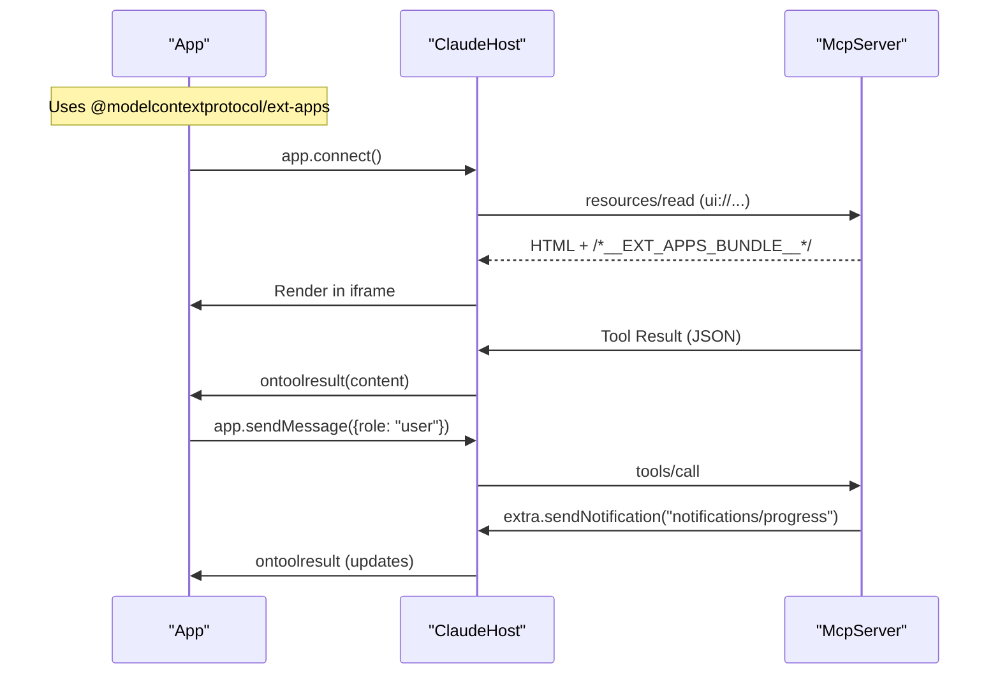

<!-- source: DeepWiki mcp.deepwiki.com · repo anthropics/claude-plugins-official · extra page mcp-server-dev · fetched 2026-10-26 -->

# mcp-server-dev

<details>
<summary>Relevant source files</summary>

The following files were used as context for generating this wiki page:

- [plugins/mcp-server-dev/skills/build-mcp-app/SKILL.md](plugins/mcp-server-dev/skills/build-mcp-app/SKILL.md)
- [plugins/mcp-server-dev/skills/build-mcp-app/references/abuse-protection.md](plugins/mcp-server-dev/skills/build-mcp-app/references/abuse-protection.md)
- [plugins/mcp-server-dev/skills/build-mcp-app/references/apps-sdk-messages.md](plugins/mcp-server-dev/skills/build-mcp-app/references/apps-sdk-messages.md)
- [plugins/mcp-server-dev/skills/build-mcp-app/references/directory-checklist.md](plugins/mcp-server-dev/skills/build-mcp-app/references/directory-checklist.md)
- [plugins/mcp-server-dev/skills/build-mcp-app/references/iframe-sandbox.md](plugins/mcp-server-dev/skills/build-mcp-app/references/iframe-sandbox.md)
- [plugins/mcp-server-dev/skills/build-mcp-app/references/payload-budgeting.md](plugins/mcp-server-dev/skills/build-mcp-app/references/payload-budgeting.md)
- [plugins/mcp-server-dev/skills/build-mcp-server/SKILL.md](plugins/mcp-server-dev/skills/build-mcp-server/SKILL.md)
- [plugins/mcp-server-dev/skills/build-mcp-server/references/auth.md](plugins/mcp-server-dev/skills/build-mcp-server/references/auth.md)
- [plugins/mcp-server-dev/skills/build-mcp-server/references/tool-design.md](plugins/mcp-server-dev/skills/build-mcp-server/references/tool-design.md)
- [plugins/mcp-server-dev/skills/build-mcpb/SKILL.md](plugins/mcp-server-dev/skills/build-mcpb/SKILL.md)

</details>


The `mcp-server-dev` plugin provides a comprehensive toolkit for designing, building, and deploying Model Context Protocol (MCP) servers. It guides developers through selecting appropriate deployment models, implementing robust tool design patterns, handling authentication, and creating interactive MCP applications with inline UI widgets [plugins/mcp-server-dev/README.md:1-13]().

Sources: [plugins/mcp-server-dev/README.md:1-13]()

## Overview of Skills

The plugin is composed of three primary skills that facilitate the end-to-end development lifecycle of an MCP integration [plugins/mcp-server-dev/README.md:7-13]().

| Skill | Purpose | Code Reference / Path |
|---|---|---|
| `build-mcp-server` | Entry point for discovery, determining deployment models and tool design patterns. | [plugins/mcp-server-dev/skills/build-mcp-server/SKILL.md:7-13]() |
| `build-mcp-app` | Adds interactive UI widgets rendered inline in chat using `@modelcontextprotocol/ext-apps`. | [plugins/mcp-server-dev/skills/build-mcp-app/SKILL.md:7-13]() |
| `build-mcpb` | Packages local stdio servers into bundled `.mcpb` archives with runtimes. | [plugins/mcp-server-dev/skills/build-mcpb/SKILL.md:7-13]() |

Sources: [plugins/mcp-server-dev/README.md:7-13](), [plugins/mcp-server-dev/skills/build-mcp-server/SKILL.md:7-13](), [plugins/mcp-server-dev/skills/build-mcp-app/SKILL.md:7-13](), [plugins/mcp-server-dev/skills/build-mcpb/SKILL.md:7-13]()

## Deployment Model Selection

The `build-mcp-server` skill uses a discovery phase to recommend a deployment architecture based on the connection target and target audience [plugins/mcp-server-dev/skills/build-mcp-server/SKILL.md:15-52]().

### Natural Language to Code Entity Mapping: Deployment Models
This diagram maps high-level user intents and discovery questions to concrete code scaffolds and server classes.

```mermaid
graph TD
    "NaturalLanguageIntent"["User Intent: 'Build an MCP'"] --> ["build-mcp-server"]
    ["build-mcp-server"] --> Q1{"What does it connect to?"}
    Q1 -- "Cloud API" --> ["remote-http-scaffold.md"]
    Q1 -- "Local Files/OS" --> ["build-mcpb"]
    ["build-mcp-server"] --> Q2{"Need Rich UI?"}
    Q2 -- "Yes" --> ["build-mcp-app"]
    
    subgraph "CodeEntitySpace"
        ["remote-http-scaffold.md"] --> ["McpServer"]
        ["build-mcpb"] --> ["manifest.json"]
        ["build-mcp-app"] --> ["registerAppTool"]
    end
```
Sources: [plugins/mcp-server-dev/skills/build-mcp-server/SKILL.md:15-103](), [plugins/mcp-server-dev/skills/build-mcp-app/SKILL.md:78-120](), [plugins/mcp-server-dev/skills/build-mcpb/SKILL.md:30-65]()

## Tool Design Patterns

Tool schemas land directly in Claude's context window, requiring precise descriptions and typed schemas [plugins/mcp-server-dev/skills/build-mcp-server/references/tool-design.md:1-4]().

- **One tool per action**: Used for small surfaces (< 15 operations). Each tool has a dedicated handler and Zod schema [plugins/mcp-server-dev/skills/build-mcp-server/SKILL.md:111-124]().
- **Search + execute**: Used for large API surfaces (dozens of endpoints) where the server exposes search and execution helpers [plugins/mcp-server-dev/skills/build-mcp-server/SKILL.md:127-138]().
- **Annotations**: Host hints including `readOnlyHint`, `destructiveHint`, `idempotentHint`, and `openWorldHint` [plugins/mcp-server-dev/skills/build-mcp-server/references/tool-design.md:127-136]().

Sources: [plugins/mcp-server-dev/skills/build-mcp-server/SKILL.md:107-138](), [plugins/mcp-server-dev/skills/build-mcp-server/references/tool-design.md:1-152]()

## Authentication (OAuth 2.0)

For remote servers, authentication uses OAuth 2.0 via **Client ID Metadata Document (CIMD)** or **Dynamic Client Registration (DCR)** [plugins/mcp-server-dev/skills/build-mcp-server/references/auth.md:36-61]().

- **CIMD (Preferred)**: The host publishes client metadata at an HTTPS URL and uses it as `client_id` [plugins/mcp-server-dev/skills/build-mcp-server/references/auth.md:38-40]().
- **Audience Validation**: Servers must validate RFC 8707 audience bounds to ensure tokens were minted specifically for the server [plugins/mcp-server-dev/skills/build-mcp-server/references/auth.md:93-97]().
- **SDK Helpers**: Utilize `mcpAuthRouter()` and `bearerAuth` middleware from `@modelcontextprotocol/sdk/server/auth` [plugins/mcp-server-dev/skills/build-mcp-server/references/auth.md:101-108]().

Sources: [plugins/mcp-server-dev/skills/build-mcp-server/references/auth.md:1-108]()

## MCP Apps (Interactive UI)

MCP Apps extend standard servers by serving UI resources rendered in an iframe sandbox via `@modelcontextprotocol/ext-apps` [plugins/mcp-server-dev/skills/build-mcp-app/SKILL.md:63-82]().

### Natural Language to Code Entity Mapping: Widget Runtime
This diagram connects user widget requests to the underlying `App` class, tool registration functions, and notification message handlers.


Sources: [plugins/mcp-server-dev/skills/build-mcp-app/SKILL.md:141-159](), [plugins/mcp-server-dev/skills/build-mcp-app/references/apps-sdk-messages.md:1-172](), [plugins/mcp-server-dev/skills/build-mcp-app/references/iframe-sandbox.md:54-62]()

### Sandbox Constraints and Payload Budgeting
Widgets operate under strict Content Security Policy (CSP) and payload limits:
- **Inlining**: The `@modelcontextprotocol/ext-apps` bundle must be inlined into the HTML at build time [plugins/mcp-server-dev/skills/build-mcp-app/references/iframe-sandbox.md:15-21]().
- **Navigation**: `window.open` is blocked; `app.openLink({ url })` must be used [plugins/mcp-server-dev/skills/build-mcp-app/references/iframe-sandbox.md:70-80]().
- **Payload Budget**: Host truncation occurs around ~150k characters; payloads should prune unnecessary columns or truncate rows `[plugins/mcp-server-dev/skills/build-mcp-app/references/payload-budgeting.md:1-42]()`.

Sources: [plugins/mcp-server-dev/skills/build-mcp-app/references/iframe-sandbox.md:1-164](), [plugins/mcp-server-dev/skills/build-mcp-app/references/apps-sdk-messages.md:57-80](), [plugins/mcp-server-dev/skills/build-mcp-app/references/payload-budgeting.md:1-54]()

## MCPB Bundling

The `build-mcpb` skill packages local servers with their runtimes for distribution without requiring user-side Node or Python toolchains [plugins/mcp-server-dev/skills/build-mcpb/SKILL.md:7-11]().

- **Manifest (`manifest.json`)**: Declares server execution parameters (`server.type`, `server.mcp_config`) and install-time settings (`user_config`) [plugins/mcp-server-dev/skills/build-mcpb/SKILL.md:32-67]().
- **Security Responsibility**: MCPB servers execute with full user privileges. Path validation and process allowlisting must be enforced within tool handlers [plugins/mcp-server-dev/skills/build-mcpb/SKILL.md:155-161]().

Sources: [plugins/mcp-server-dev/skills/build-mcpb/SKILL.md:1-181]()

---

