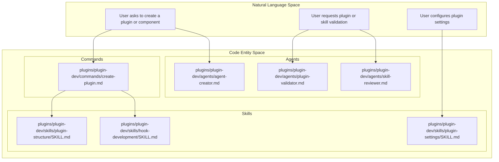
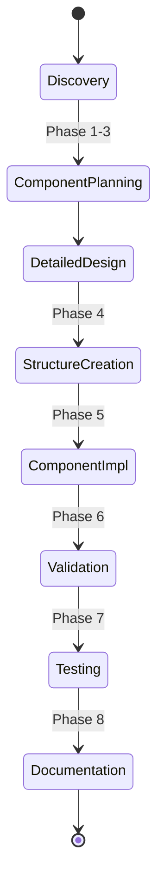
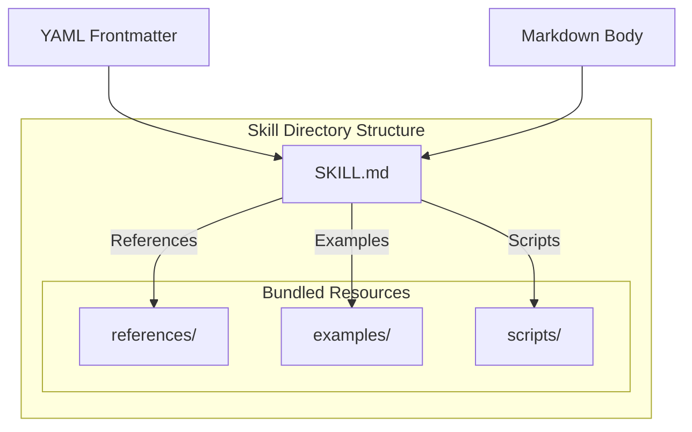
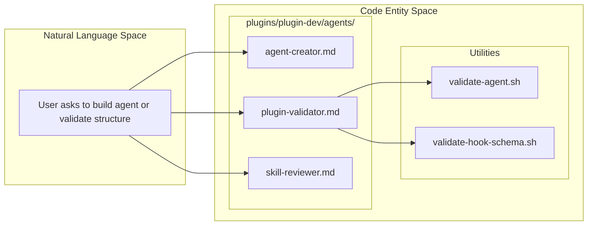

<!-- source: DeepWiki mcp.deepwiki.com · repo anthropics/claude-plugins-official · extra page plugin-dev Toolkit · fetched 2026-10-26 -->

# plugin-dev Toolkit

<details>
<summary>Relevant source files</summary>

The following files were used as context for generating this wiki page:

- [plugins/hookify/skills/writing-rules/SKILL.md](plugins/hookify/skills/writing-rules/SKILL.md)
- [plugins/plugin-dev/README.md](plugins/plugin-dev/README.md)
- [plugins/plugin-dev/agents/agent-creator.md](plugins/plugin-dev/agents/agent-creator.md)
- [plugins/plugin-dev/agents/plugin-validator.md](plugins/plugin-dev/agents/plugin-validator.md)
- [plugins/plugin-dev/agents/skill-reviewer.md](plugins/plugin-dev/agents/skill-reviewer.md)
- [plugins/plugin-dev/skills/hook-development/SKILL.md](plugins/plugin-dev/skills/hook-development/SKILL.md)
- [plugins/plugin-dev/skills/plugin-settings/SKILL.md](plugins/plugin-dev/skills/plugin-settings/SKILL.md)
- [plugins/plugin-dev/skills/plugin-structure/SKILL.md](plugins/plugin-dev/skills/plugin-structure/SKILL.md)
- [plugins/plugin-dev/skills/skill-development/SKILL.md](plugins/plugin-dev/skills/skill-development/SKILL.md)
- [plugins/pr-review-toolkit/agents/code-simplifier.md](plugins/pr-review-toolkit/agents/code-simplifier.md)

</details>


## Purpose and Scope

This document covers the `plugin-dev` toolkit, a comprehensive system for developing Claude Code plugins. The toolkit provides an 8-phase guided workflow command (`/plugin-dev:create-plugin`), seven specialized skills covering all plugin components, and specialized AI-powered development agents (`agent-creator`, `plugin-validator`, `skill-reviewer`) that automate plugin creation, validation, and quality review [plugins/plugin-dev/README.md:1-174]().

For information about individual plugin components (commands, agents, skills, hooks, MCP servers), see the Plugin Architecture section.

Sources: [plugins/plugin-dev/README.md:1-174]()

## Toolkit Architecture

The plugin-dev toolkit is structured around a guided workflow command, specialized skills, and development agents. The following diagram bridges natural language inputs to the specific code entities implementing the toolkit capabilities.

Title: Natural Language to Code Entity Mapping for plugin-dev Toolkit


Sources: [plugins/plugin-dev/README.md:1-40](), [plugins/plugin-dev/agents/agent-creator.md:1-35](), [plugins/plugin-dev/agents/plugin-validator.md:1-37]()

## The 8-Phase Workflow Command

### `/plugin-dev:create-plugin` Command

The toolkit's primary interface is the `/plugin-dev:create-plugin` command, which guides developers through an end-to-end plugin creation workflow [plugins/plugin-dev/README.md:19-23](). It uses `TodoWrite` to track progress across all phases [plugins/plugin-dev/commands/create-plugin.md:29]().

Title: create-plugin Workflow Phases


**Phase breakdown:**

| Phase | Name | Activities | Skills Loaded |
|-------|------|-----------|---------------|
| 1 | Discovery | Understand plugin purpose, gather requirements [plugins/plugin-dev/commands/create-plugin.md:35-52]() | All skills (metadata only) |
| 2 | Component Planning | Determine needed components (skills, agents, hooks, MCP) [plugins/plugin-dev/commands/create-plugin.md:56-89]() | `plugin-structure` |
| 3 | Detailed Design | Specify each component, resolve ambiguities [plugins/plugin-dev/commands/create-plugin.md:93-128]() | Component-specific skill bodies |
| 4 | Structure Creation | Set up directories, create `plugin.json` manifest [plugins/plugin-dev/commands/create-plugin.md:132-166]() | `plugin-structure` |
| 5 | Component Implementation | Create components using AI-assisted generation [plugins/plugin-dev/commands/create-plugin.md:170-194]() | Component-specific skills + `agent-creator` |
| 6 | Validation | Run validators and quality checks [plugins/plugin-dev/commands/create-plugin.md:196-209]() | `plugin-validator`, `skill-reviewer` |
| 7 | Testing | Verify plugin works in Claude Code [plugins/plugin-dev/commands/create-plugin.md:211-224]() | Testing patterns from skills |
| 8 | Documentation | Finalize README, prepare for distribution [plugins/plugin-dev/commands/create-plugin.md:226-239]() | Documentation patterns |

Sources: [plugins/plugin-dev/README.md:19-52](), [plugins/plugin-dev/commands/create-plugin.md:33-239]()

## The Seven Specialized Skills

Each skill follows a progressive disclosure pattern with metadata, core `SKILL.md` body, and bundled resources (`references/`, `examples/`, `scripts/`) [plugins/plugin-dev/README.md:7-17]().

Title: Skill Content Architecture


Sources: [plugins/plugin-dev/skills/skill-development/SKILL.md:26-76]()

### 1. hook-development Skill
- **Location:** `plugins/plugin-dev/skills/hook-development/SKILL.md` [plugins/plugin-dev/README.md:56-74]()
- **Coverage:** Prompt-based hooks, command hooks, all hook events (`PreToolUse`, `PostToolUse`, `Stop`, `SubagentStop`, `SessionStart`, `SessionEnd`, `UserPromptSubmit`, `PreCompact`, `Notification`), and `${CLAUDE_PLUGIN_ROOT}` path variable.

### 2. mcp-integration Skill
- **Location:** `plugins/plugin-dev/skills/mcp-integration/SKILL.md` [plugins/plugin-dev/README.md:76-93]()
- **Coverage:** `.mcp.json` configuration, server types (`stdio`, `SSE`, `HTTP`, `WebSocket`), environment variable expansion, and authentication patterns.

### 3. plugin-structure Skill
- **Location:** `plugins/plugin-dev/skills/plugin-structure/SKILL.md` [plugins/plugin-dev/README.md:95-111]()
- **Coverage:** Standard layout (`.claude-plugin/plugin.json`, `commands/`, `agents/`, `skills/`, `hooks/`), manifest required fields, and auto-discovery rules.

### 4. plugin-settings Skill
- **Location:** `plugins/plugin-dev/skills/plugin-settings/SKILL.md` [plugins/plugin-dev/README.md:113-133]()
- **Coverage:** `.claude/plugin-name.local.md` files, parsing YAML frontmatter with `sed` and `awk` in bash scripts, and temporarily active hooks.

### 5. command-development Skill
- **Location:** `plugins/plugin-dev/skills/command-development/SKILL.md` [plugins/plugin-dev/README.md:135-152]()
- **Coverage:** Markdown format with YAML frontmatter (`description`, `argument-hint`, `allowed-tools`), dynamic arguments, and bash execution.

### 6. agent-development Skill
- **Location:** `plugins/plugin-dev/skills/agent-development/SKILL.md` [plugins/plugin-dev/README.md:154-174]()
- **Coverage:** File structure (YAML frontmatter + system prompt), frontmatter fields (`name`, `description`, `model`, `color`, `tools`), and description formatting with `<example>` blocks.

### 7. skill-development Skill
- **Location:** `plugins/plugin-dev/skills/skill-development/SKILL.md` [plugins/plugin-dev/README.md:176-194]()
- **Coverage:** Skill anatomy (`SKILL.md`, `scripts/`, `references/`, `assets/`), progressive disclosure levels, and creation workflows.

Sources: [plugins/plugin-dev/README.md:56-194]()

## Development Agents

The toolkit leverages specialized AI-powered agents to automate plugin development tasks. The bridge below maps agent execution files to their underlying programmatic validation and creation roles.

Title: Agent Mapping to Code Architecture


### `agent-creator`
- **Definition:** `plugins/plugin-dev/agents/agent-creator.md` [plugins/plugin-dev/agents/agent-creator.md:1-35]()
- **Purpose:** Translates user requirements into precisely-tuned agent specifications, generating `agents/[identifier].md` files with frontmatter and system prompts [plugins/plugin-dev/agents/agent-creator.md:37-123]().

### `plugin-validator`
- **Definition:** `plugins/plugin-dev/agents/plugin-validator.md` [plugins/plugin-dev/agents/plugin-validator.md:1-37]()
- **Purpose:** Performs comprehensive validation of plugin manifests, directory structure, component schemas, and security settings [plugins/plugin-dev/agents/plugin-validator.md:39-135]().

### `skill-reviewer`
- **Definition:** `plugins/plugin-dev/agents/skill-reviewer.md` [plugins/plugin-dev/agents/skill-reviewer.md:1-36]()
- **Purpose:** Reviews and improves Claude Code skills for triggering effectiveness, word count compliance, and progressive disclosure implementation [plugins/plugin-dev/agents/skill-reviewer.md:38-98]().

Sources: [plugins/plugin-dev/agents/agent-creator.md:1-35](), [plugins/plugin-dev/agents/plugin-validator.md:1-37](), [plugins/plugin-dev/agents/skill-reviewer.md:1-36]()

## Integration and Usage Patterns

### Progressive Disclosure System
The toolkit implements a three-level loading system to manage context efficiently [plugins/plugin-dev/skills/skill-development/SKILL.md:77-85]().

| Level | Content | Word Count | Persistence |
|-------|---------|------------|-------------|
| 1 | Metadata (`name` + `description`) | ~100 words | Always in context |
| 2 | `SKILL.md` body | < 5,000 words | Loaded when triggered |
| 3 | Bundled resources (`references/`) | Unlimited | Loaded as needed |

Sources: [plugins/plugin-dev/skills/skill-development/SKILL.md:77-85]()

### Installation and Usage
```bash
/plugin install plugin-dev@claude-code-marketplace
/plugin-dev:create-plugin [optional description]
```

Sources: [plugins/plugin-dev/README.md:19-52](), [plugins/plugin-dev/commands/create-plugin.md:45-50]()

---

