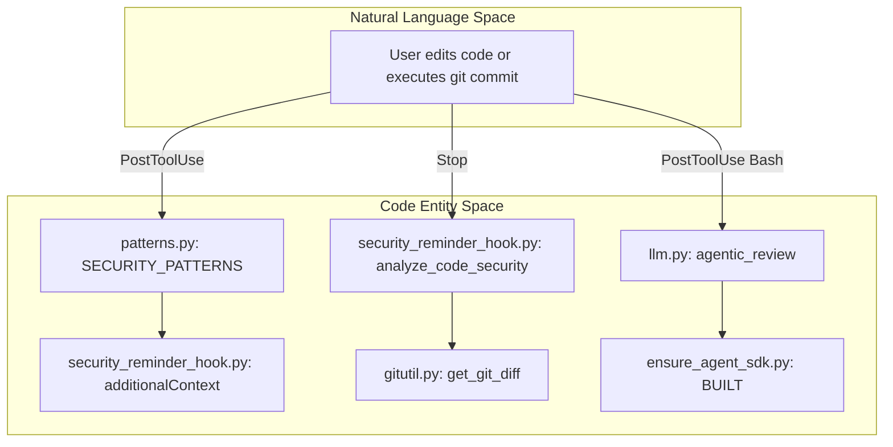
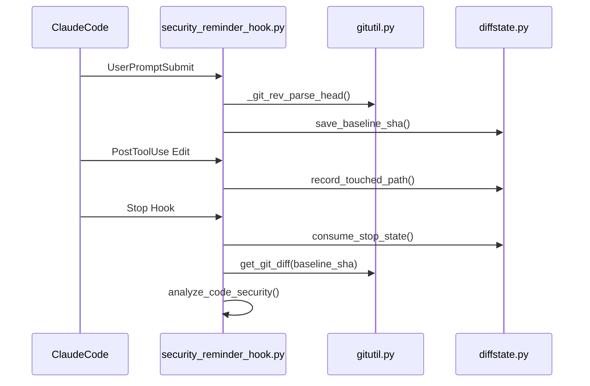

<!-- source: DeepWiki mcp.deepwiki.com · repo anthropics/claude-plugins-official · extra page security-guidance Plugin · fetched 2026-10-26 -->

# security-guidance Plugin

Relevant source files

The following files were used as context for generating this wiki page:

- [.claude-plugin/marketplace.json](.claude-plugin/marketplace.json)
- [plugins/hookify/hooks/hooks.json](plugins/hookify/hooks/hooks.json)
- [plugins/security-guidance/.claude-plugin/plugin.json](plugins/security-guidance/.claude-plugin/plugin.json)
- [plugins/security-guidance/README.md](plugins/security-guidance/README.md)
- [plugins/security-guidance/hooks/_base.py](plugins/security-guidance/hooks/_base.py)
- [plugins/security-guidance/hooks/diffstate.py](plugins/security-guidance/hooks/diffstate.py)
- [plugins/security-guidance/hooks/ensure_agent_sdk.py](plugins/security-guidance/hooks/ensure_agent_sdk.py)
- [plugins/security-guidance/hooks/extensibility.py](plugins/security-guidance/hooks/extensibility.py)
- [plugins/security-guidance/hooks/gitutil.py](plugins/security-guidance/hooks/gitutil.py)
- [plugins/security-guidance/hooks/hooks.json](plugins/security-guidance/hooks/hooks.json)
- [plugins/security-guidance/hooks/llm.py](plugins/security-guidance/hooks/llm.py)
- [plugins/security-guidance/hooks/patterns.py](plugins/security-guidance/hooks/patterns.py)
- [plugins/security-guidance/hooks/reporesolve.py](plugins/security-guidance/hooks/reporesolve.py)
- [plugins/security-guidance/hooks/review_api.py](plugins/security-guidance/hooks/review_api.py)
- [plugins/security-guidance/hooks/security_reminder_hook.py](plugins/security-guidance/hooks/security_reminder_hook.py)
- [plugins/security-guidance/hooks/session_state.py](plugins/security-guidance/hooks/session_state.py)
- [plugins/security-guidance/hooks/sg-python.sh](plugins/security-guidance/hooks/sg-python.sh)
- [plugins/security-guidance/tests/conftest.py](plugins/security-guidance/tests/conftest.py)
- [plugins/security-guidance/tests/test_git_index_locks.py](plugins/security-guidance/tests/test_git_index_locks.py)
- [plugins/security-guidance/tests/test_prompt_cache.py](plugins/security-guidance/tests/test_prompt_cache.py)
- [plugins/security-guidance/tests/test_repo_resolution.py](plugins/security-guidance/tests/test_repo_resolution.py)
- [plugins/security-guidance/tests/test_review_model.py](plugins/security-guidance/tests/test_review_model.py)
- [plugins/security-guidance/tests/test_temp_index_cleanup.py](plugins/security-guidance/tests/test_temp_index_cleanup.py)

The `security-guidance` plugin provides a real-time security review system for Claude-generated code [plugins/security-guidance/.claude-plugin/plugin.json:1-10](). It implements a three-layer analysis pipeline integrating directly into the development workflow via Claude Code hooks (`SessionStart`, `UserPromptSubmit`, `PostToolUse`, and `Stop`), identifying vulnerabilities such as command injection, XSS, SSRF, insecure deserialization, and hardcoded secrets as they are authored [plugins/security-guidance/hooks/security_reminder_hook.py:1-53](), [plugins/security-guidance/hooks/hooks.json:1-111]().

## Analysis Pipeline Architecture

The plugin utilizes a three-layer analysis strategy to balance speed and depth, ensuring that Claude receives immediate feedback on simple errors while undergoing deep agentic review for complex logic changes and git operations [plugins/security-guidance/hooks/security_reminder_hook.py:10-22]().

### 1. Pattern-Based Rules (Layer 1)
Fast regex-based checks that run on every file write via `PostToolUse` matchers (`Edit|Write|MultiEdit|NotebookEdit`) [plugins/security-guidance/hooks/hooks.json:25-34](). These detect common vulnerabilities like hardcoded secrets, SQL injection, command injection, path traversal, and unsafe deserialization using definitions in `patterns.py` [plugins/security-guidance/hooks/security_reminder_hook.py:12-15](), [plugins/security-guidance/hooks/patterns.py:89-94]().

### 2. LLM Diff Review (Layer 2)
Triggered on the `Stop` hook when Claude finishes a turn [plugins/security-guidance/hooks/security_reminder_hook.py:17-22](). It uses `git diff` against a session baseline captured during `UserPromptSubmit` to analyze only code modified during the session [plugins/security-guidance/hooks/security_reminder_hook.py:24-30](). It performs a concrete vulnerability scan with severity ratings and an areas-of-concern analysis [plugins/security-guidance/hooks/security_reminder_hook.py:19-21]().

### 3. Agentic Commit Review (Layer 3)
Triggered asynchronously via `PostToolUse[Bash]` when Claude executes `git commit`, `git push`, or `gt` commands [plugins/security-guidance/hooks/hooks.json:36-95](). It leverages the `claude_agent_sdk` to perform deep repository and commit exploration [plugins/security-guidance/hooks/security_reminder_hook.py:46-47](), [plugins/security-guidance/hooks/ensure_agent_sdk.py:1-15]().

### Data Flow and Code Entity Mapping

The following diagram illustrates how development events trigger specific Python modules and functions within the plugin implementation.

**Event to Code Execution Mapping**

Sources: [plugins/security-guidance/hooks/hooks.json:25-95](), [plugins/security-guidance/hooks/security_reminder_hook.py:10-22](), [plugins/security-guidance/hooks/patterns.py:89-94](), [plugins/security-guidance/hooks/llm.py:129-141]().

## Git Baseline Management

The plugin maintains a precise session baseline to ensure it only reviews changes made by Claude, preventing false positives from pre-existing code [plugins/security-guidance/hooks/security_reminder_hook.py:24-36]().

*   **Snapshotting**: On `UserPromptSubmit`, `capture_git_baseline()` runs `git stash create` using a temporary index (`_temp_index`) to get a SHA representing the current working tree state without modifying the user's real index or locking repo states [plugins/security-guidance/hooks/security_reminder_hook.py:26-27](), [plugins/security-guidance/hooks/diffstate.py:43-54](), [plugins/security-guidance/tests/test_git_index_locks.py:72-145]().
*   **Diffing**: The `Stop` hook consumes the state via `consume_stop_state()` and executes `git diff <baseline_sha>` [plugins/security-guidance/hooks/diffstate.py:74-118]().
*   **State Persistence**: SHAs and touched paths are managed via thread-safe locked state helpers in `session_state.py` and `diffstate.py` [plugins/security-guidance/hooks/session_state.py:95-98](), [plugins/security-guidance/hooks/diffstate.py:43-124]().

**Git State Transition**

Sources: [plugins/security-guidance/hooks/security_reminder_hook.py:24-36](), [plugins/security-guidance/hooks/gitutil.py:78-95](), [plugins/security-guidance/hooks/diffstate.py:43-118]().

## Configuration and Hooks

The plugin behavior and execution triggers are defined in `hooks.json` [plugins/security-guidance/hooks/hooks.json:1-111]().

### hooks.json Structure
The configuration routes events through the bash shim `sg-python.sh` to execute `security_reminder_hook.py` and `ensure_agent_sdk.py` [plugins/security-guidance/hooks/hooks.json:1-111]().

| Hook Event | Matcher / Condition | Purpose |
| :--- | :--- | :--- |
| `SessionStart` | None | Bootstraps the `claude_agent_sdk` environment via `ensure_agent_sdk.py` [plugins/security-guidance/hooks/hooks.json:4-13](). |
| `UserPromptSubmit` | None | Captures and records the git baseline SHA [plugins/security-guidance/hooks/hooks.json:15-24](). |
| `PostToolUse` | `Edit\|Write\|MultiEdit\|NotebookEdit` | Executes Layer 1 pattern-based checks [plugins/security-guidance/hooks/hooks.json:25-34](). |
| `PostToolUse` | `Bash(git commit:*)` / `Bash(git push:*)` | Triggers background agentic commit review via `asyncRewake` [plugins/security-guidance/hooks/hooks.json:35-95](). |
| `Stop` | None | Triggers Layer 2 LLM diff review with `asyncRewake` [plugins/security-guidance/hooks/hooks.json:97-110](). |

Sources: [plugins/security-guidance/hooks/hooks.json:1-111]().

### Agent SDK Bootstrapping
The `ensure_agent_sdk.py` script manages virtual environment creation under `~/.claude/security/agent-sdk-venv` and installs the required SDK [plugins/security-guidance/hooks/ensure_agent_sdk.py:1-15](). It records metrics for bootstrap phases and error codes (`BUILT`, `BUILT_TARGET`, `BUILD_FAILED`) to support telemetry [plugins/security-guidance/hooks/ensure_agent_sdk.py:32-62]().

### Environment Variables and Toggles
*   `SECURITY_GUIDANCE_DISABLE` or `ENABLE_SECURITY_REMINDER`: Full plugin kill switches [plugins/security-guidance/hooks/security_reminder_hook.py:39-41]().
*   `ENABLE_PATTERN_RULES`: Toggles PostToolUse regex warnings (`"1"` or `"0"`) [plugins/security-guidance/hooks/security_reminder_hook.py:44]().
*   `ENABLE_CODE_SECURITY_REVIEW`: Toggles Stop-hook git diff LLM review [plugins/security-guidance/hooks/security_reminder_hook.py:45]().
*   `ENABLE_COMMIT_REVIEW`: Toggles commit security review [plugins/security-guidance/hooks/security_reminder_hook.py:46]().
*   `SECURITY_REVIEW_MODEL`: Selects the model for LLM reviews (defaults to `claude-opus-5-5`) [plugins/security-guidance/hooks/security_reminder_hook.py:49](), [plugins/security-guidance/hooks/llm.py:139-143]().

Sources: [plugins/security-guidance/hooks/security_reminder_hook.py:37-53](), [plugins/security-guidance/hooks/llm.py:139-143]().

## Pattern Pipeline

The pattern engine defined in `patterns.py` maps file types (`_JS_EXTS`, `_PY_EXTS`, etc.) to specific vulnerability regex signatures in `SECURITY_PATTERNS` [plugins/security-guidance/hooks/patterns.py:89-94]().

| Rule Identifier | Target Language / Extension | Vulnerability Pattern |
| :--- | :--- | :--- |
| `eval_injection` | JavaScript / Python | Dynamic evaluation constructs (`eval()`, `exec()`) [plugins/security-guidance/hooks/patterns.py:89-94](). |
| `unsafe_yaml_load` | Python | Unsafe YAML parsing (`yaml.load()` without SafeLoader) [plugins/security-guidance/hooks/patterns.py:91](). |
| `unsafe_torch_load` | Python | Insecure PyTorch checkpoint deserialization (`torch.load()`) [plugins/security-guidance/hooks/patterns.py:92](). |

Sources: [plugins/security-guidance/hooks/patterns.py:89-94]().

## Extensibility

The plugin is designed for extensibility via `extensibility.py`, allowing custom checks, repository-specific rules, and external integrations to be injected into the analysis pipelines without altering core hook logic [plugins/security-guidance/hooks/security_reminder_hook.py:88](), [plugins/security-guidance/hooks/extensibility.py]().

Sources: [plugins/security-guidance/hooks/security_reminder_hook.py:88]().

---

