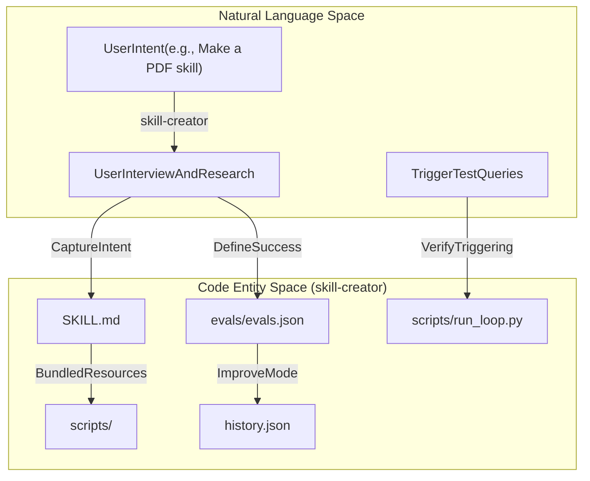
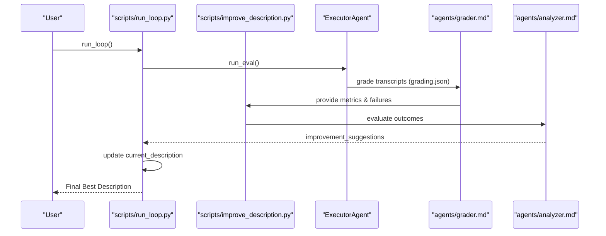

<!-- source: DeepWiki mcp.deepwiki.com · repo anthropics/claude-plugins-official · extra page skill-creator · fetched 2026-10-26 -->

# skill-creator

Relevant source files

The following files were used as context for generating this wiki page:

- [plugins/skill-creator/skills/skill-creator/SKILL.md](plugins/skill-creator/skills/skill-creator/SKILL.md)
- [plugins/skill-creator/skills/skill-creator/agents/analyzer.md](plugins/skill-creator/skills/skill-creator/agents/analyzer.md)
- [plugins/skill-creator/skills/skill-creator/references/schemas.md](plugins/skill-creator/skills/skill-creator/references/schemas.md)
- [plugins/skill-creator/skills/skill-creator/scripts/aggregate_benchmark.py](plugins/skill-creator/skills/skill-creator/scripts/aggregate_benchmark.py)
- [plugins/skill-creator/skills/skill-creator/scripts/improve_description.py](plugins/skill-creator/skills/skill-creator/scripts/improve_description.py)
- [plugins/skill-creator/skills/skill-creator/scripts/run_loop.py](plugins/skill-creator/skills/skill-creator/scripts/run_loop.py)

The `skill-creator` plugin is a specialized toolkit designed for the end-to-end development lifecycle of Claude Code skills. It provides a structured framework for creating, iteratively improving, and benchmarking skills through automated evaluation (evals), variance analysis, and triggering optimization.

## Overview and Purpose

The primary goal of `skill-creator` is to move skill development from "vibe-based" prompting to a data-driven engineering process. It accomplishes this by providing:
*   **Structured Workflows**: Guided phases for capturing intent, interviewing users, and drafting `SKILL.md` files [plugins/skill-creator/skills/skill-creator/SKILL.md:45-71]().
*   **Evaluation Framework**: A system for defining `evals.json` with verifiable assertions (expectations) [plugins/skill-creator/skills/skill-creator/references/schemas.md:7-36]().
*   **Iterative Improvement**: An automated loop that generates new skill versions, runs them against evals, and uses a "Post-hoc Analyzer" to select the best performer [plugins/skill-creator/skills/skill-creator/agents/analyzer.md:1-86]().
*   **Benchmarking**: Tools to measure pass rates, token usage, and execution time across multiple runs to account for LLM variance [plugins/skill-creator/skills/skill-creator/scripts/aggregate_benchmark.py:1-35]().
*   **Trigger Testing**: Scripts to verify if a skill's description effectively causes Claude to trigger (read) the skill for specific user queries [plugins/skill-creator/skills/skill-creator/scripts/run_loop.py:4-6]().

### Skill Creator Workflow
The following diagram illustrates the transition from a user's natural language intent to the structured code entities managed by the plugin.

**Intent to Entity Mapping**

Sources: [plugins/skill-creator/skills/skill-creator/SKILL.md:10-22](), [plugins/skill-creator/skills/skill-creator/references/schemas.md:7-41](), [plugins/skill-creator/skills/skill-creator/scripts/run_loop.py:1-7]()

---

## Core Components and Data Flow

The `skill-creator` system relies on a set of JSON schemas to coordinate between the Executor (which runs the skill), the Grader (which verifies results), and the Analyzer (which suggests improvements) [plugins/skill-creator/skills/skill-creator/references/schemas.md:1-160]().

### Key Data Structures

| File | Purpose | Key Fields |
| :--- | :--- | :--- |
| `evals.json` | Defines test cases | `prompt`, `expected_output`, `expectations[]` [plugins/skill-creator/skills/skill-creator/references/schemas.md:12-27]() |
| `grading.json` | Output of the Grader agent | `expectations[].passed`, `execution_metrics`, `timing` [plugins/skill-creator/skills/skill-creator/references/schemas.md:90-150]() |
| `metrics.json` | Runtime stats from Executor | `tool_calls`, `total_steps`, `errors_encountered` [plugins/skill-creator/skills/skill-creator/references/schemas.md:167-183]() |
| `history.json` | Tracks versioning in Improve mode | `current_best`, `iterations[].expectation_pass_rate` [plugins/skill-creator/skills/skill-creator/references/schemas.md:43-71]() |
| `timing.json` | Wall clock timing for a run | `total_tokens`, `duration_ms`, `executor_duration_seconds` [plugins/skill-creator/skills/skill-creator/references/schemas.md:203-214]() |

Sources: [plugins/skill-creator/skills/skill-creator/references/schemas.md:7-216]()

### Iterative Improvement Logic
When improving a skill, the system can perform a comparison where a `comparator.md` agent evaluates outputs without knowing which skill produced them. The Post-hoc Analyzer (`analyzer.md`) then unblinds the results to generate actionable insights [plugins/skill-creator/skills/skill-creator/agents/analyzer.md:1-8](). 

The `run_loop.py` script orchestrates this by combining `run_eval.py` and `improve_description.py` [plugins/skill-creator/skills/skill-creator/scripts/run_loop.py:4-5](). It supports a train/test split to prevent overfitting [plugins/skill-creator/skills/skill-creator/scripts/run_loop.py:24-44]().

**Improvement Data Flow and Code Entity Mapping**

Sources: [plugins/skill-creator/skills/skill-creator/agents/analyzer.md:7-86](), [plugins/skill-creator/skills/skill-creator/scripts/improve_description.py:50-148](), [plugins/skill-creator/skills/skill-creator/scripts/run_loop.py:47-137]()

---

## Benchmarking and Metrics

To handle the stochastic nature of LLMs, `skill-creator` includes a benchmarking suite that runs evaluations multiple times.

### `aggregate_benchmark.py`
This script processes the results of multiple runs to generate summary statistics. It supports both workspace layouts (from skill-creator iterations) and legacy layouts [plugins/skill-creator/skills/skill-creator/scripts/aggregate_benchmark.py:15-35]().

**Key Functions:**
*   `calculate_stats(values)`: Computes mean, stddev, min, and max for metrics like pass rate and latency [plugins/skill-creator/skills/skill-creator/scripts/aggregate_benchmark.py:45-64]().
*   `load_run_results(benchmark_dir)`: Recursively finds `grading.json` and `timing.json` files across `eval-N` and `run-M` directories [plugins/skill-creator/skills/skill-creator/scripts/aggregate_benchmark.py:67-173]().
*   `aggregate_results(results)`: Aggregates stats for each configuration and calculates deltas [plugins/skill-creator/skills/skill-creator/scripts/aggregate_benchmark.py:176-182]().

Sources: [plugins/skill-creator/skills/skill-creator/scripts/aggregate_benchmark.py:1-182]()

### Trigger Evaluation (`improve_description.py`)
The `improve_description.py` script uses Claude to rewrite skill descriptions based on evaluation failures [plugins/skill-creator/skills/skill-creator/scripts/improve_description.py:2-4](). It communicates with Claude via `claude -p` [plugins/skill-creator/skills/skill-creator/scripts/improve_description.py:20-47]().

**Improvement Heuristics:**
1.  **Generalization**: Focus on broader categories of user intent rather than specific failed queries to avoid overfitting [plugins/skill-creator/skills/skill-creator/scripts/improve_description.py:127-131]().
2.  **Constraint Enforcement**: Maintains a hard limit of 1024 characters for descriptions [plugins/skill-creator/skills/skill-creator/scripts/improve_description.py:132-132]().
3.  **Imperative Style**: Phrased as "Use this skill for..." focusing on intent over implementation [plugins/skill-creator/skills/skill-creator/scripts/improve_description.py:135-136]().

Sources: [plugins/skill-creator/skills/skill-creator/scripts/improve_description.py:50-148]()

---

## Visual Review Tools

The plugin includes HTML-based review interfaces for qualitative evaluation.

### Review and Viewer Utilities
*   **`eval_review.html`**: A local web interface for managing and reviewing eval sets, allowing users to add queries, toggle expected trigger status, and export eval configurations [plugins/skill-creator/skills/skill-creator/assets/eval_review.html:41-58]().
*   **`generate_review.py`**: A Python script that generates a self-contained HTML page for reviewing execution outputs, embedding text, images, PDFs, and Excel files directly into the HTML for offline viewing [plugins/skill-creator/skills/skill-creator/eval-viewer/generate_review.py:2-210]().

Sources: [plugins/skill-creator/skills/skill-creator/assets/eval_review.html:1-146](), [plugins/skill-creator/skills/skill-creator/eval-viewer/generate_review.py:1-214]()

---

## Best Practices for Skill Creation

The `skill-creator` implements several design patterns for high-quality skills:

1.  **Progressive Disclosure**: Skills should be structured to keep the main `SKILL.md` under 500 lines. Large datasets or complex workflows should be moved to `references/` or `scripts/` directories and loaded only when needed [plugins/skill-creator/skills/skill-creator/SKILL.md:86-109]().
2.  **Pushy Descriptions**: To prevent Claude from "undertriggering," skill descriptions in the YAML frontmatter are encouraged to be slightly aggressive, explicitly listing contexts where they should be used [plugins/skill-creator/skills/skill-creator/SKILL.md:67-68]().
3.  **Deterministic Scripts**: For repetitive or complex logic, the skill should bundle a script in `scripts/` rather than relying on the LLM to perform logic via prompting [plugins/skill-creator/skills/skill-creator/SKILL.md:81]().
4.  **Verifiable Expectations**: Evals should focus on "assertions" (e.g., "The output includes X") rather than vague qualitative goals [plugins/skill-creator/skills/skill-creator/references/schemas.md:20-23]().
5.  **Grader Critiques**: The grader agent critiques the evals themselves, flagging assertions that are too easy to satisfy or important outcomes that are unmonitored.

Sources: [plugins/skill-creator/skills/skill-creator/SKILL.md:62-115](), [plugins/skill-creator/skills/skill-creator/references/schemas.md:7-27]()

---

