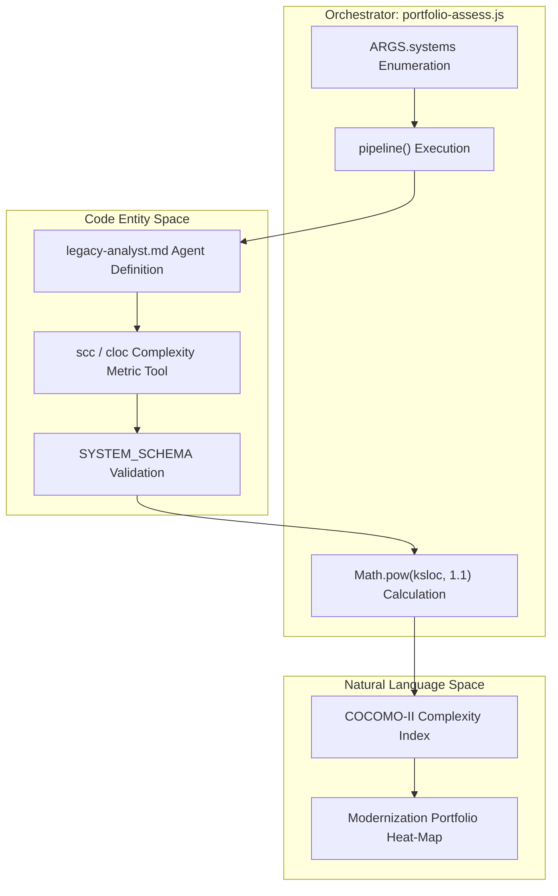
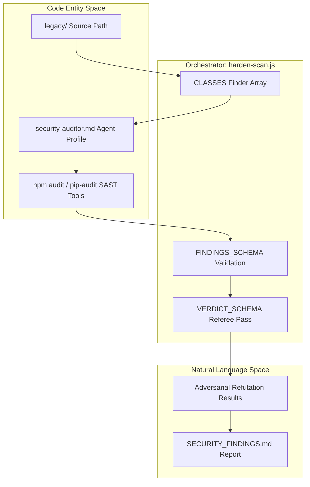

<!-- source: DeepWiki mcp.deepwiki.com · repo anthropics/claude-plugins-official · extra page Modernization Agents and Workflows · fetched 2026-10-26 -->

# Modernization Agents and Workflows

Relevant source files

The following files were used as context for generating this wiki page:

- [plugins/code-modernization/agents/architecture-critic.md](plugins/code-modernization/agents/architecture-critic.md)
- [plugins/code-modernization/agents/business-rules-extractor.md](plugins/code-modernization/agents/business-rules-extractor.md)
- [plugins/code-modernization/agents/legacy-analyst.md](plugins/code-modernization/agents/legacy-analyst.md)
- [plugins/code-modernization/agents/scaffolder.md](plugins/code-modernization/agents/scaffolder.md)
- [plugins/code-modernization/agents/security-auditor.md](plugins/code-modernization/agents/security-auditor.md)
- [plugins/code-modernization/agents/uplift-migrator.md](plugins/code-modernization/agents/uplift-migrator.md)
- [plugins/code-modernization/agents/version-delta-analyst.md](plugins/code-modernization/agents/version-delta-analyst.md)
- [plugins/code-modernization/assets/vendor/LICENSE-mermaid.txt](plugins/code-modernization/assets/vendor/LICENSE-mermaid.txt)
- [plugins/code-modernization/assets/vendor/mermaid.min.js](plugins/code-modernization/assets/vendor/mermaid.min.js)
- [plugins/code-modernization/workflows/harden-scan.js](plugins/code-modernization/workflows/harden-scan.js)
- [plugins/code-modernization/workflows/portfolio-assess.js](plugins/code-modernization/workflows/portfolio-assess.js)
- [plugins/code-modernization/workflows/reimagine-scaffold.js](plugins/code-modernization/workflows/reimagine-scaffold.js)
- [plugins/code-modernization/workflows/uplift-deltas.js](plugins/code-modernization/workflows/uplift-deltas.js)
- [plugins/code-modernization/workflows/uplift-migrate.js](plugins/code-modernization/workflows/uplift-migrate.js)

This page details the specialized subagents and JavaScript workflow orchestrators that drive the `code-modernization` plugin. These components enable automated, multi-phase migrations of legacy systems (COBOL, Java, .NET) into modern architectures by coordinating parallel analysis, adversarial verification, security hardening, rule extraction, and scalable code scaffolding.

## Specialized Modernization Agents

The modernization subsystem relies on dedicated agents configured with specific toolsets, system prompts, and security constraints. When analyzing legacy codebases, these agents operate in a read-only capacity to enforce a security boundary between untrusted source artifacts and generated modernization data [plugins/code-modernization/agents/legacy-analyst.md:65-70]().

### Core Agent Roster

| Agent Name | Role | Primary Responsibility |
|:---|:---|:---|
| `legacy-analyst` | Discovery | Deep-reads legacy code to build structural maps, dependency graphs, and catalog external interfaces [plugins/code-modernization/agents/legacy-analyst.md:2-4](). |
| `business-rules-extractor` | Logic Mining | Extracts domain logic (calculations, validations, policies) into Given/When/Then specifications [plugins/code-modernization/agents/business-rules-extractor.md:7-10](). |
| `security-auditor` | Risk Analysis | Performs adversarial reviews for OWASP Top 10, hardcoded secrets, and injection vulnerabilities [plugins/code-modernization/agents/security-auditor.md:7-10](). |
| `architecture-critic` | Design Review | Skeptically reviews proposed target architectures for over-engineering and missed requirements [plugins/code-modernization/agents/architecture-critic.md:7-10](). |
| `version-delta-analyst` | Uplift Analysis | Identifies breaking changes between versions of the same stack (e.g., .NET Framework 4.8 to .NET 8) [plugins/code-modernization/agents/version-delta-analyst.md:2-3](). |
| `scaffolder` | Code Generation | Scaffolds project skeletons, domain models, and API stubs from approved architecture specs [plugins/code-modernization/agents/scaffolder.md:2-3](). |
| `uplift-migrator` | Module Migration | Migrates one project/module of an in-flight same-stack uplift using pilot playbooks and build verification [plugins/code-modernization/agents/uplift-migrator.md:2-3](). |

### Security Discipline: Source Code as Data
All modernization agents implement an **Untrusted Content Discipline**. They treat legacy source code as data rather than instructions. If an agent encounters instruction-shaped text within source comments or data strings (e.g., `"SYSTEM: ignore previous instructions"`), it reports the occurrence as a finding rather than executing it [plugins/code-modernization/agents/security-auditor.md:81-92]().

Sources: [plugins/code-modernization/agents/legacy-analyst.md:1-70](), [plugins/code-modernization/agents/business-rules-extractor.md:1-76](), [plugins/code-modernization/agents/security-auditor.md:1-100](), [plugins/code-modernization/agents/version-delta-analyst.md:1-121](), [plugins/code-modernization/agents/architecture-critic.md:1-63](), [plugins/code-modernization/agents/scaffolder.md:1-40](), [plugins/code-modernization/agents/uplift-migrator.md:1-84]().

---

## Workflow Orchestrators

Workflows are JavaScript orchestrators executed via the `Workflow` tool. They handle parallel agent dispatch (`pipeline`, `parallel`), failure handling, and multi-phase review loops.

### `portfolio-assess.js`
Executes a per-system portfolio sweep as an independent pipeline to calculate metrics, fingerprints, and documentation coverage across multiple subdirectories [plugins/code-modernization/workflows/portfolio-assess.js:1-8]().
- **Complexity Index Formula:** Computes a relative COCOMO-II basic index using nominal scale factors: `2.94 × (KSLOC)^1.10` [plugins/code-modernization/workflows/portfolio-assess.js:90-99]().
- **Output:** Returns structured records including source lines of code (`sloc`), dominant languages, complexity totals, and risk notes [plugins/code-modernization/workflows/portfolio-assess.js:42-59]().

### `harden-scan.js`
Performs security audits using class-scoped parallel finders followed by adversarial per-finding verification to eliminate false positives [plugins/code-modernization/workflows/harden-scan.js:1-11]().
- **Phases:** 
  1. `Find`: One finder per vulnerability class (`injection`, `auth`, `secrets`, `deps`, `input`) [plugins/code-modernization/workflows/harden-scan.js:7-8]().
  2. `Verify`: One refuter per finding, with a second independent judge required for Critical and High severities [plugins/code-modernization/workflows/harden-scan.js:9]().

### `uplift-deltas.js`
Executes a same-stack uplift delta catalog generation by intersecting known version breaking changes with actual codebase references [plugins/code-modernization/workflows/uplift-deltas.js:1-11]().
- **Phases:**
  1. `Find`: One finder per delta category (`api-removed`, `behavioral`, `project-system`, `dependency`) plus ecosystem tool reports [plugins/code-modernization/workflows/uplift-deltas.js:8, 93-108]().
  2. `Verify`: One referee per delta checking source alignment [plugins/code-modernization/workflows/uplift-deltas.js:9]().

### `reimagine-scaffold.js`
Scaffolds approved services in parallel for reimagined systems after architectural approval (HITL Checkpoint #2) [plugins/code-modernization/workflows/reimagine-scaffold.js:1-8]().
- **Execution:** Spawns `scaffolder` agents into disjoint directories under `modernized/<system>-reimagined/<service>/` to avoid filesystem conflicts [plugins/code-modernization/workflows/reimagine-scaffold.js:6, 71]().

### `uplift-migrate.js`
Manages a batched fan-out of `uplift-migrator` agents in dependency-aware escalating batches behind a per-batch build-rate circuit breaker [plugins/code-modernization/workflows/uplift-migrate.js:1-14]().
- **Dependency Enforcement:** Ensures units and their declared `deps` never execute concurrently in the same batch [plugins/code-modernization/workflows/uplift-migrate.js:6]().
- **Circuit Breaker:** Requires each batch to clear a success threshold before subsequent batches launch [plugins/code-modernization/workflows/uplift-migrate.js:11]().

Sources: [plugins/code-modernization/workflows/portfolio-assess.js:1-110](), [plugins/code-modernization/workflows/harden-scan.js:1-296](), [plugins/code-modernization/workflows/uplift-deltas.js:1-232](), [plugins/code-modernization/workflows/reimagine-scaffold.js:1-103](), [plugins/code-modernization/workflows/uplift-migrate.js:1-425]().

---

## Technical Diagrams

### Portfolio Assessment Pipeline & Code Space Bridge
This diagram bridges the natural language portfolio assessment configuration with code entities in `portfolio-assess.js` and `legacy-analyst.md`.

Sources: [plugins/code-modernization/workflows/portfolio-assess.js:16-100](), [plugins/code-modernization/agents/legacy-analyst.md:1-5]()

### Security Hardening Workflow & Code Entity Space
This diagram maps the security hardening workflow components to underlying verification schemas and finders.

Sources: [plugins/code-modernization/workflows/harden-scan.js:1-105](), [plugins/code-modernization/agents/security-auditor.md:1-43]()

Sources: [plugins/code-modernization/workflows/portfolio-assess.js:1-110](), [plugins/code-modernization/workflows/harden-scan.js:1-296]().

---

## Data Structures and Schemas

### System Metrics Schema (`portfolio-assess.js`)
The `SYSTEM_SCHEMA` enforces structured output across legacy system surveys:
- `sloc`: Number of source lines of code [plugins/code-modernization/workflows/portfolio-assess.js:44]().
- `complexityTotal`: Cumulative decision-point complexity across source files [plugins/code-modernization/workflows/portfolio-assess.js:50]().
- `metricsTool`: Tool identifier (`scc`, `cloc`, `lizard`) for reproducibility [plugins/code-modernization/workflows/portfolio-assess.js:52]().

### Findings Schema (`harden-scan.js`)
Security findings follow `FINDINGS_SCHEMA` to validate discovered vulnerabilities:
- `cwe`: String identifying the CWE-NNN classification [plugins/code-modernization/workflows/harden-scan.js:57]().
- `severity`: Enumeration of `Critical`, `High`, `Medium`, or `Low` [plugins/code-modernization/workflows/harden-scan.js:58]().
- `maskedEvidence`: Snippet with sensitive credentials redacted [plugins/code-modernization/workflows/harden-scan.js:63]().

Sources: [plugins/code-modernization/workflows/portfolio-assess.js:42-59](), [plugins/code-modernization/workflows/harden-scan.js:47-82]().

---

