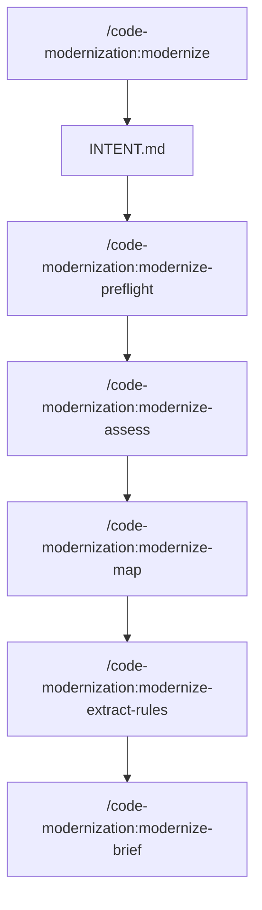
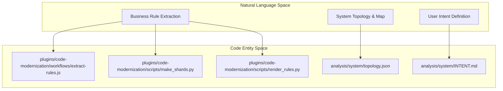
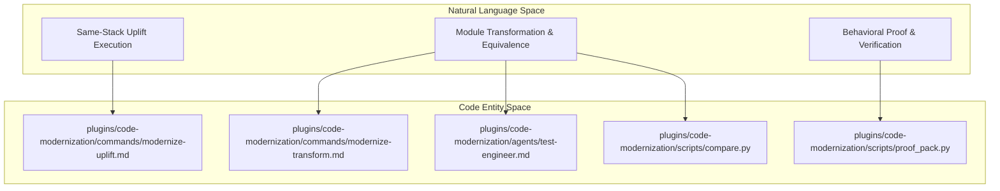

<!-- source: DeepWiki mcp.deepwiki.com · repo anthropics/claude-plugins-official · extra page Modernization Command Suite · fetched 2026-10-26 -->

# Modernization Command Suite

Relevant source files

The following files were used as context for generating this wiki page:

- [plugins/code-modernization/README.md](plugins/code-modernization/README.md)
- [plugins/code-modernization/agents/test-engineer.md](plugins/code-modernization/agents/test-engineer.md)
- [plugins/code-modernization/assets/topology-viewer.html](plugins/code-modernization/assets/topology-viewer.html)
- [plugins/code-modernization/commands/modernize-assess.md](plugins/code-modernization/commands/modernize-assess.md)
- [plugins/code-modernization/commands/modernize-brief.md](plugins/code-modernization/commands/modernize-brief.md)
- [plugins/code-modernization/commands/modernize-extract-rules.md](plugins/code-modernization/commands/modernize-extract-rules.md)
- [plugins/code-modernization/commands/modernize-harden.md](plugins/code-modernization/commands/modernize-harden.md)
- [plugins/code-modernization/commands/modernize-map.md](plugins/code-modernization/commands/modernize-map.md)
- [plugins/code-modernization/commands/modernize-preflight.md](plugins/code-modernization/commands/modernize-preflight.md)
- [plugins/code-modernization/commands/modernize-reimagine.md](plugins/code-modernization/commands/modernize-reimagine.md)
- [plugins/code-modernization/commands/modernize-status.md](plugins/code-modernization/commands/modernize-status.md)
- [plugins/code-modernization/commands/modernize-transform.md](plugins/code-modernization/commands/modernize-transform.md)
- [plugins/code-modernization/commands/modernize-uplift.md](plugins/code-modernization/commands/modernize-uplift.md)
- [plugins/code-modernization/commands/modernize.md](plugins/code-modernization/commands/modernize.md)
- [plugins/code-modernization/scripts/compare.py](plugins/code-modernization/scripts/compare.py)
- [plugins/code-modernization/scripts/render_rules.py](plugins/code-modernization/scripts/render_rules.py)
- [plugins/code-modernization/scripts/tests/test_compare_tolerance.py](plugins/code-modernization/scripts/tests/test_compare_tolerance.py)
- [plugins/code-modernization/scripts/tests/test_rules_tools.py](plugins/code-modernization/scripts/tests/test_rules_tools.py)
- [plugins/code-modernization/workflows/extract-rules.js](plugins/code-modernization/workflows/extract-rules.js)

The **Modernization Command Suite** provides a structured, multi-phase workflow for migrating legacy codebases (such as COBOL, legacy Java, or .NET Framework) to modern architectures [plugins/code-modernization/README.md:1-3](). It enforces a strict sequence to prevent common modernization failures, such as transforming code before understanding its business logic or shipping without a behavioral equivalence harness [plugins/code-modernization/README.md:53-60]().

Sources: [plugins/code-modernization/README.md:1-3](), [plugins/code-modernization/README.md:53-60]()

---

## Sequence of Modernize Commands

The modernization process is driven by an orchestrated sequence of slash commands that write shareable artifacts into `analysis/<system>/` without mutating the legacy source tree [plugins/code-modernization/README.md:28](). 

### Pipeline Sequence

Sources: [plugins/code-modernization/README.md:34-42]()

### Bridge Diagram: Natural Language Space to Code Entity Space (Discovery)
This diagram maps natural language discovery concepts to their concrete code entities, workflow scripts, and JSON schemas.

Sources: [plugins/code-modernization/commands/modernize-extract-rules.md:22-97](), [plugins/code-modernization/workflows/extract-rules.js:1-17](), [plugins/code-modernization/commands/modernize-map.md:68-99]()

Sources: [plugins/code-modernization/README.md:34-42](), [plugins/code-modernization/commands/modernize-extract-rules.md:22-97](), [plugins/code-modernization/workflows/extract-rules.js:1-17](), [plugins/code-modernization/commands/modernize-map.md:68-99]()

---

## The Human-in-the-Loop (HITL) Approval Gate

Modernization commands require explicit human checkpoints at critical junctures. The plugin never automates decisions regarding scope, risk acceptance, or design approval [plugins/code-modernization/README.md:49]().

*   **Preflight Check 0**: The `/code-modernization:modernize-preflight` command prompts the user via the `AskUserQuestion` tool for five non-derivable system attributes: complete system vs. slice, local build/test feasibility, bespoke build infrastructure, prior attempts, and off-limits components [plugins/code-modernization/commands/modernize-preflight.md:33-59]().
*   **Rule Review (`/code-modernization:modernize-review`)**: Engineers review mined business rules. Rules marked `wrong` are excluded from the behavior contract, while `discuss` items block dependent phases until resolved [plugins/code-modernization/commands/modernize-brief.md:18-21]().
*   **The Modernization Brief (`/code-modernization:modernize-brief`)**: Acts as the primary HITL approval gate. It synthesizes assessment, topology, and rule extractions into `analysis/<system>/MODERNIZATION_BRIEF.md` [plugins/code-modernization/commands/modernize-brief.md:7-16](). **Nothing is built until this brief is approved** by the steering committee or engineering lead [plugins/code-modernization/README.md:43]().

Sources: [plugins/code-modernization/README.md:43](), [plugins/code-modernization/README.md:49](), [plugins/code-modernization/commands/modernize-preflight.md:33-59](), [plugins/code-modernization/commands/modernize-brief.md:7-21]()

---

## The Three Modernization Methods

Once the Modernization Brief is approved, execution proceeds via one of three specialized methods depending on the target strategy [plugins/code-modernization/README.md:43]().

### 1. Uplift (`/code-modernization:modernize-uplift`)
Used for same-stack version migrations (e.g., .NET Framework 4.8 to .NET 8, or Java 8 to 17) [plugins/code-modernization/commands/modernize-uplift.md:1-7](). 
*   **Mechanism**: Preserves existing code structure while resolving version deltas and breaking changes [plugins/code-modernization/commands/modernize-uplift.md:11-14]().
*   **Execution**: Works in-place on a copied working directory (`modernized/$system-uplifted/`) or git worktree, driven by a `DELTA_CATALOG.md` [plugins/code-modernization/commands/modernize-uplift.md:65-75]().

### 2. Transform (`/code-modernization:modernize-transform`)
Used for cross-stack module rewrites (e.g., legacy COBOL or C# modules into modern Java or TypeScript services) following the Strangler Fig pattern [plugins/code-modernization/commands/modernize-transform.md:1-8]().
*   **Mechanism**: Driven by "Characterization Tests First" where `test-engineer` agents write test harnesses from business rules before implementation [plugins/code-modernization/commands/modernize-transform.md:47-55]().
*   **Equivalence**: Proves behavior through differential execution or recorded trace comparisons processed by `scripts/compare.py` [plugins/code-modernization/commands/modernize-transform.md:79-86]().

### 3. Reimagine (`/code-modernization:modernize-reimagine`)
Used to rebuild a system from its extracted intent onto an entirely new architecture [plugins/code-modernization/commands/modernize-reimagine.md:11-13]().
*   **Mechanism**: Mines specifications into `AI_NATIVE_SPEC.md`, designs a target architecture reviewed by `architecture-critic`, and scaffolds services in parallel using `reimagine-scaffold.js` workflows [plugins/code-modernization/commands/modernize-reimagine.md:21-75]().
*   **Checkpoints**: Enforces two strict human checkpoints before scaffolding begins [plugins/code-modernization/commands/modernize-reimagine.md:13]().

Sources: [plugins/code-modernization/README.md:43](), [plugins/code-modernization/commands/modernize-uplift.md:1-14](), [plugins/code-modernization/commands/modernize-transform.md:1-8](), [plugins/code-modernization/commands/modernize-reimagine.md:11-75]()

---

## Technical Implementation & Data Flow

### Bridge Diagram: Natural Language Space to Code Entity Space (Execution & Verification)
This diagram associates natural language execution and validation concepts with their corresponding runtime scripts and verification modules.

Sources: [plugins/code-modernization/commands/modernize-uplift.md:1-86](), [plugins/code-modernization/commands/modernize-transform.md:1-98](), [plugins/code-modernization/agents/test-engineer.md:1-5]()

Sources: [plugins/code-modernization/commands/modernize-uplift.md:1-86](), [plugins/code-modernization/commands/modernize-transform.md:1-98](), [plugins/code-modernization/agents/test-engineer.md:1-5]()

---

