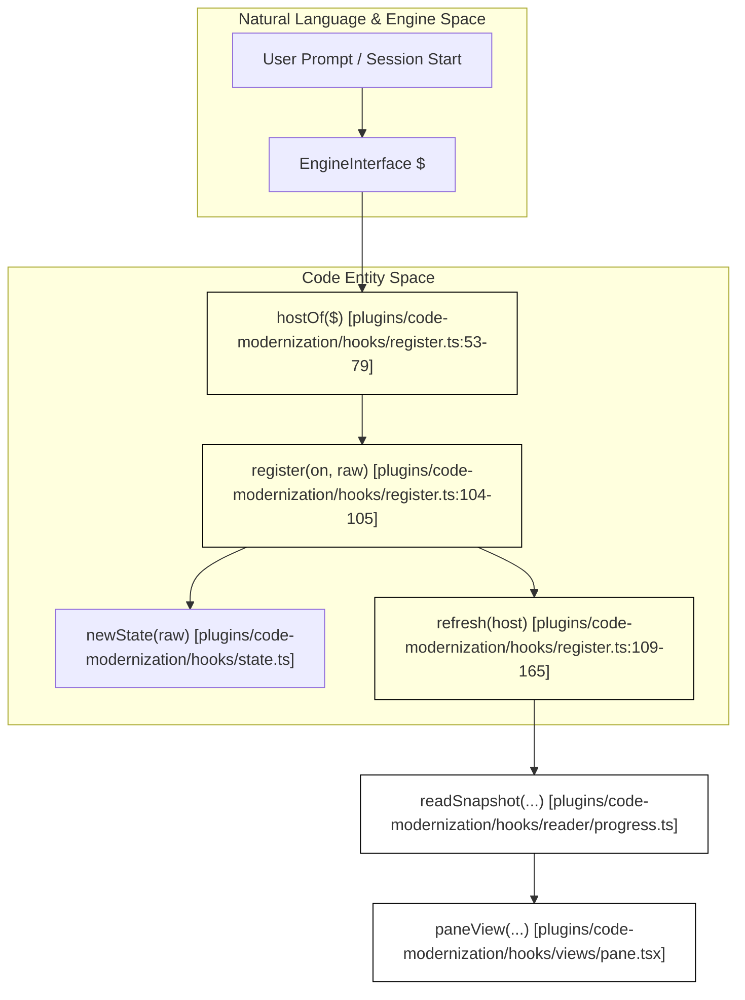
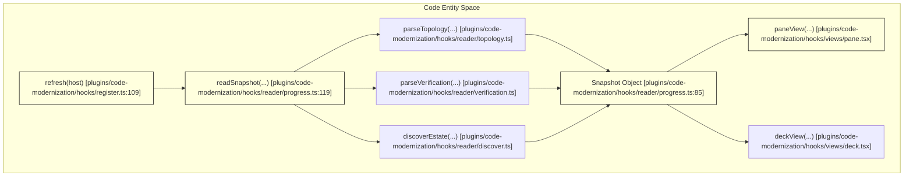
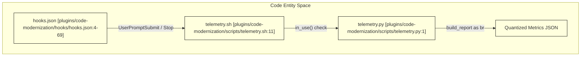

<!-- source: DeepWiki mcp.deepwiki.com · repo anthropics/claude-plugins-official · extra page Modernization Hooks UI and Telemetry · fetched 2026-10-26 -->

# Modernization Hooks UI and Telemetry

Relevant source files

The following files were used as context for generating this wiki page:

- [plugins/code-modernization/.claude-plugin/plugin.json](plugins/code-modernization/.claude-plugin/plugin.json)
- [plugins/code-modernization/CHANGELOG.md](plugins/code-modernization/CHANGELOG.md)
- [plugins/code-modernization/commands/modernize-review.md](plugins/code-modernization/commands/modernize-review.md)
- [plugins/code-modernization/hooks/README.md](plugins/code-modernization/hooks/README.md)
- [plugins/code-modernization/hooks/fleet/fleet.ts](plugins/code-modernization/hooks/fleet/fleet.ts)
- [plugins/code-modernization/hooks/hooks.json](plugins/code-modernization/hooks/hooks.json)
- [plugins/code-modernization/hooks/host.ts](plugins/code-modernization/hooks/host.ts)
- [plugins/code-modernization/hooks/map/estate.ts](plugins/code-modernization/hooks/map/estate.ts)
- [plugins/code-modernization/hooks/map/raster.ts](plugins/code-modernization/hooks/map/raster.ts)
- [plugins/code-modernization/hooks/map/treemap.ts](plugins/code-modernization/hooks/map/treemap.ts)
- [plugins/code-modernization/hooks/paths.ts](plugins/code-modernization/hooks/paths.ts)
- [plugins/code-modernization/hooks/reader/brief.ts](plugins/code-modernization/hooks/reader/brief.ts)
- [plugins/code-modernization/hooks/reader/fs.ts](plugins/code-modernization/hooks/reader/fs.ts)
- [plugins/code-modernization/hooks/reader/modernized.ts](plugins/code-modernization/hooks/reader/modernized.ts)
- [plugins/code-modernization/hooks/reader/progress.ts](plugins/code-modernization/hooks/reader/progress.ts)
- [plugins/code-modernization/hooks/reader/rules.ts](plugins/code-modernization/hooks/reader/rules.ts)
- [plugins/code-modernization/hooks/reader/tracks.ts](plugins/code-modernization/hooks/reader/tracks.ts)
- [plugins/code-modernization/hooks/reader/uplift.ts](plugins/code-modernization/hooks/reader/uplift.ts)
- [plugins/code-modernization/hooks/reader/verification.ts](plugins/code-modernization/hooks/reader/verification.ts)
- [plugins/code-modernization/hooks/register.ts](plugins/code-modernization/hooks/register.ts)
- [plugins/code-modernization/hooks/review/deck.ts](plugins/code-modernization/hooks/review/deck.ts)
- [plugins/code-modernization/hooks/state.ts](plugins/code-modernization/hooks/state.ts)
- [plugins/code-modernization/hooks/text.ts](plugins/code-modernization/hooks/text.ts)
- [plugins/code-modernization/hooks/views/deck.tsx](plugins/code-modernization/hooks/views/deck.tsx)
- [plugins/code-modernization/hooks/views/palette.ts](plugins/code-modernization/hooks/views/palette.ts)
- [plugins/code-modernization/hooks/views/pane.tsx](plugins/code-modernization/hooks/views/pane.tsx)
- [plugins/code-modernization/hooks/xray/xray.ts](plugins/code-modernization/hooks/xray/xray.ts)
- [plugins/code-modernization/scripts/telemetry.py](plugins/code-modernization/scripts/telemetry.py)
- [plugins/code-modernization/scripts/telemetry.sh](plugins/code-modernization/scripts/telemetry.sh)
- [plugins/code-modernization/scripts/tests/test_telemetry.py](plugins/code-modernization/scripts/tests/test_telemetry.py)
- [plugins/code-modernization/tests/logic.test.ts](plugins/code-modernization/tests/logic.test.ts)
- [plugins/code-modernization/tests/mount.test.ts](plugins/code-modernization/tests/mount.test.ts)
- [plugins/code-modernization/tests/register.test.ts](plugins/code-modernization/tests/register.test.ts)
- [plugins/code-modernization/tests/stacks.test.ts](plugins/code-modernization/tests/stacks.test.ts)
- [plugins/code-modernization/tests/verification.test.ts](plugins/code-modernization/tests/verification.test.ts)

## Purpose and Scope
This page details the technical implementation of the `code-modernization` plugin's TypeScript hook runtime, live progress panes, estate mapping, review decks, opt-in telemetry pipeline, and plugin test suite. The hook runtime is built on Claude Code's early-access function hooks (`CLAUDE_CODE_ENABLE_FUNCTION_HOOKS=1`), driving real-time visual feedback, topological state synchronization, and usage analytics.

---

## 1. TypeScript Hook Runtime Architecture

The hook runtime initializes upon session start via `register(on, raw)` [plugins/code-modernization/hooks/register.ts:104-105](). It binds the Claude Code engine interface (`EngineInterface`) to a local abstraction layer (`Host`) defined in [plugins/code-modernization/hooks/host.ts](), granting safe access to file systems, UI panes, command registration, and clocks [plugins/code-modernization/hooks/register.ts:53-79]().

*Figure 1: Hook registration and state refresh binding pipeline.*

Sources: [plugins/code-modernization/hooks/register.ts:53-105]()

---

## 2. Live Progress Panes and Estate Mapping

State reading is decoupled from disk I/O through `refresh(host)`, which debounces calls (`REFRESH_DEBOUNCE_MS = 450`, `REFRESH_BUSY_MS = 2500`) to prevent blocking the event loop while agent fleets write concurrently [plugins/code-modernization/hooks/register.ts:32-34, 109-165]().

The snapshot reader (`readSnapshot`) aggregates:
- System identification and track detection via `pickTrack` [plugins/code-modernization/hooks/reader/progress.ts:85-120]()
- Estate topologies via `parseTopology` and `discoverEstate` [plugins/code-modernization/hooks/reader/topology.ts](), [plugins/code-modernization/hooks/reader/discover.ts]()
- Verification proofs via `parseVerification` [plugins/code-modernization/hooks/reader/verification.ts:47-63]()
- Rule review ledgers via `parseLedger` [plugins/code-modernization/hooks/review/ledger.ts]()

*Figure 2: Artifact ingestion and view rendering pipeline.*

Sources: [plugins/code-modernization/hooks/register.ts:109-165](), [plugins/code-modernization/hooks/reader/progress.ts:85-120]()

---

## 3. Review Decks and Ledger Management

The rule review workflow (`deck.ts`) manages user verification state for mined business rules. It tracks review scopes (`DeckScope`), advances through unreviewed items via `nextUnreviewed`, and records decisions (`decide`, `undecide`) into the JSON ledger [plugins/code-modernization/hooks/register.ts:13](). Ledgers are parsed, merged, and synchronized against disk artifacts using `parseLedger` and `mergeLedger` [plugins/code-modernization/hooks/register.ts:14]().

Sources: [plugins/code-modernization/hooks/register.ts:13-14](), [plugins/code-modernization/hooks/review/deck.ts]()

---

## 4. Opt-In Telemetry Pipeline

The telemetry subsystem records anonymous, aggregate usage counts. It consists of event definitions in `hooks.json`, a shell runner `telemetry.sh`, and a Python metric extraction script `telemetry.py`.

### Hook Routing Configuration
Events such as `UserPromptSubmit`, `Stop`, `SessionStart`, `PostToolUseFailure`, and `StopFailure` trigger `telemetry.sh` asynchronously (`asyncRewake: true`) [plugins/code-modernization/hooks/hooks.json:4-69]().

*Figure 3: Telemetry execution flow from hook event to quantized JSON metrics.*

Sources: [plugins/code-modernization/hooks/hooks.json:4-69](), [plugins/code-modernization/scripts/telemetry.sh:11-30](), [plugins/code-modernization/scripts/telemetry.py:1-41]()

### Shell Guard Rails and Python Execution
`telemetry.sh` verifies off-switches (`CODE_MODERNIZATION_TELEMETRY`, `CLAUDE_PLUGIN_OPTION_TELEMETRY`, `DISABLE_TELEMETRY`), evaluates OS types (`uname -s`), detects path problems (spaces, non-ASCII, length > 200), and parses the plugin version directly from `plugin.json` without requiring Python [plugins/code-modernization/scripts/telemetry.sh:31-64](). It attempts to execute `telemetry.py` via `python3`, `python`, or the Windows `py` launcher, emitting fallback error codes if the interpreter fails [plugins/code-modernization/scripts/telemetry.sh:75-128]().

Sources: [plugins/code-modernization/scripts/telemetry.sh:31-128]()

### Privacy and Quantization Rules
`telemetry.py` parses workspace artifacts (`analysis/`, `modernized/`) safely using `build_report.py` [plugins/code-modernization/scripts/telemetry.py:37-41](). All exported values are strict whole numbers capped and rounded to two significant figures from 100 upward [plugins/code-modernization/scripts/telemetry.py:11-47](). No file names, paths, system names, raw code, prompts, or error strings are ever transmitted [plugins/code-modernization/scripts/telemetry.py:11-16]().

Sources: [plugins/code-modernization/scripts/telemetry.py:11-47]()

---

## 5. Plugin Test Suite

The test suite ensures hook robustness, state transitions, and telemetry accuracy:
- `plugins/code-modernization/tests/register.test.ts`: Tests command registration, pane opening heuristics on fullscreen vs main screens, and toggle commands [plugins/code-modernization/tests/register.test.ts:12-150]().
- `plugins/code-modernization/tests/verification.test.ts`: Validates proof pack parsing (`parseVerification`), discarding forged verdicts, and truncating hostile reasons [plugins/code-modernization/tests/verification.test.ts:46-104]().
- `plugins/code-modernization/tests/stacks.test.ts`: Exercises multi-stack snapshots (Maven uplifts, .NET, Node, PHP) [plugins/code-modernization/tests/stacks.test.ts:39-134]().
- `plugins/code-modernization/scripts/tests/test_telemetry.py`: Verifies workspace metrics computation, sanitization, and rounding constraints [plugins/code-modernization/scripts/tests/test_telemetry.py:106-154]().

Sources: [plugins/code-modernization/tests/register.test.ts:1-166](), [plugins/code-modernization/tests/verification.test.ts:1-140](), [plugins/code-modernization/tests/stacks.test.ts:1-134](), [plugins/code-modernization/scripts/tests/test_telemetry.py:106-154]()

---

