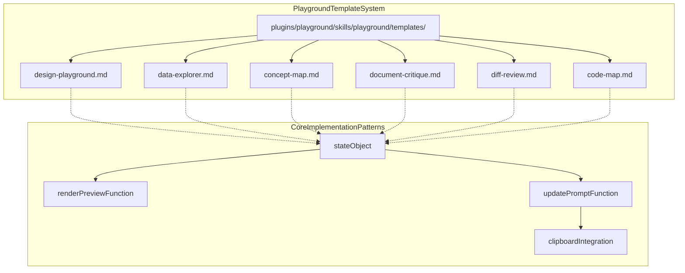
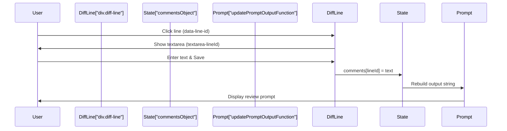
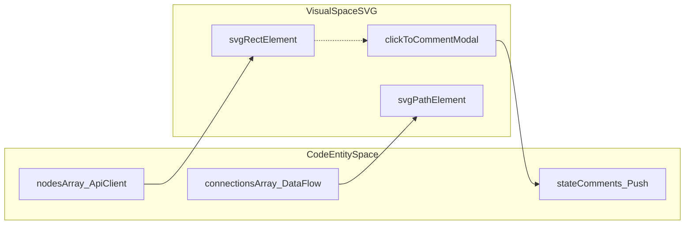
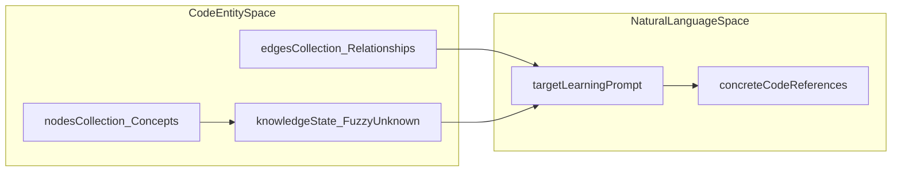

<!-- source: DeepWiki mcp.deepwiki.com · repo anthropics/claude-plugins-official · extra page Playground Templates · fetched 2026-10-26 -->

# Playground Templates

Relevant source files

The following files were used as context for generating this wiki page:

- [plugins/playground/.claude-plugin/plugin.json](plugins/playground/.claude-plugin/plugin.json)
- [plugins/playground/README.md](plugins/playground/README.md)
- [plugins/playground/skills/playground/SKILL.md](plugins/playground/skills/playground/SKILL.md)
- [plugins/playground/skills/playground/templates/code-map.md](plugins/playground/skills/playground/templates/code-map.md)
- [plugins/playground/skills/playground/templates/concept-map.md](plugins/playground/skills/playground/templates/concept-map.md)
- [plugins/playground/skills/playground/templates/data-explorer.md](plugins/playground/skills/playground/templates/data-explorer.md)
- [plugins/playground/skills/playground/templates/design-playground.md](plugins/playground/skills/playground/templates/design-playground.md)
- [plugins/playground/skills/playground/templates/diff-review.md](plugins/playground/skills/playground/templates/diff-review.md)
- [plugins/playground/skills/playground/templates/document-critique.md](plugins/playground/skills/playground/templates/document-critique.md)

This page details the playground templates provided by the playground plugin in `plugins/playground/skills/playground/templates/`. These templates define self-contained HTML interfaces for visual design, data exploration, concept mapping, document critique, diff reviewing, and code mapping, bridging user-driven interactive controls with natural language prompt generation.

## Overview

The playground system utilizes six specialized templates located in the `templates/` directory of the `playground` skill. Each template implements a distinct workflow with its own layout, interaction model, and prompt generation strategy.

Title: Playground Template Architecture

Sources: [plugins/playground/skills/playground/SKILL.md:17-23](), [plugins/playground/skills/playground/SKILL.md:36-48]()

## Template Categories

| Template | Primary Use Case | Key Interaction |
| :--- | :--- | :--- |
| `design-playground` | UI components, layouts, spacing | Sliders, color pickers, toggles [plugins/playground/skills/playground/templates/design-playground.md:25-33]() |
| `data-explorer` | SQL, APIs, regex, pipelines | Chip selection, filter rows, syntax highlighting [plugins/playground/skills/playground/templates/data-explorer.md:26-33]() |
| `concept-map` | Learning, knowledge gaps | Draggable nodes, edge drawing, tooltips [plugins/playground/skills/playground/templates/concept-map.md:25-31]() |
| `document-critique` | READMEs, SKILL.md, specs | Approve/Reject/Comment on suggestions [plugins/playground/skills/playground/templates/document-critique.md:24-38]() |
| `diff-review` | Git commits, Pull Requests | Click line to add code review comment [plugins/playground/skills/playground/templates/diff-review.md:26-31]() |
| `code-map` | Architecture, data flow | SVG canvas, layer toggles, click-to-comment [plugins/playground/skills/playground/templates/code-map.md:27-33]() |

Sources: [plugins/playground/skills/playground/SKILL.md:17-23](), [plugins/playground/skills/playground/templates/design-playground.md:25-33](), [plugins/playground/skills/playground/templates/data-explorer.md:26-33](), [plugins/playground/skills/playground/templates/concept-map.md:25-31](), [plugins/playground/skills/playground/templates/document-critique.md:24-38](), [plugins/playground/skills/playground/templates/diff-review.md:26-31](), [plugins/playground/skills/playground/templates/code-map.md:27-33]()

## Visual & Design Templates

### Design Playground
Used for visual design decisions including components, typography, and responsive behavior, mapping UI controls directly to CSS properties [plugins/playground/skills/playground/templates/design-playground.md:1-3]().

*   **Layout:** Two-column layout separating control configurations from the live component preview, complemented by a prompt output panel [plugins/playground/skills/playground/templates/design-playground.md:5-20]().
*   **Implementation:** The `renderPreview()` function applies `state` values directly to target element inline styles using standard CSS properties such as `borderRadius`, `padding`, and `boxShadow` [plugins/playground/skills/playground/templates/design-playground.md:36-47]().
*   **Prompt Strategy:** Formulates developer directions (e.g., "Update the card to feel soft...") rather than raw numeric specifications [plugins/playground/skills/playground/templates/design-playground.md:51-57]().

Sources: [plugins/playground/skills/playground/templates/design-playground.md:5-20](), [plugins/playground/skills/playground/templates/design-playground.md:36-47](), [plugins/playground/skills/playground/templates/design-playground.md:51-57]()

### Data Explorer
Used for structured configuration tasks such as SQL query building, API design, pipelines, and regular expressions [plugins/playground/skills/playground/templates/data-explorer.md:1-3]().

*   **Interaction:** Employs clickable cards and chips for table/field selections, alongside dynamic filter rows and dropdowns [plugins/playground/skills/playground/templates/data-explorer.md:26-33]().
*   **Implementation:** `renderPreview()` utilizes regular expressions to replace SQL tokens with syntax-highlighted `` elements tagged with `.kw`, `.tbl`, and `.str` classes [plugins/playground/skills/playground/templates/data-explorer.md:39-48]().
*   **Prompt Strategy:** Formulates specifications describing the structural query intent while embedding necessary schema context [plugins/playground/skills/playground/templates/data-explorer.md:52-58]().

Sources: [plugins/playground/skills/playground/templates/data-explorer.md:7-22](), [plugins/playground/skills/playground/templates/data-explorer.md:26-33](), [plugins/playground/skills/playground/templates/data-explorer.md:39-48](), [plugins/playground/skills/playground/templates/data-explorer.md:52-58]()

## Review & Feedback Templates

### Diff Review
Creates interactive git diff viewers where users click individual lines to add comments, which are subsequently aggregated into structured code review prompts [plugins/playground/skills/playground/templates/diff-review.md:1-3]().

Title: DiffReviewDataFlow

*   **Data Structure:** Diffs are parsed into a `diffData` array consisting of target files, hunk headers, and line objects flagged as `addition`, `deletion`, or `context` [plugins/playground/skills/playground/templates/diff-review.md:37-53]().
*   **Metadata:** Line elements embed `data-line-id`, `data-file`, and `data-line-num` attributes to link interactive user comments back to exact code locations [plugins/playground/skills/playground/templates/diff-review.md:132-138]().

Sources: [plugins/playground/skills/playground/templates/diff-review.md:37-53](), [plugins/playground/skills/playground/templates/diff-review.md:113-126](), [plugins/playground/skills/playground/templates/diff-review.md:132-138]()

### Document Critique
A review workflow for analyzing documents such as `SKILL.md` or README files, supporting pre-generated suggestions with an approve/reject/comment workflow [plugins/playground/skills/playground/templates/document-critique.md:1-3]().

*   **State Management:** Maintains a `suggestions` array where each entry tracks `status` (`pending`, `approved`, `rejected`) and an optional `userComment` [plugins/playground/skills/playground/templates/document-critique.md:46-65]().
*   **Fuzzy Line Matching:** Matches suggestions to document lines by parsing `lineRef` strings and applying a ±2 line tolerance window [plugins/playground/skills/playground/templates/document-critique.md:72-80]().
*   **Prompt Generation:** The `updatePrompt()` function aggregates only `approved` improvements and active user notes into the final prompt output [plugins/playground/skills/playground/templates/document-critique.md:107-132]().

Sources: [plugins/playground/skills/playground/templates/document-critique.md:46-65](), [plugins/playground/skills/playground/templates/document-critique.md:72-80](), [plugins/playground/skills/playground/templates/document-critique.md:107-132]()

## Mapping & Visualization Templates

### Code Map
Visualizes codebase architecture using an SVG canvas containing interactive nodes and directional connections [plugins/playground/skills/playground/templates/code-map.md:1-3]().

Title: CodeMapEntityBridge

*   **Layer Organization:** Nodes are structurally arranged along Y-position bands corresponding to logical layers like Client, Server, and Data [plugins/playground/skills/playground/templates/code-map.md:41-43]().
*   **Connection Styling:** Implements distinct styles via `connections` definitions, including `data-flow` (solid), `tool-call` (dashed), and `event` (short dash) [plugins/playground/skills/playground/templates/code-map.md:68-76]().
*   **Interaction:** Clicking nodes invokes a modal dialog to append targeted architectural feedback into `state.comments`, updating node visual indicators [plugins/playground/skills/playground/templates/code-map.md:86-106]().

Sources: [plugins/playground/skills/playground/templates/code-map.md:41-43](), [plugins/playground/skills/playground/templates/code-map.md:46-56](), [plugins/playground/skills/playground/templates/code-map.md:68-76](), [plugins/playground/skills/playground/templates/code-map.md:86-106]()

### Concept Map
Focuses on learning paths and knowledge gap identification using HTML `<canvas>` elements [plugins/playground/skills/playground/templates/concept-map.md:1-3]().

Title: ConceptMapPromptBridge

*   **Canvas Implementation:** Utilizes manual `draw()` loops and boundary hit testing for node dragging and edge creation [plugins/playground/skills/playground/templates/concept-map.md:35-49]().
*   **Knowledge Tracking:** Users cycle node states between "Know", "Fuzzy", and "Unknown" levels [plugins/playground/skills/playground/templates/concept-map.md:25-31]().
*   **Prompt Strategy:** Compiles a specialized learning request targeting only fuzzy or unknown nodes and their defined relationships [plugins/playground/skills/playground/templates/concept-map.md:53-57]().

Sources: [plugins/playground/skills/playground/templates/concept-map.md:25-31](), [plugins/playground/skills/playground/templates/concept-map.md:35-49](), [plugins/playground/skills/playground/templates/concept-map.md:53-57]()

## Implementation Requirements

Every playground generated from these templates must adhere to core structural standards:
1.  **Single HTML File:** All CSS and JavaScript must be fully inlined with zero external dependencies [plugins/playground/skills/playground/SKILL.md:29]().
    *   *Sources:* [plugins/playground/skills/playground/SKILL.md:29]()
2.  **Live Preview:** Visual elements must re-render instantly via `updateAll()` upon any control adjustment [plugins/playground/skills/playground/SKILL.md:30-48]().
    *   *Sources:* [plugins/playground/skills/playground/SKILL.md:30-48]()
3.  **Natural Language Prompt:** Prompt outputs must provide descriptive developer instructions instead of raw state dumps [plugins/playground/skills/playground/SKILL.md:31]().
    *   *Sources:* [plugins/playground/skills/playground/SKILL.md:31]()
4.  **Preserved Context:** Prompts must carry adequate context (file paths, schema definitions) to remain fully actionable outside the playground interface [plugins/playground/skills/playground/SKILL.md:76]().
    *   *Sources:* [plugins/playground/skills/playground/SKILL.md:76]()

---

