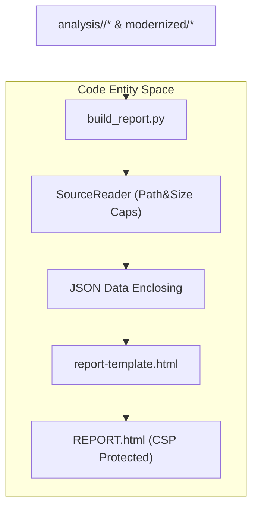

<!-- source: DeepWiki mcp.deepwiki.com · repo anthropics/claude-plugins-official · extra page Rule Extraction and Verification Pipeline · fetched 2026-10-26 -->

# Rule Extraction and Verification Pipeline

<details>
<summary>Relevant source files</summary>

The following files were used as context for generating this wiki page:

- [plugins/code-modernization/agents/test-engineer.md](plugins/code-modernization/agents/test-engineer.md)
- [plugins/code-modernization/assets/report-template.html](plugins/code-modernization/assets/report-template.html)
- [plugins/code-modernization/commands/modernize-extract-rules.md](plugins/code-modernization/commands/modernize-extract-rules.md)
- [plugins/code-modernization/commands/modernize-verify.md](plugins/code-modernization/commands/modernize-verify.md)
- [plugins/code-modernization/scripts/baseline_diff.py](plugins/code-modernization/scripts/baseline_diff.py)
- [plugins/code-modernization/scripts/build_report.py](plugins/code-modernization/scripts/build_report.py)
- [plugins/code-modernization/scripts/compare.py](plugins/code-modernization/scripts/compare.py)
- [plugins/code-modernization/scripts/make_shards.py](plugins/code-modernization/scripts/make_shards.py)
- [plugins/code-modernization/scripts/proof_pack.py](plugins/code-modernization/scripts/proof_pack.py)
- [plugins/code-modernization/scripts/render_rules.py](plugins/code-modernization/scripts/render_rules.py)
- [plugins/code-modernization/scripts/tests/test_compare_tolerance.py](plugins/code-modernization/scripts/tests/test_compare_tolerance.py)
- [plugins/code-modernization/scripts/tests/test_proof_rules_run.py](plugins/code-modernization/scripts/tests/test_proof_rules_run.py)
- [plugins/code-modernization/scripts/tests/test_proof_tools.py](plugins/code-modernization/scripts/tests/test_proof_tools.py)
- [plugins/code-modernization/scripts/tests/test_report_next.py](plugins/code-modernization/scripts/tests/test_report_next.py)
- [plugins/code-modernization/scripts/tests/test_report_tools.py](plugins/code-modernization/scripts/tests/test_report_tools.py)
- [plugins/code-modernization/scripts/tests/test_rules_tools.py](plugins/code-modernization/scripts/tests/test_rules_tools.py)
- [plugins/code-modernization/scripts/trace_rules.py](plugins/code-modernization/scripts/trace_rules.py)
- [plugins/code-modernization/scripts/uplift_checks.py](plugins/code-modernization/scripts/uplift_checks.py)
- [plugins/code-modernization/workflows/extract-rules.js](plugins/code-modernization/workflows/extract-rules.js)

</details>


## Purpose and Scope

This document details the rule extraction, verification, equivalence checking, proof generation, and HTML reporting pipeline within the `code-modernization` plugin. The system mines institutional knowledge locked in legacy codebases, converts them into testable Given/When/Then specification cards, verifies rule citations, evaluates behavioral equivalence via deterministic byte-level comparison, constructs cryptographic-style proof packs, and compiles self-contained, secure HTML reports.

---

## 1. Business-Rule Mining & Sharding Pipeline

The rule extraction system operates by deconstructing legacy systems into isolated code modules, sharding them to prevent context window saturation, extracting business rules via parallel subagents, verifying citations via referee agents, and rendering structured Markdown artifacts.

### Sharding Architecture

The sharding utility `make_shards.py` partitions a legacy system into distinct processing shards using either an architectural topology file (`analysis/$system/topology.json`) or a directory tree walk [plugins/code-modernization/scripts/tests/test_rules_tools.py:30-72](). Vendored directories, test folders, and non-source assets are automatically pruned [plugins/code-modernization/scripts/tests/test_rules_tools.py:30-47](). 

Symlinked code is followed safely while enforcing path traversal protections that reject links pointing outside the workspace or to broad system roots like `/` or `~` [plugins/code-modernization/scripts/tests/test_rules_tools.py:48-103]().

### Workflow Orchestration (`extract-rules.js`)

The `modernize-extract-rules-mine` workflow (`plugins/code-modernization/workflows/extract-rules.js`) supports two execution modes:
1. **Module Mode**: Activated when `modules` are supplied. It spawns one extractor agent per module in ordered batches (`batchSize` default 8, max 16), deduplicating and refereeing fresh rules per batch [plugins/code-modernization/workflows/extract-rules.js:21-32]().
2. **Lens Mode**: Activated when `modules` are omitted. It runs three whole-estate lens extractors (Calculations, Validations, Lifecycle) iteratively until a round yields fewer than 3 new rules or under 15% of the cataloged total [plugins/code-modernization/workflows/extract-rules.js:33-38]().

```mermaid
graph TD
    A["LegacySourceCode"] -->| "python3 make_shards.py" | B["extract-rules.modules.json"]
    B --> C["Workflow modernize-extract-rules-mine"]
    C --> D["ModuleExtractors / LensExtractors"]
    D --> E["CitationRefereeAgents"]
    E --> F["P0TwoJudgeConfirmationPanel"]
    F --> G["rules_result.json"]
    G -->| "python3 render_rules.py" | H["BUSINESS_RULES.md & DATA_OBJECTS.md"]

    subgraph "Code Entity Space"
    B
    C
    D
    E
    F
    G
    H
    end
```
*Sources: [plugins/code-modernization/commands/modernize-extract-rules.md:22-102](), [plugins/code-modernization/workflows/extract-rules.js:7-64](), [plugins/code-modernization/scripts/render_rules.py:7-112]()*, [plugins/code-modernization/scripts/tests/test_rules_tools.py:30-72]()

### Rule Rendering (`render_rules.py`)

The script `render_rules.py` reads `analysis/$system/rules_result.json` and produces `BUSINESS_RULES.md` and `DATA_OBJECTS.md` [plugins/code-modernization/scripts/render_rules.py:2-12](). 

Rules are sorted by category (`Calculation`, `Validation`, `Lifecycle`, `Policy`) and priority (`P0`, `P1`, `P2`), and numbered sequentially as `RULE-001`, `RULE-002`, etc [plugins/code-modernization/scripts/render_rules.py:18-111](). Every rule card incorporates file-line citations, plain English descriptions, Given/When/Then specification blocks, edge cases, and confidence metrics [plugins/code-modernization/scripts/render_rules.py:55-81]().

---

## 2. Verification, Tracing, and Proof Packs

Once modernized code or uplifted modules are built, the verification pipeline validates functional parity and produces an immutable proof verdict.

### Verification Workflow (`modernize-verify.md`)

The verification routine executes test suites from clean states, generates raw runner logs or JUnit XML reports, runs isolated canary tests (deliberately breaking a single line to ensure tests fail), and executes differential tests [plugins/code-modernization/commands/modernize-verify.md:34-55]().

```mermaid
graph TD
    A["modernize-verify.md"] -->| "Execute clean test suites" | B["JUnitXML / RunnerLogs"]
    A --> C["CanaryTestRunner"]
    A --> D["trace_rules.py"]
    B --> E["proof_pack.py"]
    C --> E
    D --> E
    E --> F["VERIFICATION.json & VERIFICATION.md"]

    subgraph "Code Entity Space"
    A
    B
    C
    D
    E
    F
    end
```
*Sources: [plugins/code-modernization/commands/modernize-verify.md:7-65](), [plugins/code-modernization/scripts/trace_rules.py:2-40](), [plugins/code-modernization/scripts/proof_pack.py:7-50]()*, [plugins/code-modernization/scripts/tests/test_proof_tools.py:1-27]()

### Rule Tracing (`trace_rules.py`)

The `trace_rules.py` script scans built target trees (`modernized/$system`, `-uplifted`, `-reimagined`) to map every business rule ID (`RULE-017`) to implementing test suites, distinguishing between `tested`, `named, not run`, `code only`, `claimed only`, and `none` [plugins/code-modernization/scripts/trace_rules.py:2-37](). A rule is considered genuinely tested only when executed test results (JUnit/TRX XML) explicitly confirm passing status [plugins/code-modernization/scripts/trace_rules.py:12-24]().

### Proof Packs and Verification Verdicts (`proof_pack.py`)

The proof pack engine computes an absolute verification verdict for each built module using fixed deterministic logic [plugins/code-modernization/scripts/proof_pack.py:2-14]().

| Verdict | Condition |
| :--- | :--- |
| **PROVEN** | All mandatory checks pass (Tests ran, Rules traced, Same behavior, Fresh inputs, Canary, Source untouched, plus baseline checks for uplifts). |
| **NOT PROVEN** | Any check fails (e.g., test failure, missing equivalence case, unverified canary, baseline regression). |
| **PARTLY PROVEN** | No checks failed, but complete evidence could not be gathered (e.g., legacy code could not run locally for fresh input generation). |

*Sources: [plugins/code-modernization/scripts/proof_pack.py:7-43](), [plugins/code-modernization/scripts/tests/test_proof_tools.py:1-27]()*, [plugins/code-modernization/scripts/trace_rules.py:2-40]()

---

## 3. Equivalence Checking Engine

Behavioral equivalence between legacy systems and modernized implementations is determined deterministically via byte-level comparison (`compare.py`) rather than heuristic LLM opinion [plugins/code-modernization/scripts/compare.py:2-6]().

### Masking and Tolerances

Test cases declare byte ranges or regular expressions to mask out variable data such as timestamps, session IDs, or non-deterministic sequence markers [plugins/code-modernization/scripts/compare.py:11-21](). 

To accommodate floating-point variations across distinct compiler toolchains or math libraries, a relative or absolute numerical tolerance can be declared [plugins/code-modernization/scripts/compare.py:30-40](). Strict safeguards prevent over-permissive tolerances:
* Relative tolerance (`rel`) is capped at `1%` (`0.01`) [plugins/code-modernization/scripts/compare.py:38-39]().
* Absolute tolerance (`abs`) is capped at `1e-6` [plugins/code-modernization/scripts/compare.py:111]().
* Dotted identifiers (such as IP addresses or version strings like `1.2.3`) are recognized and excluded from numerical float parsing [plugins/code-modernization/scripts/compare.py:60-61]().

```mermaid
graph TD
    A["LegacyOutput & NewOutput"] --> B["compare.py"]
    B --> C["ApplyByteAndRegexMasks"]
    C --> D["SplitNumericTokens"]
    D --> E{ "Tolerance Declared?" }
    E -->| "Yes" | F["ExactDecimalArithmeticCheck"]
    E -->| "No" | G["ExactByteComparison"]
    F --> H["EQUIVALENCE.json Verdict"]
    G --> H

    subgraph "Code Entity Space"
    B
    C
    D
    E
    F
    G
    H
    end
```
*Sources: [plugins/code-modernization/scripts/compare.py:2-44](), [plugins/code-modernization/scripts/tests/test_compare_tolerance.py:1-40]()*, [plugins/code-modernization/scripts/tests/test_compare_tolerance.py:102-118]()

---

## 4. HTML Report Generation and Secure Rendering

The report compiler `build_report.py` aggregates analysis directories, workflow outputs, rules, security findings, and proof packs into a single self-contained HTML file [plugins/code-modernization/scripts/build_report.py:2-15]().

### Security and Defensive Design

Because legacy artifacts are untrusted and potentially hostile, the HTML report implementation applies strict security boundaries [plugins/code-modernization/scripts/build_report.py:11-15]():
* **Data Transport**: Text payloads travel strictly as escaped JSON blocks inside `<script type="application/json">` tags [plugins/code-modernization/scripts/build_report.py:11-14]().
* **DOM Construction**: The client-side UI builds elements using safe properties like `textContent` rather than raw HTML innerHTML injection [plugins/code-modernization/scripts/build_report.py:11-14]().
* **Content Security Policy**: The template embeds a strict CSP header (`meta http-equiv="Content-Security-Policy"`) that blocks external network requests and restricts script execution [plugins/code-modernization/scripts/build_report.py:11-14](), [plugins/code-modernization/assets/report-template.html:6-7]().
* **File Refusal**: Files containing `.local.`, starting with `SECRETS`, or reachable via symlinks are dropped automatically [plugins/code-modernization/scripts/build_report.py:70-79]().


*Sources: [plugins/code-modernization/scripts/build_report.py:2-116](), [plugins/code-modernization/assets/report-template.html:1-16](), [plugins/code-modernization/scripts/tests/test_report_tools.py:1-25]()*, [plugins/code-modernization/scripts/tests/test_report_next.py:1-15]()

---

