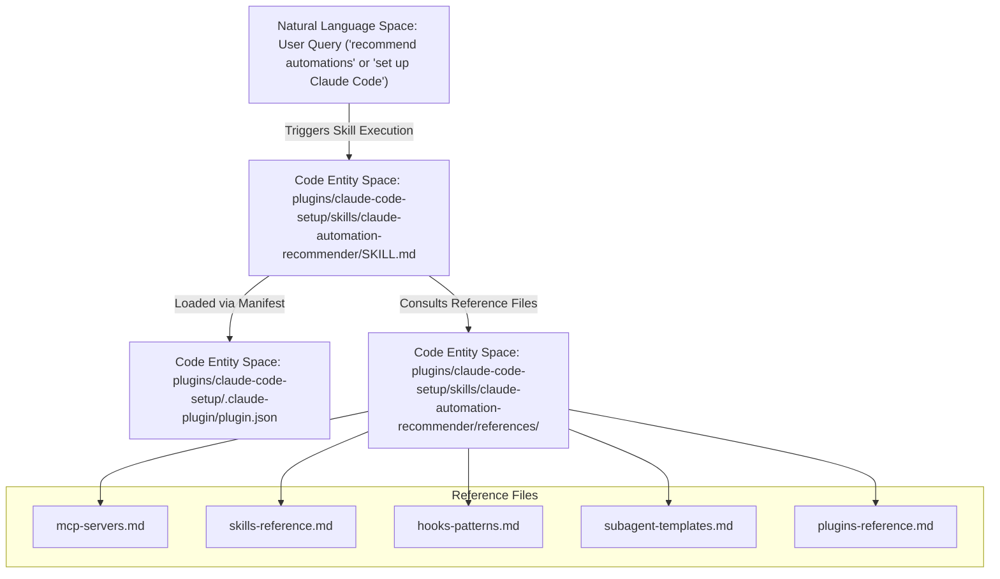
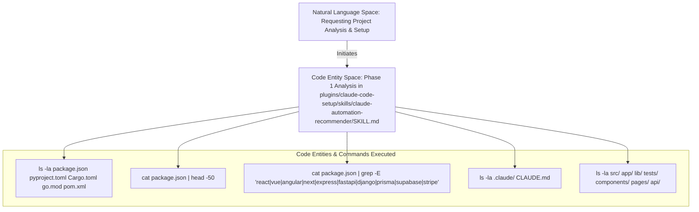

<!-- source: DeepWiki mcp.deepwiki.com · repo anthropics/claude-plugins-official · extra page claude-code-setup · fetched 2026-10-26 -->

# claude-code-setup

<details>
<summary>Relevant source files</summary>

The following files were used as context for generating this wiki page:

- [plugins/claude-code-setup/.claude-plugin/plugin.json](plugins/claude-code-setup/.claude-plugin/plugin.json)
- [plugins/claude-code-setup/README.md](plugins/claude-code-setup/README.md)
- [plugins/claude-code-setup/automation-recommender-example.png](plugins/claude-code-setup/automation-recommender-example.png)
- [plugins/claude-code-setup/skills/claude-automation-recommender/SKILL.md](plugins/claude-code-setup/skills/claude-automation-recommender/SKILL.md)
- [plugins/claude-code-setup/skills/claude-automation-recommender/references/hooks-patterns.md](plugins/claude-code-setup/skills/claude-automation-recommender/references/hooks-patterns.md)
- [plugins/claude-code-setup/skills/claude-automation-recommender/references/mcp-servers.md](plugins/claude-code-setup/skills/claude-automation-recommender/references/mcp-servers.md)
- [plugins/claude-code-setup/skills/claude-automation-recommender/references/plugins-reference.md](plugins/claude-code-setup/skills/claude-automation-recommender/references/plugins-reference.md)
- [plugins/claude-code-setup/skills/claude-automation-recommender/references/skills-reference.md](plugins/claude-code-setup/skills/claude-automation-recommender/references/skills-reference.md)
- [plugins/claude-code-setup/skills/claude-automation-recommender/references/subagent-templates.md](plugins/claude-code-setup/skills/claude-automation-recommender/references/subagent-templates.md)
- [plugins/claude-md-management/.claude-plugin/plugin.json](plugins/claude-md-management/.claude-plugin/plugin.json)

</details>


## Purpose and Scope

The `claude-code-setup` plugin analyzes codebases and recommends Claude Code automations [plugins/claude-code-setup/.claude-plugin/plugin.json:1-9](). It examines project structure, dependencies, and configuration files to suggest MCP servers, skills, hooks, subagents, and plugins tailored to the detected technology stack [plugins/claude-code-setup/skills/claude-automation-recommender/SKILL.md:1-10]().

This plugin consists of a single skill: `claude-automation-recommender`, which performs read-only analysis using `Read`, `Glob`, `Grep`, and `Bash` tools to detect patterns and generate recommendations without modifying any project files [plugins/claude-code-setup/skills/claude-automation-recommender/SKILL.md:1-11]().

Sources: [plugins/claude-code-setup/.claude-plugin/plugin.json:1-9](), [plugins/claude-code-setup/skills/claude-automation-recommender/SKILL.md:1-11]()

---

## Plugin Structure

The `claude-code-setup` plugin is structured as a single-skill plugin containing the `claude-automation-recommender` skill [plugins/claude-code-setup/.claude-plugin/plugin.json:1-9]().

### Plugin Manifest

The plugin manifest defines basic metadata:

| Field | Value |
|-------|-------|
| `name` | `claude-code-setup` |
| `description` | Analyze codebases and recommend tailored Claude Code automations such as hooks, skills, MCP servers, and subagents |
| `version` | `1.0.0` |
| `author.name` | Anthropic |
| `author.email` | support@anthropic.com |

Sources: [plugins/claude-code-setup/.claude-plugin/plugin.json:1-9]()

### Directory Organization

```
plugins/claude-code-setup/
├── .claude-plugin/
│   └── plugin.json                                          # Manifest
├── skills/
│   └── claude-automation-recommender/
│       ├── SKILL.md                                        # Skill definition
│       └── references/
│           ├── mcp-servers.md                              # MCP integrations
│           ├── skills-reference.md                         # Skill patterns
│           ├── hooks-patterns.md                           # Hook configs
│           ├── subagent-templates.md                       # Agent templates
│           └── plugins-reference.md                        # Plugin catalog
├── automation-recommender-example.png                      # Documentation image
└── README.md
```

Sources: [plugins/claude-code-setup/skills/claude-automation-recommender/SKILL.md:1-289](), [plugins/claude-code-setup/README.md:1-29]()

---

## The claude-automation-recommender Skill

### Skill Configuration

The skill is defined in `SKILL.md` with frontmatter configuration [plugins/claude-code-setup/skills/claude-automation-recommender/SKILL.md:1-5]().

| Field | Value | Purpose |
|-------|-------|---------|
| `name` | `claude-automation-recommender` | Skill identifier |
| `description` | Analyze a codebase and recommend Claude Code automations... | Triggers invocation on relevant user queries |
| `tools` | `Read`, `Glob`, `Grep`, `Bash` | Read-only analysis tools |

The skill is **read-only by design** — it performs analysis and generates recommendations but does not create or modify any files [plugins/claude-code-setup/skills/claude-automation-recommender/SKILL.md:11-11]().

Sources: [plugins/claude-code-setup/skills/claude-automation-recommender/SKILL.md:1-11]()

### Invocation Patterns and Code Entity Bridging

The skill is invoked when users ask for automation recommendations, Claude Code setup optimization, workflow improvements, or initial project setups [plugins/claude-code-setup/skills/claude-automation-recommender/SKILL.md:3-3]().


*Diagram: Bridging Natural Language User Intent to Concrete Skill and Reference File Code Entities.*

Sources: [plugins/claude-code-setup/skills/claude-automation-recommender/SKILL.md:1-10](), [plugins/claude-code-setup/.claude-plugin/plugin.json:1-9]()

### Output Guidelines

The skill follows specific output constraints defined in `SKILL.md`: [plugins/claude-code-setup/skills/claude-automation-recommender/SKILL.md:13-18]().

| Guideline | Specification |
|-----------|---------------|
| Default recommendations | 1-2 items per category (MCP, Skills, Hooks, Subagents, Plugins) |
| Focused requests | 3-5 recommendations when user asks for specific type |
| Beyond references | Uses web search for project-specific tools and frameworks |
| Extensibility prompt | Ends with invitation to request more recommendations |

Sources: [plugins/claude-code-setup/skills/claude-automation-recommender/SKILL.md:13-18]()

---

## Analysis Workflow

The skill implements a three-phase workflow: Analysis, Recommendation Generation, and Output Formatting [plugins/claude-code-setup/skills/claude-automation-recommender/SKILL.md:30-151]().

### Phase 1: Codebase Analysis and Command Mapping


*Diagram: Bridging Natural Language Analysis Intent to Execution Commands within SKILL.md.*

Sources: [plugins/claude-code-setup/skills/claude-automation-recommender/SKILL.md:32-49]()

### Key Indicators Table

The analysis phase captures specific indicators that inform recommendations [plugins/claude-code-setup/skills/claude-automation-recommender/SKILL.md:51-63]().

| Category | Detected Signals | Informs Recommendations For |
|----------|------------------|----------------------------|
| Language/Framework | `package.json`, `pyproject.toml`, import patterns | Hooks, MCP servers |
| Frontend stack | React, Vue, Angular, Next.js | Playwright MCP, frontend skills |
| Backend stack | Express, FastAPI, Django | API documentation tools |
| Database | Prisma, Supabase, raw SQL | Database MCP servers |
| External APIs | Stripe, OpenAI, AWS SDKs | context7 MCP for docs |
| Testing | Jest, pytest, Playwright configs | Testing hooks, subagents |
| CI/CD | GitHub Actions, CircleCI | GitHub MCP server |
| Issue tracking | Linear, Jira references | Issue tracker MCP |
| Docs patterns | OpenAPI, JSDoc, docstrings | Documentation skills |

Sources: [plugins/claude-code-setup/skills/claude-automation-recommender/SKILL.md:51-63]()

---

## Recommendation Engine

### Phase 2: Generate Recommendations

The recommendation engine maps detected codebase signals to specific automation types using pattern matching against reference documents [plugins/claude-code-setup/skills/claude-automation-recommender/SKILL.md:65-151]().

Sources: [plugins/claude-code-setup/skills/claude-automation-recommender/SKILL.md:65-151]()

### A. MCP Server Recommendations

Signal-to-recommendation mapping for MCP servers [plugins/claude-code-setup/skills/claude-automation-recommender/SKILL.md:69-85]().

| Codebase Signal | Recommended MCP Server | Purpose |
|-----------------|------------------------|---------|
| Uses popular libraries (React, Express, etc.) | **context7** | Live documentation lookup |
| Frontend with UI testing needs | **Playwright** | Browser automation/testing |
| Uses Supabase | **Supabase MCP** | Direct database operations |
| PostgreSQL/MySQL database | **Database MCP** | Query and schema tools |
| GitHub repository | **GitHub MCP** | Issues, PRs, actions |
| Uses Linear for issues | **Linear MCP** | Issue management |
| AWS infrastructure | **AWS MCP** | Cloud resource management |
| Slack workspace | **Slack MCP** | Team notifications |
| Memory/context persistence | **Memory MCP** | Cross-session memory |
| Sentry error tracking | **Sentry MCP** | Error investigation |
| Docker containers | **Docker MCP** | Container management |

Sources: [plugins/claude-code-setup/skills/claude-automation-recommender/SKILL.md:69-85](), [plugins/claude-code-setup/skills/claude-automation-recommender/references/mcp-servers.md:1-243]()

### B. Skills Recommendations

The skill distinguishes between plugin-bundled skills and custom skills to create [plugins/claude-code-setup/skills/claude-automation-recommender/SKILL.md:87-112]().

#### Plugin-Bundled Skills

| Codebase Signal | Skill | Plugin |
|-----------------|-------|--------|
| Building plugins | `skill-development` | `plugin-dev` |
| Git commits | `commit` | `commit-commands` |
| React/Vue/Angular | `frontend-design` | `frontend-design` |
| Automation rules | `writing-rules` | `hookify` |
| Feature planning | `feature-dev` | `feature-dev` |

#### Custom Skills to Create

| Codebase Signal | Skill to Create | Invocation | Contents |
|-----------------|-----------------|------------|----------|
| API routes | `api-doc` | Both | OpenAPI template |
| Database project | `create-migration` | User-only | Validation script |
| Test suite | `gen-test` | User-only | Example tests |
| Component library | `new-component` | User-only | Component templates |
| PR workflow | `pr-check` | User-only | Checklist |
| Releases | `release-notes` | User-only | Git context |
| Code style | `project-conventions` | Claude-only | Style guide |
| Onboarding | `setup-dev` | User-only | Prerequisite script |

**Invocation control settings:**
- `disable-model-invocation: true` → User-only (for side effects: deploy, commit, send) [plugins/claude-code-setup/skills/claude-automation-recommender/SKILL.md:232-232]().
- `user-invocable: false` → Claude-only (for background knowledge) [plugins/claude-code-setup/skills/claude-automation-recommender/SKILL.md:233-233]().
- Default (omit both) → Both can invoke.

Sources: [plugins/claude-code-setup/skills/claude-automation-recommender/SKILL.md:87-112](), [plugins/claude-code-setup/skills/claude-automation-recommender/SKILL.md:232-235]()

### C. Hooks Recommendations

Signal-to-hook mapping based on project configuration [plugins/claude-code-setup/skills/claude-automation-recommender/SKILL.md:114-126]().

| Codebase Signal | Recommended Hook | Event Type |
|-----------------|------------------|------------|
| Prettier configured | Auto-format on edit | PostToolUse |
| ESLint/Ruff configured | Auto-lint on edit | PostToolUse |
| TypeScript project | Type-check on edit | PostToolUse |
| Tests directory exists | Run related tests | PostToolUse |
| `.env` files present | Block `.env` edits | PreToolUse |
| Lock files present | Block lock file edits | PreToolUse |
| Security-sensitive code | Require confirmation | PreToolUse |

Sources: [plugins/claude-code-setup/skills/claude-automation-recommender/SKILL.md:114-126](), [plugins/claude-code-setup/skills/claude-automation-recommender/references/hooks-patterns.md:1-226]()

### D. Subagent Recommendations

Signal-to-subagent mapping for parallel specialized review [plugins/claude-code-setup/skills/claude-automation-recommender/SKILL.md:128-139]().

| Codebase Signal | Recommended Subagent | Purpose |
|-----------------|---------------------|---------|
| Large codebase (>500 files) | `code-reviewer` | Parallel code review |
| Auth/payments code | `security-reviewer` | Security audits |
| API project | `api-documenter` | OpenAPI generation |
| Performance critical | `performance-analyzer` | Bottleneck detection |
| Frontend heavy | `ui-reviewer` | Accessibility review |
| Needs more tests | `test-writer` | Test generation |

Sources: [plugins/claude-code-setup/skills/claude-automation-recommender/SKILL.md:128-139]()

---

## Output Format

### Phase 3: Recommendations Report

The skill generates a structured markdown report covering codebase profile, MCP servers, skills, hooks, and subagents [plugins/claude-code-setup/skills/claude-automation-recommender/SKILL.md:152-212]().

Sources: [plugins/claude-code-setup/skills/claude-automation-recommender/SKILL.md:152-212]()

---

## Decision Framework

The skill applies conditional logic to determine when each automation type is most appropriate [plugins/claude-code-setup/skills/claude-automation-recommender/SKILL.md:214-250]().

- **MCP Servers**: Recommend for external service integration, documentation lookups, browser automation, and cloud management [plugins/claude-code-setup/skills/claude-automation-recommender/SKILL.md:215-221]().
- **Skills**: Recommend for repeated workflows, project-specific tasks with arguments, and template application [plugins/claude-code-setup/skills/claude-automation-recommender/SKILL.md:223-230]().
- **Hooks**: Recommend for repetitive post-edit actions (formatting, linting) and protection rules [plugins/claude-code-setup/skills/claude-automation-recommender/SKILL.md:237-240]().
- **Subagents**: Recommend for specialized expertise (security, performance) and parallel review workflows [plugins/claude-code-setup/skills/claude-automation-recommender/SKILL.md:242-245]().
- **Plugins**: Recommend for bundles of related skills or team-wide standardization [plugins/claude-code-setup/skills/claude-automation-recommender/SKILL.md:247-250]().

Sources: [plugins/claude-code-setup/skills/claude-automation-recommender/SKILL.md:214-250]()

---

## Configuration Tips

The skill provides guidance on configuring recommended automations [plugins/claude-code-setup/skills/claude-automation-recommender/SKILL.md:252-288]().

### MCP Server Setup

- **Team sharing**: Check `.mcp.json` into the repository so the entire team gets the same servers [plugins/claude-code-setup/skills/claude-automation-recommender/SKILL.md:258-259]().
- **Debugging**: Use `claude --mcp-debug` to identify configuration issues [plugins/claude-code-setup/skills/claude-automation-recommender/SKILL.md:261-261]().

Sources: [plugins/claude-code-setup/skills/claude-automation-recommender/SKILL.md:252-261](), [plugins/claude-code-setup/skills/claude-automation-recommender/references/mcp-servers.md:7-16]()

---

