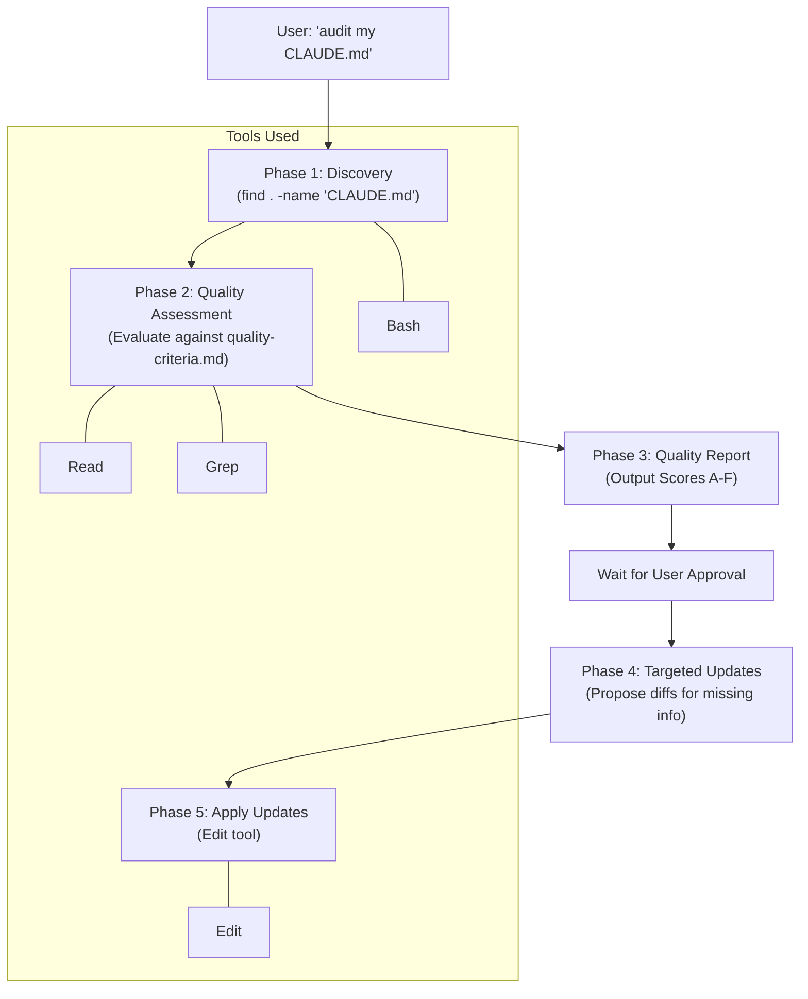
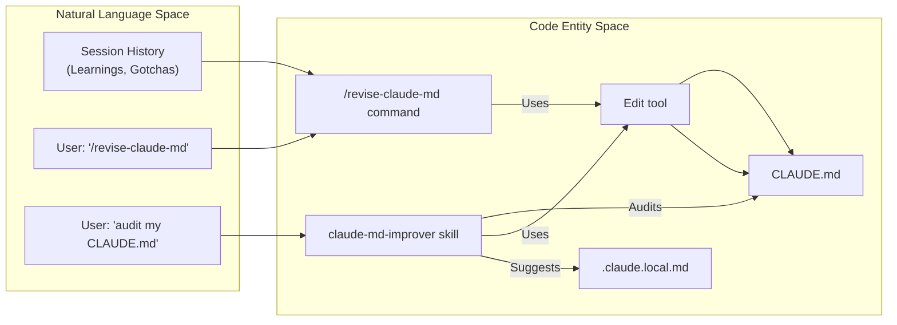

<!-- source: DeepWiki mcp.deepwiki.com · repo anthropics/claude-plugins-official · extra page claude-md-management · fetched 2026-10-26 -->

# claude-md-management

Relevant source files

The following files were used as context for generating this wiki page:

- [plugins/claude-md-management/README.md](plugins/claude-md-management/README.md)
- [plugins/claude-md-management/skills/claude-md-improver/SKILL.md](plugins/claude-md-management/skills/claude-md-improver/SKILL.md)

## Purpose and Scope

The `claude-md-management` plugin provides specialized tools for maintaining and improving `CLAUDE.md` files within a project. These files serve as project memory and context repositories for Claude Code, containing information about the project's architecture, conventions, and development guidelines [plugins/claude-md-management/README.md:1-3](). The plugin offers two primary workflows: auditing `CLAUDE.md` quality via the `claude-md-improver` skill and capturing session learnings via the `/revise-claude-md` command [plugins/claude-md-management/README.md:7-13]().

Sources: [plugins/claude-md-management/README.md:1-13](), [plugins/claude-md-management/skills/claude-md-improver/SKILL.md:1-5]()

## Core Components

The plugin is composed of two complementary tools designed for different stages of the development lifecycle.

| Component | Type | Purpose | Trigger |
|-----------|------|---------|---------|
| `claude-md-improver` | Skill | Keep `CLAUDE.md` aligned with codebase | Codebase changes / Periodic maintenance |
| `/revise-claude-md` | Command | Capture session learnings | End of session / Missing context revealed |

Sources: [plugins/claude-md-management/README.md:9-13]()

### The `claude-md-improver` Skill

The `claude-md-improver` skill implements a structured multi-phase workflow to audit and update project documentation [plugins/claude-md-management/skills/claude-md-improver/SKILL.md:13-139](). It is triggered by natural language requests such as "audit my CLAUDE.md files" or "check if my CLAUDE.md is up to date" [plugins/claude-md-management/README.md:21-24]().

#### Title: "Claude MD Improver Workflow (Skill Space to Code Space)"

Sources: [plugins/claude-md-management/skills/claude-md-improver/SKILL.md:1-21](), [plugins/claude-md-management/skills/claude-md-improver/SKILL.md:95-139]()

#### Discovery and File Types
The skill searches for multiple variations of configuration files, acknowledging that Claude auto-discovers these in parent directories for monorepo support [plugins/claude-md-management/skills/claude-md-improver/SKILL.md:17-33]().

| File Type | Location | Purpose |
|-----------|----------|---------|
| Project root | `./CLAUDE.md` | Primary project context (shared in git) |
| Local overrides | `./.claude.local.md` | Personal/local settings (gitignored) |
| Global defaults | `~/.claude/CLAUDE.md` | User-wide defaults |
| Package-specific | `./packages/*/CLAUDE.md` | Module-level context in monorepos |

Sources: [plugins/claude-md-management/skills/claude-md-improver/SKILL.md:20-33]()

#### Quality Assessment Rubric
The skill evaluates files against a weighted checklist to generate a numeric score (0-100) and a letter grade (A-F) [plugins/claude-md-management/skills/claude-md-improver/SKILL.md:39-56]().

| Criterion | Weight | Check |
|-----------|--------|-------|
| Commands/workflows | High | Are build/test/deploy commands present? |
| Architecture clarity | High | Is the codebase structure understandable? |
| Non-obvious patterns | Medium | Are gotchas and quirks documented? |
| Currency | High | Does it reflect current codebase state? |
| Actionability | High | Are instructions executable? |

Sources: [plugins/claude-md-management/skills/claude-md-improver/SKILL.md:39-56]()

### The `/revise-claude-md` Command

While the skill focuses on alignment with the static codebase, the `/revise-claude-md` command focuses on the dynamic session history [plugins/claude-md-management/README.md:9-13](). It captures learnings—such as a specific build flag that was discovered or a naming convention that Claude was corrected on—and persists them into the `CLAUDE.md` file to prevent the same issues in future sessions [plugins/claude-md-management/README.md:7-13]().

Sources: [plugins/claude-md-management/README.md:7-36]()

## Data Flow: From Session to Project Memory

#### Title: "Project Memory Persistence Loop"

Sources: [plugins/claude-md-management/README.md:7-13](), [plugins/claude-md-management/skills/claude-md-improver/SKILL.md:153-161](), [plugins/claude-md-management/skills/claude-md-improver/SKILL.md:4-5]()

## Implementation Details

### Common Issues Flagged
The plugin specifically looks for these common documentation failures:
1. **Stale commands**: Build commands that no longer work [plugins/claude-md-management/skills/claude-md-improver/SKILL.md:146]().
2. **Missing dependencies**: Required tools not mentioned in setup [plugins/claude-md-management/skills/claude-md-improver/SKILL.md:147]().
3. **Outdated architecture**: Documentation reflecting a previous file structure [plugins/claude-md-management/skills/claude-md-improver/SKILL.md:148]().
4. **Broken test commands**: Test scripts that have changed [plugins/claude-md-management/skills/claude-md-improver/SKILL.md:150]().
5. **Undocumented gotchas**: Non-obvious patterns that caused friction during the session [plugins/claude-md-management/skills/claude-md-improver/SKILL.md:151]().

Sources: [plugins/claude-md-management/skills/claude-md-improver/SKILL.md:144-152]()

### Update Guidelines
The skill is instructed to follow strict guidelines when proposing updates:
- **Targeted additions only**: Focus on genuinely useful info discovered during analysis [plugins/claude-md-management/skills/claude-md-improver/SKILL.md:101-106]().
- **Keep it minimal**: Avoid restating what is obvious from the code or generic best practices [plugins/claude-md-management/skills/claude-md-improver/SKILL.md:108-112]().
- **Show diffs**: Present changes in a clear `+` / `-` format before applying [plugins/claude-md-management/skills/claude-md-improver/SKILL.md:114-134]().
- **Preserve structure**: Maintain the existing formatting and sections of the file [plugins/claude-md-management/skills/claude-md-improver/SKILL.md:138]().

Sources: [plugins/claude-md-management/skills/claude-md-improver/SKILL.md:99-138]()

## Integration with Development Workflow

The `claude-md-management` plugin serves as the maintenance layer of the Claude Code ecosystem. It bridges the gap between the initial setup and ongoing development tasks.

- **`#` key shortcut**: Users are reminded that during a session, they can press `#` to have Claude auto-incorporate learnings [plugins/claude-md-management/skills/claude-md-improver/SKILL.md:157]().
- **Global vs Local**: The plugin encourages using `.claude.local.md` for personal preferences and `~/.claude/CLAUDE.md` for user-wide defaults, ensuring the main `CLAUDE.md` remains focused on team-wide project context [plugins/claude-md-management/skills/claude-md-improver/SKILL.md:160-161]().

Sources: [plugins/claude-md-management/skills/claude-md-improver/SKILL.md:153-161]()

---

