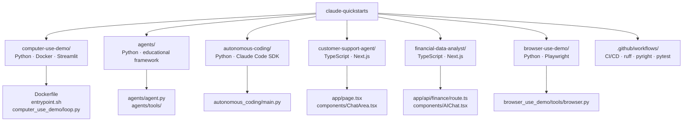
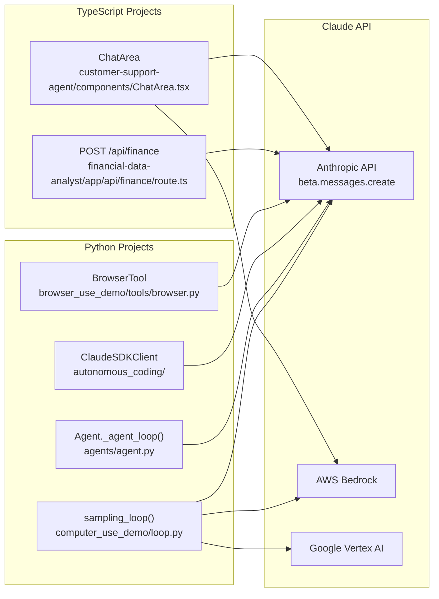

<!-- source: DeepWiki mcp.deepwiki.com · repo anthropics/claude-quickstarts · page 1 Overview · fetched 2026-10-26 -->

# Overview

<details>
<summary>Relevant source files</summary>

The following files were used as context for generating this wiki page:

- [.github/workflows/tests.yaml](.github/workflows/tests.yaml)
- [CLAUDE.md](CLAUDE.md)
- [README.md](README.md)
- [agents/README.md](agents/README.md)
- [customer-support-agent/README.md](customer-support-agent/README.md)
- [financial-data-analyst/README.md](financial-data-analyst/README.md)
- [financial-data-analyst/app/api/finance/route.ts](financial-data-analyst/app/api/finance/route.ts)

</details>


This page introduces the `claude-quickstarts` repository, summarizes each project it contains, and describes the tech stacks and entry points for getting started. For deeper documentation of any individual project, follow the links in each section below.

---

## Repository Purpose

`claude-quickstarts` ([README.md:1-3]()) is a collection of self-contained reference implementations demonstrating how to build applications with the Claude API. Each project is independently runnable and is intended as a starting point for customization.

A Claude API key is required for all projects. Keys can be obtained at `console.anthropic.com`.

Sources: [README.md:1-8]()

---

## Projects at a Glance

| Directory | Language / Framework | Primary Focus |
|---|---|---|
| `computer-use-demo/` | Python, Streamlit, Docker | Desktop automation via Claude computer use tools |
| `customer-support-agent/` | TypeScript, Next.js | RAG-backed chat with Amazon Bedrock knowledge bases |
| `financial-data-analyst/` | TypeScript, Next.js | File upload + chart generation via Claude tool use |
| `autonomous-coding/` | Python, Claude Code SDK | Two-agent autonomous code generation |
| `browser-use-demo/` | Python, Playwright | Browser automation via Claude browser tools |
| `agents/` | Python | Minimal educational agent framework |

Sources: [README.md:9-40](), [CLAUDE.md:1-63]()

---

## Repository Structure

**Repository layout diagram**



Sources: [README.md:9-40](), [CLAUDE.md:1-63]()

---

## Project Summaries

### Computer Use Demo

The most fully featured project in the repository. Claude controls a real Linux desktop inside a Docker container using three tool types: `BashTool`, `ComputerTool`, and `EditTool`. The agent loop is implemented in `computer_use_demo/loop.py` as the `sampling_loop()` function. A Streamlit web UI on port `:8501` and a noVNC viewer on port `:6080` provide the user interface. Port `:8080` serves a combined landing page.

Supports three API providers: Anthropic direct, AWS Bedrock, and Google Vertex AI.

For full documentation, see the Computer Use Demo section (page [2]()).

**Quick start:**
```bash
docker run -e ANTHROPIC_API_KEY=$ANTHROPIC_API_KEY \
  -p 5900:5900 -p 8501:8501 -p 6080:6080 -p 8080:8080 \
  ghcr.io/anthropics/anthropic-quickstarts:computer-use-demo-latest
```

Sources: [README.md:23-27](), [CLAUDE.md:9-16]()

---

### Customer Support Agent

A Next.js chat application backed by Amazon Bedrock knowledge bases for retrieval-augmented generation (RAG). The core component is `ChatArea.tsx`. The application supports configurable sidebar layouts via npm scripts (`dev:full`, `dev:left`, `dev:right`, `dev:chat`) and can be deployed to AWS Amplify.

Required environment variables: `ANTHROPIC_API_KEY`, `BAWS_ACCESS_KEY_ID`, `BAWS_SECRET_ACCESS_KEY`.

For full documentation, see [3.1]().

**Quick start:**
```bash
cd customer-support-agent
npm install
npm run dev
```

Sources: [customer-support-agent/README.md:1-22](), [CLAUDE.md:31-40]()

---

### Financial Data Analyst

A Next.js application that accepts file uploads (images, PDFs, text/CSV) and uses Claude's tool use to generate interactive charts via Recharts. The backend API route is at `financial-data-analyst/app/api/finance/route.ts`. Claude calls the `generate_graph_data` tool ([financial-data-analyst/app/api/finance/route.ts:37-101]()) to produce structured chart data, which the frontend renders using Recharts.

Supported chart types: `bar`, `multiBar`, `line`, `pie`, `area`, `stackedArea`.

For full documentation, see [3.2]().

**Quick start:**
```bash
cd financial-data-analyst
npm install
npm run dev
```

Sources: [financial-data-analyst/README.md:1-52](), [financial-data-analyst/app/api/finance/route.ts:37-101]()

---

### Autonomous Coding Agent

A Python project demonstrating a two-agent pattern using the Claude Code SDK. An **Initializer** agent and a **Coding Agent** collaborate to build applications incrementally across multiple sessions. Progress is persisted via git and a `feature_list.json` file. The `ClaudeSDKClient` applies security sandboxing and filesystem restrictions.

For full documentation, see [3.3]().

**Quick start:**
```bash
cd autonomous-coding
pip install -r requirements.txt
python main.py
```

Sources: [README.md:37-39]()

---

### Browser Use Demo

A Python project providing a `BrowserTool` class built on Playwright for browser automation. Claude navigates web pages, interacts with DOM elements, fills forms, and reads page content. A `CoordinateScaler` adapts between logical and physical coordinates.

For full documentation, see [3.4]().

Sources: [README.md:29-33]()

---

### Agents Framework

A minimal, educational Python package (`agents/`) that demonstrates how to implement an LLM agent from scratch using the Claude API. The core logic is under 300 lines. It is **not** an SDK — it is a reference implementation. Key components are `agent.py` (the `Agent` class), `tools/` (local and MCP tool implementations), and `utils/` (message history and MCP connection utilities).

For full documentation, see [4]().

**Quick start:**
```python
from agents.agent import Agent
from agents.tools.think import ThinkTool

agent = Agent(name="MyAgent", system="You are a helpful assistant.", tools=[ThinkTool()])
response = agent.run("What should I consider when buying a new laptop?")
```

Sources: [agents/README.md:1-44]()

---

## How Claude API Integrations Work Across Projects

**API integration patterns diagram**



Sources: [README.md:1-70](), [CLAUDE.md:1-63](), [financial-data-analyst/app/api/finance/route.ts:1-15]()

---

## General Setup Pattern

All projects follow the same general setup steps ([README.md:41-49]()):

1. Clone the repository: `git clone https://github.com/anthropics/claude-quickstarts`
2. Navigate to the project directory: `cd <project-name>`
3. Install dependencies (either `pip install -r requirements.txt` or `npm install`)
4. Set the `ANTHROPIC_API_KEY` environment variable (plus any provider-specific keys)
5. Run the application

---

## CI/CD

The repository includes a GitHub Actions workflow at `.github/workflows/tests.yaml` that runs on pull requests and pushes to `main`. It targets the `computer-use-demo/` directory and runs three jobs: `ruff` (linting), `pyright` (type checking), and `pytest` (unit tests). For more details, see [5]().

Sources: [.github/workflows/tests.yaml:1-59]()

---

## Further Reading

| Resource | Description |
|---|---|
| Claude API Documentation | `docs.claude.com` |
| Claude Cookbooks | `github.com/anthropics/claude-cookbooks` |
| Claude API Fundamentals Course | `github.com/anthropics/courses` |
| Anthropic Discord | `anthropic.com/discord` |

Sources: [README.md:51-66]()

---

