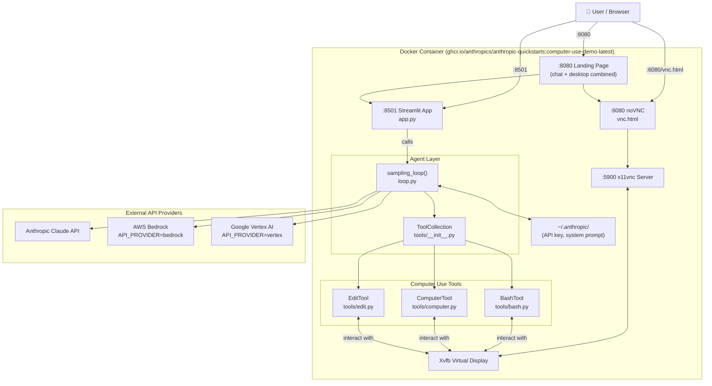
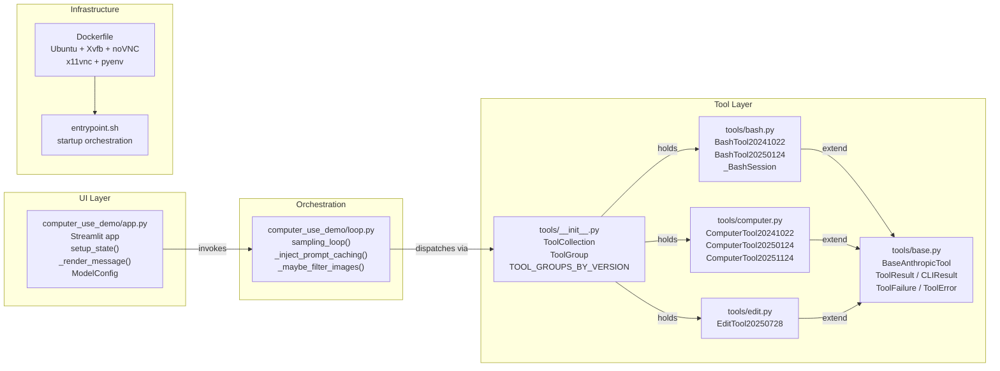

<!-- source: DeepWiki mcp.deepwiki.com · repo anthropics/claude-quickstarts · page 2 Computer Use Demo · fetched 2026-10-26 -->

# Computer Use Demo

<details>
<summary>Relevant source files</summary>

The following files were used as context for generating this wiki page:

- [computer-use-demo/README.md](computer-use-demo/README.md)

</details>


This page introduces the Computer Use Demo quickstart: what it demonstrates, which Claude models it supports, which API providers it works with, and a top-level summary of the system. For deeper technical detail, see the child pages: [Architecture Overview](#2.1), [Sampling Loop & Agent Orchestration](#2.2), [Streamlit User Interface](#2.3), [Tool System](#2.4), [Docker Environment & Deployment](#2.5), and [Setup & Configuration](#2.6).

---

## Purpose

The Computer Use Demo is a reference implementation showing how to give Claude control of a real desktop environment — mouse, keyboard, screenshots, shell, and files — through Anthropic's **computer use** beta API. It bundles a full Linux desktop inside a Docker container and exposes a Streamlit chat interface so users can issue natural language instructions that Claude carries out by operating the desktop directly.

> **Beta notice:** Computer use is a beta feature. The API and tool definitions are subject to change. See [computer-use-demo/README.md:27-28]() for the relevant caution.

---

## What the Demo Provides

| Component | Description |
|---|---|
| Docker container | Self-contained Ubuntu environment with a virtual X display, VNC server, noVNC proxy, and all Python dependencies |
| Agent loop | `sampling_loop()` in `computer-use-demo/computer_use_demo/loop.py` — drives the conversation with the API and dispatches tool calls |
| Computer use tools | `BashTool`, `ComputerTool`, `EditTool` — versioned implementations that map Claude's tool calls to real system actions |
| Streamlit UI | A chat interface for user input, message rendering, and real-time tool output display |
| Landing page | A combined view at port 8080 embedding both the chat and the live desktop |

Sources: [computer-use-demo/README.md:18-23]()

---

## Supported Models

The demo supports the following Claude models across providers:

| Model | Identifier |
|---|---|
| Claude Opus 4.5 | `claude-opus-4-5-20251101` |
| Claude Opus 4 | `claude-opus-4-20250514` |
| Claude Sonnet 4.5 | `claude-sonnet-4-5-20250929` |
| Claude Sonnet 4 | `claude-sonnet-4-20250514` |
| Claude Haiku 4.5 | `claude-haiku-4-5-20251001` |
| Claude 3.7 Sonnet | `claude-sonnet-3-7-...` |
| Claude 3.5 Sonnet | `claude-sonnet-3-5-...` |

Sources: [computer-use-demo/README.md:4-4](), [computer-use-demo/README.md:21-21]()

---

## Supported API Providers

Three API providers are supported, selected via the `API_PROVIDER` environment variable:

| Provider | `API_PROVIDER` value | Credentials required |
|---|---|---|
| Anthropic (default) | _(unset)_ | `ANTHROPIC_API_KEY` |
| AWS Bedrock | `bedrock` | AWS credentials (profile or access key) |
| Google Vertex AI | `vertex` | GCP Application Default Credentials |

Sources: [computer-use-demo/README.md:35-127]()

---

## System Overview

The entire demo runs inside a single Docker container. The agent loop executes inside the same container that Claude is controlling, which means the tools have direct access to the virtual desktop's processes, filesystem, and display.

**Runtime architecture diagram:**



Sources: [computer-use-demo/README.md:129-139]()

---

## Key Design Constraints

- **Single session:** The agent loop and tools run inside the container under control. Only one session can use the loop at a time. Restarting the container resets state between sessions. [computer-use-demo/README.md:31-31]()
- **Weakly separated components:** The Streamlit UI, agent loop, and desktop environment are all colocated inside the container by design, for simplicity of the reference implementation.
- **Screen resolution:** The demo defaults to XGA (1024×768) for optimal model accuracy. Higher resolutions are supported via `WIDTH` and `HEIGHT` environment variables, but screenshots are scaled down before being sent to the API. [computer-use-demo/README.md:141-164]()
- **Settings persistence:** API keys and custom system prompts are stored in `~/.anthropic/` inside the container. Mount a host directory at that path to persist settings across container restarts.

---

## Quick Start

To run the demo with the Anthropic API:

```bash
export ANTHROPIC_API_KEY=<your_api_key>
docker run \
    -e ANTHROPIC_API_KEY=$ANTHROPIC_API_KEY \
    -v $HOME/.anthropic:/home/computeruse/.anthropic \
    -p 5900:5900 \
    -p 8501:8501 \
    -p 6080:6080 \
    -p 8080:8080 \
    -it ghcr.io/anthropics/anthropic-quickstarts:computer-use-demo-latest
```

Then open `http://localhost:8080` in a browser. [computer-use-demo/README.md:40-52]()

For Bedrock and Vertex setup instructions, see [Setup & Configuration](#2.6).

---

## Port Reference

| Port | Service | URL |
|---|---|---|
| `8080` | Combined landing page | `http://localhost:8080` |
| `8501` | Streamlit chat interface only | `http://localhost:8501` |
| `6080` | noVNC desktop view only | `http://localhost:6080/vnc.html` |
| `5900` | Raw VNC | `vnc://localhost:5900` |

Sources: [computer-use-demo/README.md:129-139]()

---

## Component Map

The following diagram maps the major code modules to their roles:



Sources: [computer-use-demo/README.md:18-23]()

---

