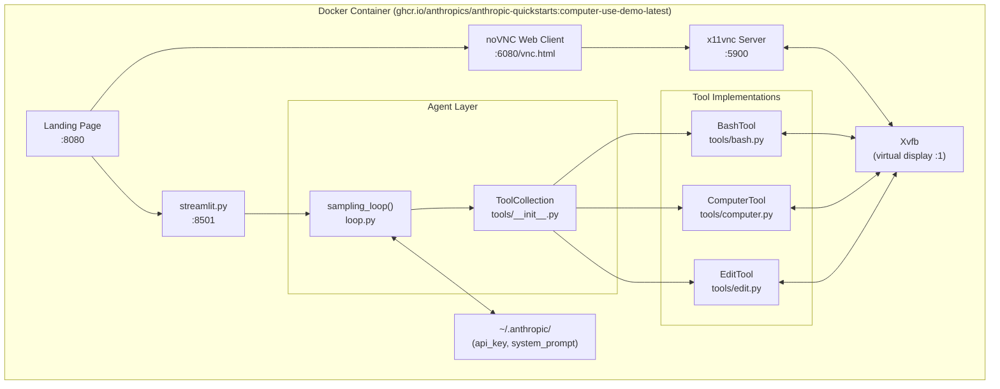
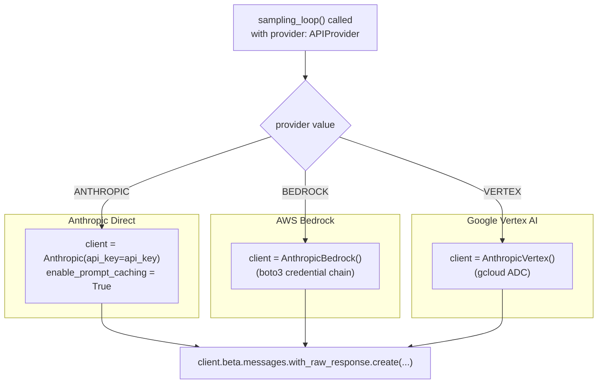
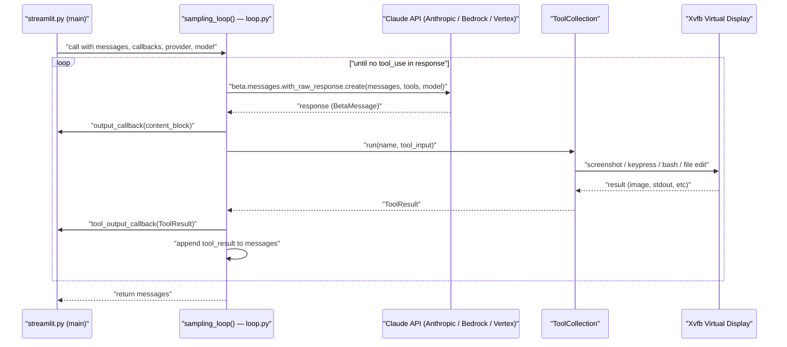

<!-- source: DeepWiki mcp.deepwiki.com · repo anthropics/claude-quickstarts · page 2.1 Architecture Overview · fetched 2026-10-26 -->

# Architecture Overview

Relevant source files

The following files were used as context for generating this wiki page:

- [computer-use-demo/.gitignore](computer-use-demo/.gitignore)
- [computer-use-demo/.zed/settings.json](computer-use-demo/.zed/settings.json)
- [computer-use-demo/Dockerfile](computer-use-demo/Dockerfile)
- [computer-use-demo/LICENSE](computer-use-demo/LICENSE)
- [computer-use-demo/README.md](computer-use-demo/README.md)
- [computer-use-demo/computer_use_demo/__init__.py](computer-use-demo/computer_use_demo/__init__.py)
- [computer-use-demo/computer_use_demo/loop.py](computer-use-demo/computer_use_demo/loop.py)
- [computer-use-demo/computer_use_demo/streamlit.py](computer-use-demo/computer_use_demo/streamlit.py)

This page describes the runtime architecture of the Computer Use Demo: how its Docker container is structured, what services run inside it, and how the agent loop connects user input, Claude models, and a live desktop environment. For details on the agent loop's internal logic, see [Sampling Loop & Agent Orchestration](#2.2). For the tool system, see [Tool System](#2.4). For Docker environment and deployment specifics, see [Docker Environment & Deployment](#2.5).

---

## System Boundaries

The entire demo runs inside a single Docker container. There is no external backend service — the Streamlit application, the VNC desktop, and the agent loop all coexist in one process space on one container. This is an intentional design: the agent controls the same machine it runs on.

> **Important constraint:** The agent loop runs in the container being controlled by Claude. Only one session is supported at a time, and the container must be restarted or reset between sessions if necessary. ([computer-use-demo/README.md:31-32]())

---

## Port Map

Four ports are exposed by the container and serve distinct purposes:

| Port | Service | Description |
|------|---------|-------------|
| `8080` | Landing page | Combined view: chat interface + desktop iframe |
| `8501` | Streamlit app | Chat interface only |
| `6080` | noVNC web client | Browser-based VNC viewer (`/vnc.html`) |
| `5900` | x11vnc server | Raw VNC protocol, for native VNC clients |

Sources: [computer-use-demo/README.md:131-139]()

---

## Container Internal Architecture

**Diagram: Services Inside the Docker Container**

Sources: [computer-use-demo/Dockerfile:1-104](), [computer-use-demo/README.md:131-139](), [computer-use-demo/computer_use_demo/loop.py:70-191]()

---

## API Provider Integration

The `sampling_loop()` function in [computer-use-demo/computer_use_demo/loop.py:70-87]() accepts a `provider` argument of type `APIProvider` (a `StrEnum` defined at [computer-use-demo/computer_use_demo/loop.py:42-45]()). The provider controls which API client is instantiated on each loop iteration:

| `APIProvider` value | Client class | Required credentials |
|--------------------|-------------|----------------------|
| `APIProvider.ANTHROPIC` | `Anthropic(api_key=api_key)` | `ANTHROPIC_API_KEY` env var |
| `APIProvider.BEDROCK` | `AnthropicBedrock()` | AWS credentials (profile, key+secret, or IAM role) |
| `APIProvider.VERTEX` | `AnthropicVertex()` | GCP application default credentials + `CLOUD_ML_REGION` |

Prompt caching is only enabled for the `ANTHROPIC` provider ([computer-use-demo/computer_use_demo/loop.py:104-106]()). Bedrock and Vertex rely on their respective SDK credential resolution chains rather than an explicit API key.

The provider is set via the `API_PROVIDER` environment variable, which `streamlit.py` reads into `st.session_state.provider` during `setup_state()` ([computer-use-demo/computer_use_demo/streamlit.py:130-132]()).

**Diagram: API Provider Selection in `sampling_loop`**

Sources: [computer-use-demo/computer_use_demo/loop.py:98-147](), [computer-use-demo/computer_use_demo/streamlit.py:34-38](), [computer-use-demo/computer_use_demo/streamlit.py:385-405]()

---

## Agent Loop and Desktop Interaction

The agent loop (`sampling_loop` in `loop.py`) sits between the Streamlit UI and the Claude API. On each iteration:

1. The current message history is sent to the Claude API.
2. Claude responds with text blocks and/or `tool_use` blocks.
3. Each `tool_use` block is dispatched to a tool in the `ToolCollection`.
4. Tools act on the virtual desktop (Xvfb) via shell commands, X11 input synthesis, or file operations.
5. Tool results are appended to the message history and the loop repeats.
6. The loop terminates when a response contains no `tool_use` blocks.

This means the agent's "eyes" (screenshots via `ComputerTool`) and "hands" (keyboard/mouse via `ComputerTool`, shell via `BashTool`) are all operating on the same virtual machine running inside the container.

**Diagram: Agent Loop Data Flow**

Sources: [computer-use-demo/computer_use_demo/loop.py:98-191](), [computer-use-demo/computer_use_demo/streamlit.py:327-351]()

---

## Key Code Entities and Their Roles

The table below maps architectural components to their concrete code locations:

| Component | File | Key symbol |
|-----------|------|-----------|
| Agent loop | `computer_use_demo/loop.py` | `sampling_loop()` |
| API provider enum | `computer_use_demo/loop.py` | `APIProvider` |
| Streamlit UI entry | `computer_use_demo/streamlit.py` | `main()` |
| Session initialization | `computer_use_demo/streamlit.py` | `setup_state()` |
| Model/tool version mapping | `computer_use_demo/streamlit.py` | `MODEL_TO_MODEL_CONF`, `ModelConfig` |
| Tool dispatcher | `computer_use_demo/tools/__init__.py` | `ToolCollection` |
| Tool versioning registry | `computer_use_demo/tools/__init__.py` | `TOOL_GROUPS_BY_VERSION` |
| Container entrypoint | `computer-use-demo/image/entrypoint.sh` | `entrypoint.sh` |
| Persistent settings | `~/.anthropic/` | `api_key`, `system_prompt` files |

Sources: [computer-use-demo/computer_use_demo/loop.py:1-50](), [computer-use-demo/computer_use_demo/streamlit.py:1-90](), [computer-use-demo/Dockerfile:94-104]()

---

## Weak Separation Constraint

The README explicitly notes that the components are "weakly separated" ([computer-use-demo/README.md:31-32]()). Concretely:

- The agent loop and the desktop it controls run in the same container.
- There is no sandbox boundary between Claude's tool execution and the Streamlit process.
- A single container handles one user session at a time.

This is suitable for a demo or development environment. For production use, the README recommends running in a dedicated VM or container with minimal privileges and restricted network access ([computer-use-demo/README.md:7-16]()).

---

