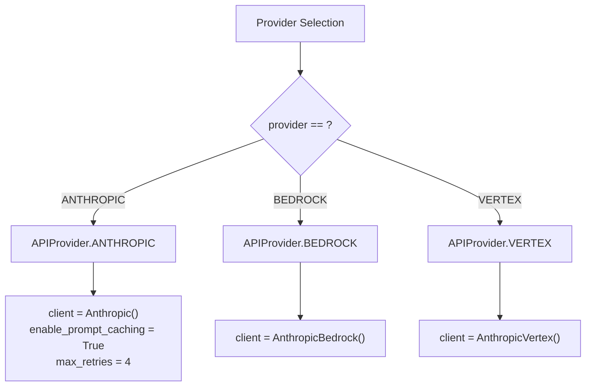
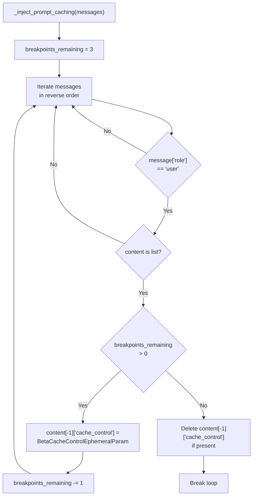
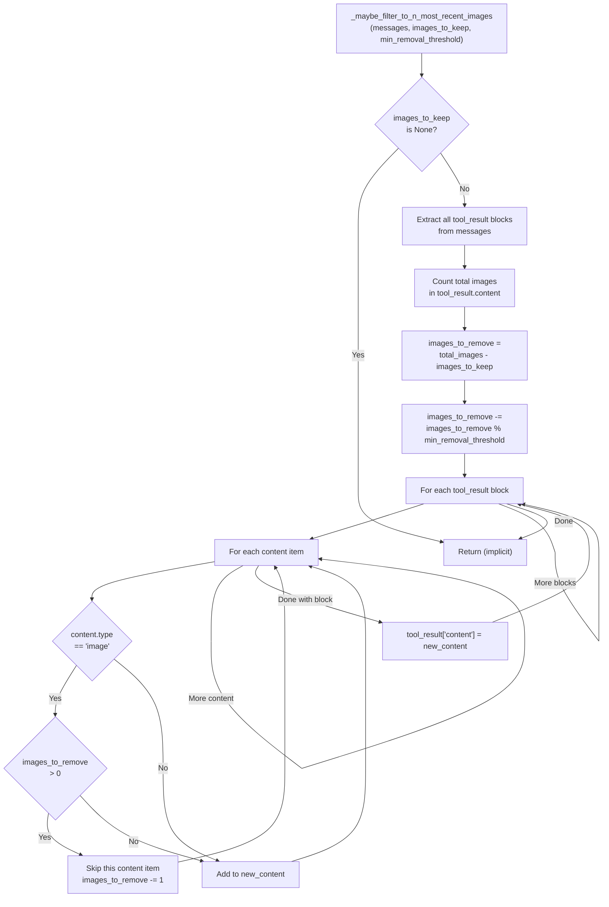
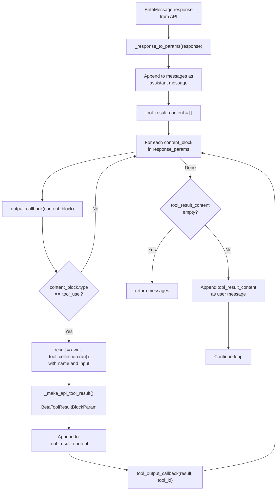
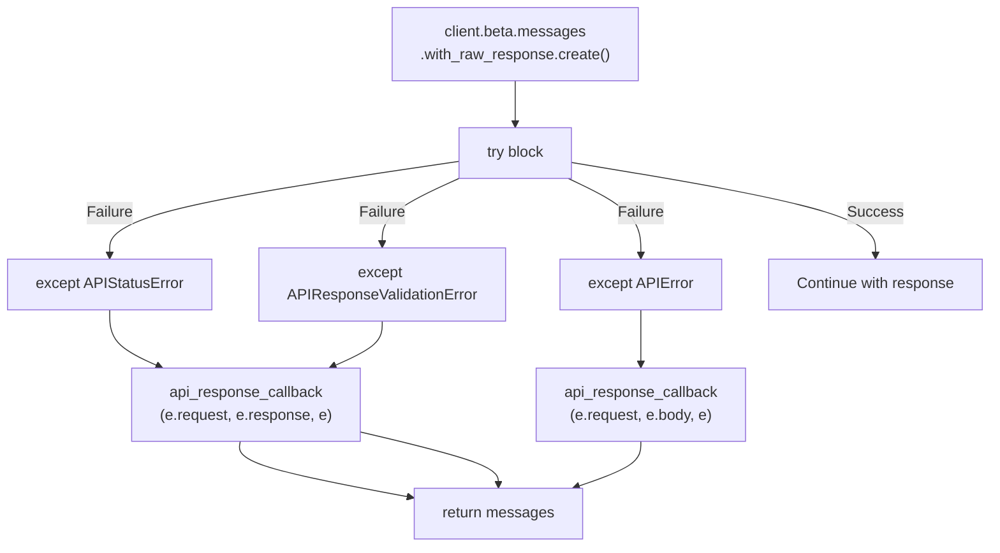
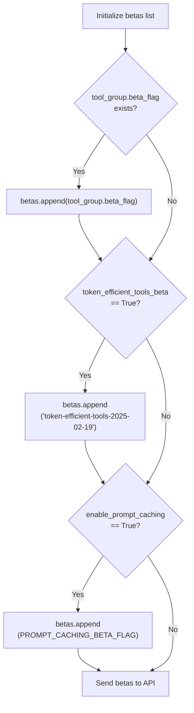

<!-- source: DeepWiki mcp.deepwiki.com · repo anthropics/claude-quickstarts · page 2.2 Sampling Loop & Agent Orchestration · fetched 2026-10-26 -->

# Sampling Loop & Agent Orchestration

<details>
<summary>Relevant source files</summary>

The following files were used as context for generating this wiki page:

- [computer-use-demo/computer_use_demo/loop.py](computer-use-demo/computer_use_demo/loop.py)
- [computer-use-demo/computer_use_demo/streamlit.py](computer-use-demo/computer_use_demo/streamlit.py)
- [computer-use-demo/computer_use_demo/tools/__init__.py](computer-use-demo/computer_use_demo/tools/__init__.py)

</details>


## Purpose and Scope

This page documents the `sampling_loop` function, which serves as the core orchestration mechanism for the Computer Use Demo. The sampling loop manages the iterative cycle of sending messages to Claude, receiving responses, executing requested tools, and feeding results back into the conversation. It handles message history management, prompt caching optimization, image truncation, and multi-provider API support.

For information about the individual tools that the sampling loop orchestrates, see [Tool System](#2.4). For details on how the Streamlit UI invokes the sampling loop and processes callbacks, see [Streamlit User Interface](#2.3).

---

## Core Function: `sampling_loop`

The `sampling_loop` function is the central orchestrator located in [computer-use-demo/computer_use_demo/loop.py:70-191](). It implements an asynchronous agent loop that alternates between LLM inference and tool execution until the model produces a final response without tool requests.

### Function Signature

| Parameter | Type | Purpose |
|-----------|------|---------|
| `model` | `str` | Model identifier (e.g., `"claude-3-5-sonnet-20241022"`) |
| `provider` | `APIProvider` | API provider: `ANTHROPIC`, `BEDROCK`, or `VERTEX` |
| `system_prompt_suffix` | `str` | Additional context appended to system prompt |
| `messages` | `list[BetaMessageParam]` | Conversation history (modified in-place) |
| `output_callback` | `Callable` | Called for each content block in LLM response |
| `tool_output_callback` | `Callable` | Called after each tool execution |
| `api_response_callback` | `Callable` | Called with raw HTTP request/response details |
| `api_key` | `str` | API authentication key |
| `only_n_most_recent_images` | `int \| None` | Image truncation limit (0 disables) |
| `max_tokens` | `int` | Maximum tokens for LLM response (default: 4096) |
| `tool_version` | `ToolVersion` | Tool version to use (date-based enum) |
| `thinking_budget` | `int \| None` | Extended thinking budget in tokens |
| `token_efficient_tools_beta` | `bool` | Enable token-efficient tools beta feature |

The function modifies `messages` in-place and returns it when the loop terminates (either on error or when the model produces a non-tool response).

**Sources:** [computer-use-demo/computer_use_demo/loop.py:70-96]()

---

## API Provider Configuration

The sampling loop supports three API providers through the `APIProvider` enum:

```python
class APIProvider(StrEnum):
    ANTHROPIC = "anthropic"
    BEDROCK = "bedrock"
    VERTEX = "vertex"
```

### Provider Initialization



**Provider-Specific Features:**

| Provider | Prompt Caching | Max Retries | Notes |
|----------|----------------|-------------|-------|
| `ANTHROPIC` | ✓ Enabled | 4 | Full feature support including prompt caching |
| `BEDROCK` | ✗ Disabled | Default | AWS-hosted Claude via Bedrock |
| `VERTEX` | ✗ Disabled | Default | GCP-hosted Claude via Vertex AI |

Only the `ANTHROPIC` provider enables prompt caching, which significantly impacts the image truncation and message management strategy.

**Sources:** [computer-use-demo/computer_use_demo/loop.py:42-45](), [computer-use-demo/computer_use_demo/loop.py:104-119]()

---

## System Prompt

The `SYSTEM_PROMPT` constant defines the environmental context and capabilities available to Claude. It is dynamically constructed with:

- **Architecture information**: Platform architecture (`platform.machine()`)
- **Current date**: Formatted as "DayOfWeek, Month Day, Year"
- **Ubuntu environment details**: Instructions for GUI applications, bash commands
- **Tool usage guidance**: Best practices for bash, computer, and edit tools
- **Firefox-specific instructions**: Handling startup wizards, PDF downloads

The system prompt is appended with an optional `system_prompt_suffix` parameter and marked with cache control when prompt caching is enabled.

**Sources:** [computer-use-demo/computer_use_demo/loop.py:53-67](), [computer-use-demo/computer_use_demo/loop.py:93-96]()

---

## Message Flow and Orchestration

### Main Loop Structure

```mermaid
sequenceDiagram
    participant Loop as "sampling_loop"
    participant Config as "Configuration Phase"
    participant API as "Claude API"
    participant Tools as "ToolCollection"
    participant Messages as "messages list"
    
    activate Loop
    Loop->>Config: Initialize tool_collection<br/>from tool_version
    
    loop "While True"
        Loop->>Config: Configure provider client<br/>(Anthropic/Bedrock/Vertex)
        
        alt "enable_prompt_caching == True"
            Loop->>Messages: _inject_prompt_caching(messages)
            Note over Messages: Cache breakpoints on<br/>3 most recent user turns
            Loop->>Loop: only_n_most_recent_images = 0
        end
        
        alt "only_n_most_recent_images > 0"
            Loop->>Messages: _maybe_filter_to_n_most_recent_images()
            Note over Messages: Remove old images<br/>in chunks
        end
        
        Loop->>API: client.beta.messages.with_raw_response.create()
        Note over API: Include: messages, system,<br/>tools, betas, max_tokens
        
        alt "API Error"
            API-->>Loop: APIStatusError / APIError
            Loop->>Loop: api_response_callback(error)
            Loop-->>Loop: return messages
        end
        
        API-->>Loop: BetaMessage response
        Loop->>Loop: api_response_callback(success)
        
        Loop->>Messages: Append assistant message<br/>with response_params
        
        loop "For each content_block"
            Loop->>Loop: output_callback(content_block)
            
            alt "content_block is tool_use"
                Loop->>Tools: run(name, tool_input)
                Tools-->>Loop: ToolResult
                Loop->>Loop: tool_output_callback(result)
                Loop->>Messages: Append tool_result as user message
            end
        end
        
        alt "No tool_result_content"
            Loop-->>Loop: return messages
        end
    end
    
    deactivate Loop
```

### Message History Management

The `messages` parameter is a mutable list of `BetaMessageParam` objects that grows throughout the conversation:

1. **Initial state**: User messages from previous conversation
2. **Assistant responses**: Appended after each LLM call [computer-use-demo/computer_use_demo/loop.py:162-167]()
3. **Tool results**: Appended as user messages with `tool_result` content [computer-use-demo/computer_use_demo/loop.py:190]()

The conversation alternates between `"assistant"` and `"user"` roles, with assistant messages containing text and tool_use blocks, and user messages containing tool_result blocks.

**Sources:** [computer-use-demo/computer_use_demo/loop.py:98-191]()

---

## Prompt Caching Strategy

When using the `ANTHROPIC` provider, the sampling loop implements a sophisticated prompt caching strategy to reduce API costs and improve latency.

### Cache Breakpoint Injection

The `_inject_prompt_caching` function marks the last content item in the 3 most recent user messages with `cache_control` ephemeral breakpoints:



**Cache Breakpoint Strategy:**

| Breakpoint | Location | Purpose |
|------------|----------|---------|
| 1 | System prompt | Shared across all sessions |
| 2 | Tools definitions | Shared across all sessions |
| 3 | 3rd most recent user turn | Recent conversation context |
| 4 | 2nd most recent user turn | Recent conversation context |
| 5 | Most recent user turn | Current context |

This strategy ensures that the expensive system prompt and tool definitions are cached once, while the 3 most recent conversational turns are also cached for fast iteration.

**Impact on Image Truncation:**

When prompt caching is enabled, `only_n_most_recent_images` is set to `0` [computer-use-demo/computer_use_demo/loop.py:117](). This is because cached reads are 10% of the price of regular reads, making it uneconomical to break the cache by removing images.

**Sources:** [computer-use-demo/computer_use_demo/loop.py:112-119](), [computer-use-demo/computer_use_demo/loop.py:265-288]()

---

## Image Truncation

For non-caching providers or when explicitly configured, the `_maybe_filter_to_n_most_recent_images` function removes older screenshots from tool_result blocks to manage context window size.

### Truncation Algorithm



**Chunk-Based Removal:**

The algorithm removes images in chunks of `min_removal_threshold` to minimize cache invalidation. For example, with `min_removal_threshold=10`, removing 23 images would actually remove only 20 (rounded down to nearest multiple of 10).

**Implementation Details:**

- Images are removed from oldest to newest (first-in-first-out)
- Only images in `tool_result` blocks are affected
- Text content is never removed
- The function modifies messages in-place

**Sources:** [computer-use-demo/computer_use_demo/loop.py:193-240]()

---

## Tool Execution Cycle

### Response Processing

After receiving a `BetaMessage` from the API, the sampling loop processes the response through several stages:



### Tool Result Formatting

The `_make_api_tool_result` function converts a `ToolResult` object into a `BetaToolResultBlockParam` suitable for the API:

**Structure:**

```
BetaToolResultBlockParam {
    type: "tool_result"
    tool_use_id: string
    is_error: boolean
    content: [
        {type: "text", text: string},  // Optional: result.output
        {type: "image", source: {...}} // Optional: result.base64_image
    ]
}
```

**Error Handling:**

- If `result.error` exists, `is_error=True` and `content` is a string with the error message
- If `result.system` exists, it's prepended as `<system>...</system>` XML tags

**Sources:** [computer-use-demo/computer_use_demo/loop.py:169-190](), [computer-use-demo/computer_use_demo/loop.py:291-324]()

---

## Response Transformations

The `_response_to_params` function converts `BetaMessage.content` blocks into `BetaContentBlockParam` format suitable for message history:

### Transformation Logic

| Input Block Type | Condition | Output |
|-----------------|-----------|---------|
| `BetaTextBlock` | `block.text` exists | `BetaTextBlockParam` with text |
| `BetaTextBlock` | `type == "thinking"` | Thinking block dict with `thinking` and optional `signature` fields |
| Tool use block | Always | `BetaToolUseBlockParam` via `model_dump()` |

**Thinking Block Support:**

Extended thinking blocks are preserved with their signature field when present, enabling the thinking feature introduced in later API versions.

**Sources:** [computer-use-demo/computer_use_demo/loop.py:242-262]()

---

## Error Handling

The sampling loop implements comprehensive error handling for API failures:



**Error Types:**

- **`APIStatusError`**: HTTP status code errors (4xx, 5xx)
- **`APIResponseValidationError`**: Response doesn't match expected schema
- **`APIError`**: General API errors (network, timeout, etc.)

All errors are reported via `api_response_callback` with full request/response details for debugging, then the function returns the current `messages` list to preserve conversation state.

**Sources:** [computer-use-demo/computer_use_demo/loop.py:138-157]()

---

## Beta Features

The sampling loop supports multiple beta features through the `betas` parameter:



**Beta Flags:**

| Flag | Condition | Purpose |
|------|-----------|---------|
| Tool-specific beta | `tool_group.beta_flag` present | Enable features for specific tool versions |
| `token-efficient-tools-2025-02-19` | `token_efficient_tools_beta=True` | Reduce token usage for tool definitions |
| `prompt-caching-2024-07-31` | `provider=ANTHROPIC` | Enable prompt caching |

**Sources:** [computer-use-demo/computer_use_demo/loop.py:99-113]()

---

