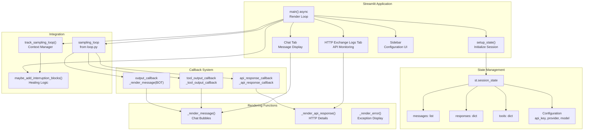
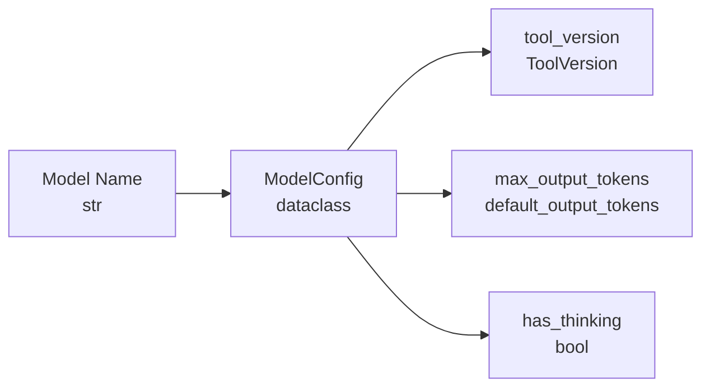
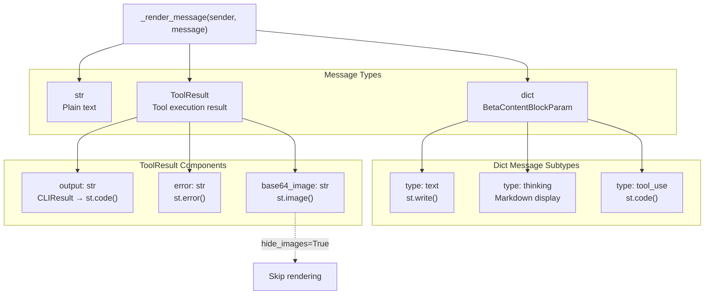
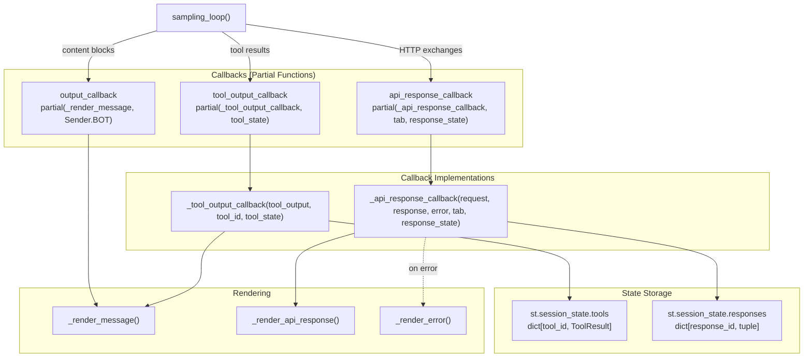
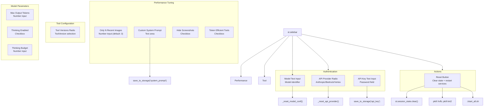
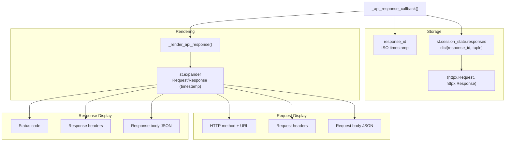

<!-- source: DeepWiki mcp.deepwiki.com · repo anthropics/claude-quickstarts · page 2.3 Streamlit User Interface · fetched 2026-10-26 -->

# Streamlit User Interface

<details>
<summary>Relevant source files</summary>

The following files were used as context for generating this wiki page:

- [computer-use-demo/computer_use_demo/loop.py](computer-use-demo/computer_use_demo/loop.py)
- [computer-use-demo/computer_use_demo/streamlit.py](computer-use-demo/computer_use_demo/streamlit.py)

</details>


## Purpose and Scope

This document covers the Streamlit web application that provides the primary user interface for the computer-use-demo system. The application enables users to interact with Claude through a chat interface, configure model parameters, monitor tool execution, and view HTTP exchange logs.

For information about the agent loop that processes messages, see [Sampling Loop & Agent Orchestration](#2.2). For details on the underlying tools, see [Tool System](#2.4). For deployment configuration, see [Docker Environment & Deployment](#2.5).

---

## Application Architecture

The Streamlit application is implemented as a single-file application in [computer-use-demo/computer_use_demo/streamlit.py:1-544]() that orchestrates the user interface, state management, and integration with the sampling loop.



**Sources:** [computer-use-demo/computer_use_demo/streamlit.py:185-356]()

---

## Session State Management

The application maintains state across Streamlit reruns using `st.session_state`. The `setup_state()` function initializes all required state variables with default values.

| State Variable | Type | Purpose |
|----------------|------|---------|
| `messages` | `list[BetaMessageParam]` | Conversation history passed to Claude API |
| `api_key` | `str` | Anthropic API key (loaded from file or environment) |
| `provider` | `APIProvider` | Selected API provider (Anthropic, Bedrock, Vertex) |
| `model` | `str` | Model identifier (e.g., "claude-sonnet-4-5-20250929") |
| `auth_validated` | `bool` | Whether authentication has been validated |
| `responses` | `dict[str, tuple]` | HTTP request/response pairs for logging |
| `tools` | `dict[str, ToolResult]` | Tool execution results indexed by tool_use_id |
| `only_n_most_recent_images` | `int` | Number of recent screenshots to include (default: 3) |
| `custom_system_prompt` | `str` | User-provided system prompt suffix |
| `hide_images` | `bool` | Toggle for hiding screenshots in UI |
| `token_efficient_tools_beta` | `bool` | Enable beta token-efficient tools flag |
| `in_sampling_loop` | `bool` | Tracks whether sampling loop is currently executing |

**Model Configuration:**

The application maps model names to configuration objects that specify tool versions, token limits, and capabilities:



Configuration constants defined in [computer-use-demo/computer_use_demo/streamlit.py:41-92]():
- `SONNET_3_5_NEW`: 8K max tokens, no thinking, `computer_use_20241022`
- `SONNET_3_7`: 128K max tokens, thinking enabled, `computer_use_20250124`
- `CLAUDE_4`, `CLAUDE_4_5`: 128K max tokens, thinking enabled, `computer_use_20250124`
- `HAIKU_4_5`: 8K max tokens, no thinking, `computer_use_20250124`

**Storage Persistence:**

The application persists API keys and custom system prompts to `~/.anthropic/` directory using `save_to_storage()` and `load_from_storage()` functions [computer-use-demo/computer_use_demo/streamlit.py:412-434](). Files are created with `0o600` permissions (user read/write only) for security.

| State Variable | Type | Purpose |
|----------------|------|---------|
| `messages` | `list[BetaMessageParam]` | Conversation history passed to Claude API |
| `api_key` | `str` | Anthropic API key (loaded from file or environment) |
| `provider` | `APIProvider` | Active API provider (committed value) |
| `provider_radio` | `APIProvider` | Sidebar radio widget binding (triggers `_reset_api_provider`) |
| `model` | `str` | Model identifier (e.g., `claude-sonnet-4-5-20250929`) |
| `auth_validated` | `bool` | Whether authentication has been validated this session |
| `responses` | `dict[str, tuple]` | HTTP request/response pairs for the Logs tab |
| `tools` | `dict[str, ToolResult]` | Tool execution results indexed by `tool_use_id` |
| `only_n_most_recent_images` | `int` | Number of recent screenshots to retain in API messages (default: 3) |
| `custom_system_prompt` | `str` | User-provided system prompt suffix (persisted to `~/.anthropic/system_prompt`) |
| `hide_images` | `bool` | UI-only toggle to hide screenshots in the chat view |
| `token_efficient_tools_beta` | `bool` | Enables the `token-efficient-tools-2025-02-19` beta flag |
| `in_sampling_loop` | `bool` | `True` while `sampling_loop()` is executing; used for interruption detection |
| `tool_version` | `ToolVersion` | Active tool version string passed to `sampling_loop()` |
| `has_thinking` | `bool` | Whether the selected model supports extended thinking |
| `output_tokens` | `int` | Max output token budget passed to `sampling_loop()` |
| `max_output_tokens` | `int` | Upper bound for `thinking_budget` widget |
| `thinking_budget` | `int` | Token allocation for thinking (half of `default_output_tokens` by default) |
</old_str>

<old_str>
**Sources:** [computer-use-demo/computer_use_demo/streamlit.py:125-157](), [computer-use-demo/computer_use_demo/streamlit.py:41-92](), [computer-use-demo/computer_use_demo/streamlit.py:412-434]()
</old_str>
<new_str>
**Sources:** [computer-use-demo/computer_use_demo/streamlit.py:121-177](), [computer-use-demo/computer_use_demo/streamlit.py:41-88](), [computer-use-demo/computer_use_demo/streamlit.py:408-430]()

---

## Main Render Loop

The `main()` async function implements the core render loop that handles user input and orchestrates the sampling loop execution.

```mermaid
sequenceDiagram
    participant User
    participant Main as "main()"
    participant State as "st.session_state"
    participant Auth as "validate_auth()"
    participant Loop as "sampling_loop()"
    participant Render as "_render_message()"
    
    User->>Main: Load page
    Main->>State: setup_state()
    Main->>Auth: validate_auth()
    
    alt Authentication Failed
        Auth-->>Main: Error message
        Main-->>User: Display warning
    else Authentication Successful
        State->>State: auth_validated = True
        User->>Main: Submit chat input
        Main->>State: Append user message
        Main->>Render: Render user message
        Main->>State: Check maybe_add_interruption_blocks()
        Main->>Loop: Call sampling_loop()
        
        loop For each response block
            Loop->>Render: output_callback()
            Loop->>Render: tool_output_callback()
            Loop->>Render: api_response_callback()
        end
        
        Loop-->>Main: Updated messages
        Main->>State: Update messages
    end
```

**Execution Flow:**

1. **Initialization** [computer-use-demo/computer_use_demo/streamlit.py:179-188]():
   - Call `setup_state()` to initialize session state
   - Apply custom CSS styling via `STREAMLIT_STYLE`
   - Display `WARNING_TEXT` security alert (suppressed when `HIDE_WARNING` env var is set)

2. **Authentication** [computer-use-demo/computer_use_demo/streamlit.py:268-275]():
   - Validate credentials using `validate_auth(provider, api_key)`
   - For `APIProvider.ANTHROPIC`: check that `api_key` is non-empty
   - For `APIProvider.BEDROCK`: verify AWS credentials via `boto3.Session().get_credentials()`
   - For `APIProvider.VERTEX`: verify `CLOUD_ML_REGION` env var and Google Cloud default credentials

3. **UI Rendering** [computer-use-demo/computer_use_demo/streamlit.py:277-303]():
   - Create two tabs: `"Chat"` and `"HTTP Exchange Logs"`
   - Render historical messages from `st.session_state.messages`
   - Render historical HTTP exchanges from `st.session_state.responses`

4. **User Input Processing** [computer-use-demo/computer_use_demo/streamlit.py:306-325]():
   - Capture new message from `st.chat_input()`
   - Prepend interruption blocks via `maybe_add_interruption_blocks()` if needed
   - Append user message to `messages` list

5. **Sampling Loop Execution** [computer-use-demo/computer_use_demo/streamlit.py:327-351]():
   - Execute within `track_sampling_loop()` context manager
   - Pass partial callbacks for progressive rendering
   - Update `st.session_state.messages` with complete conversation returned by `sampling_loop()`

**Sources:** [computer-use-demo/computer_use_demo/streamlit.py:179-351](), [computer-use-demo/computer_use_demo/streamlit.py:385-406]()

---

## Message Rendering System

The application renders different message types using the `_render_message()` function, which handles text, tool use blocks, tool results, and thinking blocks.



**Rendering Logic** [computer-use-demo/computer_use_demo/streamlit.py:497-535]():

1. **String Messages**: Rendered with `st.markdown()`
2. **Dict (`BetaContentBlockParam`) Messages**: Dispatched on the `type` field:
   - `"text"`: `st.write(message["text"])`
   - `"thinking"`: `st.markdown(f"[Thinking]\n\n{thinking_content}")`
   - `"tool_use"`: `st.code(f"Tool Use: {message['name']}\nInput: {message['input']}")`
3. **`ToolResult` Objects**: Multi-component rendering in order:
   - `output`: `st.code()` if the instance's class name is `"CLIResult"`, else `st.markdown()`
   - `error`: `st.error()`
   - `base64_image`: `st.image(base64.b64decode(...))` — skipped when `hide_images` is `True`

> **Note:** The `is_tool_result` check uses `not isinstance(message, str | dict)` rather than `isinstance(message, ToolResult)` to avoid a Streamlit hot-reload issue where `isinstance` checks against imported types can fail after a module reload.

**Sender Enumeration:**

The `Sender` enum [computer-use-demo/computer_use_demo/streamlit.py:119-122]() defines three message origins:
- `USER`: User-submitted messages
- `BOT`: Assistant (Claude) responses
- `TOOL`: Tool execution results

**Image Management:**

Screenshot visibility is controlled by two mechanisms:
1. `only_n_most_recent_images`: Limits images sent to API (token optimization)
2. `hide_images`: UI-only toggle that hides screenshots in chat display

**Sources:** [computer-use-demo/computer_use_demo/streamlit.py:115-118](), [computer-use-demo/computer_use_demo/streamlit.py:497-535]()

---

## Callback System

The application integrates with the sampling loop via three callback functions that enable progressive rendering of agent activity.



**Output Callback** [computer-use-demo/computer_use_demo/streamlit.py:334]():
- Receives each `BetaContentBlockParam` from Claude's response
- Renders text, thinking, and `tool_use` blocks immediately via `_render_message`
- Constructed as `partial(_render_message, Sender.BOT)` to bind the sender

**Tool Output Callback** — `_tool_output_callback` [computer-use-demo/computer_use_demo/streamlit.py:450-455]():
- Called after each tool execution with `(tool_output: ToolResult, tool_id: str)`
- Stores the `ToolResult` in `st.session_state.tools[tool_id]`
- Immediately calls `_render_message(Sender.TOOL, tool_output)` for live feedback
- The stored value is later used when re-rendering the full conversation history (tool results in messages reference the stored object by `tool_use_id`)

**API Response Callback** — `_api_response_callback` [computer-use-demo/computer_use_demo/streamlit.py:433-447]():
- Captures the raw `httpx.Request` / `httpx.Response` pair after each API call
- Stores in `st.session_state.responses` keyed by `datetime.now().isoformat()`
- Forwards to `_render_api_response()` in the HTTP Logs tab
- On error, calls `_render_error()` before rendering the exchange

**Progressive Rendering:**

The callback pattern enables the UI to update incrementally as the agent loop progresses, providing real-time feedback without waiting for the entire conversation to complete.

**Sources:** [computer-use-demo/computer_use_demo/streamlit.py:327-351](), [computer-use-demo/computer_use_demo/streamlit.py:433-455]()

---

## Sidebar Configuration

The sidebar provides controls for API configuration, model selection, and execution parameters.



**Configuration Controls** [computer-use-demo/computer_use_demo/streamlit.py:190-261]():

| Control | Widget | Key | Behaviour on Change |
|---------|--------|-----|---------------------|
| API Provider | `st.radio` | `provider_radio` | Calls `_reset_api_provider()`: resets model + invalidates `auth_validated` |
| Model | `st.text_input` | `model` | Calls `_reset_model_conf()`: updates `tool_version`, `output_tokens`, `thinking_budget` |
| Claude API Key | `st.text_input` (password) | `api_key` | Saves to `~/.anthropic/api_key` via `save_to_storage()` |
| Only N Recent Images | `st.number_input` | `only_n_most_recent_images` | Passed directly to `sampling_loop()` |
| Custom System Prompt | `st.text_area` | `custom_system_prompt` | Saves to `~/.anthropic/system_prompt`; appended to `SYSTEM_PROMPT` in `loop.py` |
| Hide Screenshots | `st.checkbox` | `hide_images` | Suppresses `base64_image` rendering in `_render_message` |
| Token-Efficient Tools | `st.checkbox` | `token_efficient_tools_beta` | Passes `token_efficient_tools_beta=True` to `sampling_loop()` |
| Tool Versions | `st.radio` | `tool_versions` | Overrides the model-derived `tool_version`; uses `get_args(ToolVersion)` for options |
| Max Output Tokens | `st.number_input` | `output_tokens` | Passed as `max_tokens` to `sampling_loop()` |
| Thinking Enabled | `st.checkbox` | `thinking` | Enables/disables `thinking_budget` widget; gates `thinking_budget` arg in `sampling_loop()` |
| Thinking Budget | `st.number_input` | `thinking_budget` | Passed to `sampling_loop()` when `thinking=True`; bounded by `max_output_tokens` |

> The API Key field is only shown when `provider == APIProvider.ANTHROPIC`. Bedrock and Vertex use ambient credentials (boto3 / Google auth).

**`_reset_api_provider()`** [computer-use-demo/computer_use_demo/streamlit.py:192-195](): compares `provider_radio` to `provider`; if different, calls `_reset_model()` and sets `auth_validated = False`.

**`_reset_model_conf()`** [computer-use-demo/computer_use_demo/streamlit.py:162-176](): looks up the model in `MODEL_TO_MODEL_CONF` (falls back to `CLAUDE_4`), then writes `tool_version`, `has_thinking`, `output_tokens`, `max_output_tokens`, and `thinking_budget` into session state. If `tool_versions` is already in session state (user has made a manual radio selection), that value takes precedence over the model-derived `tool_version`.

**Reset Button** [computer-use-demo/computer_use_demo/streamlit.py:259-266]():
- Clears all session state via `st.session_state.clear()`
- Kills `Xvfb` and `tint2` processes with `pkill`
- Restarts the virtual desktop via `./start_all.sh`

**Sources:** [computer-use-demo/computer_use_demo/streamlit.py:190-266]()

---

## Interruption Handling

The application implements graceful interruption handling to allow users to stop the agent loop mid-execution and provide corrective instructions.

```mermaid
sequenceDiagram
    participant User
    participant Main as "main()"
    participant Track as "track_sampling_loop()"
    participant State as "st.session_state"
    participant Interrupt as "maybe_add_interruption_blocks()"
    participant Loop as "sampling_loop()"
    
    User->>Main: Submit first message
    Main->>Track: Enter context manager
    Track->>State: in_sampling_loop = True
    Main->>Loop: Execute sampling_loop()
    
    Note over Loop: Agent executing tools...
    
    User->>Main: Submit new message (interruption)
    Main->>Interrupt: Check for interruption
    Interrupt->>State: Check in_sampling_loop
    
    alt Interrupted (in_sampling_loop = True)
        Interrupt->>State: Get last message
        Interrupt->>State: Extract tool_use_ids
        
        loop For each pending tool_use_id
            Interrupt->>State: tools[tool_use_id] = ToolResult(error)
            Interrupt->>Interrupt: Create BetaToolResultBlockParam(is_error=True)
        end
        
        Interrupt->>Interrupt: Add INTERRUPT_TEXT block
        Interrupt-->>Main: Return interruption blocks
        Main->>State: Append blocks to new message
    else Not Interrupted
        Interrupt-->>Main: Return empty list
    end
    
    Main->>Loop: Execute with healed message
    Loop-->>Main: Complete
    Main->>Track: Exit context manager
    Track->>State: in_sampling_loop = False
```

**Interruption Detection** [computer-use-demo/computer_use_demo/streamlit.py:354-375]():

The `maybe_add_interruption_blocks()` function detects interruptions by checking the `in_sampling_loop` flag. If a new user message arrives while the sampling loop is executing, the system:

1. **Identifies Incomplete Tool Calls**: Extracts `tool_use_id` values from the last assistant message
2. **Injects Error Results**: Creates `BetaToolResultBlockParam` objects with `is_error=True` and error message `"human stopped or interrupted tool execution"`
3. **Stores Error State**: Updates `st.session_state.tools` with `ToolResult(error=INTERRUPT_TOOL_ERROR)`
4. **Adds Context Block**: Appends text block with `INTERRUPT_TEXT` ("(user stopped or interrupted and wrote the following)")
5. **Returns Healing Blocks**: Returns list of blocks to prepend to new user message

**Context Manager** [computer-use-demo/computer_use_demo/streamlit.py:378-382]():

The `track_sampling_loop()` context manager ensures proper state tracking:
- Sets `in_sampling_loop = True` on entry
- Sets `in_sampling_loop = False` on exit (even if exception occurs)
- Enables interruption detection in subsequent render cycles

**Interruption Constants** [computer-use-demo/computer_use_demo/streamlit.py:111-112]():
- `INTERRUPT_TEXT`: Message displayed to Claude about interruption
- `INTERRUPT_TOOL_ERROR`: Error message for incomplete tool executions

This mechanism allows users to:
- Stop long-running or incorrect tool executions
- Provide corrective guidance mid-task
- Maintain conversation coherence by healing incomplete tool calls

**Sources:** [computer-use-demo/computer_use_demo/streamlit.py:354-382](), [computer-use-demo/computer_use_demo/streamlit.py:111-112](), [computer-use-demo/computer_use_demo/streamlit.py:327-351]()

---

## HTTP Exchange Visualization

The "HTTP Exchange Logs" tab provides detailed visibility into API interactions for debugging and monitoring.



**API Response Callback Flow** [computer-use-demo/computer_use_demo/streamlit.py:433-447]():

1. Generate unique `response_id` using ISO timestamp
2. Store `(request, response)` tuple in `st.session_state.responses`
3. Render error via `_render_error()` if present
4. Render exchange via `_render_api_response()`

**Response Rendering** [computer-use-demo/computer_use_demo/streamlit.py:458-479]():

Each HTTP exchange is displayed in an expandable section showing:

**Request Section:**
- HTTP method and URL (e.g., `POST https://api.anthropic.com/v1/messages`)
- Request headers formatted as key-value pairs
- Request body as formatted JSON

**Response Section:**
- HTTP status code (e.g., `200`)
- Response headers formatted as key-value pairs
- Response body as formatted JSON

**Error Handling** [computer-use-demo/computer_use_demo/streamlit.py:482-494]():

The `_render_error()` function provides specialized handling for different exception types:

1. **RateLimitError**:
   - Displays rate limit message
   - Extracts `retry-after` header and converts to HH:MM:SS format
   - Links to API documentation
   - Shows error message

2. **Other Exceptions**:
   - Displays exception class name
   - Shows exception message
   - Includes full traceback in code block
   - Saves error details to timestamped file in `~/.anthropic/`

The error rendering uses `st.error()` with material error icon for visual prominence.

**Sources:** [computer-use-demo/computer_use_demo/streamlit.py:433-494]()

---

## Testing

The Streamlit application includes integration tests that verify core functionality.

**Test Structure** [computer-use-demo/tests/streamlit_test.py:1-28]():

The test suite uses `streamlit.testing.v1.AppTest` to simulate user interactions:

1. **App Initialization**: Loads app from file path
2. **Authentication**: Sets API key via text input
3. **Message Submission**: Submits chat message via `chat_input`
4. **Sampling Loop Verification**: Mocks `sampling_loop` and verifies:
   - Function is called
   - Messages include user input with correct structure
   - No exceptions are raised

The test validates the integration between the Streamlit UI and the sampling loop, ensuring that user messages are correctly formatted as `BetaMessageParam` objects with the appropriate `role` and `content` structure.

**Sources:** [computer-use-demo/tests/streamlit_test.py:1-28]()

---

