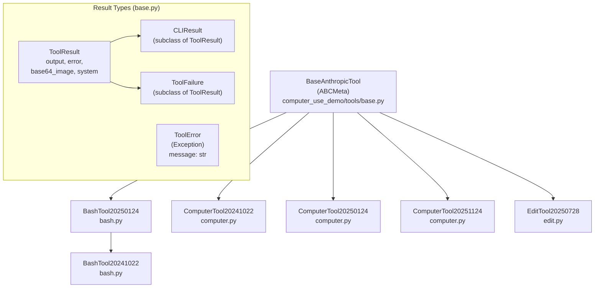
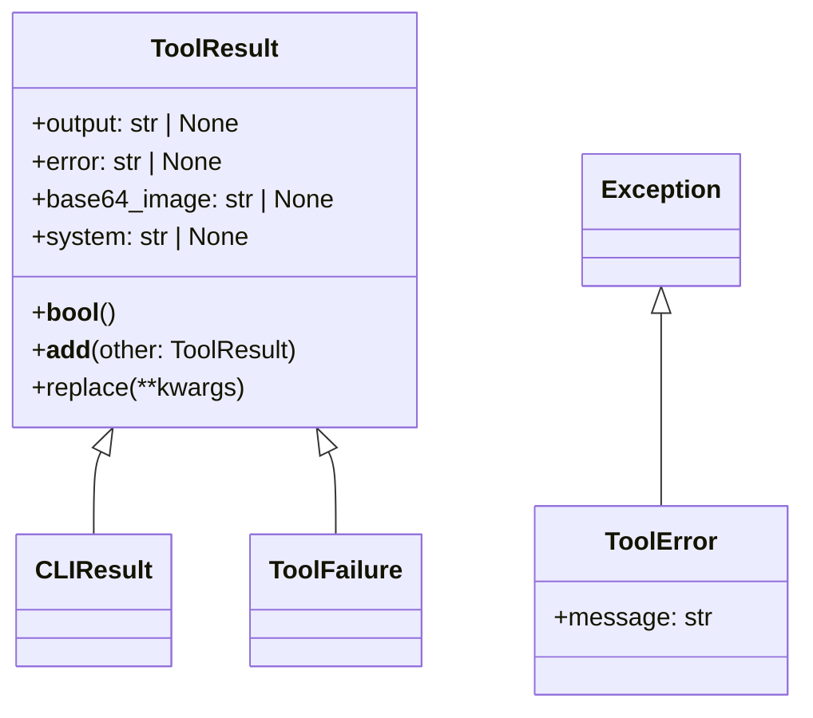
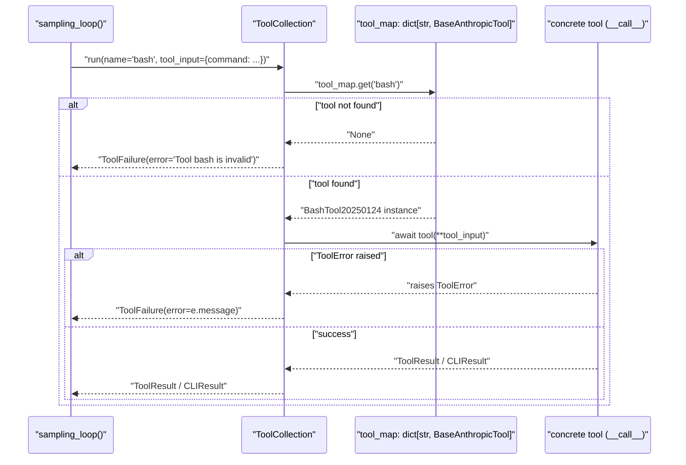
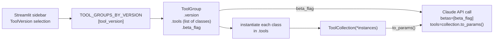

<!-- source: DeepWiki mcp.deepwiki.com · repo anthropics/claude-quickstarts · page 2.4 Tool System · fetched 2026-10-26 -->

# Tool System

<details>
<summary>Relevant source files</summary>

The following files were used as context for generating this wiki page:

- [computer-use-demo/computer_use_demo/requirements.txt](computer-use-demo/computer_use_demo/requirements.txt)
- [computer-use-demo/computer_use_demo/tools/__init__.py](computer-use-demo/computer_use_demo/tools/__init__.py)
- [computer-use-demo/computer_use_demo/tools/base.py](computer-use-demo/computer_use_demo/tools/base.py)
- [computer-use-demo/computer_use_demo/tools/bash.py](computer-use-demo/computer_use_demo/tools/bash.py)
- [computer-use-demo/computer_use_demo/tools/collection.py](computer-use-demo/computer_use_demo/tools/collection.py)
- [computer-use-demo/computer_use_demo/tools/groups.py](computer-use-demo/computer_use_demo/tools/groups.py)

</details>


This page provides an overview of the computer use tool system in `computer-use-demo`: the abstract base class, result types, the `ToolCollection` dispatcher, and the versioned tool group registry that ties them together at runtime.

For deeper coverage of individual tools, see:
- [Tool Architecture & Versioning](#2.4.1) — interface contracts, `ToolGroup`, and the version registry in detail
- [BashTool](#2.4.2) — `BashTool20250124`, `BashTool20241022`, and the `_BashSession` lifecycle
- [ComputerTool](#2.4.3) — action sets, coordinate scaling, and version differences
- [EditTool](#2.4.4) — the four file-editing commands and path validation

For how the tool system is invoked during the agent loop, see [Sampling Loop & Agent Orchestration](#2.2).

---

## Tool Class Hierarchy

All tools inherit from `BaseAnthropicTool`, defined in [computer-use-demo/computer_use_demo/tools/base.py]().

**Tool Class Hierarchy and Result Types**



Sources: [computer-use-demo/computer_use_demo/tools/base.py:1-70](), [computer-use-demo/computer_use_demo/tools/bash.py:104-148]()

---

## BaseAnthropicTool

`BaseAnthropicTool` ([computer-use-demo/computer_use_demo/tools/base.py:8-20]()) uses `ABCMeta` and mandates two abstract methods on every concrete tool:

| Method | Signature | Purpose |
|---|---|---|
| `__call__` | `(**kwargs) -> Any` | Execute the tool with Claude-supplied arguments |
| `to_params` | `() -> BetaToolUnionParam` | Return the Anthropic API schema dict for this tool |

Both must be implemented; `ToolCollection` (see below) calls `to_params()` to build the API request and `__call__()` to dispatch execution.

Sources: [computer-use-demo/computer_use_demo/tools/base.py:8-20]()

---

## Result Types

Tool executions return instances of `ToolResult` or one of its two subclasses. `ToolError` is an exception, not a result type — it is caught by `ToolCollection` and converted into a `ToolFailure`.



All three `ToolResult` variants are frozen dataclasses. The `__add__` method on `ToolResult` allows concatenating two results; it raises `ValueError` if both sides have a `base64_image` field set ([computer-use-demo/computer_use_demo/tools/base.py:35-50]()).

| Type | Produced by | Meaning |
|---|---|---|
| `ToolResult` | Any tool | Generic result carrying output, error, image, or system text |
| `CLIResult` | `_BashSession.run()` | Terminal-style output; rendered differently in the UI |
| `ToolFailure` | `ToolCollection.run()` | Tool name not found, or a `ToolError` was raised during execution |
| `ToolError` | Any tool raising it | Exception form; never returned to callers directly |

Sources: [computer-use-demo/computer_use_demo/tools/base.py:23-70](), [computer-use-demo/computer_use_demo/tools/collection.py:29-36]()

---

## ToolCollection

`ToolCollection` ([computer-use-demo/computer_use_demo/tools/collection.py:15-36]()) is the runtime dispatcher. It holds a set of instantiated tools and exposes two methods used by the sampling loop:

| Method | Signature | Returns |
|---|---|---|
| `to_params` | `() -> list[BetaToolUnionParam]` | API-format tool schemas for the `tools=` argument in the Claude API call |
| `run` | `(*, name: str, tool_input: dict) -> ToolResult` | Dispatches a tool call by name and returns a `ToolResult` |

**ToolCollection dispatch flow**



`tool_map` is built at construction time from each tool's `to_params()["name"]` value ([computer-use-demo/computer_use_demo/tools/collection.py:19-22]()).

Sources: [computer-use-demo/computer_use_demo/tools/collection.py:1-36]()

---

## Versioned Tool Groups

Different Claude model versions require different tool schemas. The version registry in [computer-use-demo/computer_use_demo/tools/groups.py]() maps each `ToolVersion` string to a `ToolGroup` that specifies which concrete tool classes and which API beta flag to use.

### Types

```python
ToolVersion = Literal[
    "computer_use_20241022",
    "computer_use_20250124",
    "computer_use_20250429",
    "computer_use_20251124",
]

BetaFlag = Literal[
    "computer-use-2024-10-22",
    "computer-use-2025-01-24",
    "computer-use-2025-04-29",
    "computer-use-2025-11-24",
]
```

`ToolGroup` is a frozen dataclass with three fields ([computer-use-demo/computer_use_demo/tools/groups.py:23-27]()):

| Field | Type | Purpose |
|---|---|---|
| `version` | `ToolVersion` | The string key used to look up this group |
| `tools` | `list[type[BaseAnthropicTool]]` | Tool classes to instantiate for this version |
| `beta_flag` | `BetaFlag \| None` | Added to the `betas=` API header; `None` for no beta flag |

### Registry

`TOOL_GROUPS_BY_VERSION` is a `dict[ToolVersion, ToolGroup]` built from the `TOOL_GROUPS` list:

| `ToolVersion` | `ComputerTool` class | `BashTool` class | `EditTool` class | `BetaFlag` |
|---|---|---|---|---|
| `computer_use_20241022` | `ComputerTool20241022` | `BashTool20241022` | `EditTool20250728` | `computer-use-2024-10-22` |
| `computer_use_20250124` | `ComputerTool20250124` | `BashTool20250124` | `EditTool20250728` | `computer-use-2025-01-24` |
| `computer_use_20250429` | `ComputerTool20250124` | `BashTool20250124` | `EditTool20250728` | `computer-use-2025-01-24` |
| `computer_use_20251124` | `ComputerTool20251124` | `BashTool20250124` | `EditTool20250728` | `computer-use-2025-11-24` |

Note that `computer_use_20250429` reuses the same tool classes as `computer_use_20250124` but is a distinct `ToolVersion` entry ([computer-use-demo/computer_use_demo/tools/groups.py:41-45]()).

Sources: [computer-use-demo/computer_use_demo/tools/groups.py:1-53]()

---

## Runtime Tool Group Selection

The Streamlit UI exposes `ToolVersion` as a sidebar option (see [Streamlit User Interface](#2.3)). At the start of each `sampling_loop` invocation, the selected version string is used to look up the matching `ToolGroup`:

**Version selection to ToolCollection construction**



The `beta_flag` from the `ToolGroup` is passed directly into the `betas=` parameter of the Anthropic API call. If `beta_flag` is `None`, no beta header is sent.

Sources: [computer-use-demo/computer_use_demo/tools/groups.py:30-53](), [computer-use-demo/computer_use_demo/tools/collection.py:15-36]()

---

## Module Exports

The public surface of the tools package is defined in [computer-use-demo/computer_use_demo/tools/__init__.py:1-19](). The following names are exported for use by the rest of the application:

| Export | Source module |
|---|---|
| `CLIResult` | `base.py` |
| `ToolResult` | `base.py` |
| `BashTool20241022` | `bash.py` |
| `BashTool20250124` | `bash.py` |
| `ToolCollection` | `collection.py` |
| `ComputerTool20241022` | `computer.py` |
| `ComputerTool20250124` | `computer.py` |
| `EditTool20250728` | `edit.py` |
| `TOOL_GROUPS_BY_VERSION` | `groups.py` |
| `ToolVersion` | `groups.py` |

Sources: [computer-use-demo/computer_use_demo/tools/__init__.py:1-19]()

---

