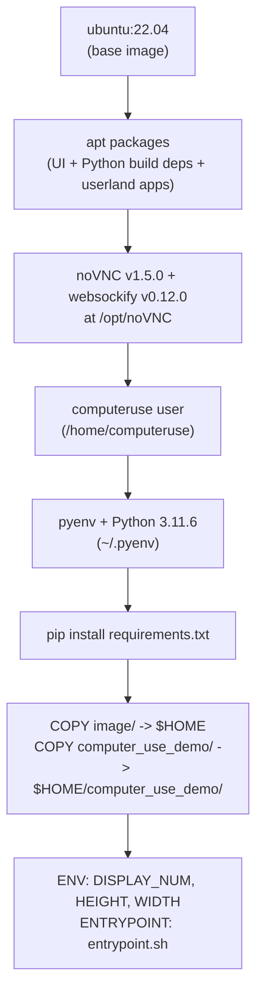
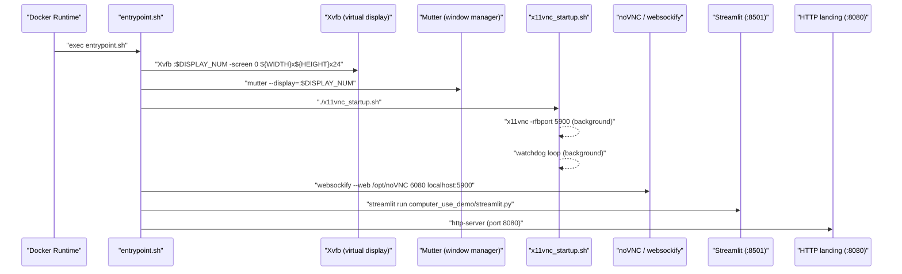
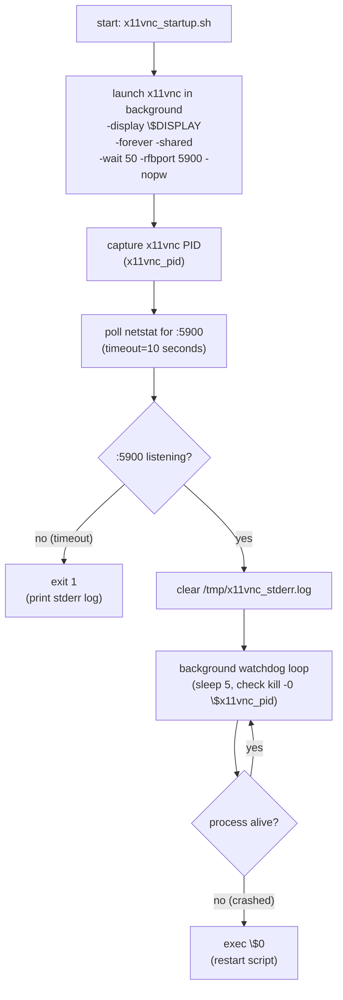
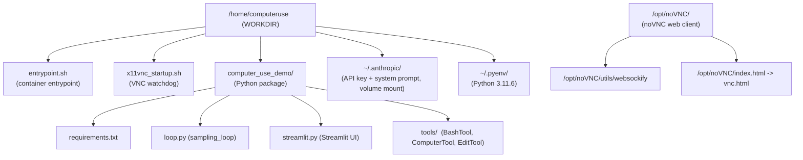

<!-- source: DeepWiki mcp.deepwiki.com · repo anthropics/claude-quickstarts · page 2.5 Docker Environment & Deployment · fetched 2026-10-26 -->

# Docker Environment & Deployment

<details>
<summary>Relevant source files</summary>

The following files were used as context for generating this wiki page:

- [computer-use-demo/.gitignore](computer-use-demo/.gitignore)
- [computer-use-demo/.zed/settings.json](computer-use-demo/.zed/settings.json)
- [computer-use-demo/Dockerfile](computer-use-demo/Dockerfile)
- [computer-use-demo/LICENSE](computer-use-demo/LICENSE)
- [computer-use-demo/README.md](computer-use-demo/README.md)
- [computer-use-demo/computer_use_demo/__init__.py](computer-use-demo/computer_use_demo/__init__.py)
- [computer-use-demo/image/x11vnc_startup.sh](computer-use-demo/image/x11vnc_startup.sh)

</details>


This page documents the Docker image used by the Computer Use Demo: its base OS, installed system packages, Python runtime setup, display server stack, VNC configuration, the non-root user, and the startup sequence defined in `entrypoint.sh`. For information about environment variables, volume mounts, screen resolution, and API provider configuration, see [Setup & Configuration](#2.6). For the overall runtime architecture and how these services interconnect, see [Architecture Overview](#2.1).

---

## Image Overview

The Computer Use Demo ships as a single self-contained Docker image published to GitHub Container Registry:

```
ghcr.io/anthropics/anthropic-quickstarts:computer-use-demo-latest
```

The image bundles a full virtual desktop environment (Xvfb + Mutter), a VNC server (x11vnc), a browser-based VNC client (noVNC), the Streamlit application, and the Python agent loop. All components run inside a single container, co-located so the agent tools can interact with the same desktop the user sees.

**Sources:** [computer-use-demo/Dockerfile:1-104](), [computer-use-demo/README.md:33-52]()

---

## Dockerfile Walkthrough

**Diagram: Dockerfile Layer Structure**



**Sources:** [computer-use-demo/Dockerfile:1-104]()

### Base Image

```
FROM docker.io/ubuntu:22.04
```

`DEBIAN_FRONTEND=noninteractive` and `DEBIAN_PRIORITY=high` are set to suppress interactive prompts during package installation [computer-use-demo/Dockerfile:1-5]().

### System Packages

Packages are installed in three logical groups [computer-use-demo/Dockerfile:6-52]():

| Group | Packages |
|---|---|
| **UI / Display** | `xvfb`, `xterm`, `xdotool`, `scrot`, `imagemagick`, `sudo`, `mutter`, `x11vnc` |
| **Python / pyenv build deps** | `build-essential`, `libssl-dev`, `zlib1g-dev`, `libbz2-dev`, `libreadline-dev`, `libsqlite3-dev`, `curl`, `git`, `libncursesw5-dev`, `xz-utils`, `tk-dev`, `libxml2-dev`, `libxmlsec1-dev`, `libffi-dev`, `liblzma-dev` |
| **Network tools** | `net-tools`, `netcat` |
| **Userland apps** (via Mozilla PPA) | `libreoffice`, `firefox-esr`, `x11-apps`, `xpdf`, `gedit`, `xpaint`, `tint2`, `galculator`, `pcmanfm`, `unzip` |

The userland applications (Firefox, LibreOffice, etc.) are installed because Claude's computer use tools interact with a real desktop. These are the programs Claude can open and control via `BashTool`, `ComputerTool`, and `EditTool`. See [Tool System](#2.4) for details on the tool implementations.

### noVNC Installation

noVNC is cloned directly from GitHub at a pinned version [computer-use-demo/Dockerfile:54-57]():

| Component | Version | Install Path |
|---|---|---|
| `noVNC` | `v1.5.0` | `/opt/noVNC` |
| `websockify` | `v0.12.0` | `/opt/noVNC/utils/websockify` |

A symlink is created from `/opt/noVNC/vnc.html` to `/opt/noVNC/index.html` so that the noVNC client is reachable at both `/vnc.html` and `/`.

### The `computeruse` User

The container runs as a non-root user [computer-use-demo/Dockerfile:59-65]():

```
ENV USERNAME=computeruse
ENV HOME=/home/computeruse
RUN useradd -m -s /bin/bash -d $HOME $USERNAME
RUN echo "${USERNAME} ALL=(ALL) NOPASSWD: ALL" >> /etc/sudoers
USER computeruse
WORKDIR $HOME
```

The user is granted passwordless `sudo` so that tools operating inside the container (e.g., package installation tasks initiated by Claude) can escalate privileges. All subsequent layers run as `computeruse`.

### Python Runtime: pyenv + Python 3.11.6

Python is installed via pyenv rather than the system package manager to allow exact version pinning [computer-use-demo/Dockerfile:67-87]():

| Environment Variable | Value |
|---|---|
| `PYENV_ROOT` | `$HOME/.pyenv` |
| `PYENV_VERSION` | `3.11.6` |
| `PYENV_VERSION_MAJOR` | `3` |
| `PYENV_VERSION_MINOR` | `11` |
| `PYENV_VERSION_PATCH` | `6` |

The pyenv shims directory is prepended to `PATH` so that `python` and `pip` resolve to the pyenv-managed installation without requiring `eval "$(pyenv init -)"` in every shell invocation [computer-use-demo/Dockerfile:84]().

pip is pinned to version `23.1.2`, setuptools to `58.0.4`, and wheel to `0.40.0` for reproducible builds [computer-use-demo/Dockerfile:86-87]().

### Application Code and Dependencies

Dependencies are installed before copying the full application source, which preserves the Docker build cache when only source files change [computer-use-demo/Dockerfile:89-95]():

1. `computer_use_demo/requirements.txt` is copied first and `pip install` is run.
2. `image/` directory contents are copied to `$HOME` (this includes `entrypoint.sh`, `x11vnc_startup.sh`, and desktop configuration files).
3. `computer_use_demo/` source is copied to `$HOME/computer_use_demo/`.

### Build Arguments and Display Environment

Three `ARG`/`ENV` pairs control the virtual display resolution [computer-use-demo/Dockerfile:97-103]():

| Variable | Default | Description |
|---|---|---|
| `DISPLAY_NUM` | `1` | X11 display number (`:1`) |
| `HEIGHT` | `768` | Virtual display height in pixels |
| `WIDTH` | `1024` | Virtual display width in pixels |

These can be overridden at `docker run` time with `-e WIDTH=... -e HEIGHT=...`.

The entrypoint is set to `./entrypoint.sh` (resolved relative to `WORKDIR`, i.e., `/home/computeruse/entrypoint.sh`) [computer-use-demo/Dockerfile:104]().

**Sources:** [computer-use-demo/Dockerfile:1-104]()

---

## Startup Sequence

**Diagram: Container Startup — `entrypoint.sh` Service Launch Order**



> Note: The exact entrypoint script is part of the `image/` directory (`COPY --chown=$USERNAME:$USERNAME image/ $HOME`). Its source is not listed in the provided files but its behavior is inferred from the README, the Dockerfile ENTRYPOINT declaration, and the port bindings.

**Sources:** [computer-use-demo/Dockerfile:94-104](), [computer-use-demo/README.md:33-52](), [computer-use-demo/image/x11vnc_startup.sh:1-46]()

---

## x11vnc Startup and Watchdog (`x11vnc_startup.sh`)

The `x11vnc_startup.sh` script handles both initial startup and crash recovery for the VNC server [computer-use-demo/image/x11vnc_startup.sh:1-46]().

**Diagram: `x11vnc_startup.sh` Control Flow**



### x11vnc Launch Flags

| Flag | Value | Purpose |
|---|---|---|
| `-display` | `$DISPLAY` | Connect to the Xvfb virtual display |
| `-forever` | — | Keep running after client disconnects |
| `-shared` | — | Allow multiple simultaneous VNC clients |
| `-wait` | `50` | Milliseconds between screen polls |
| `-rfbport` | `5900` | RFB (VNC) protocol port |
| `-nopw` | — | No VNC password required |

### Startup Health Check

After launching x11vnc in the background, the script polls `netstat -tuln` once per second for up to 10 seconds to confirm that port 5900 is bound [computer-use-demo/image/x11vnc_startup.sh:14-28](). If the port never appears, the script prints the captured stderr from `/tmp/x11vnc_stderr.log` and exits with code 1, which propagates back through `entrypoint.sh` to halt container startup.

### Crash Watchdog

A second background subshell runs a `while true` loop that checks whether `x11vnc_pid` is still alive every 5 seconds using `kill -0` [computer-use-demo/image/x11vnc_startup.sh:33-46](). If the process has died, the watchdog calls `exec "$0"` to replace itself with a fresh run of `x11vnc_startup.sh`, which re-launches x11vnc and re-registers a new watchdog.

**Sources:** [computer-use-demo/image/x11vnc_startup.sh:1-46]()

---

## Exposed Ports

The container exposes four ports, each serving a distinct interface:

| Port | Service | Description |
|---|---|---|
| `8080` | Landing page | Combined chat + desktop view (primary access point) |
| `8501` | Streamlit | Chat-only agent interface |
| `6080` | noVNC (websockify) | Browser-based VNC desktop viewer at `/vnc.html` |
| `5900` | x11vnc (RFB) | Raw VNC protocol for native VNC clients |

Standard `docker run` port mapping:

```
-p 5900:5900 -p 8501:8501 -p 6080:6080 -p 8080:8080
```

**Sources:** [computer-use-demo/README.md:41-50]()

---

## File and Directory Layout Inside the Container

**Diagram: Filesystem Layout — Key Paths**



The `image/` directory on the host is copied verbatim into `$HOME` [computer-use-demo/Dockerfile:94](). This means scripts like `entrypoint.sh` and `x11vnc_startup.sh` live alongside the Python application code in the working directory.

The `~/.anthropic/` directory is not part of the image; it is expected to be volume-mounted from the host to persist the API key and custom system prompt across container restarts.

**Sources:** [computer-use-demo/Dockerfile:89-95](), [computer-use-demo/README.md:133]()

---

## CI/CD: Automated Image Builds

The repository includes a GitHub Actions workflow ([.github/workflows/]()) that builds and publishes the Docker image for both `amd64` and `arm64` architectures. The published image tag is:

```
ghcr.io/anthropics/anthropic-quickstarts:computer-use-demo-latest
```

For details on the development setup, local builds, and the pre-commit pipeline, see [Development Setup](#5.1) and [Setup & Configuration](#2.6).

**Sources:** [computer-use-demo/README.md:167-183]()

---

