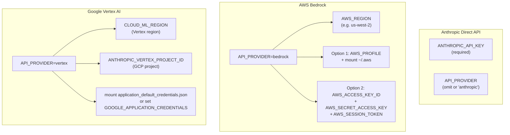
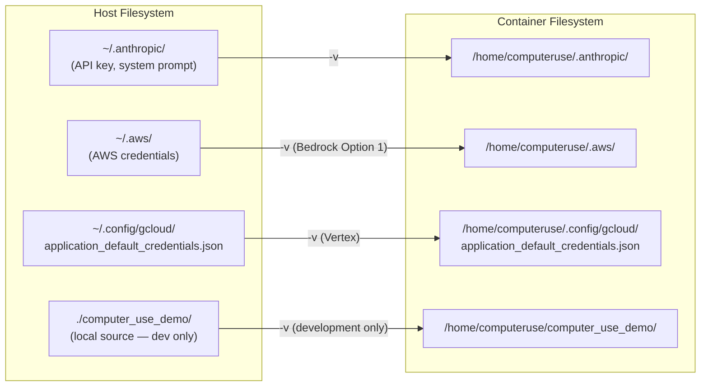
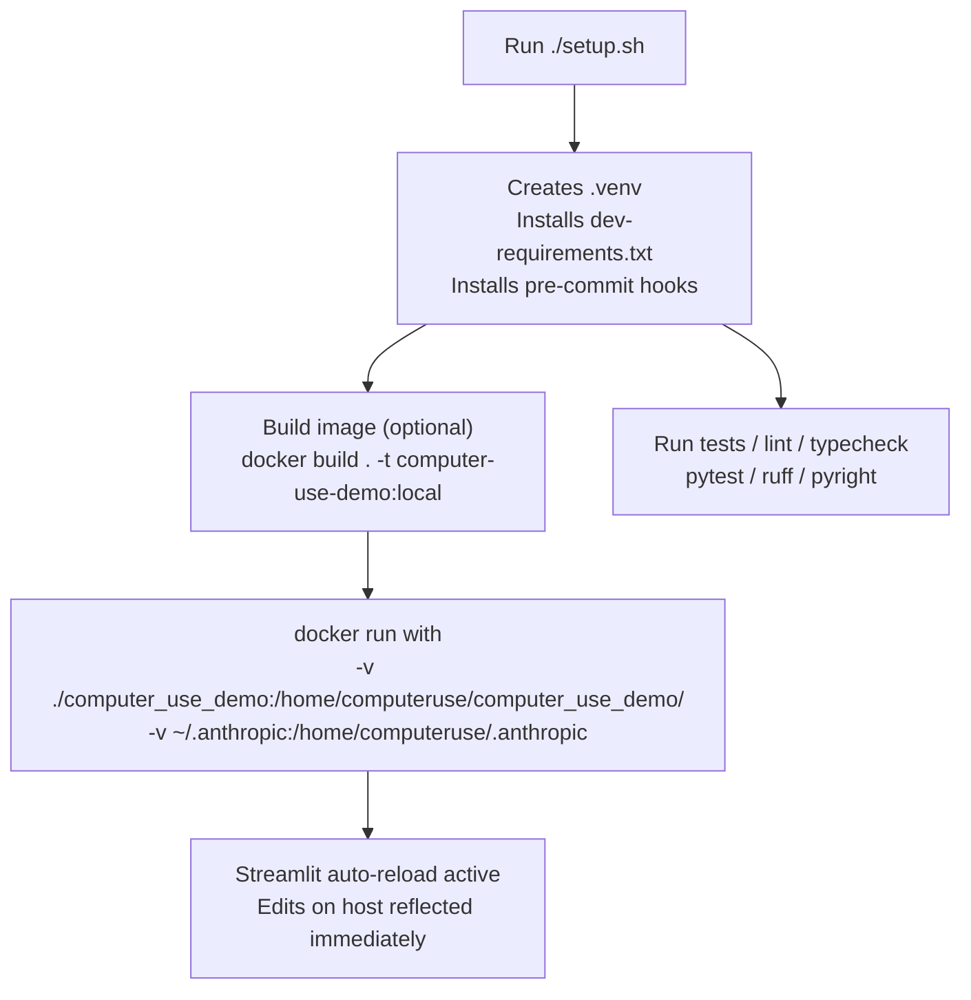

<!-- source: DeepWiki mcp.deepwiki.com · repo anthropics/claude-quickstarts · page 2.6 Setup & Configuration · fetched 2026-10-26 -->

# Setup & Configuration

<details>
<summary>Relevant source files</summary>

The following files were used as context for generating this wiki page:

- [CLAUDE.md](CLAUDE.md)
- [computer-use-demo/README.md](computer-use-demo/README.md)
- [computer-use-demo/setup.sh](computer-use-demo/setup.sh)

</details>


This page covers how to configure and run the Computer Use Demo — both as a pre-built Docker container (the typical path) and as a local development environment. It documents required environment variables per API provider, volume mounts, port mappings, screen resolution settings, and the custom system prompt mechanism.

For a description of what runs *inside* the container once it starts, see [Docker Environment & Deployment](#2.5). For information about the Streamlit UI configuration options (model selection, tool version, etc.), see [Streamlit User Interface](#2.3).

---

## Local Development Setup

The `setup.sh` script prepares a local Python environment for running tests, linting, and type checking against the `computer_use_demo` module without being inside the container.

**Steps performed by `setup.sh`** [computer-use-demo/setup.sh:1-21]():

| Step | Action |
|------|--------|
| Python version check | Requires Python 3.12 or lower; exits if `python3 --version` minor version > 12 |
| Cargo check | Requires Rust's `cargo` to be available (needed by a dependency); exits if missing |
| venv creation | `python3 -m venv .venv` |
| Activation | `source .venv/bin/activate` |
| Dependency install | `pip install -r dev-requirements.txt` |
| Pre-commit hooks | `pre-commit install` |

After running `setup.sh`, the standard development commands are available:

| Command | Purpose |
|---------|---------|
| `ruff check .` | Lint |
| `ruff format .` | Format |
| `pyright` | Type check |
| `pytest` | Run test suite |

For full documentation of the development tooling, see [Development Setup](#5.1).

Sources: [computer-use-demo/setup.sh:1-21](), [CLAUDE.md:9-21]()

---

## Running with Docker

All three supported API providers use the same published image:

```
ghcr.io/anthropics/anthropic-quickstarts:computer-use-demo-latest
```

All `docker run` invocations share a common set of port mappings:

| Host Port | Container Port | Service |
|-----------|---------------|---------|
| `5900` | `5900` | x11vnc (raw VNC) |
| `8501` | `8501` | Streamlit app |
| `6080` | `6080` | noVNC web client |
| `8080` | `8080` | Landing page (combined view) |

Once running, open `http://localhost:8080` for the combined chat + desktop interface.

Sources: [computer-use-demo/README.md:33-131]()

---

## Environment Variables by API Provider

**Provider selection** is controlled by the `API_PROVIDER` environment variable. The sampling loop reads this to determine which Anthropic client to initialize. For the default Anthropic direct API, `API_PROVIDER` does not need to be set.

### Diagram: Environment Variables per Provider



Sources: [computer-use-demo/README.md:35-127]()

### Anthropic Direct API

| Variable | Required | Description |
|----------|----------|-------------|
| `ANTHROPIC_API_KEY` | Yes | API key from [console.anthropic.com] |

[computer-use-demo/README.md:40-50]()

### AWS Bedrock

| Variable | Required | Description |
|----------|----------|-------------|
| `API_PROVIDER` | Yes | Must be `bedrock` |
| `AWS_REGION` | Yes | AWS region (e.g. `us-west-2`) |
| `AWS_PROFILE` | Option 1 | AWS CLI profile name |
| `AWS_ACCESS_KEY_ID` | Option 2 | IAM access key |
| `AWS_SECRET_ACCESS_KEY` | Option 2 | IAM secret key |
| `AWS_SESSION_TOKEN` | Option 2 | Session token (if using temp credentials) |

[computer-use-demo/README.md:54-101]()

### Google Vertex AI

| Variable | Required | Description |
|----------|----------|-------------|
| `API_PROVIDER` | Yes | Must be `vertex` |
| `CLOUD_ML_REGION` | Yes | Vertex AI region |
| `ANTHROPIC_VERTEX_PROJECT_ID` | Yes | GCP project ID |
| `GOOGLE_APPLICATION_CREDENTIALS` | Alt | Path to a service account credentials file |

[computer-use-demo/README.md:103-127]()

---

## Volume Mounts

Volume mounts serve two purposes: persisting configuration across container runs, and enabling live-reload development by mounting local source files into the container.

### Diagram: Volume Mount Mapping



| Host Path | Container Path | Purpose | Provider |
|-----------|---------------|---------|----------|
| `$HOME/.anthropic` | `/home/computeruse/.anthropic` | Persists API key and custom system prompt | All |
| `$HOME/.aws` | `/home/computeruse/.aws` | AWS credentials file | Bedrock (Option 1) |
| `$HOME/.config/gcloud/application_default_credentials.json` | `/home/computeruse/.config/gcloud/application_default_credentials.json` | GCP application default credentials | Vertex |
| `$(pwd)/computer_use_demo` | `/home/computeruse/computer_use_demo` | Live source mount for development | Dev only |

The `~/.anthropic/` directory is the most universally used mount. It persists settings between container restarts so the API key and system prompt do not need to be re-entered each time.

Sources: [computer-use-demo/README.md:41-50](), [computer-use-demo/README.md:62-99](), [computer-use-demo/README.md:107-122](), [computer-use-demo/README.md:166-183]()

---

## Screen Resolution

The virtual display resolution is controlled by two environment variables passed to `docker run`:

| Variable | Default | Description |
|----------|---------|-------------|
| `WIDTH` | (container default) | Virtual display width in pixels |
| `HEIGHT` | (container default) | Virtual display height in pixels |

Example: [computer-use-demo/README.md:144-156]()

```
-e WIDTH=1920 -e HEIGHT=1080
```

**Recommended resolution**: XGA (1024×768). The `ComputerTool` implements coordinate scaling internally (`MAX_SCALING_TARGETS`, `ScalingSource`), which maps between the actual virtual display resolution and the resolution sent to the model. Sending screenshots above XGA resolution increases latency and reduces model accuracy. For full details on the scaling implementation, see [ComputerTool](#2.4.3).

| Scenario | Recommendation |
|----------|---------------|
| Higher resolution than XGA | Scale image down to XGA; map coordinates back proportionally |
| Lower resolution / small device | Add black padding to reach 1024×768 |

Sources: [computer-use-demo/README.md:141-164]()

---

## Custom System Prompt

The container stores the custom system prompt in `~/.anthropic/` (i.e., `/home/computeruse/.anthropic/` inside the container). By mounting `$HOME/.anthropic` from the host, the system prompt is persisted across container restarts and can be edited from the host filesystem.

The system prompt is surfaced in the Streamlit sidebar and is read during `sampling_loop()` initialization. For details on how the system prompt is constructed and injected into the API call, see [Sampling Loop & Agent Orchestration](#2.2).

Sources: [computer-use-demo/README.md:133-134]()

---

## Development Workflow

For development, the local Python module is mounted into the container. Streamlit is configured with auto-reload, so edits to files under `computer_use_demo/` on the host take effect immediately without rebuilding the image.

### Diagram: Development Setup Flow



The full development `docker run` command mounts the source directory and uses either the locally built image or the published image [computer-use-demo/README.md:166-183]().

Sources: [computer-use-demo/README.md:166-183](), [computer-use-demo/setup.sh:1-21](), [CLAUDE.md:9-21]()

---

