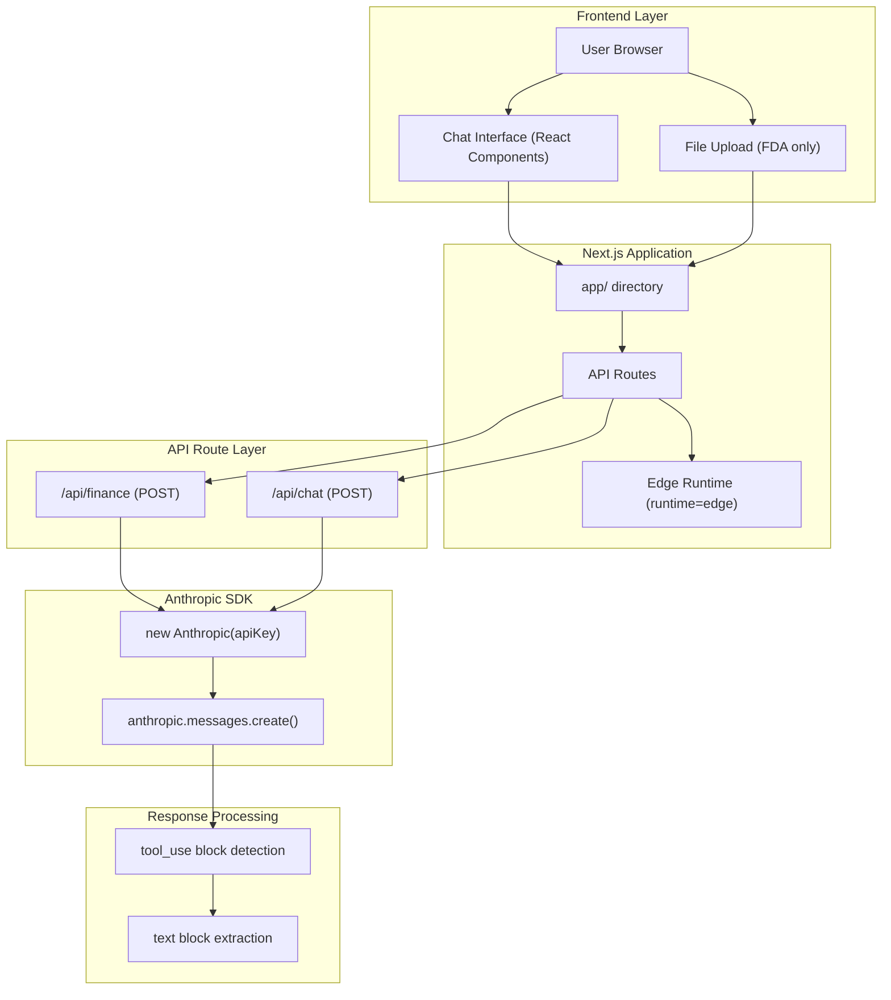
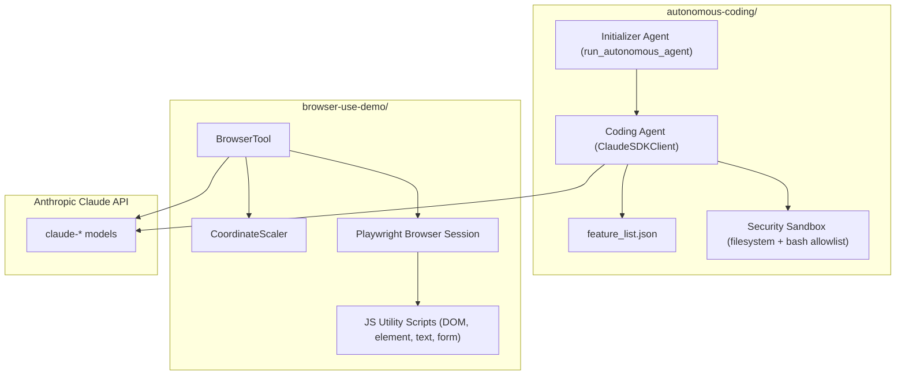
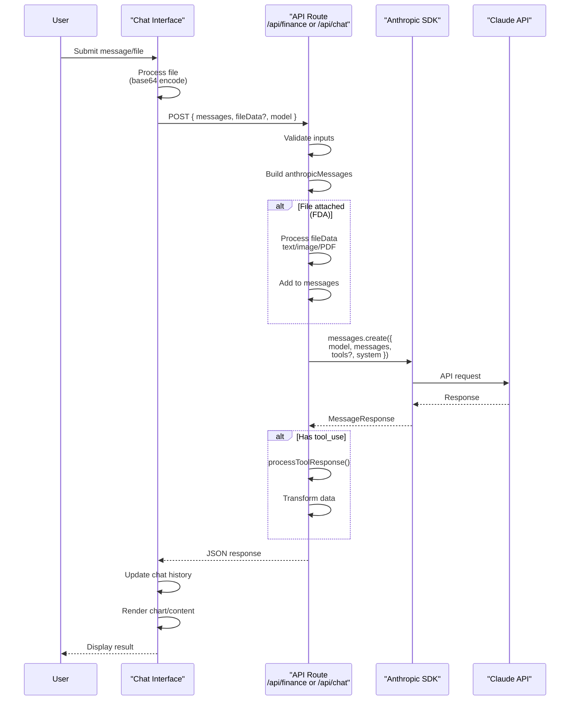
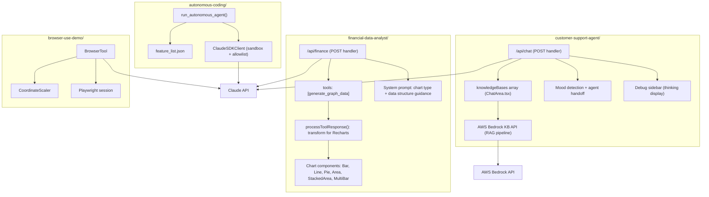
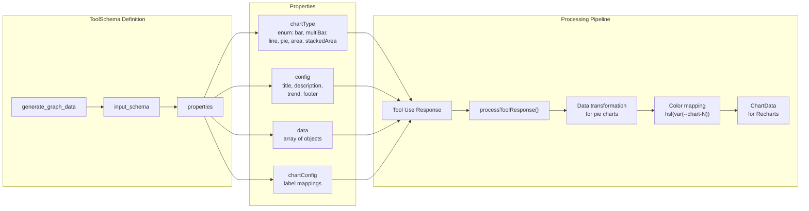
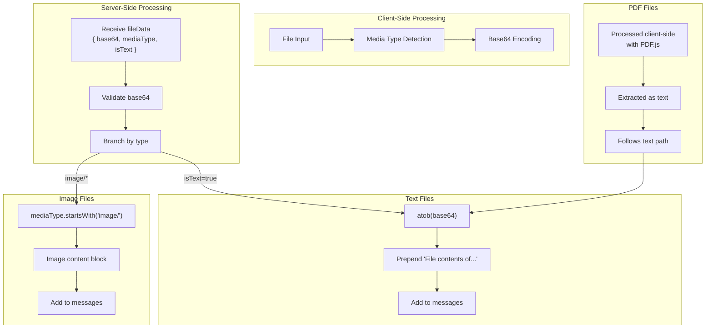

<!-- source: DeepWiki mcp.deepwiki.com · repo anthropics/claude-quickstarts · page 3 Quickstart Applications · fetched 2026-10-26 -->

# Quickstart Applications

<details>
<summary>Relevant source files</summary>

The following files were used as context for generating this wiki page:

- [.github/workflows/tests.yaml](.github/workflows/tests.yaml)
- [README.md](README.md)
- [agents/README.md](agents/README.md)
- [customer-support-agent/README.md](customer-support-agent/README.md)
- [financial-data-analyst/README.md](financial-data-analyst/README.md)
- [financial-data-analyst/app/api/finance/route.ts](financial-data-analyst/app/api/finance/route.ts)

</details>


This section covers four quickstart projects beyond the Computer Use Demo: two Next.js web applications (Financial Data Analyst and Customer Support Agent) and two Python-based automation projects (Autonomous Coding Agent and Browser Use Demo). Each demonstrates a distinct pattern for building Claude-powered applications.

For detailed documentation, see the sub-pages: [Customer Support Agent](3.1), [Financial Data Analyst](3.2), [Autonomous Coding Agent](3.3), and [Browser Use Demo](3.4). For the agent framework and computer use demo, see [Agent Framework](4) and [Computer Use Demo](2).

**Sources:** [README.md:9-39](), [customer-support-agent/README.md:1-14](), [financial-data-analyst/README.md:1-21]()

## Available Quickstarts

| Quickstart | Language / Stack | Primary Pattern | Directory |
|------------|-----------------|-----------------|-----------|
| **Customer Support Agent** | TypeScript / Next.js | RAG with AWS Bedrock Knowledge Bases | `customer-support-agent/` |
| **Financial Data Analyst** | TypeScript / Next.js | Tool use, chart generation, file upload | `financial-data-analyst/` |
| **Autonomous Coding Agent** | Python / Claude Code SDK | Two-agent orchestration, session continuity | `autonomous-coding/` |
| **Browser Use Demo** | Python / Playwright | Browser automation via Claude tool use | `browser-use-demo/` |

The two Next.js apps share a common architecture (Next.js API routes, Anthropic SDK, AWS Amplify deployment). The two Python apps each implement a custom tool loop tailored to their domain.

**Sources:** [README.md:11-39](), [financial-data-analyst/README.md:54-67](), [customer-support-agent/README.md:6-13]()

## Next.js Application Pattern (Financial Data Analyst & Customer Support Agent)

Both Next.js quickstarts share the same structural pattern: a React chat UI in the browser posts to a Next.js Edge Runtime API route, which calls the Anthropic SDK, then returns structured JSON for the frontend to render.

**Next.js Applications: Shared Architecture**



The pattern implemented in both apps:

1. **Frontend**: React chat interface with message history; file upload in FDA
2. **API Routes**: Next.js Edge Runtime routes — `/api/finance` (FDA) and `/api/chat` (CSA)
3. **Claude Integration**: `@anthropic-ai/sdk` `Anthropic` client calls `messages.create()`
4. **Response Processing**: Detect `tool_use` vs `text` content blocks and return structured JSON

**Sources:** [financial-data-analyst/app/api/finance/route.ts:1-11](), [financial-data-analyst/README.md:56-67](), [customer-support-agent/README.md:6-9]()

## Python Application Pattern (Autonomous Coding Agent & Browser Use Demo)

The two Python-based quickstarts implement custom agent loops rather than a web API layer. Each defines a tool class that Claude can invoke, and runs an interaction loop to drive automation.

**Python Applications: Shared Architecture**



- **Autonomous Coding Agent**: Orchestrates two agents. The initializer parses a `feature_list.json` and the coding agent implements features incrementally using the Claude Code SDK, with a security sandbox restricting filesystem and shell access.
- **Browser Use Demo**: Provides a `BrowserTool` class with actions for navigation, DOM inspection, and form interaction. A `CoordinateScaler` maps between display and browser coordinate spaces. Playwright manages the browser session.

**Sources:** [README.md:35-39](), [agents/README.md:1-10]()

## Request/Response Flow



**Request/Response Flow: Message Processing Pipeline**

The flow maps to specific code paths:

1. **Input Validation**: [financial-data-analyst/app/api/finance/route.ts:116-128]() validates `messages` array and `model` selection
2. **Message Conversion**: [financial-data-analyst/app/api/finance/route.ts:130-134]() transforms UI messages to Anthropic format
3. **File Processing**: [financial-data-analyst/app/api/finance/route.ts:137-193]() handles base64 encoding, text decoding, and image attachment
4. **Claude API Call**: [financial-data-analyst/app/api/finance/route.ts:215-330]() invokes `anthropic.messages.create()` with tools and system prompt
5. **Response Processing**: [financial-data-analyst/app/api/finance/route.ts:350-406]() extracts tool use and text content

**Sources:** [financial-data-analyst/app/api/finance/route.ts:103-222]()

## Comparison Across All Four Quickstarts

**All Quickstarts: Feature Comparison**



| Aspect | Financial Data Analyst | Customer Support Agent | Autonomous Coding | Browser Use Demo |
|--------|------------------------|------------------------|-------------------|-----------------|
| **Stack** | TypeScript / Next.js | TypeScript / Next.js | Python | Python / Playwright |
| **Primary Pattern** | Tool calling, structured chart output | RAG, knowledge retrieval | Two-agent orchestration | Browser automation |
| **Claude Integration** | `tools: [generate_graph_data]` | System prompt + RAG context | Claude Code SDK | `BrowserTool` actions |
| **External Services** | None | AWS Bedrock Knowledge Bases | None | Playwright browser |
| **Output Format** | `ChartData` JSON → Recharts | Natural language + citations | Generated code files | DOM / page state |
| **File Processing** | Client-side (PDF.js, base64) | Pre-indexed in S3 | `feature_list.json` | N/A |
| **Session Continuity** | Stateless per-request | Knowledge base selection | `feature_list.json` + git | Playwright session |
| **Deployment** | AWS Amplify / local | AWS Amplify / local | Local | Local |

**Sources:** [financial-data-analyst/app/api/finance/route.ts:37-101](), [customer-support-agent/README.md:69-109](), [README.md:35-39]()

## Tool Definition: generate_graph_data

The Financial Data Analyst defines a single tool that constrains Claude's output to valid chart specifications:



**Tool Definition Structure**

The `generate_graph_data` tool is defined at [financial-data-analyst/app/api/finance/route.ts:37-101]() with:

- **`chartType`**: Enum constraining to six supported chart types
- **`config`**: Metadata including title, description, trend percentage/direction, footer
- **`data`**: Array of objects with flexible structure based on chart type
- **`chartConfig`**: Mapping of data keys to display labels and colors

Post-processing at [financial-data-analyst/app/api/finance/route.ts:353-402]() transforms tool output:

1. **Pie Chart Normalization**: Ensures `segment` and `value` keys for consistency
2. **Color Assignment**: Maps data keys to CSS variables (`hsl(var(--chart-1))`, etc.)
3. **Data Validation**: Verifies required fields and array structure

**Sources:** [financial-data-analyst/app/api/finance/route.ts:27-101](), [financial-data-analyst/app/api/finance/route.ts:353-402]()

## System Prompts and Behavior

Both quickstarts use detailed system prompts to guide Claude's behavior:

**Financial Data Analyst System Prompt** [financial-data-analyst/app/api/finance/route.ts:222-330]():

- Defines six chart types with use cases (time series, comparisons, distributions)
- Provides data structure examples for each chart type
- Specifies formatting requirements (proper financial formatting, contextual data)
- Includes explicit instructions: "NEVER SAY you are using the generate_graph_data tool"
- Focuses on generating real, contextually appropriate data

**Customer Support Agent** (documented in [Customer Support Agent](#3.2)):

- Implements mood detection for escalation to human agents
- Integrates RAG context from Bedrock Knowledge Bases
- Displays thinking process in debug sidebar
- Supports multiple knowledge base switching

The Financial Data Analyst uses a prescriptive prompt with examples, while the Customer Support Agent uses a conversational prompt with RAG context injection.

**Sources:** [financial-data-analyst/app/api/finance/route.ts:222-330](), [customer-support-agent/README.md:11-12]()

## File Processing: Multi-Format Support

The Financial Data Analyst implements comprehensive file processing:



**Multi-Format File Processing Pipeline**

The implementation at [financial-data-analyst/app/api/finance/route.ts:137-193]() handles:

1. **Text Files**: Decoded from base64 with `atob()`, prepended with filename context
2. **Image Files**: Embedded as image content blocks with media type and base64 data
3. **PDF Files**: Client-side extraction with PDF.js, then processed as text

File content is inserted into the last message of the conversation, combining with the user's prompt. The Customer Support Agent does not support file upload; documents are pre-indexed in S3-backed knowledge bases.

**Sources:** [financial-data-analyst/app/api/finance/route.ts:137-193](), [financial-data-analyst/README.md:10-13](), [customer-support-agent/README.md:69-109]()

## Deployment Configuration

Both quickstarts support AWS Amplify deployment with environment variable configuration:

| Environment Variable | Financial Data Analyst | Customer Support Agent | Purpose |
|---------------------|------------------------|------------------------|---------|
| `ANTHROPIC_API_KEY` | Required | Required | Claude API authentication |
| `BAWS_ACCESS_KEY_ID` | - | Required | AWS Bedrock access (prefixed to avoid Amplify restriction) |
| `BAWS_SECRET_ACCESS_KEY` | - | Required | AWS Bedrock secret key |
| `KNOWLEDGE_BASE_ID` | - | Optional | Default knowledge base selection |

The "B" prefix on AWS credentials works around Amplify's restriction on environment variables starting with "AWS". The variables are referenced without the prefix in application code.

**Amplify Build Configuration** [customer-support-agent/README.md:169-191]():

```yaml
version: 1
frontend:
  phases:
    preBuild:
      commands:
        - npm ci --cache .npm --prefer-offline
    build:
      commands:
        - npm run build
        - echo "ANTHROPIC_API_KEY=$ANTHROPIC_API_KEY" >> .env
        - echo "BAWS_ACCESS_KEY_ID=$BAWS_ACCESS_KEY_ID" >> .env
        - echo "BAWS_SECRET_ACCESS_KEY=$BAWS_SECRET_ACCESS_KEY" >> .env
```

For local development, both applications use `.env.local` files with standard variable names.

**Sources:** [customer-support-agent/README.md:23-33](), [customer-support-agent/README.md:159-206](), [financial-data-analyst/README.md:42-45]()

## Common Patterns and Best Practices

Both quickstarts demonstrate production-ready patterns:

**API Route Design:**
- Edge Runtime for low latency and global distribution
- Comprehensive input validation before processing
- Detailed error handling with specific error types
- Structured JSON responses with consistent schema

**Claude Integration:**
- Model selection via runtime parameter (not hardcoded)
- Temperature setting for appropriate creativity level (0.7 for both)
- Max tokens configured for expected response length (4096)
- Detailed system prompts with examples and constraints

**Response Processing:**
- Detection of tool use via `content.type === 'tool_use'`
- Separation of text content and tool outputs
- Progressive UI updates via callback patterns
- Client-side rendering of structured outputs (charts, formatted text)

**Error Handling:**
- Authentication error detection (`Anthropic.AuthenticationError`)
- API error handling (`Anthropic.APIError`) with status codes
- Detailed console logging for debugging
- User-friendly error messages in responses

The quickstarts serve as templates for building production applications with similar requirements.

**Sources:** [financial-data-analyst/app/api/finance/route.ts:103-465](), [README.md:29-38]()

---

