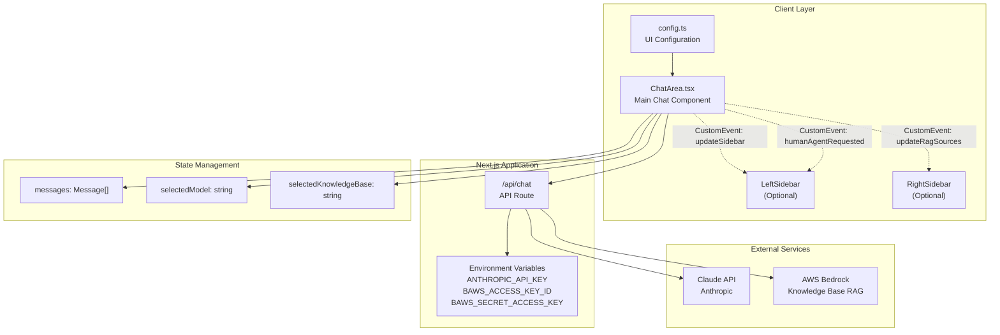
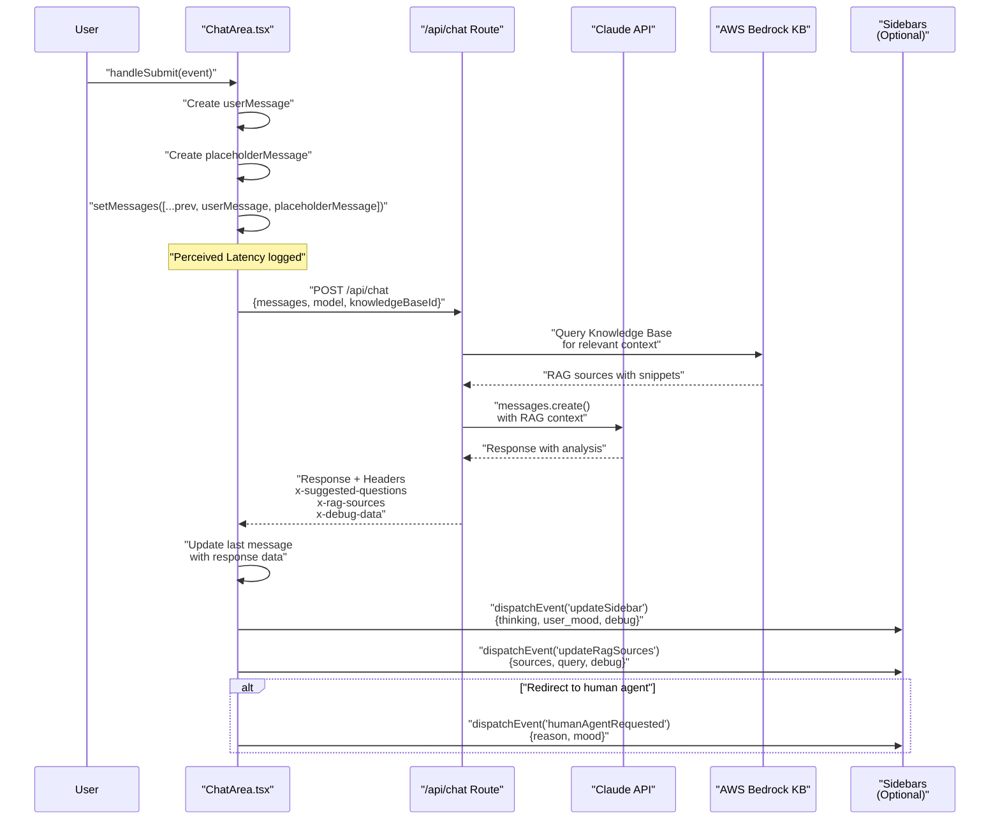
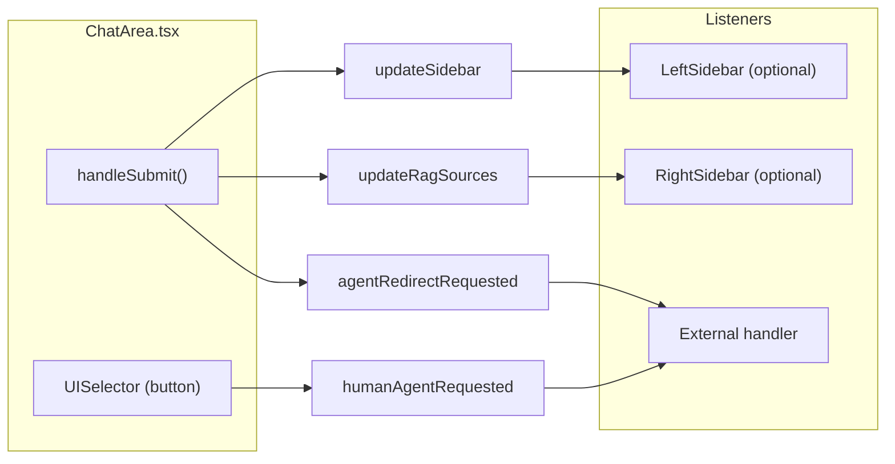
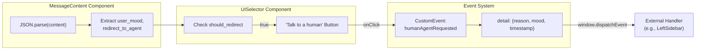
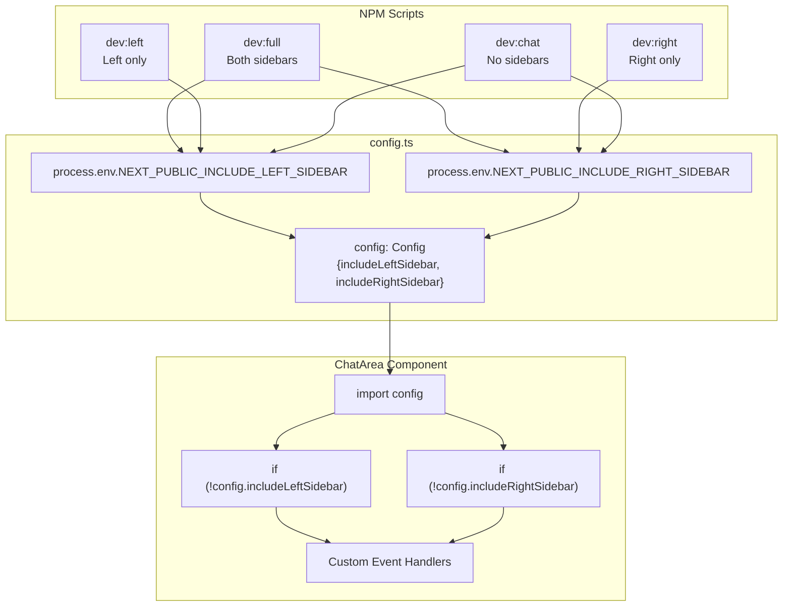

<!-- source: DeepWiki mcp.deepwiki.com · repo anthropics/claude-quickstarts · page 3.1 Customer Support Agent · fetched 2026-10-26 -->

# Customer Support Agent

<details>
<summary>Relevant source files</summary>

The following files were used as context for generating this wiki page:

- [.github/workflows/tests.yaml](.github/workflows/tests.yaml)
- [README.md](README.md)
- [agents/README.md](agents/README.md)
- [customer-support-agent/README.md](customer-support-agent/README.md)
- [customer-support-agent/components/ChatArea.tsx](customer-support-agent/components/ChatArea.tsx)
- [financial-data-analyst/README.md](financial-data-analyst/README.md)
- [financial-data-analyst/app/api/finance/route.ts](financial-data-analyst/app/api/finance/route.ts)
- [financial-data-analyst/app/finance/page.tsx](financial-data-analyst/app/finance/page.tsx)

</details>


## Purpose and Scope

This document describes the Customer Support Agent quickstart, a production-ready Next.js application demonstrating AI-powered customer support using Claude with AWS Bedrock Knowledge Base integration for retrieval-augmented generation (RAG). The application showcases real-time chat, mood detection, human agent escalation, and suggested follow-up questions. For information about the Financial Data Analyst application with chart generation capabilities, see [3.2](#3.2). For the minimal agent framework reference implementation, see [4](#4).

**Sources:** [README.md:11-15](), [customer-support-agent/README.md:1-14]()

---

## Architecture Overview

The Customer Support Agent is built as a Next.js application with a React-based frontend and serverless API routes. The system integrates with AWS Bedrock Knowledge Bases for contextual retrieval and uses Anthropic's Claude API for response generation.

### System Architecture



**Sources:** [customer-support-agent/components/ChatArea.tsx:1-726](), [customer-support-agent/README.md:24-33]()

---

## Core Components

### ChatArea Component

The `ChatArea` component ([customer-support-agent/components/ChatArea.tsx:300-723]()) serves as the primary chat interface. It manages conversation state, handles user input, and coordinates communication with the API.

**Key State Variables:**

| State Variable | Type | Default | Purpose |
|---------------|------|---------|---------|
| `messages` | `Message[]` | `[]` | Conversation history |
| `selectedModel` | `string` | `"claude-haiku-4-5-20251001"` | Active Claude model ID |
| `selectedKnowledgeBase` | `string` | `"your-knowledge-base-id"` | Active Bedrock KB ID |
| `input` | `string` | `""` | Current textarea value |
| `isLoading` | `boolean` | `false` | API request in-flight flag |
| `showHeader` | `boolean` | `false` | Whether conversation header is visible |
| `showAvatar` | `boolean` | `false` | Whether AI avatar is visible |

**Sources:** [customer-support-agent/components/ChatArea.tsx:301-312]()

### Message Interface

```typescript
interface Message {
  id: string;
  role: string;  // "user" or "assistant"
  content: string;
}
```

Assistant messages contain JSON-formatted responses with structured fields:

| Field | Type | Description |
|-------|------|-------------|
| `response` | `string` | The assistant's reply text |
| `thinking` | `string` | Internal reasoning process |
| `user_mood` | `string` | Detected user sentiment |
| `suggested_questions` | `string[]` | Follow-up question suggestions |
| `redirect_to_agent` | `object` | Human agent escalation data |
| `debug` | `object` | Debug information including context usage |

**Sources:** [customer-support-agent/components/ChatArea.tsx:199-203](), [customer-support-agent/components/ChatArea.tsx:126-135]()

### Model and Knowledge Base Configuration

The application supports multiple Claude models and knowledge bases, configurable via dropdown selectors:

```typescript
const models: Model[] = [
  { id: "claude-3-haiku-20240307", name: "Claude 3 Haiku" },
  { id: "claude-haiku-4-5-20251001", name: "Claude 4.5 Haiku" },
  { id: "claude-3-5-sonnet-20240620", name: "Claude 3.5 Sonnet" },
];

const knowledgeBases: KnowledgeBase[] = [
  { id: "your-knowledge-base-id", name: "Your KB Name" },
  // Add more knowledge bases as needed
];
```

**Sources:** [customer-support-agent/components/ChatArea.tsx:318-322](), [customer-support-agent/components/ChatArea.tsx:313-316]()

---

## Message Flow and API Integration

### Request Lifecycle



**Sources:** [customer-support-agent/components/ChatArea.tsx:402-539]()

### handleSubmit Function Flow

The `handleSubmit` function ([customer-support-agent/components/ChatArea.tsx:402-539]()) orchestrates the request lifecycle with performance tracking:

1. **Initial Setup** ([customer-support-agent/components/ChatArea.tsx:408-442]()): Creates user message and placeholder assistant message
2. **API Request** ([customer-support-agent/components/ChatArea.tsx:444-466]()): Sends POST to `/api/chat` with conversation history
3. **Response Processing** ([customer-support-agent/components/ChatArea.tsx:467-511]()): Parses JSON response and custom headers
4. **Event Dispatching** ([customer-support-agent/components/ChatArea.tsx:513-530]()): Emits custom events for sidebar updates

**Performance Monitoring:**
- Perceived Latency: Time until placeholder displayed
- Network Duration: Full round trip to API
- JSON Parse Duration: Response deserialization time
- Total Client Operation: End-to-end timing

**Sources:** [customer-support-agent/components/ChatArea.tsx:397-401](), [customer-support-agent/components/ChatArea.tsx:441-442]()

---

## Custom Event System

`ChatArea` communicates response data to optional sidebar components and external listeners using `window.dispatchEvent` with standard browser `CustomEvent` instances. This decouples the chat core from the optional UI panels.

**Events dispatched by `ChatArea`:**

| Event Name | Dispatcher | `detail` Payload | Typical Listener |
|-----------|-----------|-----------------|-----------------|
| `updateSidebar` | `handleSubmit` [line 513-522]() | `{id, content, user_mood, debug, matched_categories}` | `LeftSidebar` |
| `updateRagSources` | `handleSubmit` [line 488-496]() | `{sources, query, debug}` | `RightSidebar` |
| `agentRedirectRequested` | `handleSubmit` [line 524-530]() | `redirect_to_agent` object | External escalation handler |
| `humanAgentRequested` | `UISelector` button click [line 68-80]() | `{reason, mood, timestamp}` | External escalation handler |

**Events listened for by `ChatArea`:**

| Event Name | Handler | Purpose |
|-----------|---------|---------|
| `toolExecution` | `handleToolExecution` [line 562-573]() | Receives tool execution results from external components |

When a sidebar is excluded via `config.ts`, `ChatArea` registers a no-op fallback handler for the corresponding event to prevent unhandled event scenarios:

- `updateSidebar` fallback: active when `!config.includeLeftSidebar` [customer-support-agent/components/ChatArea.tsx:346-364]()
- `updateRagSources` fallback: active when `!config.includeRightSidebar` [customer-support-agent/components/ChatArea.tsx:366-384]()

**Custom Event Flow:**



Sources: [customer-support-agent/components/ChatArea.tsx:346-384](), [customer-support-agent/components/ChatArea.tsx:488-530](), [customer-support-agent/components/ChatArea.tsx:562-573]()

---

## AWS Bedrock RAG Integration

### Knowledge Base Configuration

The application uses AWS Bedrock Knowledge Bases for retrieval-augmented generation. Each knowledge base is identified by an ID and contains indexed documents/sources.

**Configuration Location:**
- Knowledge base IDs are stored in the `knowledgeBases` array ([customer-support-agent/components/ChatArea.tsx:313-316]())
- The selected knowledge base ID is passed to the API route via `knowledgeBaseId` parameter ([customer-support-agent/components/ChatArea.tsx:453]())

**Setup Requirements:**

| Component | Configuration |
|-----------|--------------|
| AWS Account | Bedrock access enabled |
| Knowledge Base | Created in AWS region, documents indexed |
| IAM Permissions | `AmazonBedrockFullAccess` policy attached |
| Environment Variables | `BAWS_ACCESS_KEY_ID`, `BAWS_SECRET_ACCESS_KEY` |

**Sources:** [customer-support-agent/README.md:69-86](), [customer-support-agent/README.md:44-67]()

### RAG Source Visualization

When the API returns RAG sources in the `x-rag-sources` header ([customer-support-agent/components/ChatArea.tsx:480-497]()), the application dispatches a custom event to update the RightSidebar:

```typescript
window.dispatchEvent(
  new CustomEvent("updateRagSources", {
    detail: {
      sources,
      query: userMessage.content,
      debug: data.debug,
    },
  })
);
```

**Sources:** [customer-support-agent/components/ChatArea.tsx:488-496]()

---

## Key Features

### Mood Detection and Human Agent Escalation

The system analyzes user sentiment and can trigger human agent escalation based on detected frustration or complex queries.



**Implementation Details:**

The `UISelector` component ([customer-support-agent/components/ChatArea.tsx:58-87]()) checks the `redirect_to_agent` field in the parsed response. When `should_redirect` is true, it renders a "Talk to a human" button that dispatches the `humanAgentRequested` event via `window.dispatchEvent`.

`handleSubmit` also independently dispatches `agentRedirectRequested` when the API response includes `redirect_to_agent.should_redirect === true` ([customer-support-agent/components/ChatArea.tsx:524-530]()). The two events serve different listener audiences: `humanAgentRequested` is user-initiated (button click), while `agentRedirectRequested` is API-initiated (automatic after response parsing).

**Sources:** [customer-support-agent/components/ChatArea.tsx:58-87](), [customer-support-agent/components/ChatArea.tsx:186-188](), [customer-support-agent/components/ChatArea.tsx:524-530]()

### Suggested Questions

The system generates contextual follow-up questions to guide user interactions. Suggested questions are returned in the `x-suggested-questions` header ([customer-support-agent/components/ChatArea.tsx:473-478]()) and stored in the message's `suggested_questions` field.

**SuggestedQuestions Component:**

The component ([customer-support-agent/components/ChatArea.tsx:89-116]()) renders clickable buttons for each suggested question. When clicked, the question is automatically submitted via `handleSubmit(question)` ([customer-support-agent/components/ChatArea.tsx:558-560]()).

**Sources:** [customer-support-agent/components/ChatArea.tsx:89-116](), [customer-support-agent/components/ChatArea.tsx:663-670]()

### Message Parsing and Display

The `MessageContent` component ([customer-support-agent/components/ChatArea.tsx:118-191]()) handles JSON parsing and display of assistant responses with several states:

| State | Condition | Display |
|-------|-----------|---------|
| Thinking | Response not yet parsed | Animated spinner + "Thinking..." |
| Error | Parse failure after timeout | "Something went wrong" message |
| Success | Valid response received | Markdown-rendered response + UI elements |

**Timeout Handling:** A 30-second timeout ([customer-support-agent/components/ChatArea.tsx:141-144]()) triggers error state if response is incomplete.

**Sources:** [customer-support-agent/components/ChatArea.tsx:118-191]()

---

## UI Configuration System

The application supports flexible deployment configurations to include or exclude sidebar components based on environment variables.

### Configuration Architecture



**Configuration Options:**

| Script | Left Sidebar | Right Sidebar | Use Case |
|--------|--------------|---------------|----------|
| `npm run dev` (default) | ✓ | ✓ | Full application |
| `npm run dev:left` | ✓ | ✗ | Focus on thinking/mood display |
| `npm run dev:right` | ✗ | ✓ | Focus on RAG sources |
| `npm run dev:chat` | ✗ | ✗ | Minimal chat interface |

**Event Handling with Config:** The ChatArea component checks configuration before registering event listeners ([customer-support-agent/components/ChatArea.tsx:346-384]()):

```typescript
if (!config.includeLeftSidebar) {
  const handleUpdateSidebar = (event: CustomEvent<ThinkingContent>) => {
    console.log("LeftSidebar not included. Event data:", event.detail);
  };
  // Register alternative handler
}
```

**Sources:** [customer-support-agent/README.md:221-267](), [customer-support-agent/components/ChatArea.tsx:4](), [customer-support-agent/components/ChatArea.tsx:346-384]()

---

## Environment Configuration

### Required Environment Variables

The application requires three environment variables in a `.env.local` file:

| Variable | Purpose | Source |
|----------|---------|--------|
| `ANTHROPIC_API_KEY` | Claude API authentication | [console.anthropic.com](https://console.anthropic.com) |
| `BAWS_ACCESS_KEY_ID` | AWS Bedrock access | IAM User Access Key |
| `BAWS_SECRET_ACCESS_KEY` | AWS Bedrock access | IAM User Secret Key |

**Note:** The "B" prefix in AWS variable names is required because AWS Amplify does not allow environment variable names starting with "AWS" ([customer-support-agent/README.md:33](), [customer-support-agent/README.md:201]()).

**Sources:** [customer-support-agent/README.md:24-33](), [customer-support-agent/README.md:36-67]()

### AWS IAM Setup

To obtain AWS credentials for Bedrock access:

1. Create IAM user in AWS Management Console
2. Attach `AmazonBedrockFullAccess` policy ([customer-support-agent/README.md:57-58]())
3. Create access key with "Application running on an AWS compute service" option
4. Save Access Key ID and Secret Access Key (only visible once)

**Sources:** [customer-support-agent/README.md:44-67]()

---

## Deployment

### AWS Amplify Deployment

The application can be deployed using AWS Amplify with automatic GitHub integration.

**Build Configuration (amplify.yml):**

```yaml
version: 1
frontend:
  phases:
    preBuild:
      commands:
        - npm ci --cache .npm --prefer-offline
    build:
      commands:
        - npm run build
        - echo "ANTHROPIC_API_KEY=$ANTHROPIC_API_KEY" >> .env
        - echo "BAWS_ACCESS_KEY_ID=$BAWS_ACCESS_KEY_ID" >> .env
        - echo "BAWS_SECRET_ACCESS_KEY=$BAWS_SECRET_ACCESS_KEY" >> .env
  artifacts:
    baseDirectory: .next
    files:
      - "**/*"
  cache:
    paths:
      - .next/cache/**/*
      - .npm/**/*
```

**Service Role Configuration:**

After deployment, the Amplify service role must have the `AmazonBedrockFullAccess` policy attached:

1. Navigate to deployment settings
2. Copy Service role ARN
3. Locate role in IAM console
4. Attach `AmazonBedrockFullAccess` policy

**Sources:** [customer-support-agent/README.md:159-220]()

---

## Component Reference

### ConversationHeader

The `ConversationHeader` component ([customer-support-agent/components/ChatArea.tsx:221-298]()) displays the conversation header with model and knowledge base selection dropdowns.

**Props:**

| Prop | Type | Description |
|------|------|-------------|
| `selectedModel` | `string` | Current model ID |
| `setSelectedModel` | `(modelId: string) => void` | Model change handler |
| `models` | `Model[]` | Available models |
| `showAvatar` | `boolean` | Display AI avatar |
| `selectedKnowledgeBase` | `string` | Current KB ID |
| `setSelectedKnowledgeBase` | `(kbId: string) => void` | KB change handler |
| `knowledgeBases` | `KnowledgeBase[]` | Available knowledge bases |

**Sources:** [customer-support-agent/components/ChatArea.tsx:206-228]()

### Auto-scrolling Behavior

The application implements automatic scrolling to the latest message using `useEffect` hooks and `messagesEndRef` ([customer-support-agent/components/ChatArea.tsx:308](), [customer-support-agent/components/ChatArea.tsx:673]()).

**Scroll Timing Logic:**

```typescript
useEffect(() => {
  const scrollToNewestMessage = () => {
    if (messagesEndRef.current) {
      const behavior = messages.length <= 2 ? "auto" : "smooth";
      messagesEndRef.current.scrollIntoView({ behavior, block: "end" });
    }
  };
  
  if (messages.length > 0) {
    setTimeout(scrollToNewestMessage, 100);
  }
}, [messages]);
```

**Sources:** [customer-support-agent/components/ChatArea.tsx:328-344]()

---

## Customization

### Theme System

The application uses shadcn/ui components with a customizable theme system. Themes are defined in `styles/themes.js` with separate light and dark mode configurations:

```javascript
export const themes = {
  neutral: {
    light: {
      // Light mode colors for neutral theme
    },
    dark: {
      // Dark mode colors for neutral theme
    }
  },
  // Add more themes here
};
```

**UI Component Customization:**
- Modify components in `components/ui` directory
- Adjust global styles in `app/globals.css`
- Update theme colors in `styles/themes.js`

**Sources:** [customer-support-agent/README.md:134-158]()

---

## Technology Stack

| Category | Technology |
|----------|-----------|
| Framework | Next.js 14 |
| UI Library | React with shadcn/ui components |
| Styling | TailwindCSS |
| Markdown Rendering | `react-markdown` with `rehype-highlight`, `rehype-raw` |
| Syntax Highlighting | `highlight.js` with Atom One Dark theme |
| AI Integration | Anthropic SDK (Claude API) |
| RAG Backend | AWS Bedrock Knowledge Bases |
| Deployment | AWS Amplify (or local development server) |

**Sources:** [customer-support-agent/components/ChatArea.tsx:3-28](), [customer-support-agent/README.md:1-278]()

---

