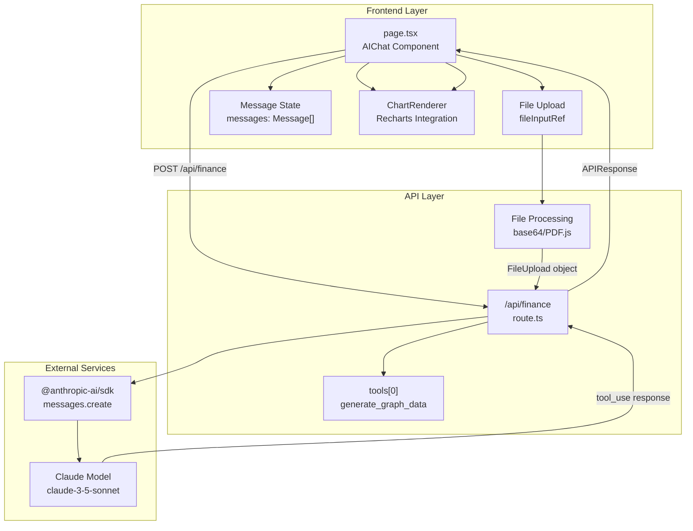
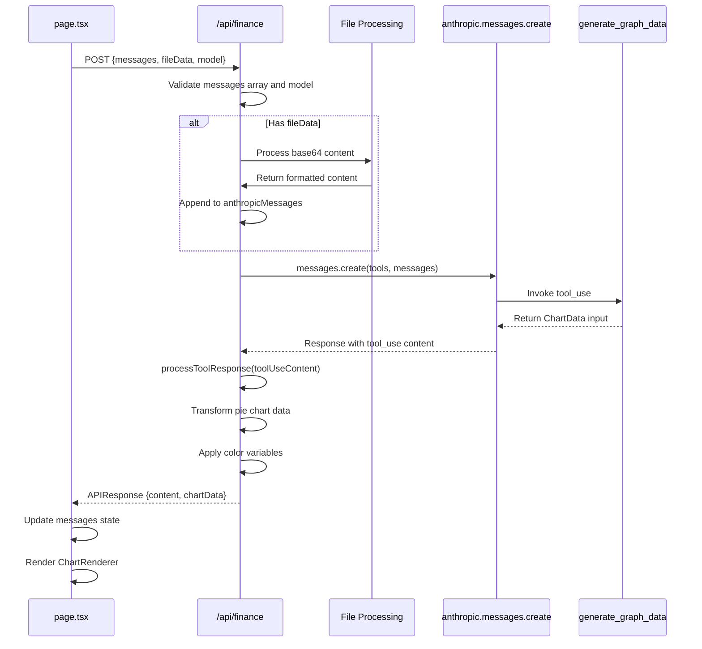
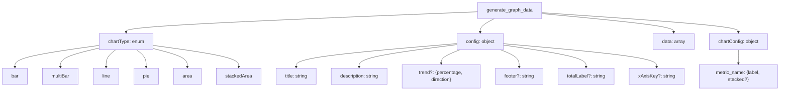
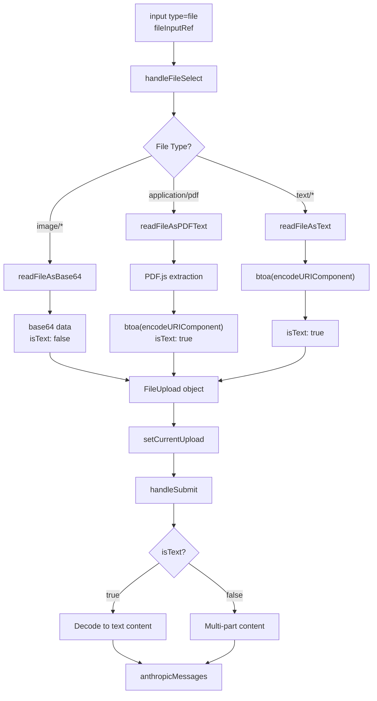
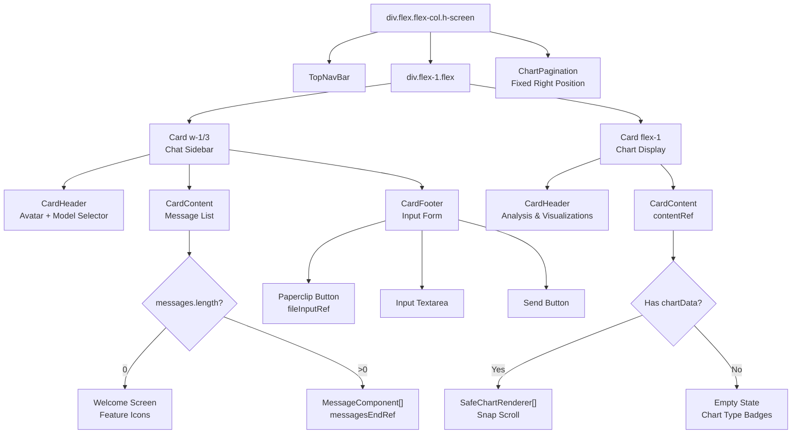
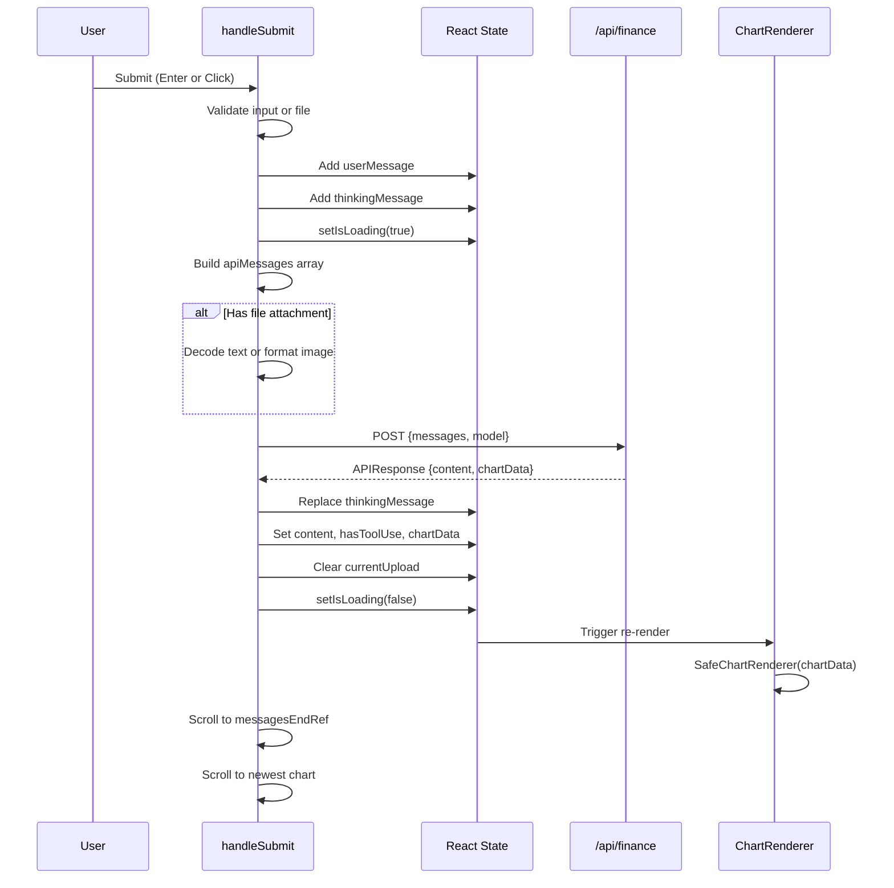
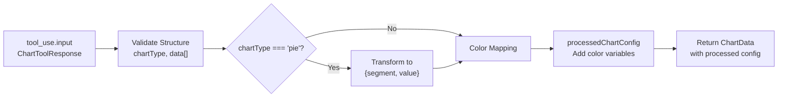

<!-- source: DeepWiki mcp.deepwiki.com · repo anthropics/claude-quickstarts · page 3.2 Financial Data Analyst · fetched 2026-10-26 -->

# Financial Data Analyst

<details>
<summary>Relevant source files</summary>

The following files were used as context for generating this wiki page:

- [.github/workflows/tests.yaml](.github/workflows/tests.yaml)
- [README.md](README.md)
- [agents/README.md](agents/README.md)
- [customer-support-agent/README.md](customer-support-agent/README.md)
- [customer-support-agent/components/ChatArea.tsx](customer-support-agent/components/ChatArea.tsx)
- [financial-data-analyst/README.md](financial-data-analyst/README.md)
- [financial-data-analyst/app/api/finance/route.ts](financial-data-analyst/app/api/finance/route.ts)
- [financial-data-analyst/app/finance/page.tsx](financial-data-analyst/app/finance/page.tsx)

</details>


## Purpose and Scope

This document describes the Financial Data Analyst quickstart application, a Next.js-based demonstration of Claude's ability to analyze financial data and generate interactive visualizations. The application implements a chat interface where users can upload files (CSV, PDF, images, text) and request data analysis, with Claude generating structured chart data through tool use.

For information about the customer support use case with RAG integration, see page 3.1. For the Python agent framework, see page 4.

**Sources:** [README.md:1-59](), [financial-data-analyst/README.md:1-120]()

## Architecture Overview

The Financial Data Analyst implements a three-layer architecture consisting of a React frontend, Next.js API route middleware, and Claude API integration. The system processes multi-modal inputs (text, images, PDFs) and outputs structured chart data through Claude's tool use capability.

### System Architecture



**Sources:** [financial-data-analyst/app/finance/page.tsx:1-748](), [financial-data-analyst/app/api/finance/route.ts:1-466]()

### Key Components

| Component | File Path | Purpose |
|-----------|-----------|---------|
| `AIChat` | [app/finance/page.tsx:197-747]() | Main page component managing chat state and UI |
| `POST` handler | [app/api/finance/route.ts:103-465]() | Edge runtime API route processing Claude requests |
| `generate_graph_data` | [app/api/finance/route.ts:37-101]() | Tool definition for structured chart data output |
| `ChartRenderer` | Referenced in [app/finance/page.tsx:27]() | Component rendering Recharts visualizations |
| `MessageComponent` | [app/finance/page.tsx:114-171]() | Individual message display with chart badges |

**Sources:** [financial-data-analyst/app/finance/page.tsx:197-747](), [financial-data-analyst/app/api/finance/route.ts:1-466]()

## API Route Implementation

The `/api/finance` route implements an Edge Runtime handler that processes chat messages, manages file uploads, and orchestrates Claude's tool use for chart generation.

### Request Processing Flow



**Sources:** [financial-data-analyst/app/api/finance/route.ts:103-465]()

### Tool Definition Structure

The `generate_graph_data` tool is defined with a comprehensive JSON schema specifying six chart types and their configuration requirements:



The tool schema is defined at [app/api/finance/route.ts:37-101]() with these key properties:

| Property | Type | Required | Description |
|----------|------|----------|-------------|
| `chartType` | `enum` | Yes | One of: bar, multiBar, line, pie, area, stackedArea |
| `config.title` | `string` | Yes | Chart title displayed in UI |
| `config.description` | `string` | Yes | Chart description/subtitle |
| `config.trend` | `object` | No | Percentage and direction (up/down) |
| `config.xAxisKey` | `string` | No | Key for x-axis data points |
| `data` | `array` | Yes | Array of data objects with arbitrary structure |
| `chartConfig` | `object` | Yes | Mapping of data keys to label and display properties |

**Sources:** [financial-data-analyst/app/api/finance/route.ts:37-101]()

### System Prompt Configuration

The API route includes a comprehensive system prompt at [app/api/finance/route.ts:222-329]() that instructs Claude on:

1. **Chart Type Selection**: Guidance on when to use each of the six chart types
2. **Data Structure Patterns**: Examples for time-series, comparisons, and distributions
3. **Best Practices**: Real data generation, proper financial formatting, appropriate visualization choices
4. **Prohibited Behaviors**: Never announce tool usage, avoid placeholder data, exclude technical details

The system prompt defines specific data structure patterns:

- **Time-Series (Line/Bar/Area)**: Objects with `period` and metric keys, requires `xAxisKey: "period"`
- **Comparisons (MultiBar)**: Objects with `category` and multiple metric keys for side-by-side analysis
- **Distributions (Pie)**: Objects with `segment` and `value` keys, requires `totalLabel` in config

**Sources:** [financial-data-analyst/app/api/finance/route.ts:222-329]()

## File Upload Processing

The application supports three file input types with distinct processing pipelines: images (base64), text files (base64-encoded text), and PDFs (text extraction via PDF.js).

### File Processing Pipeline



The file processing logic is implemented in [app/finance/page.tsx:282-369]():

1. **Image Files**: Read as base64 using `readFileAsBase64`, stored with `isText: false`, sent to Claude as image content blocks
2. **PDF Files**: Text extracted using `readFileAsPDFText` from PDF.js, encoded with `btoa(encodeURIComponent)`, marked as `isText: true`
3. **Text Files**: Read as text using `readFileAsText`, encoded same as PDFs, marked as `isText: true`

When sending to the API, text files are decoded and prepended to the message content at [app/finance/page.tsx:399-405](), while images are sent as multi-part content with image source blocks at [app/finance/page.tsx:407-424]().

**Sources:** [financial-data-analyst/app/finance/page.tsx:282-369](), [financial-data-analyst/app/finance/page.tsx:371-491](), [financial-data-analyst/app/api/finance/route.ts:130-193]()

### Message Structure Transformation

The API route transforms user messages with file attachments into Claude-compatible formats:

**Text Files and PDFs** — the last `anthropicMessages` entry is replaced with a two-element array: a `text` block prefixed with `"File contents of <fileName>:\n\n..."` followed by the user's typed message. See [financial-data-analyst/app/api/finance/route.ts:148-165]().

**Image Files** — the last entry is replaced with a two-element array: an `image` block carrying `type: "base64"`, `media_type`, and `data`, followed by the user's typed message text. See [financial-data-analyst/app/api/finance/route.ts:166-184]().

**Sources:** [financial-data-analyst/app/api/finance/route.ts:136-193]()

## Frontend Application

The `AIChat` component manages the entire user experience including message history, file uploads, model selection, and chart display with pagination.

### Component State Management

The main state elements in [app/finance/page.tsx:198-211]():

| State Variable | Type | Purpose |
|----------------|------|---------|
| `messages` | `Message[]` | Chat history with user/assistant messages and chart data |
| `input` | `string` | Current textarea input value |
| `isLoading` | `boolean` | Loading state during API requests |
| `selectedModel` | `string` | Currently selected Claude model ID |
| `currentUpload` | `FileUpload \| null` | Pending file attachment |
| `currentChartIndex` | `number` | Active chart in pagination view |
| `isScrollLocked` | `boolean` | Prevents scroll during message updates |

### Message Type Definition

The `Message` interface is defined at [financial-data-analyst/app/finance/page.tsx:45-57]() and carries these fields:

| Field | Type | Purpose |
|-------|------|---------|
| `id` | `string` | Unique UUID per message |
| `role` | `string` | `"user"` or `"assistant"` |
| `content` | `string` | Text content or `"thinking"` sentinel for loading state |
| `hasToolUse` | `boolean?` | Indicates Claude invoked `generate_graph_data` |
| `file.base64` | `string?` | Base64-encoded file payload |
| `file.mediaType` | `string?` | MIME type of the attached file |
| `file.isText` | `boolean?` | Whether payload is text-encoded vs. binary image |
| `chartData` | `ChartData?` | Processed chart payload returned by the API |

**Sources:** [financial-data-analyst/app/finance/page.tsx:44-70](), [financial-data-analyst/app/finance/page.tsx:197-211]()

### UI Layout Structure

The application uses a two-column layout with chat sidebar and chart display area:



**Sources:** [financial-data-analyst/app/finance/page.tsx:516-746]()

### Submit Flow and Response Handling

The `handleSubmit` function at [app/finance/page.tsx:371-491]() implements the complete submission flow:



**Key Implementation Details:**

1. **Placeholder Message**: A "thinking" message is immediately added at [page.tsx:385-392]() for instant feedback
2. **Message Transformation**: The `apiMessages` array is built by mapping over all messages and handling file attachments at [page.tsx:397-432]()
3. **Response Processing**: The API response replaces the thinking message at [page.tsx:453-466]() with actual content and chart data
4. **Auto-scroll**: Multiple scroll mechanisms ensure visibility of new messages at [page.tsx:213-230](), [page.tsx:232-247](), and [page.tsx:483-489]()

**Sources:** [financial-data-analyst/app/finance/page.tsx:371-491]()

## Chart Rendering System

The chart rendering system processes tool output from Claude into interactive Recharts visualizations with automatic scrolling and pagination.

### Chart Data Processing

The `processToolResponse` function at [app/api/finance/route.ts:353-402]() transforms Claude's tool output:

1. **Validation**: Checks for required `chartType`, `data` array at [route.ts:356-364]()
2. **Pie Chart Normalization**: Transforms data items to consistent `segment`/`value` structure at [route.ts:367-383]()
3. **Color Assignment**: Maps `chartConfig` keys to CSS variables `hsl(var(--chart-${index + 1}))` at [route.ts:386-396]()



**Sources:** [financial-data-analyst/app/api/finance/route.ts:353-402]()

### Chart Type Configurations

The six supported chart types with their typical use cases:

| Chart Type | Use Case | Data Structure | Required Config |
|------------|----------|----------------|-----------------|
| `line` | Time series trends | `{period, metric}` | `xAxisKey: "period"` |
| `bar` | Single metric comparisons | `{category, value}` | `xAxisKey` |
| `multiBar` | Multiple metrics side-by-side | `{category, metric1, metric2}` | `xAxisKey`, multiple chartConfig entries |
| `area` | Volume over time | `{period, quantity}` | `xAxisKey: "period"` |
| `stackedArea` | Component breakdowns | `{period, component1, component2}` | `xAxisKey`, `stacked: true` in chartConfig |
| `pie` | Distribution analysis | `{segment, value}` | `xAxisKey: "segment"`, `totalLabel` |

The system prompt at [financial-data-analyst/app/api/finance/route.ts:281-296]() includes a concrete `multiBar` example with `category`, `sales`, and `costs` keys in each data object, `xAxisKey: "category"` in `config`, and separate `chartConfig` entries for `sales` and `costs`.

**Sources:** [financial-data-analyst/app/api/finance/route.ts:222-329]()

### Chart Display and Pagination

The chart display area implements snap scrolling and pagination dots:

**Snap Scroll Container** [page.tsx:689-693]():
- Uses `overflow-y-auto snap-y snap-mandatory` classes
- Each chart is `min-h-full flex-shrink-0 snap-start snap-always`
- Tracks scroll position via `handleChartScroll` at [page.tsx:249-255]()

**Pagination Controls** [page.tsx:173-195]():
- Fixed right position dots indicating total charts
- Current chart highlighted with `scale-125` transform
- Click handler calls `scrollToChart(index)` for navigation

**Auto-scroll to Newest** [page.tsx:267-280]():
- Effect triggers when messages update
- Finds last chart index and scrolls to it
- Ensures new visualizations are immediately visible

**Sources:** [financial-data-analyst/app/finance/page.tsx:173-195](), [financial-data-analyst/app/finance/page.tsx:249-280](), [financial-data-analyst/app/finance/page.tsx:681-736]()

## Model Selection and Configuration

The application supports three Claude models with a dropdown selector in the chat header:

```typescript
const models: Model[] = [
  { id: "claude-3-haiku-20240307", name: "Claude 3 Haiku" },
  { id: "claude-haiku-4-5-20251001", name: "Claude 4.5 Haiku" },
  { id: "claude-3-5-sonnet-20240620", name: "Claude 3.5 Sonnet" },
];
```

Defined at [app/finance/page.tsx:72-76]()

The selected model is passed to the API at [page.tsx:436]() in the request body. The API route uses this model ID directly in the `anthropic.messages.create` call at [route.ts:215-330]() with these parameters:

- `max_tokens: 4096` - Maximum response length
- `temperature: 0.7` - Balanced creativity/consistency
- `tool_choice: { type: "auto" }` - Claude decides when to use tools
- `tools: [generate_graph_data]` - Single tool definition

**Sources:** [financial-data-analyst/app/finance/page.tsx:72-76](), [financial-data-analyst/app/finance/page.tsx:434-446](), [financial-data-analyst/app/api/finance/route.ts:215-330]()

## Error Handling and Edge Cases

The application implements comprehensive error handling across file processing, API requests, and chart rendering:

### File Processing Errors

[app/finance/page.tsx:298-368]()

- **PDF Parsing Failure**: Catches errors from `readFileAsPDFText`, shows "PDF parsing failed" toast
- **Text Reading Failure**: Falls back to "Invalid file type" error for unreadable files
- **General Upload Error**: Shows "Upload failed" toast and clears loading state

### API Request Errors

[app/api/finance/route.ts:422-464]()

- **Anthropic.APIError**: Returns error with status code and message details
- **Anthropic.AuthenticationError**: Returns 401 with authentication failure message
- **Invalid Input**: Returns 400 for missing messages array or model selection at [route.ts:116-128]()
- **General Errors**: Returns 500 with error message

### Chart Rendering Errors

The `SafeChartRenderer` component at [financial-data-analyst/app/finance/page.tsx:95-112]() wraps chart rendering in a try-catch block. On success it renders `ChartRenderer`; on failure it logs via `console.error` and renders a `text-red-500` error message div in place of the chart.

**Sources:** [financial-data-analyst/app/finance/page.tsx:95-112](), [financial-data-analyst/app/finance/page.tsx:282-369](), [financial-data-analyst/app/api/finance/route.ts:422-464]()

## Technology Stack Integration

The Financial Data Analyst integrates several key technologies:

| Technology | Version/Config | Usage | File Reference |
|------------|----------------|-------|----------------|
| Next.js | 14 | React framework with API routes | [financial-data-analyst/README.md:57]() |
| Edge Runtime | `export const runtime = "edge"` | Lightweight API execution | [route.ts:11]() |
| Anthropic SDK | `@anthropic-ai/sdk` | Claude API client | [route.ts:3](), [route.ts:7-9]() |
| Recharts | Chart library | Interactive data visualizations | [README.md:62]() |
| PDF.js | PDF parser | Text extraction from PDFs | [README.md:62]() |
| TailwindCSS | Utility CSS | Styling and layout | [README.md:59]() |
| Shadcn/ui | Component library | Button, Card, Textarea components | [README.md:60]() |

**Runtime Configuration:**
- The Edge Runtime at [route.ts:11]() enables fast, globally distributed API execution
- Allows deployment to edge networks for lower latency
- Supports streaming responses (though current implementation uses standard JSON)

**Sources:** [financial-data-analyst/README.md:54-68](), [financial-data-analyst/app/api/finance/route.ts:11]()

---

