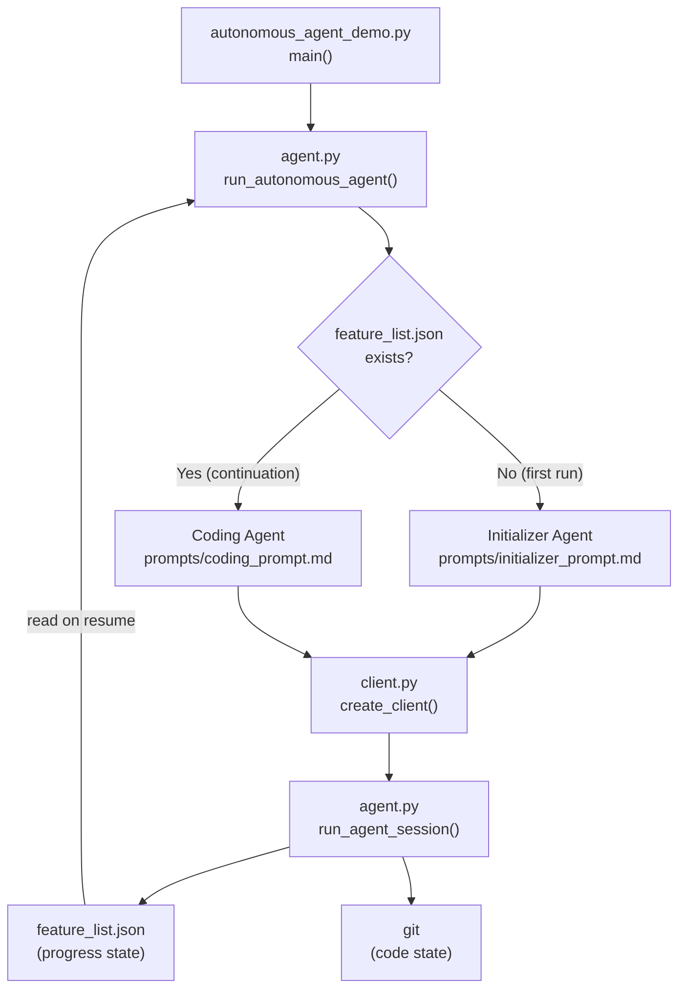
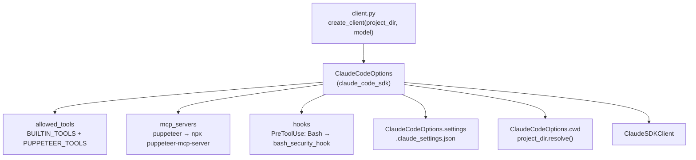
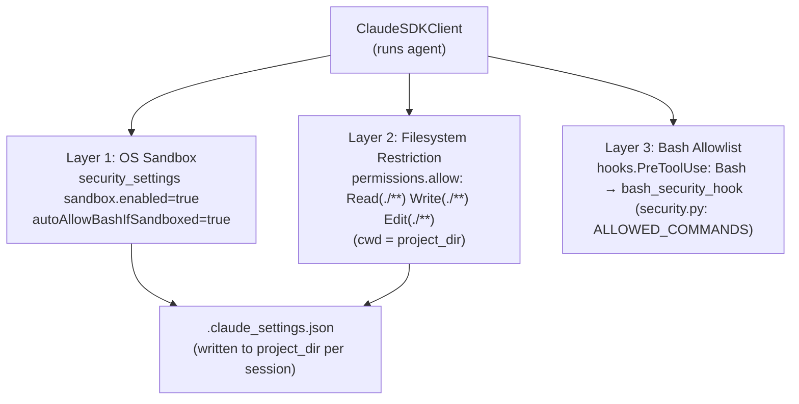

<!-- source: DeepWiki mcp.deepwiki.com · repo anthropics/claude-quickstarts · page 3.3 Autonomous Coding Agent · fetched 2026-10-26 -->

# Autonomous Coding Agent

<details>
<summary>Relevant source files</summary>

The following files were used as context for generating this wiki page:

- [autonomous-coding/README.md](autonomous-coding/README.md)
- [autonomous-coding/agent.py](autonomous-coding/agent.py)
- [autonomous-coding/autonomous_agent_demo.py](autonomous-coding/autonomous_agent_demo.py)
- [autonomous-coding/client.py](autonomous-coding/client.py)
- [autonomous-coding/progress.py](autonomous-coding/progress.py)
- [autonomous-coding/prompts.py](autonomous-coding/prompts.py)

</details>


## Purpose and Scope

The `autonomous-coding` quickstart demonstrates long-running autonomous coding with the Claude Code SDK. It implements a two-agent pattern (an Initializer and a Coding Agent) that builds complete applications across multiple sessions, with progress persisted to `feature_list.json` and git.

For information about the foundational agent framework, see page 4. For other quickstart applications, see page 3.1 (Customer Support Agent) and page 3.2 (Financial Data Analyst).

Sources: [autonomous-coding/README.md:1-3]()

---

## Overview

The system is driven from a single entry point, `autonomous_agent_demo.py`, which parses CLI arguments and calls `run_autonomous_agent` from `agent.py`. The agent loop creates a fresh `ClaudeSDKClient` for each session, loads the appropriate prompt, and streams the response back to the terminal. Progress is tracked by reading `feature_list.json` in the project directory.

**Key files:**

| File | Role |
|------|------|
| `autonomous_agent_demo.py` | CLI entry point, argument parsing |
| `agent.py` | `run_autonomous_agent` loop, `run_agent_session` |
| `client.py` | `create_client` — SDK client + security configuration |
| `security.py` | `bash_security_hook`, `ALLOWED_COMMANDS` allowlist |
| `progress.py` | `count_passing_tests`, `print_progress_summary` |
| `prompts.py` | `get_initializer_prompt`, `get_coding_prompt`, `copy_spec_to_project` |
| `prompts/initializer_prompt.md` | First-session prompt template |
| `prompts/coding_prompt.md` | Continuation-session prompt template |
| `prompts/app_spec.txt` | Application specification fed to the initializer |

Sources: [autonomous-coding/README.md:81-95]()

---

## Two-Agent Pattern

The system uses two distinct agent roles, distinguished by whether `feature_list.json` exists in the project directory. The decision is made inside `run_autonomous_agent`.

**Two-agent pattern overview:**



| Agent Role | Triggered When | Prompt File | Key Output |
|---|---|---|---|
| Initializer | `feature_list.json` absent | `prompts/initializer_prompt.md` | `feature_list.json`, project scaffold, `init.sh`, git init |
| Coding Agent | `feature_list.json` present | `prompts/coding_prompt.md` | Feature implementations, updated `feature_list.json`, git commits |

Sources: [autonomous-coding/agent.py:122-166](), [autonomous-coding/README.md:53-65]()

---

## `run_autonomous_agent` Orchestration

`run_autonomous_agent` in `agent.py` is the main loop. It runs indefinitely (or until `--max-iterations` is reached), creating a fresh `ClaudeSDKClient` per iteration via `create_client`.

**Session loop flow:**

```mermaid
sequenceDiagram
    participant CLI as "autonomous_agent_demo.py\nmain()"
    participant LOOP as "agent.py\nrun_autonomous_agent()"
    participant PROMPTS as "prompts.py"
    participant CLIENT as "client.py\ncreate_client()"
    participant SESSION as "agent.py\nrun_agent_session()"
    participant SDK as "ClaudeSDKClient\n(claude_code_sdk)"
    participant PROGRESS as "progress.py\nprint_progress_summary()"

    CLI->>LOOP: "run_autonomous_agent(project_dir, model, max_iterations)"
    LOOP->>LOOP: "check feature_list.json exists"
    loop "each iteration"
        LOOP->>CLIENT: "create_client(project_dir, model)"
        CLIENT-->>LOOP: "ClaudeSDKClient"
        LOOP->>PROMPTS: "get_initializer_prompt() or get_coding_prompt()"
        PROMPTS-->>LOOP: "prompt string"
        LOOP->>SESSION: "run_agent_session(client, prompt, project_dir)"
        SESSION->>SDK: "client.query(message)"
        SDK-->>SESSION: "stream: AssistantMessage / UserMessage"
        SESSION-->>LOOP: "(status, response_text)"
        LOOP->>PROGRESS: "print_progress_summary(project_dir)"
        LOOP->>LOOP: "asyncio.sleep(AUTO_CONTINUE_DELAY_SECONDS)"
    end
```

Key constants:
- `AUTO_CONTINUE_DELAY_SECONDS = 3` — delay between sessions [autonomous-coding/agent.py:20]()
- `DEFAULT_MODEL = "claude-sonnet-4-5-20250929"` — default model [autonomous-coding/autonomous_agent_demo.py:24]()
- `max_turns=1000` — passed to `ClaudeCodeOptions` [autonomous-coding/client.py:118]()

Sources: [autonomous-coding/agent.py:97-206](), [autonomous-coding/autonomous_agent_demo.py:75-116]()

---

## `ClaudeSDKClient` Configuration

`create_client` in `client.py` constructs a `ClaudeSDKClient` (from `claude_code_sdk`) with a `ClaudeCodeOptions` object. A fresh client is created at the start of every session, giving each session its own context window.

**Client and options structure:**



**`BUILTIN_TOOLS`** (allowed file/shell operations): `Read`, `Write`, `Edit`, `Glob`, `Grep`, `Bash`

**`PUPPETEER_TOOLS`** (MCP browser automation): `mcp__puppeteer__puppeteer_navigate`, `mcp__puppeteer__puppeteer_screenshot`, `mcp__puppeteer__puppeteer_click`, `mcp__puppeteer__puppeteer_fill`, `mcp__puppeteer__puppeteer_select`, `mcp__puppeteer__puppeteer_hover`, `mcp__puppeteer__puppeteer_evaluate`

Sources: [autonomous-coding/client.py:19-122]()

---

## Security Model

The system uses a three-layer defense-in-depth approach configured in `create_client` and `security.py`.

**Security layers:**



**`ALLOWED_COMMANDS`** in `security.py`:

| Category | Commands |
|---|---|
| File inspection | `ls`, `cat`, `head`, `tail`, `wc`, `grep` |
| Node.js | `npm`, `node` |
| Version control | `git` |
| Process management | `ps`, `lsof`, `sleep`, `pkill` |

Any `Bash` tool call whose command is not in the allowlist is blocked by `bash_security_hook` before execution. The settings are written to `.claude_settings.json` in the project directory on every call to `create_client`.

Sources: [autonomous-coding/client.py:56-122](), [autonomous-coding/README.md:67-78]()

---

## `feature_list.json` Session Continuity

`feature_list.json` is the source of truth for progress. It is created by the Initializer Agent and updated by the Coding Agent as features are implemented.

- **Schema**: a JSON array of objects; each entry has at minimum a `passes` boolean field.
- **Checked on startup**: `run_autonomous_agent` checks `project_dir / "feature_list.json"` to determine whether to use the Initializer or Coding Agent prompt [autonomous-coding/agent.py:125-129]().
- **Progress read**: `count_passing_tests` in `progress.py` reads and parses the file, returning `(passing_count, total_count)` [autonomous-coding/progress.py:12-36]().
- **Displayed after each session**: `print_progress_summary` calls `count_passing_tests` and prints `{passing}/{total} tests passing ({pct}%)` [autonomous-coding/progress.py:49-57]().

**Generated project directory layout** (after initialization):

```
{project_dir}/
├── feature_list.json       # test cases, passes tracked here
├── app_spec.txt            # copied from prompts/app_spec.txt
├── init.sh                 # environment setup (created by agent)
├── claude-progress.txt     # session notes (created by agent)
└── .claude_settings.json   # security settings (written by create_client)
```

Sources: [autonomous-coding/progress.py:12-57](), [autonomous-coding/agent.py:122-142](), [autonomous-coding/README.md:98-109]()

---

## Prompt Management

`prompts.py` loads prompt templates from the `prompts/` subdirectory. All prompts are plain text/Markdown files read at runtime.

| Function | File read | Used when |
|---|---|---|
| `get_initializer_prompt()` | `prompts/initializer_prompt.md` | First session (no `feature_list.json`) |
| `get_coding_prompt()` | `prompts/coding_prompt.md` | All subsequent sessions |
| `copy_spec_to_project(project_dir)` | copies `prompts/app_spec.txt` → `{project_dir}/app_spec.txt` | Before first session |

The `copy_spec_to_project` function is called once before the first `run_agent_session` to make the application spec available to the agent in its working directory [autonomous-coding/agent.py:137-138]().

Sources: [autonomous-coding/prompts.py:1-37]()

---

## Setup and Usage

The quickstart is located in `autonomous-coding/`. Prerequisites and installation:

1. Install Claude Code CLI: `npm install -g @anthropic-ai/claude-code`
2. Install Python dependencies: `pip install -r requirements.txt`
3. Set the API key: `export ANTHROPIC_API_KEY='your-api-key-here'`

**CLI options** (parsed by `parse_args` in `autonomous_agent_demo.py`):

| Option | Default | Description |
|---|---|---|
| `--project-dir` | `./autonomous_demo_project` | Project output directory; relative paths are placed under `generations/` |
| `--max-iterations` | `None` (unlimited) | Stop after N agent iterations |
| `--model` | `claude-sonnet-4-5-20250929` | Claude model identifier |

**Resuming a session**: Running the same `--project-dir` command again automatically detects `feature_list.json` and switches to the Coding Agent prompt. Press `Ctrl+C` to pause at any point.

> **Note on timing**: The first (Initializer) session generates 200 test cases in `feature_list.json` and can take 10–20+ minutes. Subsequent coding sessions take 5–15 minutes each.

Sources: [autonomous-coding/README.md:6-49](), [autonomous-coding/autonomous_agent_demo.py:27-116]()

---

## Key Differentiators

The Autonomous Coding Agent differs from other quickstarts in several important ways:

| Feature | Autonomous Coding Agent | Other Quickstarts |
|---------|------------------------|-------------------|
| Session Model | Multi-session with persistence | Single-session interactions |
| State Management | Git-based version control | In-memory message history |
| Agent Pattern | Two specialized agents | Single agent per application |
| Task Scope | Complete application development | Domain-specific tasks |
| Time Scale | Hours to days | Minutes to hours |
| Tool Focus | File system + version control | API integration, GUI automation |

This quickstart is particularly suited for:
- Building prototype applications iteratively
- Demonstrating long-running agent workflows
- Showcasing multi-agent collaboration patterns
- Exploring state persistence in agent systems

**Sources:** [README.md:29-33](), [README.md:11-27]()

---

