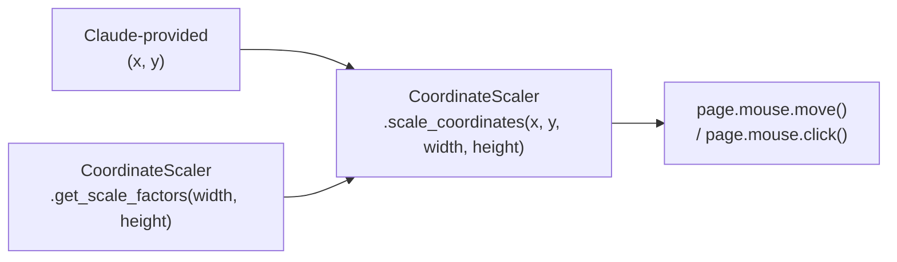

<!-- source: DeepWiki mcp.deepwiki.com · repo anthropics/claude-quickstarts · page 3.4 Browser Use Demo · fetched 2026-10-26 -->

# Browser Use Demo

<details>
<summary>Relevant source files</summary>

The following files were used as context for generating this wiki page:

- [browser-use-demo/CHANGELOG.md](browser-use-demo/CHANGELOG.md)
- [browser-use-demo/browser_use_demo/tools/browser.py](browser-use-demo/browser_use_demo/tools/browser.py)

</details>


This page documents the `browser-use-demo` quickstart: its `BrowserTool` class, supported actions, coordinate scaling logic, JavaScript utility scripts, and Playwright browser session lifecycle. For the related desktop automation approach that operates at the OS level (mouse, keyboard, screenshots), see the Computer Use Demo ([2](#2)) and its tool system ([2.4](#2.4)).

---

## Overview

The Browser Use Demo provides a Claude-controlled Playwright-based browser that can navigate websites, interact with DOM elements, extract structured content, and execute JavaScript — all through a single `BrowserTool` class exposed to the Claude API as a custom tool.

The demo operates a non-headless Chromium browser instance and translates Claude's tool calls into Playwright API calls. Unlike the Computer Use Demo (which controls a full virtual desktop), this demo scopes interaction exclusively to a browser page via DOM APIs.

---

## Project Structure

```
browser-use-demo/
├── browser_use_demo/
│   ├── tools/
│   │   ├── base.py               # BaseAnthropicTool, ToolResult, ToolError
│   │   ├── browser.py            # BrowserTool (main implementation)
│   │   └── coordinate_scaling.py # CoordinateScaler
│   ├── browser_tool_utils/
│   │   ├── browser_dom_script.js      # DOM accessibility tree extraction
│   │   ├── browser_element_script.js  # Element finding and coordinate lookup
│   │   ├── browser_text_script.js     # Full-page text extraction
│   │   ├── browser_form_input_script.js # Form field manipulation
│   │   └── browser_key_map.py         # KEY_MAP for key name normalization
│   └── display_constants.py      # BROWSER_WIDTH, BROWSER_HEIGHT, DISPLAY_NUM
└── CHANGELOG.md
```

Sources: [browser-use-demo/browser_use_demo/tools/browser.py:1-25]()

---

## BrowserTool Class

`BrowserTool` ([browser-use-demo/browser_use_demo/tools/browser.py:158-177]()) extends `BaseAnthropicTool` and holds a persistent Playwright session across conversation turns.

### Key Instance Attributes

| Attribute | Type | Description |
|---|---|---|
| `_browser` | `Optional[Browser]` | Playwright `Browser` object |
| `_context` | `Optional[BrowserContext]` | Browser context with viewport/UA config |
| `_page` | `Optional[Page]` | Active page; default timeout 30s |
| `_playwright` | `AsyncPlaywright` | Playwright runtime handle |
| `_initialized` | `bool` | Guards against double-initialization |
| `width` / `height` | `int` | Viewport dimensions from `BROWSER_WIDTH`/`BROWSER_HEIGHT` |
| `cdp_url` | `Optional[str]` | CDP endpoint (when connecting to existing browser) |

### Tool API Parameters

`to_params()` ([browser-use-demo/browser_use_demo/tools/browser.py:207-216]()) returns a custom tool definition using `BROWSER_TOOL_INPUT_SCHEMA` and `BROWSER_TOOL_DESCRIPTION` rather than using a built-in Anthropic computer use beta tool.

```
name:         "browser"
description:  BROWSER_TOOL_DESCRIPTION
input_schema: BROWSER_TOOL_INPUT_SCHEMA
```

Sources: [browser-use-demo/browser_use_demo/tools/browser.py:158-216]()

---

## Supported Actions

The `Actions` type alias ([browser-use-demo/browser_use_demo/tools/browser.py:131-155]()) enumerates all valid action strings. These are also declared in `BROWSER_TOOL_INPUT_SCHEMA` as an enum.

**Action reference by category:**

| Category | Actions | Required Parameters |
|---|---|---|
| Navigation | `navigate` | `text` (URL or `"back"`/`"forward"`) |
| Visual | `screenshot`, `zoom` | `region` (x1,y1,x2,y2) for zoom |
| Mouse — Click | `left_click`, `right_click`, `middle_click`, `double_click`, `triple_click` | `coordinate` or `ref` |
| Mouse — Movement | `hover`, `left_click_drag`, `left_mouse_down`, `left_mouse_up` | `coordinate`; `start_coordinate` + `coordinate` for drag |
| Keyboard | `type`, `key`, `hold_key` | `text`; `duration` for `hold_key` |
| Scroll | `scroll`, `scroll_to` | `scroll_direction`, `scroll_amount`; `ref` for `scroll_to` |
| DOM/Content | `read_page`, `get_page_text`, `find` | `text` for `find` |
| Form | `form_input` | `ref`, `value` |
| Timing | `wait` | `duration` (0–100 seconds) |
| Scripting | `execute_js` | `text` (JavaScript code string) |

The `__call__` method ([browser-use-demo/browser_use_demo/tools/browser.py:1105-1248]()) dispatches each action string to its corresponding private method.

Sources: [browser-use-demo/browser_use_demo/tools/browser.py:28-102](), [browser-use-demo/browser_use_demo/tools/browser.py:131-155]()

---

## Input Schema

`BROWSER_TOOL_INPUT_SCHEMA` ([browser-use-demo/browser_use_demo/tools/browser.py:28-102]()) defines the JSON schema for the tool's inputs. Only `action` is required; all other parameters are conditional on the action.

**Schema fields summary:**

| Field | Type | Used By |
|---|---|---|
| `action` | `string` (enum) | All actions |
| `text` | `string` | `navigate`, `type`, `key`, `hold_key`, `find`, `execute_js`, modifier for clicks |
| `ref` | `string` | `scroll_to`, `form_input`, click actions (alternative to coordinate) |
| `coordinate` | `[int, int]` | Mouse actions |
| `start_coordinate` | `[int, int]` | `left_click_drag` |
| `scroll_direction` | `string` (enum) | `scroll` |
| `scroll_amount` | `integer` | `scroll` |
| `duration` | `number` | `hold_key`, `wait` |
| `value` | `string\|number\|boolean` | `form_input` |
| `region` | `[int, int, int, int]` | `zoom` |

Sources: [browser-use-demo/browser_use_demo/tools/browser.py:28-102]()

---

## Browser Session Lifecycle

**Title: BrowserTool Session Lifecycle**

```mermaid
sequenceDiagram
    participant "Claude API" as API
    participant "__call__()" as Call
    participant "_ensure_browser()" as EnsureBrowser
    participant "playwright.chromium.launch()" as Launch
    participant "_page" as Page

    API->>"__call__()": "action=navigate, text=url"
    "__call__()"->>"_ensure_browser()": "await"
    "_ensure_browser()"->>"+_ensure_browser()": "_initialized == False?"
    "_ensure_browser()"->>+"playwright.chromium.launch()": "headless=False, args=[...]"
    "playwright.chromium.launch()"->>-"_ensure_browser()": "Browser instance"
    "_ensure_browser()"->>+"_page": "new_context() → new_page()"
    "_page"->>-"_ensure_browser()": "Page ready"
    "_ensure_browser()"-->>-"__call__()": "_initialized = True"
    "__call__()"->>+"_page": "_navigate(url)"
    "_page"-->>"__call__()": "ToolResult(base64_image=...)"
    "__call__()"-->>API: "ToolResult"

    note over "_ensure_browser()": "Second call: _initialized=True → reuse existing session"
```

Key behaviors of `_ensure_browser()` ([browser-use-demo/browser_use_demo/tools/browser.py:218-321]()):

- Browser is launched **once** and reused across all subsequent tool calls within a session.
- In Docker environments (detected via `/.dockerenv`), extra Chromium args are added including `--display=:{DISPLAY_NUM}` to connect to the X virtual framebuffer.
- Viewport is set to `BROWSER_WIDTH × BROWSER_HEIGHT` (imported from `display_constants`).
- User-agent is set to a Chrome/macOS string to avoid bot detection.
- Default page timeout: 30 seconds.

`cleanup()` ([browser-use-demo/browser_use_demo/tools/browser.py:1250-1276]()) closes the page, context, and browser, then stops the Playwright runtime. If `cdp_url` is set (external browser mode), it only drops references without closing the browser.

Sources: [browser-use-demo/browser_use_demo/tools/browser.py:218-321](), [browser-use-demo/browser_use_demo/tools/browser.py:1250-1276]()

---

## Coordinate Scaling

Claude's vision model interprets screenshots at a resolution that may differ from the actual browser viewport. The `CoordinateScaler` class ([browser-use-demo/browser_use_demo/tools/coordinate_scaling.py]()) compensates for this.

`_scale_coordinates(x, y)` ([browser-use-demo/browser_use_demo/tools/browser.py:416-455]()) is called before every mouse operation that takes raw coordinates:

1. Calls `CoordinateScaler.get_scale_factors(self.width, self.height)` to get `(scale_x, scale_y)`.
2. Calls `CoordinateScaler.scale_coordinates(x, y, self.width, self.height)` to produce `(scaled_x, scaled_y)`.
3. Logs a warning if the original and scaled values differ.

This is applied to: `_click`, `_drag`, `_mouse_down`, `_mouse_up`, and `_hover` (coordinate path).

> **Note:** The code comments ([browser-use-demo/browser_use_demo/tools/browser.py:197-205]()) document that this implementation uses fixed 1920×1080 dimensions with empirical correction. The Anthropic computer use documentation describes an alternative approach using client-side downscaling.

**Title: Coordinate Scaling Data Flow**



Sources: [browser-use-demo/browser_use_demo/tools/browser.py:416-455]()

---

## JavaScript Utility Scripts

`BrowserTool` delegates DOM introspection and element interaction to JavaScript files loaded at runtime from `BROWSER_TOOL_UTILS_DIR` ([browser-use-demo/browser_use_demo/tools/browser.py:123]()). The `_execute_js_from_file(filename, *args)` method ([browser-use-demo/browser_use_demo/tools/browser.py:323-350]()) reads each file and evaluates it via `page.evaluate()`.

| File | Used By | Behavior |
|---|---|---|
| `browser_dom_script.js` | `_read_page()`, `_find()` | Defines `window.__generateAccessibilityTree(filterType)` and returns a YAML-formatted accessibility tree with `ref_*` element IDs. Wrapped in an IIFE on execution. |
| `browser_element_script.js` | `_click()` (ref path), `_hover()` (ref path), `_scroll_to()` | Finds an element by its `ref_*` ID and returns `{ success, coordinates, message }`. |
| `browser_text_script.js` | `_get_page_text()` | Extracts all visible text, returning `{ title, url, source, text }`. |
| `browser_form_input_script.js` | `_form_input()` | Sets a form field's value by `ref_*` ID, returning `{ success, message }`. |
| `browser_key_map.py` | `_press_key()` | `KEY_MAP` dict mapping lowercase key names to `{ key, code }` structures for Playwright. |

The `browser_dom_script.js` file is handled specially: it is wrapped in an IIFE that calls `window.__generateAccessibilityTree(filterType)` ([browser-use-demo/browser_use_demo/tools/browser.py:335-345]()), whereas all other scripts are wrapped and called with JSON-serialized positional arguments.

Sources: [browser-use-demo/browser_use_demo/tools/browser.py:323-350](), [browser-use-demo/CHANGELOG.md:7-11]()

---

## Action Method Details

**Title: BrowserTool Action Method Map**

```mermaid
graph TD
    Call["__call__(action, ...)"]

    Call --> navigate["_navigate(url)\npage.goto() + _take_screenshot()"]
    Call --> screenshot["_take_screenshot()\npage.screenshot() → base64"]
    Call --> zoom["_zoom_screenshot(x,y,w,h)\npage.screenshot(clip=...)"]
    Call --> click["_click(action, coordinate, ref, text)\npage.mouse.click() or ref-based"]
    Call --> hover["_hover(coordinate, ref)\npage.mouse.move()"]
    Call --> type["_type_text(text)\npage.keyboard.type()"]
    Call --> key["_press_key(key, hold, duration)\npage.keyboard.press()"]
    Call --> scroll["_scroll(coord, dir, amount)\nmouse.wheel() or window.scrollBy()"]
    Call --> scroll_to["_scroll_to(ref)\nbrowser_element_script.js"]
    Call --> drag["_drag(sx, sy, ex, ey)\nmouse.down/move/up"]
    Call --> mouse_down["_mouse_down(x, y)\npage.mouse.down()"]
    Call --> mouse_up["_mouse_up(x, y)\npage.mouse.up()"]
    Call --> read_page["_read_page(filter_type)\nbrowser_dom_script.js"]
    Call --> get_text["_get_page_text()\nbrowser_text_script.js"]
    Call --> find["_find(query)\nbrowser_dom_script.js + Claude API"]
    Call --> form_input["_form_input(ref, value)\nbrowser_form_input_script.js"]
    Call --> wait["_wait(duration)\nasyncio.sleep()"]
    Call --> exec_js["_execute_js(code)\npage.evaluate(code)"]
```



### `_navigate`

[browser-use-demo/browser_use_demo/tools/browser.py:397-414]()

- Prepends `https://` if no protocol is present.
- Uses `wait_until="domcontentloaded"` then sleeps 2 seconds.
- Automatically returns a screenshot on completion.
- Supports `"back"` and `"forward"` as special `text` values (per schema description).

### `_click`

[browser-use-demo/browser_use_demo/tools/browser.py:457-556]()

Supports three targeting modes, in priority order:
1. **`coordinate`** — applies `_scale_coordinates`, validates against viewport bounds (logs warnings but proceeds), then calls `page.mouse.click()`.
2. **`ref`** — resolves element position via `browser_element_script.js`, then calls `page.mouse.click()` at the returned coordinates.
3. **`text`** — uses Playwright's `page.click(f"text={text}")` selector.

### `_read_page`

[browser-use-demo/browser_use_demo/tools/browser.py:814-855]()

Returns a structured output string prefixed with `__PAGE_EXTRACTED__` and a token/character count summary, followed by `__FULL_CONTENT__` and the full accessibility tree text. The `filter_type` parameter may be `"interactive"` to restrict results to interactive elements.

### `_get_page_text`

[browser-use-demo/browser_use_demo/tools/browser.py:857-901]()

Returns output prefixed with `__TEXT_EXTRACTED__` and a per-page summary (title, URL, estimated token count), followed by the full extracted text.

### `_find`

[browser-use-demo/browser_use_demo/tools/browser.py:903-1045]()

Two-phase operation:
1. Fetches the accessibility tree via `browser_dom_script.js`.
2. If `ANTHROPIC_API_KEY` is set, sends the tree to `claude-3-5-sonnet-20241022` with a structured prompt requesting `ref_*` matches. Falls back to `page.query_selector_all()` text matching if the API is unavailable.

### `_press_key`

[browser-use-demo/browser_use_demo/tools/browser.py:569-614]()

- Imports `KEY_MAP` from `browser_tool_utils/browser_key_map.py` to normalize key names.
- Handles `+`-delimited combinations (e.g., `"ctrl+c"`) by splitting and mapping each part.
- `hold=True` mode calls `keyboard.down()`, sleeps `duration`, then `keyboard.up()`.

### `_scroll`

[browser-use-demo/browser_use_demo/tools/browser.py:616-664]()

- Each scroll unit equals 100 pixels of `scrollBy` delta.
- When a `coordinate` is given, uses `page.mouse.wheel(delta_x, delta_y)`.
- Otherwise uses `page.evaluate("window.scrollBy(...)")`.
- Returns a screenshot after a 0.5-second stabilization delay.

Sources: [browser-use-demo/browser_use_demo/tools/browser.py:397-1077](), [browser-use-demo/CHANGELOG.md:28-35]()

---

## Output Format Conventions

`ToolResult` objects returned by `BrowserTool` follow these conventions:

| Action type | `output` field | `base64_image` field |
|---|---|---|
| Mouse clicks | `"Clicked at (x, y)"` or `"Clicked element with ref: ..."` | None |
| `navigate` | — (via `_take_screenshot`) | PNG as base64 |
| `screenshot` | `""` | PNG as base64 |
| `zoom` | `""` | Clipped PNG as base64 |
| `scroll` / `scroll_to` / `hover` | Text description | PNG as base64 |
| `read_page` | `__PAGE_EXTRACTED__\n<summary>\n__FULL_CONTENT__\n<tree>` | None |
| `get_page_text` | `__TEXT_EXTRACTED__\n<summary>\n__FULL_CONTENT__\n<text>` | None |
| `execute_js` | JSON-formatted result or `"undefined"` | None |

Screenshot files are written to `/tmp/outputs/` with UUID-based filenames before being read back as base64 ([browser-use-demo/browser_use_demo/tools/browser.py:119-120](), [browser-use-demo/browser_use_demo/tools/browser.py:362-371]()).

Sources: [browser-use-demo/browser_use_demo/tools/browser.py:352-395](), [browser-use-demo/browser_use_demo/tools/browser.py:848-900]()

---

## Relationship to BaseAnthropicTool

`BrowserTool` follows the same `BaseAnthropicTool` contract used by the Computer Use Demo tools (see [2.4.1](#2.4.1)):

- `to_params()` — returns a `BetaToolUnionParam` dict with `name`, `description`, and `input_schema`.
- `__call__(**kwargs)` — async entry point, returns `ToolResult`.

The difference is that `BrowserTool` provides a fully custom `input_schema` (`BROWSER_TOOL_INPUT_SCHEMA`) instead of using the versioned built-in Anthropic computer use schemas.

Sources: [browser-use-demo/browser_use_demo/tools/browser.py:207-216](), [browser-use-demo/browser_use_demo/tools/browser.py:1105-1119]()

---

