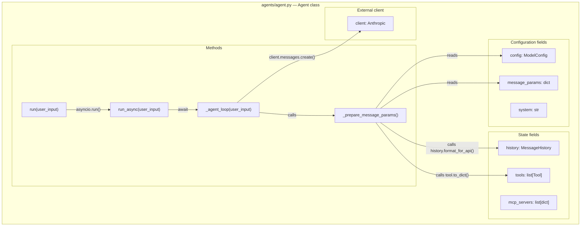
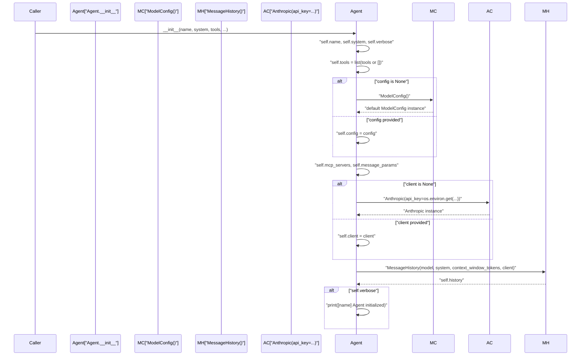
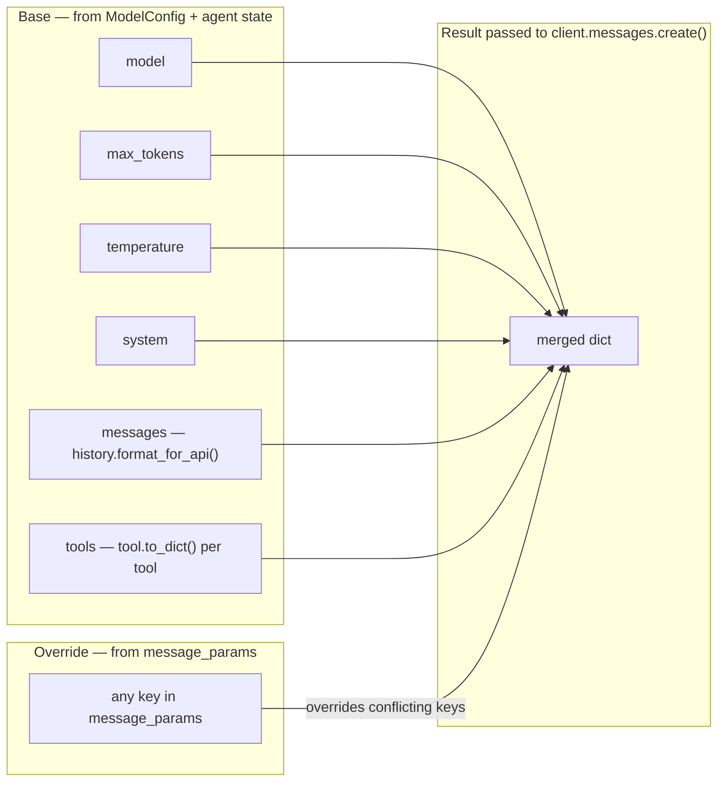
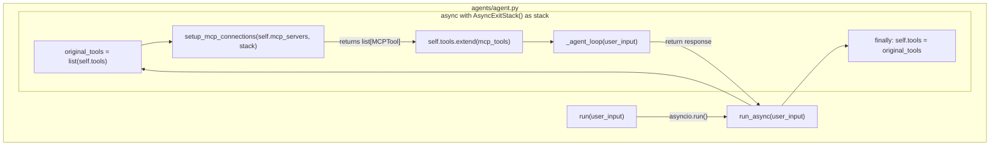
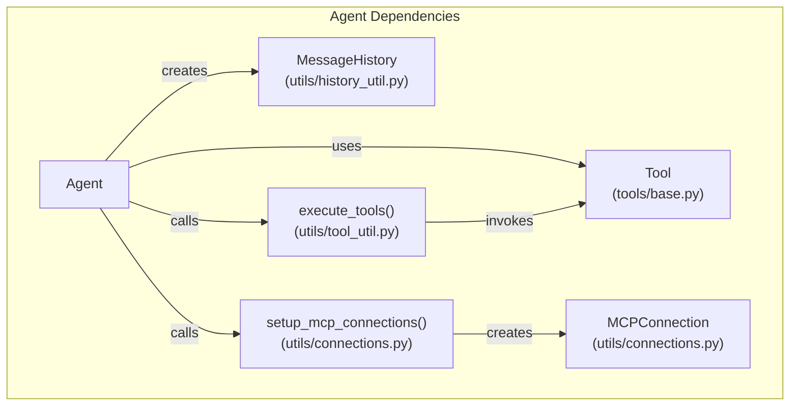

<!-- source: DeepWiki mcp.deepwiki.com · repo anthropics/claude-quickstarts · page 4.1 Agent Class Architecture · fetched 2026-10-26 -->

# Agent Class Architecture

<details>
<summary>Relevant source files</summary>

The following files were used as context for generating this wiki page:

- [agents/.gitignore](agents/.gitignore)
- [agents/__init__.py](agents/__init__.py)
- [agents/agent.py](agents/agent.py)
- [agents/test_message_params.py](agents/test_message_params.py)
- [agents/tools/mcp_tool.py](agents/tools/mcp_tool.py)

</details>


## Purpose and Scope

The `Agent` class in `agents/agent.py` provides a reusable implementation for building Claude-powered agents with tool use capabilities. It handles API communication, conversation history management, tool execution orchestration, and configuration management.

For information about the `Tool` base class and MCP integration, see page 4.2. For comparison with the computer-use-demo's `sampling_loop` approach, see page 2.2.

The package exports `Agent`, `ModelConfig`, and `Tool` from `agents/__init__.py`.

Sources: [agents/__init__.py:1-6](), [agents/agent.py:1-174]()

---

## Agent Class Overview

The `Agent` class in `agents/agent.py` encapsulates all aspects of agent behavior:

- `Anthropic` client management
- Conversation history tracking via `MessageHistory`
- Tool availability and execution
- MCP server connection lifecycle
- Model configuration and parameter customization via `ModelConfig` and `message_params`

The diagram below maps the key responsibilities to the actual class fields and methods in `agents/agent.py`:

**Diagram: `Agent` class structure mapped to code entities**



Sources: [agents/agent.py:33-76](), [agents/agent.py:80-173]()

---

## ModelConfig Dataclass

`ModelConfig` is a `@dataclass` defined at [agents/agent.py:17-31]() that centralizes model selection and generation settings.

| Field | Type | Default | Description |
|-------|------|---------|-------------|
| `model` | `str` | `"claude-sonnet-4-20250514"` | Claude model identifier |
| `max_tokens` | `int` | `4096` | Maximum tokens in response |
| `temperature` | `float` | `1.0` | Sampling temperature |
| `context_window_tokens` | `int` | `180000` | Token budget for `MessageHistory` truncation |

The `model` field accepts any Claude model identifier. Values noted in source comments:

- `claude-sonnet-4-20250514` (default)
- `claude-opus-4-20250514`
- `claude-haiku-4-5-20251001`
- `claude-3-5-sonnet-20240620`
- `claude-3-haiku-20240307`

`context_window_tokens` is passed to `MessageHistory` and is not sent to the API directly — it controls when the history manager trims older messages.

Sources: [agents/agent.py:17-31]()

---

## Agent Initialization

`Agent.__init__` parameters:

| Parameter | Type | Default | Description |
|-----------|------|---------|-------------|
| `name` | `str` | — | Agent identifier used in verbose logging |
| `system` | `str` | — | System prompt passed to the API |
| `tools` | `list[Tool] \| None` | `None` | Local tool instances |
| `mcp_servers` | `list[dict[str, Any]] \| None` | `None` | MCP server configuration dicts |
| `config` | `ModelConfig \| None` | `None` | Model settings; defaults to `ModelConfig()` |
| `verbose` | `bool` | `False` | Print detailed progress to stdout |
| `client` | `Anthropic \| None` | `None` | Pre-built client; creates one from `ANTHROPIC_API_KEY` if omitted |
| `message_params` | `dict[str, Any] \| None` | `None` | Extra params forwarded to `client.messages.create()` |

### Initialization Sequence

**Diagram: `Agent.__init__` execution sequence**



Sources: [agents/agent.py:36-79]()

---

## Message Parameter System

`message_params` allows passing additional or overriding parameters to `client.messages.create()`.

### `_prepare_message_params()`

The method at [agents/agent.py:80-94]() builds the final dict for the API call. `message_params` is spread last, so its keys override any conflicting base parameters.

**Diagram: Parameter assembly in `_prepare_message_params`**



### Supported `message_params` Keys

| Category | Example keys | Effect |
|----------|-------------|--------|
| Sampling overrides | `temperature`, `top_k`, `top_p` | Override `ModelConfig` defaults |
| Response limits | `max_tokens` | Override `ModelConfig.max_tokens` |
| Custom HTTP headers | `extra_headers` | Merged with default beta header (see below) |
| Beta feature flags | `extra_headers["anthropic-beta"]` | Overrides the default beta string |
| Request metadata | `metadata["user_id"]` | Passed through to the API |

### `extra_headers` Merging in `_agent_loop`

`_agent_loop` applies special merging logic at [agents/agent.py:108-120]():

1. A default header dict is built: `{"anthropic-beta": "code-execution-2025-05-22"}`
2. If `extra_headers` is present in the assembled params, it is **popped** from the params dict
3. The caller-supplied headers are spread over the defaults (`{**default_headers, **custom_headers}`), so custom values win
4. The merged dict is passed as `extra_headers=` to `client.messages.create()`

This means providing `anthropic-beta` in `message_params["extra_headers"]` replaces the default `code-execution-2025-05-22` value entirely.

Sources: [agents/agent.py:80-94](), [agents/agent.py:108-120](), [agents/test_message_params.py:57-228]()

---

## Agent Loop Execution Flow

`_agent_loop` at [agents/agent.py:96-156]() implements the core reasoning-and-tool-use cycle.

**Diagram: `_agent_loop` message flow**

```mermaid
sequenceDiagram
    participant Caller
    participant AL["_agent_loop(user_input)"]
    participant MH["self.history: MessageHistory"]
    participant PP["_prepare_message_params()"]
    participant CL["self.client: Anthropic"]
    participant ET["execute_tools()"]

    Caller->>AL: "user_input"
    AL->>MH: "add_message('user', user_input, None)"
    AL->>AL: "tool_dict = {tool.name: tool for tool in self.tools}"

    loop "while True"
        AL->>MH: "history.truncate()"
        AL->>PP: "_prepare_message_params()"
        PP-->>AL: "params dict"
        AL->>AL: "merge extra_headers with default beta header"
        AL->>CL: "client.messages.create(**params, extra_headers=...)"
        CL-->>AL: "response (Message object)"
        AL->>AL: "tool_calls = [b for b in response.content if b.type == 'tool_use']"
        AL->>MH: "add_message('assistant', response.content, response.usage)"

        alt "tool_calls is non-empty"
            AL->>ET: "execute_tools(tool_calls, tool_dict)"
            ET-->>AL: "tool_results"
            AL->>MH: "add_message('user', tool_results)"
            Note over AL: "continue loop"
        else "no tool_calls"
            AL-->>Caller: "return response"
            Note over AL: "exit loop"
        end
    end
```

### Step-by-Step Breakdown

| Step | Code Location | Description |
|------|--------------|-------------|
| User message enqueue | [agents/agent.py:100]() | `history.add_message("user", user_input, None)` |
| Tool name index | [agents/agent.py:102]() | `tool_dict = {tool.name: tool for tool in self.tools}` |
| Context truncation | [agents/agent.py:105]() | `self.history.truncate()` — trims old messages to fit context window |
| Parameter assembly | [agents/agent.py:106]() | `_prepare_message_params()` |
| Header merge | [agents/agent.py:108-119]() | Pop `extra_headers`, merge with `{"anthropic-beta": "code-execution-2025-05-22"}` |
| API call | [agents/agent.py:117-120]() | `client.messages.create(**params, extra_headers=merged_headers)` |
| Tool extraction | [agents/agent.py:121-123]() | Filter `response.content` for blocks where `block.type == "tool_use"` |
| Assistant message record | [agents/agent.py:138-140]() | `history.add_message("assistant", response.content, response.usage)` |
| Tool execution | [agents/agent.py:143-146]() | `execute_tools(tool_calls, tool_dict)` — async |
| Tool result enqueue | [agents/agent.py:153]() | `history.add_message("user", tool_results)` |
| Loop exit | [agents/agent.py:155]() | `return response` when no tool calls remain |

Sources: [agents/agent.py:96-156]()

---

## Execution Entrypoints

The `Agent` class provides both synchronous and asynchronous entry points.

### `run_async(user_input)`

Defined at [agents/agent.py:157-170](). Manages the MCP connection lifecycle around `_agent_loop`.

**Diagram: `run_async` and `run` call chain**



Key behaviors:
- `AsyncExitStack` ensures MCP connections are torn down even on exception
- `self.tools` is restored in the `finally` block, so MCP tools do not persist across calls
- `setup_mcp_connections` is imported from `agents/utils/connections.py`

### `run(user_input)`

Defined at [agents/agent.py:171-173](). A thin synchronous wrapper:

```
asyncio.run(self.run_async(user_input))
```

Both methods return the raw `response` object from `client.messages.create()`.

Sources: [agents/agent.py:157-173]()

---

## Integration Points

The `Agent` class integrates with several other components in the framework:



### Key Dependencies

1. **Tool** [agents/tools/base.py](): Base class for agent tools
   - Agent stores list of `Tool` instances
   - Converts tools to dictionaries for API
   - Passes tools to execution utilities

2. **MessageHistory** [agents/utils/history_util.py](): Conversation state manager
   - Created during agent initialization
   - Handles context window truncation
   - Formats messages for API
   - Tracks token usage

3. **execute_tools** [agents/utils/tool_util.py](): Tool execution utility
   - Receives tool calls and tool dictionary
   - Executes each tool asynchronously
   - Returns formatted tool results

4. **setup_mcp_connections** [agents/utils/connections.py](): MCP server setup
   - Connects to configured MCP servers
   - Returns list of `MCPTool` instances
   - Manages connection lifecycle with `AsyncExitStack`

**Sources:** [agents/agent.py:11-14](), [agents/agent.py:33-76](), [agents/agent.py:157-170]()

---

