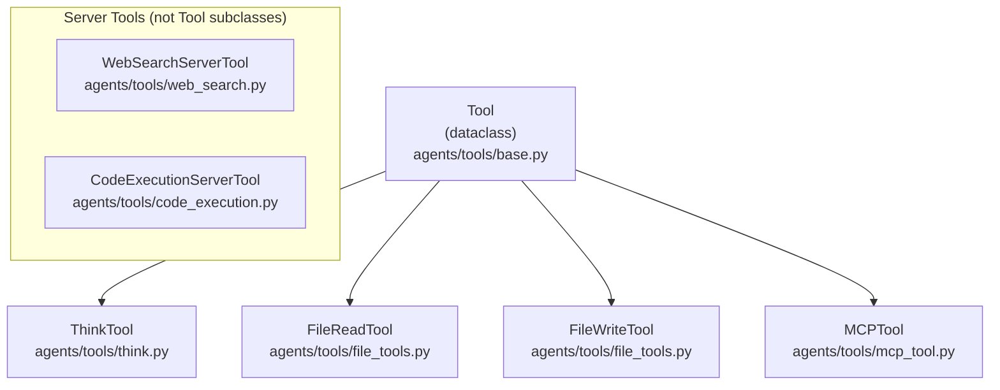
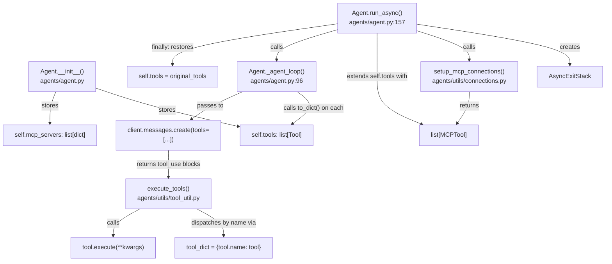
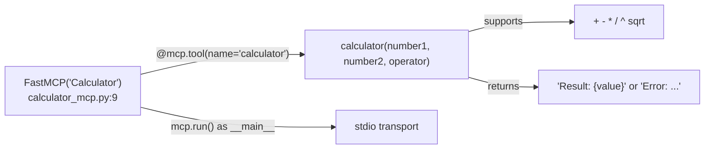

<!-- source: DeepWiki mcp.deepwiki.com · repo anthropics/claude-quickstarts · page 4.2 Tool Integration & MCP · fetched 2026-10-26 -->

# Tool Integration & MCP

<details>
<summary>Relevant source files</summary>

The following files were used as context for generating this wiki page:

- [agents/agent.py](agents/agent.py)
- [agents/agent_demo.ipynb](agents/agent_demo.ipynb)
- [agents/test_message_params.py](agents/test_message_params.py)
- [agents/tools/__init__.py](agents/tools/__init__.py)
- [agents/tools/base.py](agents/tools/base.py)
- [agents/tools/calculator_mcp.py](agents/tools/calculator_mcp.py)
- [agents/tools/code_execution.py](agents/tools/code_execution.py)
- [agents/tools/file_tools.py](agents/tools/file_tools.py)
- [agents/tools/mcp_tool.py](agents/tools/mcp_tool.py)
- [agents/tools/think.py](agents/tools/think.py)
- [agents/tools/web_search.py](agents/tools/web_search.py)

</details>


This page documents the tool system in the `agents/` package: the `Tool` base class, all built-in tool implementations, the two server tool types (`WebSearchServerTool` and `CodeExecutionServerTool`), the MCP integration layer (`MCPTool`, `MCPConnection`, `setup_mcp_connections`), and the `calculator_mcp` FastMCP example server. For a description of how the `Agent` class consumes tools and runs the agent loop, see [Agent Class Architecture](#4.1).

---

## Tool System Overview

The framework supports three categories of tools, each with a different execution model:

| Category | Classes | Execution | Format sent to API |
|---|---|---|---|
| **Local tools** | `Tool` subclasses | Python `async execute()` | Standard `input_schema` format |
| **Server tools** | `WebSearchServerTool`, `CodeExecutionServerTool` | Handled by Anthropic's servers | Anthropic server tool format (`type` field) |
| **MCP tools** | `MCPTool` | Delegated to an MCP server via `MCPConnection` | Standard `input_schema` format |

All three are passed into `Agent.tools` and serialized by calling `.to_dict()` on each item. Local and MCP tools share the `Tool` base class; server tools are standalone dataclasses that happen to also expose `to_dict()`.

**Tool class hierarchy:**



Sources: [agents/tools/__init__.py:1-16](), [agents/tools/base.py:1-27](), [agents/tools/mcp_tool.py:1-36]()

---

## `Tool` Base Class

Defined in [agents/tools/base.py:1-27]() as a `@dataclass`.

**Fields:**

| Field | Type | Purpose |
|---|---|---|
| `name` | `str` | Tool identifier used by the model |
| `description` | `str` | Natural language description sent in the API call |
| `input_schema` | `dict[str, Any]` | JSON Schema describing the tool's parameters |

**Methods:**

- `to_dict()` — Returns `{"name": ..., "description": ..., "input_schema": ...}`, the format expected by the Claude messages API.
- `execute(**kwargs) -> str` — Abstract async method. Raises `NotImplementedError` in the base class. All subclasses must implement it.

---

## Built-in Local Tools

### `ThinkTool`

[agents/tools/think.py:1-32]()

A no-op reasoning tool. When the model calls it, `execute()` returns the string `"Thinking complete!"` without performing any external action. Its purpose is to give the model a structured scratch pad — the `thought` argument is logged in the message history but has no side effects.

- Tool name: `"think"`
- Input schema: one required string field `thought`

### `FileReadTool`

[agents/tools/file_tools.py:11-135]()

Exposes two operations via a single `operation` parameter:

| `operation` | Required params | Behavior |
|---|---|---|
| `"read"` | `path`, optional `max_lines` | Reads file content; `max_lines=0` means no limit |
| `"list"` | `path`, optional `pattern` | `glob`s files matching pattern in the directory |

All I/O is done with `asyncio.to_thread` to avoid blocking the event loop.

- Tool name: `"file_read"`

### `FileWriteTool`

[agents/tools/file_tools.py:138-277]()

Exposes two operations:

| `operation` | Required params | Behavior |
|---|---|---|
| `"write"` | `path`, `content` | Creates or overwrites a file; creates parent directories with `os.makedirs` |
| `"edit"` | `path`, `old_text`, `new_text` | String-replaces `old_text` with `new_text`; warns if multiple occurrences exist |

- Tool name: `"file_write"`

---

## Server Tools

Server tools use Anthropic's hosted execution infrastructure rather than local Python code. They are not subclasses of `Tool`; they are standalone `@dataclass` classes that only implement `to_dict()`. The model's tool calls for these are handled entirely server-side.

### `WebSearchServerTool`

[agents/tools/web_search.py:1-38]()

| Field | Default | Purpose |
|---|---|---|
| `name` | `"web_search"` | Tool name |
| `type` | `"web_search_20250305"` | Anthropic server tool type identifier |
| `max_uses` | `None` | Limit number of searches per request |
| `allowed_domains` | `None` | Allowlist of domains to search |
| `blocked_domains` | `None` | Blocklist of domains to exclude |
| `user_location` | `None` | Location hint for local search results |

`to_dict()` produces the server tool format: `{"type": "web_search_20250305", "name": "web_search", ...optional fields}`. Fields with `None` values are omitted.

### `CodeExecutionServerTool`

[agents/tools/code_execution.py:1-18]()

| Field | Default | Purpose |
|---|---|---|
| `name` | `"code_execution"` | Tool name |
| `type` | `"code_execution_20250522"` | Anthropic server tool type identifier |

`to_dict()` returns `{"type": "code_execution_20250522", "name": "code_execution"}`.

> **Note:** The `Agent._agent_loop` method always sends the beta header `"anthropic-beta": "code-execution-2025-05-22"` by default ([agents/agent.py:109]()). This is required for the `CodeExecutionServerTool` to function.

---

## MCP Integration

The Model Context Protocol (MCP) integration allows the agent to connect to external tool servers at runtime. The key components are:

```mermaid
sequenceDiagram
    participant Agent as "Agent.run_async()"
    participant Stack as "AsyncExitStack"
    participant Setup as "setup_mcp_connections()\nagents/utils/connections.py"
    participant Conn as "MCPConnection"
    participant MCPSrv as "MCP Server process"
    participant Loop as "Agent._agent_loop()"
    participant MCPTool as "MCPTool.execute()"

    Agent->>Stack: "enter async context"
    Agent->>Setup: "setup_mcp_connections(mcp_servers, stack)"
    Setup->>MCPSrv: "spawn subprocess / connect"
    Setup->>Conn: "create MCPConnection per server"
    Setup->>MCPTool: "wrap each server tool as MCPTool"
    Setup-->>Agent: "list[MCPTool]"
    Agent->>Agent: "self.tools.extend(mcp_tools)"
    Agent->>Loop: "_agent_loop(user_input)"
    Loop->>MCPTool: "execute(**kwargs)"
    MCPTool->>Conn: "call_tool(name, arguments)"
    Conn->>MCPSrv: "MCP protocol call"
    MCPSrv-->>Conn: "result"
    Conn-->>MCPTool: "result.content"
    MCPTool-->>Loop: "text string"
    Agent->>Agent: "self.tools = original_tools (finally)"
```

Sources: [agents/agent.py:157-173](), [agents/tools/mcp_tool.py:1-36]()

### `MCPTool`

[agents/tools/mcp_tool.py:1-36]()

A `Tool` subclass that wraps a single tool exposed by an MCP server.

- Constructed by `setup_mcp_connections` with `name`, `description`, `input_schema` obtained from the MCP server's tool manifest, plus a `connection` reference.
- `execute(**kwargs)` calls `self.connection.call_tool(self.name, arguments=kwargs)`, extracts the first `text`-type item from `result.content`, and returns it as a string.
- Non-text content types in the MCP result are currently ignored; the method returns `"No text content in tool response"` if no text item is found.

### `MCPConnection` and `setup_mcp_connections`

Defined in `agents/utils/connections.py` (imported in [agents/tools/mcp_tool.py:5]() and [agents/agent.py:6]()).

`setup_mcp_connections(mcp_servers, stack)` iterates over the list of MCP server configuration dicts, establishes a connection to each (registered with the `AsyncExitStack` so it is torn down on exit), queries the server's tool list, and wraps each tool as an `MCPTool`. It returns a flat `list[MCPTool]`.

`MCPConnection` holds the active session for a single MCP server and exposes `call_tool(name, arguments)`.

### MCP Server Configuration Format

Each entry in `Agent.mcp_servers` is a plain `dict` with at minimum:

| Key | Example | Purpose |
|---|---|---|
| `"type"` | `"stdio"` | Transport type |
| `"command"` | `"python"` | Executable to launch |
| `"args"` | `["path/to/server.py"]` | Command-line arguments |
| `"env"` | `{"API_KEY": "..."}` | Optional environment variables |

Example from the demo notebook [agents/agent_demo.ipynb:62-66]():

```python
calculator_server = {
    "type": "stdio",
    "command": "python",
    "args": [calculator_server_path]
}
```

The Brave Search MCP server example shows how to pass environment variables and use `npx` for TypeScript-based servers [agents/agent_demo.ipynb:74-83]().

---

## Tool Lifecycle in `Agent`



Sources: [agents/agent.py:63-173]()

Key behavior details:
- During `run_async`, MCP tools are appended to `self.tools` for the duration of the call and removed in a `finally` block ([agents/agent.py:159-169]()).
- `_prepare_message_params` calls `tool.to_dict()` on every item in `self.tools` ([agents/agent.py:92]()). Both `Tool` subclasses and server tool dataclasses expose `to_dict()`, so they are interchangeable at this call site.
- The `tool_dict` used for dispatch in `execute_tools` is built as `{tool.name: tool for tool in self.tools}` ([agents/agent.py:102]()). Server tools (which lack `execute()`) are not dispatched locally; their calls never appear in `tool_calls` because the server handles them.

---

## `calculator_mcp` — FastMCP Example

[agents/tools/calculator_mcp.py:1-55]()

A self-contained MCP server using the `FastMCP` framework, illustrating the minimum structure needed to expose a tool via MCP.



The `calculator` function is decorated with `@mcp.tool(name="calculator")`. When run as a script (`mcp.run()`), it starts a stdio MCP server. The agent connects to it using a config dict pointing to the script path.

Supported operators: `+`, `-`, `*`, `/`, `^` (exponentiation), `sqrt` (uses `number1`, ignores `number2`).

Sources: [agents/tools/calculator_mcp.py:1-55]()

---

## Public Exports

[agents/tools/__init__.py:1-16]()

The `agents.tools` package exports:

| Symbol | Source file |
|---|---|
| `Tool` | `tools/base.py` |
| `CodeExecutionServerTool` | `tools/code_execution.py` |
| `FileReadTool` | `tools/file_tools.py` |
| `FileWriteTool` | `tools/file_tools.py` |
| `ThinkTool` | `tools/think.py` |
| `WebSearchServerTool` | `tools/web_search.py` |

`MCPTool` is not in `__all__`; it is constructed internally by `setup_mcp_connections` and not intended for direct instantiation by callers.

---

