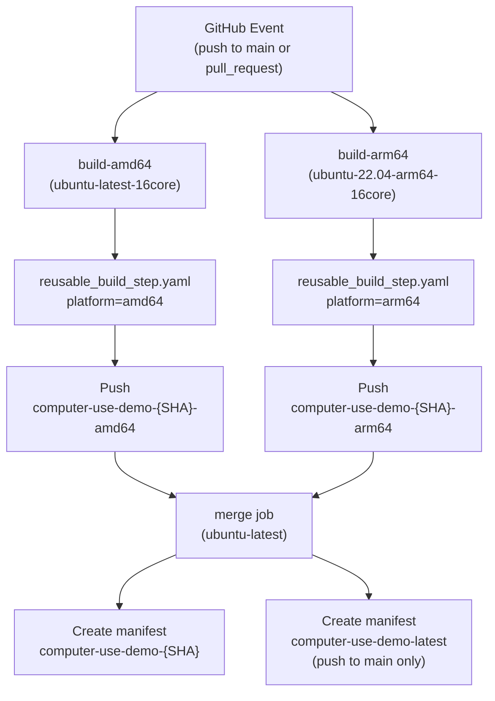

<!-- source: DeepWiki mcp.deepwiki.com · repo anthropics/claude-quickstarts · page 5 Development & CI/CD · fetched 2026-10-26 -->

# Development & CI/CD

Relevant source files

The following files were used as context for generating this wiki page:

- [.github/pull_request_template.md](.github/pull_request_template.md)
- [.github/workflows/build.yaml](.github/workflows/build.yaml)
- [.github/workflows/reusable_build_step.yaml](.github/workflows/reusable_build_step.yaml)
- [computer-use-demo/CONTRIBUTING.md](computer-use-demo/CONTRIBUTING.md)

This page covers the overall development tooling, quality assurance infrastructure, and the GitHub Actions CI/CD pipeline for the `claude-quickstarts` repository. The primary artifact produced by the CI/CD system is a multi-architecture Docker image for the Computer Use Demo.

For contributor-specific setup steps, see [Development Setup](#5.1). For test suite details, see [Testing & Quality Assurance](#5.2). For linting and formatting rules, see [Code Style & Conventions](#5.3).

---

## CI/CD Overview

The repository uses two GitHub Actions workflow files to build, test, and publish the Computer Use Demo Docker image to the GitHub Container Registry (`ghcr.io`).

| File | Role |
|---|---|
| [`.github/workflows/build.yaml`](.github/workflows/build.yaml:1-73)() | Orchestration: triggers, platform jobs, manifest merge |
| [`.github/workflows/reusable_build_step.yaml`](.github/workflows/reusable_build_step.yaml:1-92)() | Reusable: build, smoke-test, and push for a single platform |

### Trigger Conditions

The build pipeline runs on two events, both scoped to paths that include `.github/**` or `computer-use-demo/**`:

| Event | Branch | Effect |
|---|---|---|
| `pull_request` | any | Builds and pushes platform images tagged with the short SHA; does **not** update `latest` |
| `push` | `main` | Builds and pushes platform images tagged with the short SHA **and** updates `latest` tags |

Sources: [`.github/workflows/build.yaml:4-14`](.github/workflows/build.yaml:4-14)()

---

## Pipeline Architecture

**CI/CD Job Flow**

Sources: [`.github/workflows/build.yaml:15-72`](.github/workflows/build.yaml:15-72)()

---

## Reusable Build Step Detail

Each platform build runs through a linear sequence of steps inside `reusable_build_step.yaml`. The steps after the Docker build perform live smoke tests against the running container.

**`reusable_build_step.yaml` Step Sequence**

```mermaid
flowchart LR
    checkout["actions/checkout@v4"]
    login["docker/login-action@v3\nghcr.io"]
    buildx["docker/setup-buildx-action@v3"]
    tag["Set image tag\n{registry}:{prefix}{short_sha}"]
    build["docker/build-push-action@v5\npush=false, load=true\ncache: type=gha"]
    run["docker run -d -p 8051:8051"]
    check_sl["Check Streamlit\nHTTP 200 on :8501\n(60s timeout)"]
    check_vnc["Check VNC\nnc localhost 5900 -z"]
    check_novnc["Check noVNC\nHTTP 200 on :6080"]
    check_landing["Check landing page\nHTTP 200 on :8080"]
    push["docker/build-push-action@v5\npush=true"]

    checkout --> login --> buildx --> tag --> build --> run
    run --> check_sl --> check_vnc --> check_novnc --> check_landing --> push
```

Sources: [`.github/workflows/reusable_build_step.yaml:26-92`](.github/workflows/reusable_build_step.yaml:26-92)()

### Smoke Test Checks

After starting the container, four checks verify that all primary services are reachable:

| Check | Command | Expected Result |
|---|---|---|
| Streamlit app | `curl http://127.0.0.1:8501` | HTTP 200 (polled for up to 60 s) |
| VNC server | `nc localhost 5900 -z` | Port open |
| noVNC proxy | `curl http://localhost:6080` | HTTP 200 |
| Landing page | `curl http://localhost:8080` | HTTP 200 |

Sources: [`.github/workflows/reusable_build_step.yaml:49-75`](.github/workflows/reusable_build_step.yaml:49-75)()

### Image Tagging Strategy

| Event | Tags pushed per platform | Multi-arch manifest |
|---|---|---|
| `pull_request` | `{prefix}{SHA}-{platform}` | SHA-tagged only |
| `push` to `main` | `{prefix}{SHA}-{platform}`, `{prefix}latest-{platform}` | SHA-tagged + `latest` |

The short SHA is computed via `git rev-parse --short ${{ github.sha }}` in both workflow files.

Sources: [`.github/workflows/reusable_build_step.yaml:77-81`](.github/workflows/reusable_build_step.yaml:77-81)(), [`.github/workflows/build.yaml:57-72`](.github/workflows/build.yaml:57-72)()

---

## Registry and Image Coordinates

| Variable | Value |
|---|---|
| Registry | `ghcr.io/anthropics/anthropic-quickstarts` |
| Tag prefix | `computer-use-demo-` |
| Latest image | `ghcr.io/anthropics/anthropic-quickstarts:computer-use-demo-latest` |

The `REGISTRY` environment variable is defined at the top of `build.yaml` [`.github/workflows/build.yaml:1-2`](.github/workflows/build.yaml:1-2)() and passed as the `registry` input to the reusable workflow.

---

## Build Cache

Both platform builds use GitHub Actions cache (`type=gha`) scoped by platform:

- `scope=computer-use-amd64`
- `scope=computer-use-arm64`

This avoids redundant layer rebuilds across runs. Cache is written with `mode=max` to maximize layer coverage.

Sources: [`.github/workflows/reusable_build_step.yaml:46-47`](.github/workflows/reusable_build_step.yaml:46-47)()

---

## Pull Request Process

The repository provides a pull request template at [`.github/pull_request_template.md`](.github/pull_request_template.md:1-27)(). Contributors are expected to:

1. Identify which quickstart the PR affects (Computer Use Demo, Customer Support Agent, Financial Data Analyst, or N/A)
2. Classify the type of change (bug fix, feature, documentation, refactoring)
3. Confirm testing steps taken (unit tests added/updated, manual testing, development environment verification)

Per [`computer-use-demo/CONTRIBUTING.md`](computer-use-demo/CONTRIBUTING.md:86-88)(), **all commits must be signed** (`git commit -S`).

### PR Checklist Summary

| Requirement | Notes |
|---|---|
| Tests pass | Run `pytest` |
| Ruff linting passes | `ruff check .` |
| Type checking passes | `pyright` |
| Pre-commit hooks pass | `pre-commit run --all-files` |
| Commits signed | `git commit -S` |
| Documentation updated | README and docstrings |

Sources: [`computer-use-demo/CONTRIBUTING.md:86-101`](computer-use-demo/CONTRIBUTING.md:86-101)()

---

## Contribution Policy

The `CONTRIBUTING.md` distinguishes between two categories of contribution:

- **Always welcome**: bug fixes and correctness-focused documentation updates.
- **Accepted at maintainer discretion**: feature additions, refactors, and other major changes — submitted as separate PRs, evaluated against criteria including coding standards, reference-implementation clarity, third-party dependency minimization, and broad developer applicability.

Sources: [`computer-use-demo/CONTRIBUTING.md:9-20`](computer-use-demo/CONTRIBUTING.md:9-20)()

---

