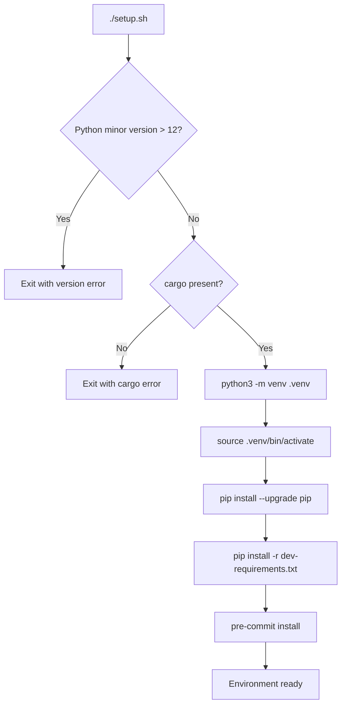
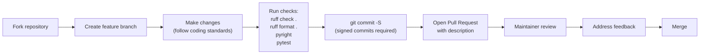

<!-- source: DeepWiki mcp.deepwiki.com · repo anthropics/claude-quickstarts · page 5.1 Development Setup · fetched 2026-10-26 -->

# Development Setup

Relevant source files

The following files were used as context for generating this wiki page:

- [.github/pull_request_template.md](.github/pull_request_template.md)
- [CLAUDE.md](CLAUDE.md)
- [computer-use-demo/CONTRIBUTING.md](computer-use-demo/CONTRIBUTING.md)
- [computer-use-demo/setup.sh](computer-use-demo/setup.sh)

This page covers the contributor development setup for the `computer-use-demo` quickstart project within the `claude-quickstarts` repository. It describes how to prepare a local environment for running, testing, and modifying the Python-based code. For information on code style and linting conventions, see [Code Style & Conventions](#5.3). For the test suite itself, see [Testing & Quality Assurance](#5.2).

---

## Prerequisites

Before running setup, two prerequisites must be satisfied:

| Requirement | Details |
|---|---|
| Python | Version 3.12 or lower (`python3.12` or earlier) |
| Cargo (Rust) | Required by one of the pip dependencies; see [rust-lang.org/tools/install](https://www.rust-lang.org/tools/install) |

The `setup.sh` script enforces both of these checks before proceeding.

[computer-use-demo/setup.sh:2-15]()

**Python version check:** The script extracts the Python minor version and exits with an error if it is greater than 12, printing instructions for manually specifying a Python version in the `venv` creation command.

**Cargo check:** The script checks for the `cargo` binary via `command -v cargo`. If absent, it prints installation instructions and exits.

Sources: [computer-use-demo/setup.sh:1-15](), [computer-use-demo/CONTRIBUTING.md:24-43]()

---

## Running the Setup Script

The primary setup entry point is `setup.sh` in the `computer-use-demo/` directory.

**Setup script flow diagram:**

Sources: [computer-use-demo/setup.sh:1-21]()

The steps performed by `setup.sh` in order:

1. Checks Python minor version (must be ≤ 12)
2. Checks that `cargo` is available
3. Creates a virtual environment at `.venv` using `python3 -m venv`
4. Activates the virtual environment
5. Upgrades `pip`
6. Installs all dependencies from `dev-requirements.txt`
7. Installs pre-commit hooks via `pre-commit install`

[computer-use-demo/setup.sh:17-21]()

---

## Development Commands Reference

After setup, the following commands are used during development:

| Task | Command |
|---|---|
| Lint | `ruff check .` |
| Format | `ruff format .` |
| Type check | `pyright` |
| Run all tests | `pytest` |
| Run single test | `pytest tests/path_to_test.py::test_name -v` |
| Build Docker image | `docker build . -t computer-use-demo:local` |
| Run Docker container | See `CLAUDE.md` for the full `docker run` invocation |

Sources: [CLAUDE.md:16-21]()

---

## Dependency Installation

All Python development dependencies are installed from `dev-requirements.txt`. This single file covers both runtime and development-time packages (the application dependencies, test libraries, linting tools, and type checkers).

The `pre-commit install` step registers git hooks defined in the project's pre-commit configuration. These hooks run `ruff`, `pyright`, and other checks automatically before each commit.

Sources: [computer-use-demo/setup.sh:20-21](), [computer-use-demo/CONTRIBUTING.md:38-43]()

---

## Contributing Workflow

The contribution process follows a standard fork-and-PR model.

**Contribution workflow diagram:**

Sources: [computer-use-demo/CONTRIBUTING.md:44-101]()

### Commit Requirements

- All commits **must be signed**: `git commit -S`
- Commit messages use present tense ("Add feature", not "Added feature")
- Issue numbers should be referenced when applicable

[computer-use-demo/CONTRIBUTING.md:87-91]()

### Pull Request Checklist

The `.github/pull_request_template.md` provides a standard PR template. Before requesting review, contributors should verify:

- [ ] Tests added or updated for new functionality
- [ ] `ruff check .` passes
- [ ] `pyright` type checking passes
- [ ] `pre-commit` hooks pass
- [ ] Documentation updated as needed

[.github/pull_request_template.md:1-30](), [computer-use-demo/CONTRIBUTING.md:93-101]()

---

## Contribution Policy Summary

The `CONTRIBUTING.md` distinguishes between two categories of contributions:

| Type | Policy |
|---|---|
| Bug fixes, correctness documentation updates | Always welcome |
| Feature additions, refactors, major documentation changes | Accepted at maintainer discretion; submit each in a separate PR |

Criteria for evaluating major changes include: coding standards adherence, value as a reference implementation, user experience, applicability to a broad developer audience, minimization of third-party dependencies, and no promotion of a product or service.

Sources: [computer-use-demo/CONTRIBUTING.md:9-21]()

---

