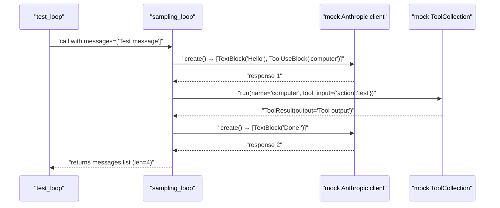
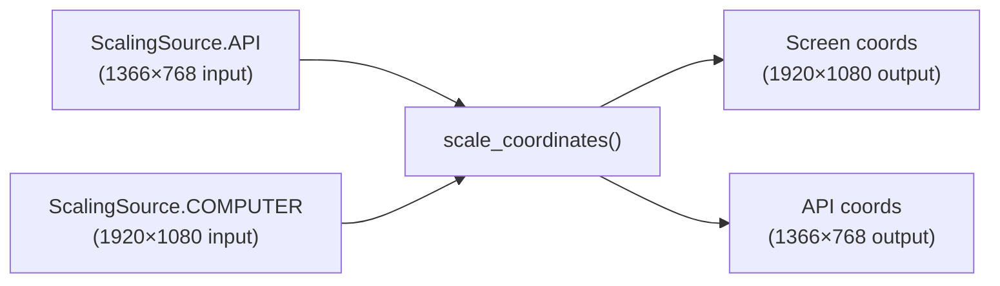
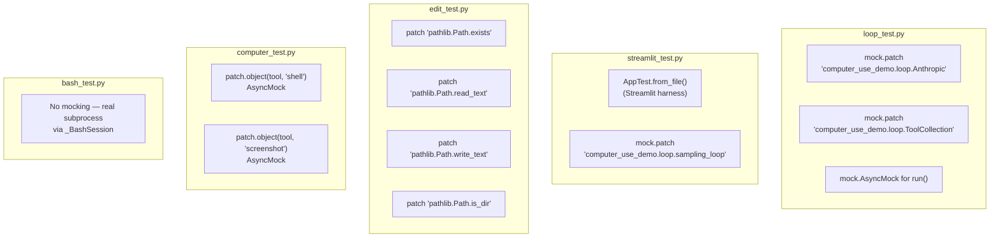

<!-- source: DeepWiki mcp.deepwiki.com · repo anthropics/claude-quickstarts · page 5.2 Testing & Quality Assurance · fetched 2026-10-26 -->

# Testing & Quality Assurance

<details>
<summary>Relevant source files</summary>

The following files were used as context for generating this wiki page:

- [.github/pull_request_template.md](.github/pull_request_template.md)
- [computer-use-demo/CONTRIBUTING.md](computer-use-demo/CONTRIBUTING.md)
- [computer-use-demo/tests/loop_test.py](computer-use-demo/tests/loop_test.py)
- [computer-use-demo/tests/streamlit_test.py](computer-use-demo/tests/streamlit_test.py)
- [computer-use-demo/tests/tools/bash_test.py](computer-use-demo/tests/tools/bash_test.py)
- [computer-use-demo/tests/tools/computer_test.py](computer-use-demo/tests/tools/computer_test.py)
- [computer-use-demo/tests/tools/edit_test.py](computer-use-demo/tests/tools/edit_test.py)

</details>


This page documents the automated test suite for the **computer-use-demo** project: its structure, configuration, and the specific behaviors each test module validates. Code style enforcement and linting tools are covered separately in [Code Style & Conventions](#5.3). For details on setting up the development environment to run these tests, see [Development Setup](#5.1).

---

## Scope

Testing in this repository is concentrated in the `computer-use-demo` component. The test suite covers:

- The `sampling_loop` agent orchestration function
- The Streamlit user interface initialization and message dispatch
- The three core tools: `EditTool`, `BashTool`, and `ComputerTool`

---

## Test Infrastructure

### Configuration

pytest is configured to run all tests in **async mode**, as required by the async tool implementations. This is set in [computer-use-demo/pyproject.toml]() via:

```
asyncio_mode = "auto"
```

All async test functions use the `@pytest.mark.asyncio` decorator (or rely on the auto mode), and the `pytest-asyncio` package is included in dev dependencies.

### Running Tests

From within the `computer-use-demo` directory with the virtual environment active:

```bash
pytest
```

Dev dependencies are declared in [computer-use-demo/CONTRIBUTING.md:77-83]().

---

## Test Directory Structure

```
computer-use-demo/
└── tests/
    ├── loop_test.py
    ├── streamlit_test.py
    └── tools/
        ├── bash_test.py
        ├── computer_test.py
        └── edit_test.py
```

**Test module map:**

| File | Subject Under Test | Key Classes/Functions |
|---|---|---|
| `tests/loop_test.py` | Agent loop orchestration | `sampling_loop`, `APIProvider` |
| `tests/streamlit_test.py` | Streamlit UI | `Sender`, `AppTest` |
| `tests/tools/bash_test.py` | Shell tool | `BashTool20241022`, `BashTool20250124` |
| `tests/tools/computer_test.py` | Mouse/keyboard tool | `ComputerTool20241022`, `ComputerTool20250124` |
| `tests/tools/edit_test.py` | File editing tool | `EditTool20250728` |

Sources: [computer-use-demo/tests/loop_test.py:1-69](), [computer-use-demo/tests/streamlit_test.py:1-27](), [computer-use-demo/tests/tools/bash_test.py:1-72](), [computer-use-demo/tests/tools/computer_test.py:1-141](), [computer-use-demo/tests/tools/edit_test.py:1-302]()

---

## Sampling Loop Tests

**File:** `computer-use-demo/tests/loop_test.py`

The single `test_loop` function validates the full two-iteration behavior of `sampling_loop`.

### Test Setup

The test mocks two collaborators:

- `Anthropic` client — patched via `mock.patch("computer_use_demo.loop.Anthropic")` to return a mock that produces two sequential API responses
- `ToolCollection` — patched via `mock.patch("computer_use_demo.loop.ToolCollection")` as an `AsyncMock`

The first simulated API response contains a `TextBlock` followed by a `ToolUseBlock` (triggering a second loop iteration). The second response contains only a `TextBlock` (terminating the loop).

### Assertions

[computer-use-demo/tests/loop_test.py:53-68]()

| Assertion | What It Verifies |
|---|---|
| `len(result) == 4` | Message list grows correctly over two loop iterations |
| `result[0]["role"] == "user"` | Original user message preserved |
| `result[1]["role"] == "assistant"` | First assistant response appended |
| `result[2]["role"] == "user"` | Tool result appended as user message |
| `result[3]["role"] == "assistant"` | Second assistant response appended |
| `create.call_count == 2` | API called exactly twice |
| `tool_collection.run.assert_called_once_with(name="computer", ...)` | Tool dispatch by name |
| `output_callback.call_count == 3` | Text block callback fires for each text block |
| `tool_output_callback.call_count == 1` | Tool result callback fires once |
| `api_response_callback.call_count == 2` | API response callback fires per API call |

**Loop flow diagram:**



Sources: [computer-use-demo/tests/loop_test.py:1-69]()

---

## Streamlit App Tests

**File:** `computer-use-demo/tests/streamlit_test.py`

Uses Streamlit's built-in `AppTest` harness to drive the app programmatically without a browser.

### Fixture

```python
@pytest.fixture
def streamlit_app():
    return AppTest.from_file("computer_use_demo/streamlit.py")
```

[computer-use-demo/tests/streamlit_test.py:10-12]()

### `test_streamlit`

[computer-use-demo/tests/streamlit_test.py:15-27]()

1. Runs the app with `streamlit_app.run()`
2. Sets the API key input (`text_input[1]`) to a dummy value `"sk-ant-0000000000000"`
3. Patches `computer_use_demo.loop.sampling_loop`
4. Submits `"Hello"` via `chat_input[0]`
5. Asserts that `sampling_loop` was called with `messages` containing a correctly shaped `BetaMessageParam`:

```python
{
    "role": Sender.USER,
    "content": [TextBlockParam(text="Hello", type="text")],
}
```

6. Asserts `not streamlit_app.exception` — no unhandled errors during execution

Sources: [computer-use-demo/tests/streamlit_test.py:1-27]()

---

## EditTool Tests

**File:** `computer-use-demo/tests/tools/edit_test.py`

All tests use a shared `edit_tool` fixture that returns a fresh `EditTool20250728()` instance. Filesystem operations are mocked via `unittest.mock.patch`.

### Command Coverage

**`test_view_command`** — [computer-use-demo/tests/tools/edit_test.py:16-77]()

| Scenario | Mock | Expected Result |
|---|---|---|
| View existing file | `Path.read_text` returns content | `CLIResult` with file content |
| View directory | `run` returns listing | `CLIResult` with filenames |
| View with `view_range=[2,3]` | `Path.read_text` returns 4 lines | Output contains lines 2–3 with line numbers |
| Invalid range (`[3,2]`) | — | `ToolError("Invalid \`view_range\`")` |
| Non-existent path | `Path.exists` → `False` | `ToolError("does not exist")` |
| Directory + `view_range` | `Path.is_dir` → `True` | `ToolError("\`view_range\` parameter is not allowed")` |

**`test_create_command`** — [computer-use-demo/tests/tools/edit_test.py:80-105]()

| Scenario | Expected Result |
|---|---|
| Create new file with `file_text` | `ToolResult` with "File created successfully"; `write_text` called once |
| Missing `file_text` | `ToolError("Parameter \`file_text\` is required")` |
| File already exists | `ToolError("File already exists")` |

**`test_str_replace_command`** — [computer-use-demo/tests/tools/edit_test.py:108-174]()

| Scenario | Expected Result |
|---|---|
| Replace unique string | `CLIResult` with "has been edited"; `write_text` called with replaced content |
| `old_str` not found | `ToolError("did not appear verbatim")` |
| `old_str` appears multiple times | `ToolError("Multiple occurrences")` |
| Successful replacement | `_file_history[path]` contains original content |

**`test_insert_command`** — [computer-use-demo/tests/tools/edit_test.py:177-262]()

| Scenario | `insert_line` | Expected Written Content |
|---|---|---|
| Insert mid-file | `2` | `"Line 1\nLine 2\nNew Line\nLine 3"` |
| Insert at beginning | `0` | `"New First Line\nLine 1\nLine 2"` |
| Insert at end | `2` (== line count) | `"Line 1\nLine 2\nNew Last Line"` |
| Out-of-bounds line | `5` (> line count) | `ToolError("Invalid \`insert_line\` parameter")` |
| Successful insert | any valid | `_file_history[path]` contains original content |

**`test_validate_path`** — [computer-use-demo/tests/tools/edit_test.py:265-301]()

| Path Type | Command | Expected |
|---|---|---|
| Absolute, exists | `view` | No error |
| Relative path | `view` | `ToolError("not an absolute path")` |
| Non-existent | `view` | `ToolError("does not exist")` |
| Existing path | `create` | `ToolError("File already exists")` |
| Directory path | `str_replace` | `ToolError("is a directory")` |
| Directory path | `view` | No error |

Sources: [computer-use-demo/tests/tools/edit_test.py:1-302]()

---

## BashTool Tests

**File:** `computer-use-demo/tests/tools/bash_test.py`

Uses a **parametrized fixture** that runs each test against both `BashTool20241022` and `BashTool20250124`:

[computer-use-demo/tests/tools/bash_test.py:6-8]()

```python
@pytest.fixture(params=[BashTool20241022, BashTool20250124])
def bash_tool(request):
    return request.param()
```

Unlike the EditTool tests, BashTool tests run **real subprocesses** — no filesystem mocking.

### Test Cases

| Test Function | What It Verifies |
|---|---|
| `test_bash_tool_restart` | `restart=True` returns `system="tool has been restarted."`, then tool still executes commands |
| `test_bash_tool_run_command` | `echo 'Hello, World!'` → `result.output.strip() == "Hello, World!"`, `result.error == ""` |
| `test_bash_tool_no_command` | Calling with no args raises `ToolError("no command provided.")` |
| `test_bash_tool_session_creation` | After first call, `bash_tool._session is not None` |
| `test_bash_tool_session_reuse` | Two sequential calls each return their own output (session persists) |
| `test_bash_tool_session_error` | Invalid command → `"command not found"` in `result.error` |
| `test_bash_tool_non_zero_exit` | `bash -c 'exit 1'` → empty output and error (non-zero exit captured silently) |
| `test_bash_tool_timeout` | Setting `_session._timeout = 0.1` then running `sleep 1` raises `ToolError("timed out: ...")` |

[computer-use-demo/tests/tools/bash_test.py:11-72]()

Sources: [computer-use-demo/tests/tools/bash_test.py:1-72]()

---

## ComputerTool Tests

**File:** `computer-use-demo/tests/tools/computer_test.py`

Also uses a **parametrized fixture** over `ComputerTool20241022` and `ComputerTool20250124`:

[computer-use-demo/tests/tools/computer_test.py:14-17]()

Individual tool methods (`shell`, `screenshot`) are patched with `AsyncMock` to avoid real X11 dependencies.

### Action Tests

| Test Function | Action Tested | Key Assertion |
|---|---|---|
| `test_computer_tool_mouse_move` | `mouse_move` | `shell` called with `xdotool mousemove --sync 100 200` |
| `test_computer_tool_type` | `type` | `shell` called with `type --delay 12 -- 'Hello, World!'`; screenshot attached |
| `test_computer_tool_screenshot` | `screenshot` | `screenshot()` called once; `result.base64_image` returned |
| `test_computer_tool_invalid_action` | `invalid_action` | `ToolError("Invalid action: invalid_action")` |
| `test_computer_tool_missing_coordinate` | `mouse_move` without coord | `ToolError("coordinate is required for mouse_move")` |
| `test_computer_tool_missing_text` | `type` without text | `ToolError("text is required for type")` |

### Coordinate Scaling Tests

[computer-use-demo/tests/tools/computer_test.py:58-111]()

The `scale_coordinates` method is tested directly. `ScalingSource.API` scales from API coordinates to screen coordinates; `ScalingSource.COMPUTER` scales the reverse.



| Test | Screen Resolution | Source | Input Coords | Expected Output |
|---|---|---|---|---|
| `test_computer_tool_scaling` | 1920×1080 | `API` | 1366, 768 | 1920, 1080 |
| `test_computer_tool_scaling` | 1920×1080 | `COMPUTER` | 1920, 1080 | 1366, 768 |
| `test_computer_tool_scaling` (disabled) | 1920×1080 | `API` | 1366, 768 | 1366, 768 (passthrough) |
| `test_computer_tool_scaling_with_different_aspect_ratio` | 1920×1200 | `API` | 1280, 800 | 1920, 1200 |
| `test_computer_tool_no_scaling_for_unsupported_resolution` | 4096×2160 | `API` | 4096, 2160 | 4096, 2160 (no target match) |
| `test_computer_tool_scaling_out_of_bounds` | 1920×1080 | `API` | 2000, 1500 | `ToolError("Coordinates .* are out of bounds")` |

Sources: [computer-use-demo/tests/tools/computer_test.py:1-141]()

---

## Mocking Patterns

The test suite uses three distinct mocking strategies depending on the module under test:



Sources: [computer-use-demo/tests/loop_test.py:34-39](), [computer-use-demo/tests/streamlit_test.py:18-19](), [computer-use-demo/tests/tools/edit_test.py:18-23](), [computer-use-demo/tests/tools/computer_test.py:21-23](), [computer-use-demo/tests/tools/bash_test.py:11-18]()

---

## Test Coverage Summary

| Module | Real I/O | Mocking Level | Async |
|---|---|---|---|
| `loop_test.py` | No (API mocked) | Full — Anthropic client + ToolCollection | Yes |
| `streamlit_test.py` | No (loop mocked) | Partial — sampling_loop only | No |
| `edit_test.py` | No (filesystem mocked) | Full — all Path operations | Yes |
| `bash_test.py` | Yes (real subprocess) | None | Yes |
| `computer_test.py` | No (X11 mocked) | Partial — shell/screenshot | Yes |

Sources: [computer-use-demo/CONTRIBUTING.md:74-83]()

---

