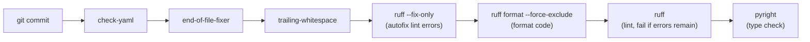
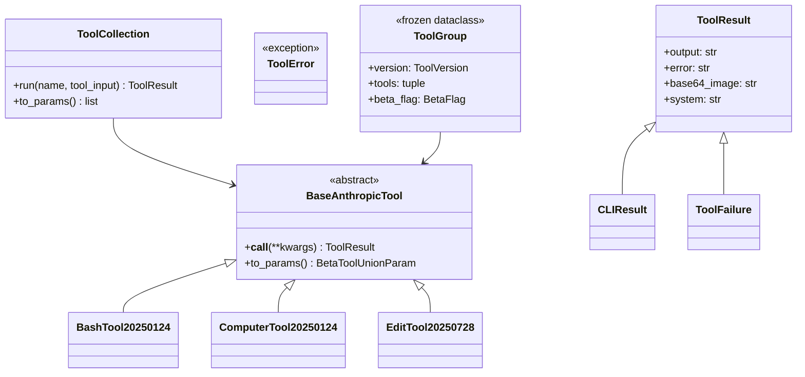

<!-- source: DeepWiki mcp.deepwiki.com · repo anthropics/claude-quickstarts · page 5.3 Code Style & Conventions · fetched 2026-10-26 -->

# Code Style & Conventions

<details>
<summary>Relevant source files</summary>

The following files were used as context for generating this wiki page:

- [.github/pull_request_template.md](.github/pull_request_template.md)
- [.pre-commit-config.yaml](.pre-commit-config.yaml)
- [CLAUDE.md](CLAUDE.md)
- [computer-use-demo/CONTRIBUTING.md](computer-use-demo/CONTRIBUTING.md)
- [pyproject.toml](pyproject.toml)

</details>


This page documents the coding standards, tooling configuration, and contribution conventions for the `claude-quickstarts` repository. The scope covers Python linting and formatting rules, type checking settings, the pre-commit hook pipeline, naming conventions, and class design patterns. For information about running the test suite, see [Testing & Quality Assurance](#5.2). For the contributor setup steps (virtual environment, `setup.sh`), see [Development Setup](#5.1).

---

## Scope by Subproject

The repository contains both Python and TypeScript projects. Automated tooling (ruff, pyright, pre-commit) applies only to the `computer-use-demo/` Python project. The TypeScript projects (`customer-support-agent`, `financial-data-analyst`) use ESLint via their own `package.json` configurations.

| Project | Language | Linter | Formatter | Type Checker |
|---|---|---|---|---|
| `computer-use-demo` | Python | ruff | ruff format | pyright |
| `agents` | Python | ruff | ruff format | pyright |
| `customer-support-agent` | TypeScript | ESLint (Next.js) | ESLint | TypeScript strict |
| `financial-data-analyst` | TypeScript | ESLint (Next.js) | ESLint | TypeScript strict |
| `autonomous-coding` | Python | — | — | — |
| `browser-use-demo` | Python | — | — | — |

Sources: [CLAUDE.md:1-63]()

---

## Python Naming Conventions

The Python codebase follows PEP 8 with these specific rules:

| Construct | Convention | Example |
|---|---|---|
| Functions | `snake_case` | `sampling_loop`, `_inject_prompt_caching` |
| Variables | `snake_case` | `tool_result`, `api_response` |
| Classes | `PascalCase` | `BashTool20250124`, `ToolCollection` |
| Constants | `UPPER_SNAKE_CASE` | `TOOL_GROUPS_BY_VERSION`, `SNIPPET_LINES` |
| Private methods | leading underscore + `snake_case` | `_file_history`, `_make_output` |

Sources: [CLAUDE.md:23-29](), [computer-use-demo/CONTRIBUTING.md:51-60]()

---

## Type Annotations

All Python function parameters and return values must have type annotations. This applies to both public API and private helper methods.

- Use `Literal` for constrained string types (e.g., `ToolVersion`, `BetaFlag`, `ScalingSource`).
- Use `TypedDict` or dataclasses for structured data — not plain `dict`.
- Set `useLibraryCodeForTypes = false` in pyright config to enforce that types come from stubs, not inferred library source.

Sources: [CLAUDE.md:28](), [computer-use-demo/CONTRIBUTING.md:56](), [pyproject.toml:1-4]()

---

## Ruff: Lint and Format

Ruff is the single tool used for both linting and formatting in the Python projects. The CONTRIBUTING.md references a `ruff.toml` for enabled rule details.

**CLI commands** (from `computer-use-demo/`):

```
ruff check .          # lint only
ruff format .         # format only
```

The pre-commit pipeline runs ruff in three ordered passes:

**Pre-commit Hook Pipeline — ruff**



Sources: [.pre-commit-config.yaml:1-23](), [CLAUDE.md:17-19](), [computer-use-demo/CONTRIBUTING.md:63-72]()

---

## Pre-commit Hook Configuration

The `.pre-commit-config.yaml` at the repository root scopes all hooks to the `computer-use-demo/` directory via the `files: ^computer-use-demo/` filter. Hooks run on both `pre-commit` and `pre-push` stages.

**Hook inventory:**

| Hook ID | Source | Purpose |
|---|---|---|
| `check-yaml` | `pre-commit-hooks` v2.3.0 | Validate YAML syntax |
| `end-of-file-fixer` | `pre-commit-hooks` v2.3.0 | Ensure files end with a newline |
| `trailing-whitespace` | `pre-commit-hooks` v2.3.0 | Remove trailing whitespace |
| `ruff` (fix-only) | `astral-sh/ruff-pre-commit` v0.6.7 | Autofix lint violations |
| `ruff` (format) | `astral-sh/ruff-pre-commit` v0.6.7 | Enforce formatting |
| `ruff` (lint) | `astral-sh/ruff-pre-commit` v0.6.7 | Fail on remaining lint errors |
| `pyright` | `RobertCraigie/pyright-python` v1.1.384 | Static type checking |

Sources: [.pre-commit-config.yaml:1-23]()

---

## Pyright Configuration

Pyright is configured in `pyproject.toml` at the repository root. It targets the `computer-use-demo/.venv` virtual environment.

[pyproject.toml:1-4]()

| Setting | Value | Effect |
|---|---|---|
| `venvPath` | `"computer-use-demo"` | Directory containing the venv |
| `venv` | `".venv"` | Virtual environment name |
| `useLibraryCodeForTypes` | `false` | Only use `.pyi` stubs, not inferred source types |

Sources: [pyproject.toml:1-4]()

---

## Class Design Patterns

**Diagram: Key Abstract Patterns in Code**



The key design rules enforced by `CONTRIBUTING.md`:

- All tools **must** inherit from `BaseAnthropicTool` and implement `__call__` and `to_params`.
- Use `ToolError` (exception) to signal tool-level failures inside a tool's execution.
- Return `ToolFailure` (a `ToolResult` subtype) when a tool completes but produces an error output to surface to the model.
- Use `CLIResult` for shell command output.
- Use **frozen dataclasses** for immutable structured data (e.g., `ToolGroup`).
- Use **abstract base classes (ABC)** to define shared interfaces.

Sources: [computer-use-demo/CONTRIBUTING.md:57-60](), [computer-use-demo/CONTRIBUTING.md:104-111]()

---

## Error Handling

| Scenario | Pattern |
|---|---|
| Tool logic failure (invalid input, unexpected state) | Raise `ToolError` |
| Tool produces error output for the model | Return `ToolFailure` |
| Shell command output (success or failure) | Return `CLIResult` |

Do not use bare `Exception` for tool errors. The `ToolError` and `ToolFailure` classes in `computer-use-demo/computer_use_demo/tools/base.py` are the correct vehicles.

Sources: [CLAUDE.md:27](), [computer-use-demo/CONTRIBUTING.md:59-60]()

---

## Imports

Python imports use **isort** with the `combine-as-imports` option enabled. This means `from x import a, b as c` style imports are combined on one line rather than split into separate `import` statements for each alias.

Sources: [CLAUDE.md:26]()

---

## Documentation Conventions

- All public classes and methods must have docstrings.
- For simple functions, use a concise single-line docstring.
- For complex functions, document: a brief description, parameters (if not obvious), return value (if not obvious), and important behavioral notes.
- Avoid inline comments — code should be self-documenting through clear naming.

Sources: [computer-use-demo/CONTRIBUTING.md:114-126]()

---

## Commit Requirements

All commits to the repository **must be signed** (`git commit -S`). This is a hard requirement documented in the contributing guidelines.

Commit message conventions:
- Use **present tense** ("Add feature", not "Added feature").
- Write clear, descriptive messages.
- Reference issue numbers when applicable.

Sources: [computer-use-demo/CONTRIBUTING.md:86-90]()

---

## TypeScript Conventions (Next.js Projects)

The `customer-support-agent` and `financial-data-analyst` projects follow these patterns:

| Convention | Rule |
|---|---|
| Type mode | Strict mode with complete interface definitions |
| Components | Function components using React hooks (no class components) |
| Formatting | ESLint with Next.js configuration |
| UI library | `shadcn/ui` (customer-support-agent) |
| Visualization | Recharts (financial-data-analyst) |
| State management | React hooks (`useState`, `useEffect`, etc.) |

Sources: [CLAUDE.md:41-47](), [CLAUDE.md:57-63]()

---

## Pull Request Checklist

The PR template at [.github/pull_request_template.md:1-29]() structures contributions around:

- Identifying which quickstart the PR affects.
- Classifying the change type (bug fix, feature, docs, refactor).
- Confirming unit tests were added or updated and manually verified.

Before a PR can be merged, all of these must pass:

1. `pytest` — all tests pass
2. `ruff check .` — no lint errors
3. `pyright` — no type errors
4. Pre-commit hooks — all hooks pass

Sources: [computer-use-demo/CONTRIBUTING.md:92-101](), [.github/pull_request_template.md:1-29]()