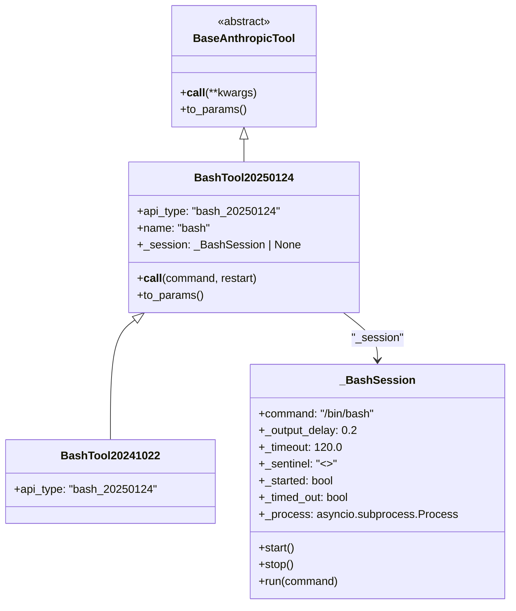
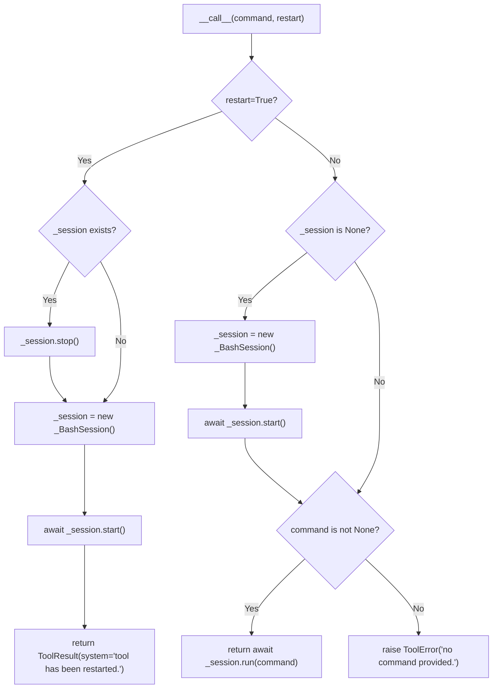

<!-- source: DeepWiki mcp.deepwiki.com · repo anthropics/claude-quickstarts · extra page BashTool · fetched 2026-10-26 -->

# BashTool

<details>
<summary>Relevant source files</summary>

The following files were used as context for generating this wiki page:

- [computer-use-demo/computer_use_demo/requirements.txt](computer-use-demo/computer_use_demo/requirements.txt)
- [computer-use-demo/computer_use_demo/tools/base.py](computer-use-demo/computer_use_demo/tools/base.py)
- [computer-use-demo/computer_use_demo/tools/bash.py](computer-use-demo/computer_use_demo/tools/bash.py)
- [computer-use-demo/computer_use_demo/tools/collection.py](computer-use-demo/computer_use_demo/tools/collection.py)
- [computer-use-demo/tests/tools/bash_test.py](computer-use-demo/tests/tools/bash_test.py)
- [computer-use-demo/tests/tools/computer_test.py](computer-use-demo/tests/tools/computer_test.py)

</details>


This page covers the `BashTool` implementations in the Computer Use Demo: the `_BashSession` class that manages a persistent shell subprocess, and the two versioned tool classes (`BashTool20250124` and `BashTool20241022`) that expose bash execution to the agent. For an overview of how tools fit into the broader tool system (versioning, `ToolCollection`, `BaseAnthropicTool`), see [Tool Architecture & Versioning](#2.4.1). For how `BashTool` is selected at runtime alongside other tools, see [Tool System](#2.4).

---

## Overview

`BashTool` gives the Claude agent the ability to run shell commands inside the Docker container's virtual desktop environment. It maintains a **persistent bash session** across invocations, which means environment variables, working directory changes, and shell state are preserved between commands. A `restart` parameter is available to tear down and recreate the session when needed.

All relevant code is in [computer-use-demo/computer_use_demo/tools/bash.py]().

---

## Class Structure

**Class diagram: BashTool class hierarchy**



Sources: [computer-use-demo/computer_use_demo/tools/bash.py:1-148]()

---

## `_BashSession`

`_BashSession` [computer-use-demo/computer_use_demo/tools/bash.py:8-101]() encapsulates a single long-lived `/bin/bash` subprocess. It uses `asyncio.create_subprocess_shell` with `PIPE` for `stdin`, `stdout`, and `stderr`.

### Session Constants

| Attribute | Value | Purpose |
|---|---|---|
| `command` | `"/bin/bash"` | Shell binary to launch |
| `_output_delay` | `0.2` seconds | Polling interval when reading output |
| `_timeout` | `120.0` seconds | Maximum time to wait for a command |
| `_sentinel` | `"<<exit>>"` | Marker appended after each command to detect completion |

Sources: [computer-use-demo/computer_use_demo/tools/bash.py:14-17]()

### Session Lifecycle

```mermaid
stateDiagram-v2
    [*] --> "Unstarted": "_BashSession()"
    "Unstarted" --> "Running": "start()"
    "Running" --> "Running": "run(command)"
    "Running" --> "TimedOut": "asyncio.TimeoutError"
    "Running" --> "Exited": "process exits"
    "Running" --> "Stopped": "stop()"
    "TimedOut" --> "Stopped": "stop() + restart=True"
    "Exited" --> "Stopped": "restart=True"
    "Stopped" --> [*]
```

Sources: [computer-use-demo/computer_use_demo/tools/bash.py:23-59]()

### Sentinel-Based Output Capture

The `run()` method cannot simply wait for EOF on `stdout` because the shell process remains alive between commands. Instead it uses a **sentinel pattern**:

1. The command string is written to `stdin`, suffixed with `; echo '<<exit>>'`.
2. The method polls `stdout._buffer` every `_output_delay` seconds.
3. When `"<<exit>>"` appears in the buffer, the output up to that marker is extracted and the sentinel is stripped.
4. The `stdout` and `stderr` buffers are manually cleared so the next command starts clean.

This is a direct read from the `asyncio.StreamReader` internal buffer rather than the public async API, because `await read()` would block indefinitely waiting for EOF.

Sources: [computer-use-demo/computer_use_demo/tools/bash.py:66-101]()

**Sequence diagram: single command execution in `_BashSession.run()`**

```mermaid
sequenceDiagram
    participant Caller as "BashTool20250124.__call__"
    participant Session as "_BashSession.run()"
    participant Stdin as "process.stdin"
    participant Stdout as "process.stdout._buffer"
    participant Stderr as "process.stderr._buffer"

    Caller->>Session: "run(command)"
    Session->>Stdin: "write(command + \"; echo '<<exit>>'\n\")"
    loop "every _output_delay (0.2s)"
        Session->>Stdout: "read _buffer"
        alt "sentinel '<<exit>>' found"
            Session->>Session: "strip sentinel, break"
        end
    end
    Session->>Stderr: "read _buffer"
    Session->>Stdout: "_buffer.clear()"
    Session->>Stderr: "_buffer.clear()"
    Session-->>Caller: "CLIResult(output, error)"
```

Sources: [computer-use-demo/computer_use_demo/tools/bash.py:67-101]()

### Timeout Behavior

The output-reading loop is wrapped in `asyncio.timeout(self._timeout)` (120 seconds). If a command does not produce the sentinel within that window:

- `self._timed_out` is set to `True`.
- A `ToolError` is raised: `"timed out: bash has not returned in 120.0 seconds and must be restarted"`.
- All subsequent calls to `run()` will immediately raise the same error until the session is restarted.

The only recovery path is to call `BashTool20250124.__call__(restart=True)`, which calls `session.stop()` and creates a fresh `_BashSession`.

Sources: [computer-use-demo/computer_use_demo/tools/bash.py:56-88]()

### Exited Process Detection

Before running any command, `run()` checks `self._process.returncode`. If the process has already exited (returncode is not `None`), it returns a `ToolResult` with `system="tool must be restarted"` and an error message including the return code. This is a non-exception signal to the agent that a restart is required.

Sources: [computer-use-demo/computer_use_demo/tools/bash.py:50-55]()

---

## `BashTool20250124`

`BashTool20250124` [computer-use-demo/computer_use_demo/tools/bash.py:104-143]() is the primary concrete implementation. It holds a single `_BashSession` instance as `_session`, lazily initializing it on first use.

### `to_params()`

Returns the API schema descriptor sent to the Anthropic API:

```
{"type": "bash_20250124", "name": "bash"}
```

Sources: [computer-use-demo/computer_use_demo/tools/bash.py:119-123]()

### `__call__(command, restart, **kwargs)`

**Call diagram: `BashTool20250124.__call__` decision tree**



Sources: [computer-use-demo/computer_use_demo/tools/bash.py:125-143]()

### Parameters

| Parameter | Type | Description |
|---|---|---|
| `command` | `str \| None` | Shell command to execute. Required unless `restart=True`. |
| `restart` | `bool` | If `True`, terminates the current session and starts a fresh one. |

Sources: [computer-use-demo/computer_use_demo/tools/bash.py:126-143]()

---

## `BashTool20241022`

`BashTool20241022` [computer-use-demo/computer_use_demo/tools/bash.py:146-147]() is a subclass of `BashTool20250124` that exists for backward compatibility. It overrides `api_type` but sets it to the **same value** (`"bash_20250124"`) as the parent class, making the two classes functionally identical from the API's perspective.

```
class BashTool20241022(BashTool20250124):
    api_type: Literal["bash_20250124"] = "bash_20250124"
```

The `pyright: ignore` comment on that line acknowledges that this technically violates the `Literal` type override rule but is intentional.

Sources: [computer-use-demo/computer_use_demo/tools/bash.py:146-147]()

### Version Comparison

| Property | `BashTool20250124` | `BashTool20241022` |
|---|---|---|
| `api_type` | `"bash_20250124"` | `"bash_20250124"` (same) |
| `name` | `"bash"` | `"bash"` (inherited) |
| Behavior | Full implementation | Identical (inherits all) |
| Parent class | `BaseAnthropicTool` | `BashTool20250124` |

Both classes are exercised by the same parameterized test fixture in [computer-use-demo/tests/tools/bash_test.py:6-8]().

Sources: [computer-use-demo/computer_use_demo/tools/bash.py:104-148](), [computer-use-demo/tests/tools/bash_test.py:1-8]()

---

## Return Values

`_BashSession.run()` always returns a `CLIResult` (a subtype of `ToolResult`). `BashTool20250124.__call__()` can return either a `ToolResult` (for restart) or a `CLIResult` (for command execution).

| Situation | Return type | Fields set |
|---|---|---|
| `restart=True` | `ToolResult` | `system="tool has been restarted."` |
| Command succeeds | `CLIResult` | `output`, `error` (may both be non-empty) |
| Process already exited | `ToolResult` | `system="tool must be restarted"`, `error=<returncode>` |
| No command provided | raises `ToolError` | — |
| Timeout | raises `ToolError` | — |
| Subsequent call after timeout | raises `ToolError` | — |

Sources: [computer-use-demo/computer_use_demo/tools/bash.py:47-101](), [computer-use-demo/computer_use_demo/tools/base.py:57-61]()

---

## Test Coverage

The test file [computer-use-demo/tests/tools/bash_test.py]() covers both tool versions via a parameterized fixture and validates:

| Test | What it checks |
|---|---|
| `test_bash_tool_restart` | `restart=True` returns system message; subsequent command works |
| `test_bash_tool_run_command` | stdout captured, error is empty string |
| `test_bash_tool_no_command` | `ToolError("no command provided.")` raised |
| `test_bash_tool_session_creation` | `_session` is not `None` after first call |
| `test_bash_tool_session_reuse` | Same session object handles multiple commands |
| `test_bash_tool_session_error` | Invalid command writes to stderr |
| `test_bash_tool_non_zero_exit` | Non-zero exit code produces no output or error text |
| `test_bash_tool_timeout` | Short `_timeout` triggers `ToolError` with correct message |

Sources: [computer-use-demo/tests/tools/bash_test.py:1-72]()

---

