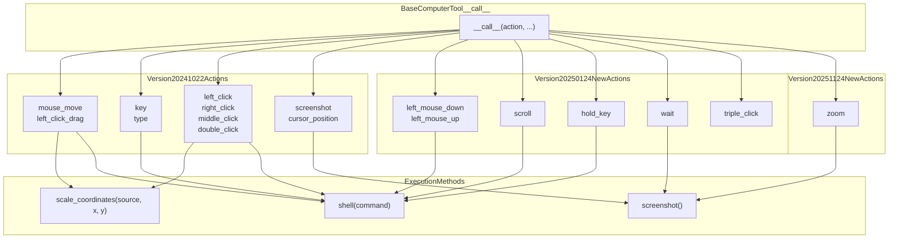
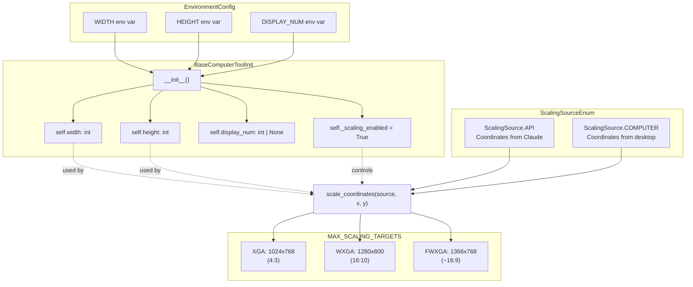
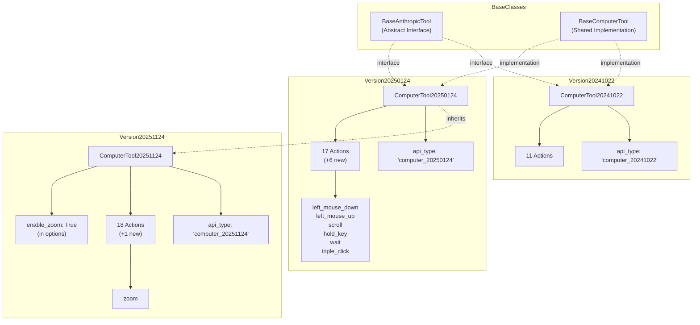
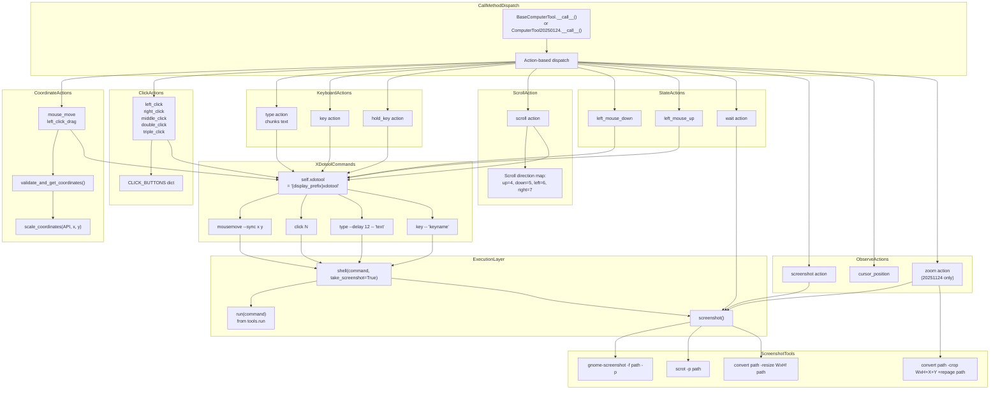
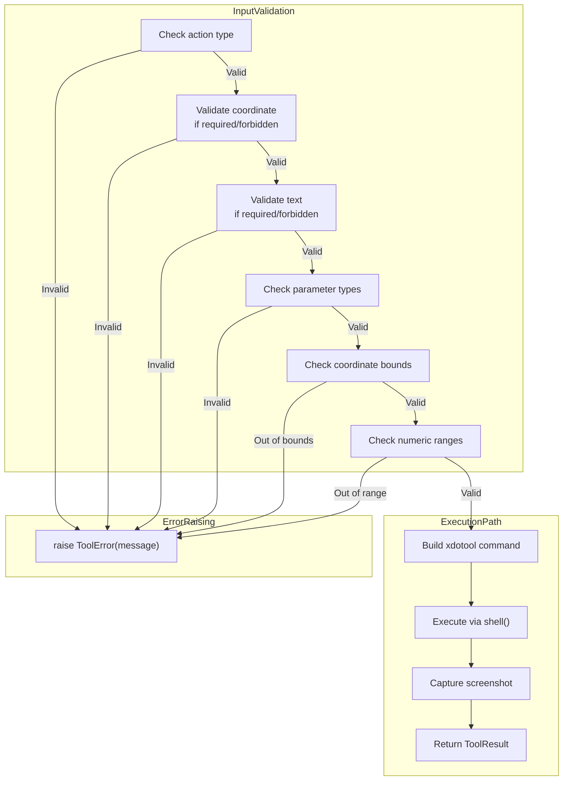

<!-- source: DeepWiki mcp.deepwiki.com · repo anthropics/claude-quickstarts · extra page ComputerTool · fetched 2026-10-26 -->

# ComputerTool

<details>
<summary>Relevant source files</summary>

The following files were used as context for generating this wiki page:

- [computer-use-demo/computer_use_demo/tools/computer.py](computer-use-demo/computer_use_demo/tools/computer.py)
- [computer-use-demo/tests/tools/bash_test.py](computer-use-demo/tests/tools/bash_test.py)
- [computer-use-demo/tests/tools/computer_test.py](computer-use-demo/tests/tools/computer_test.py)

</details>


The `ComputerTool` enables Claude to interact with graphical user interfaces (GUIs) through mouse control, keyboard input, and screenshot capture. This tool is the primary mechanism for Claude to observe and manipulate desktop applications within the virtual environment.

For information about shell command execution, see [BashTool](#2.4.2). For file editing operations, see [EditTool](#2.4.4). For the overall tool architecture, see [Tool Architecture & Versioning](#2.4.1).

## Overview

The `ComputerTool` provides three categories of interaction with the desktop environment:
- **Mouse Actions**: Move cursor, click (left/right/middle), double-click, and drag operations
- **Keyboard Actions**: Text input and special key combinations
- **Screenshot Capture**: Visual observation of the desktop state

All interactions are implemented using `xdotool`, a command-line tool for simulating X11 keyboard and mouse events. The tool includes a coordinate scaling system to handle different screen resolutions optimally for Claude's vision capabilities.

**Sources:** [computer-use-demo/README.md:158-165](), [computer-use-demo/tests/tools/computer_test.py:1-141]()

## Supported Actions by Version

The `ComputerTool` actions have evolved across three versions. Each version maintains backward compatibility with previous actions while adding new capabilities.

### Action Version Matrix

| Action | 20241022 | 20250124 | 20251124 | Description |
|--------|----------|----------|----------|-------------|
| `screenshot` | ✓ | ✓ | ✓ | Capture desktop as base64 PNG |
| `cursor_position` | ✓ | ✓ | ✓ | Get current cursor coordinates |
| `mouse_move` | ✓ | ✓ | ✓ | Move cursor to coordinate |
| `left_click` | ✓ | ✓ | ✓ | Click at coordinate (optional in 20250124+) |
| `right_click` | ✓ | ✓ | ✓ | Right-click at coordinate (optional in 20250124+) |
| `middle_click` | ✓ | ✓ | ✓ | Middle-click at coordinate (optional in 20250124+) |
| `double_click` | ✓ | ✓ | ✓ | Double-click at coordinate (optional in 20250124+) |
| `left_click_drag` | ✓ | ✓ | ✓ | Drag from current position to coordinate |
| `type` | ✓ | ✓ | ✓ | Type text with delay |
| `key` | ✓ | ✓ | ✓ | Press special keys |
| `left_mouse_down` | — | ✓ | ✓ | Hold left button down |
| `left_mouse_up` | — | ✓ | ✓ | Release left button |
| `scroll` | — | ✓ | ✓ | Scroll in direction with modifier keys |
| `hold_key` | — | ✓ | ✓ | Hold key for duration |
| `wait` | — | ✓ | ✓ | Wait for duration, return screenshot |
| `triple_click` | — | ✓ | ✓ | Triple-click at coordinate (optional) |
| `zoom` | — | — | ✓ | Crop screenshot to region |

### Action Category Architecture



### Mouse Actions (All Versions)

| Action | Parameters | Description | xdotool Pattern |
|--------|-----------|-------------|----------------|
| `mouse_move` | `coordinate: [x, y]` | Move cursor to position | `mousemove --sync x y` |
| `left_click_drag` | `coordinate: [x, y]` | Drag from current to coordinate | `mousedown 1 mousemove --sync x y mouseup 1` |

**Version 20241022:** Click actions require coordinate parameter.

| Action | Parameters | xdotool Pattern |
|--------|-----------|----------------|
| `left_click` | `coordinate: [x, y]` | `mousemove --sync x y click 1` |
| `right_click` | `coordinate: [x, y]` | `mousemove --sync x y click 3` |
| `middle_click` | `coordinate: [x, y]` | `mousemove --sync x y click 2` |
| `double_click` | `coordinate: [x, y]` | `mousemove --sync x y click --repeat 2 --delay 10 1` |

**Version 20250124+:** Click actions support optional coordinate and modifier key.

| Action | Parameters | xdotool Pattern |
|--------|-----------|----------------|
| `left_click` | `coordinate: [x, y]` (optional)<br/>`key: str` (optional) | `[mousemove --sync x y] [keydown key] click 1 [keyup key]` |
| `right_click` | `coordinate: [x, y]` (optional)<br/>`key: str` (optional) | `[mousemove --sync x y] [keydown key] click 3 [keyup key]` |
| `middle_click` | `coordinate: [x, y]` (optional)<br/>`key: str` (optional) | `[mousemove --sync x y] [keydown key] click 2 [keyup key]` |
| `double_click` | `coordinate: [x, y]` (optional)<br/>`key: str` (optional) | `[mousemove --sync x y] [keydown key] click --repeat 2 --delay 10 1 [keyup key]` |
| `triple_click` | `coordinate: [x, y]` (optional)<br/>`key: str` (optional) | `[mousemove --sync x y] [keydown key] click --repeat 3 --delay 10 1 [keyup key]` |

**Version 20250124+:** Mouse state control actions.

| Action | Parameters | Description | xdotool Pattern |
|--------|-----------|-------------|----------------|
| `left_mouse_down` | None | Press and hold left button | `mousedown 1` |
| `left_mouse_up` | None | Release left button | `mouseup 1` |

**Version 20250124+:** Scroll action with modifier key support.

| Action | Parameters | Description | xdotool Pattern |
|--------|-----------|-------------|----------------|
| `scroll` | `scroll_direction: "up"\|"down"\|"left"\|"right"`<br/>`scroll_amount: int`<br/>`coordinate: [x, y]` (optional)<br/>`text: str` (optional modifier key) | Scroll at position with modifier | `[mousemove --sync x y] [keydown text] click --repeat N {4\|5\|6\|7} [keyup text]` |

**Sources:** [computer-use-demo/computer_use_demo/tools/computer.py:21-46](), [computer-use-demo/computer_use_demo/tools/computer.py:136-213](), [computer-use-demo/computer_use_demo/tools/computer.py:318-401]()

### Keyboard Actions (All Versions)

| Action | Parameters | Description | Implementation |
|--------|-----------|-------------|----------------|
| `type` | `text: str` | Type literal text in chunks | Chunks of 50 chars, 12ms delay per char |
| `key` | `text: str` | Press special key(s) | `xdotool key -- {text}` |

The `type` action chunks text into groups of `TYPING_GROUP_SIZE` (50 characters) to avoid command-line length limits. Each chunk is typed with `TYPING_DELAY_MS` (12ms) between characters.

**Version 20250124+:** Key hold action.

| Action | Parameters | Description | xdotool Pattern |
|--------|-----------|-------------|----------------|
| `hold_key` | `text: str`<br/>`duration: int\|float` | Hold key for duration (max 100s) | `keydown {text} sleep {duration} keyup {text}` |

**Sources:** [computer-use-demo/computer_use_demo/tools/computer.py:18-19](), [computer-use-demo/computer_use_demo/tools/computer.py:154-180](), [computer-use-demo/computer_use_demo/tools/computer.py:363-373]()

### Screenshot and Observation Actions (All Versions)

| Action | Parameters | Description | Return Value |
|--------|-----------|-------------|--------------|
| `screenshot` | None | Capture desktop as PNG | `ToolResult` with `base64_image` |
| `cursor_position` | None | Get cursor coordinates | `ToolResult` with output `"X={x},Y={y}"` |

**Version 20250124+:** Wait action.

| Action | Parameters | Description | Return Value |
|--------|-----------|-------------|--------------|
| `wait` | `duration: int\|float` | Sleep then capture (max 100s) | `ToolResult` with `base64_image` |

**Version 20251124:** Zoom action.

| Action | Parameters | Description | Implementation |
|--------|-----------|-------------|----------------|
| `zoom` | `region: [x0, y0, x1, y1]` | Crop screenshot to region | Takes screenshot, crops using ImageMagick `convert` |

The `zoom` action enables Claude to focus on a specific region of the screen. It scales coordinates from API space to screen space, takes a full screenshot, then crops using ImageMagick:

```
convert {screenshot} -crop {width}x{height}+{x0}+{y0} +repage {output}
```

**Sources:** [computer-use-demo/computer_use_demo/tools/computer.py:195-209](), [computer-use-demo/computer_use_demo/tools/computer.py:224-250](), [computer-use-demo/computer_use_demo/tools/computer.py:375-377](), [computer-use-demo/computer_use_demo/tools/computer.py:427-469]()

## Coordinate Scaling System

The `ComputerTool` implements bidirectional coordinate scaling to optimize Claude's vision performance. The system translates between actual desktop resolution and target API resolutions defined in `MAX_SCALING_TARGETS`.

### Scaling Configuration



### Resolution Targets and Aspect Ratios

The `MAX_SCALING_TARGETS` dictionary defines three target resolutions selected based on aspect ratio matching:

| Target | Resolution | Aspect Ratio | Use Case |
|--------|-----------|--------------|----------|
| `XGA` | 1024×768 | 4:3 (~1.33) | Standard displays |
| `WXGA` | 1280×800 | 16:10 (1.60) | Widescreen displays |
| `FWXGA` | 1366×768 | ~16:9 (~1.78) | Full HD widescreen |

The scaling algorithm selects a target by:
1. Calculating desktop aspect ratio: `width / height`
2. Finding target with matching aspect ratio (within 0.02 tolerance)
3. Verifying target width is less than desktop width
4. If no match or target larger than desktop, no scaling applied

**Sources:** [computer-use-demo/computer_use_demo/tools/computer.py:56-62](), [computer-use-demo/computer_use_demo/tools/computer.py:113-125]()

### Scale Coordinates Method

The `scale_coordinates(source: ScalingSource, x: int, y: int)` method performs bidirectional coordinate translation:

#### Scaling from API Space to Computer Space

When `source == ScalingSource.API`:
- Validates coordinates are within bounds (raises `ToolError` if out of bounds)
- Scales up from target resolution to actual desktop resolution
- Used when executing actions with coordinates from Claude

```python
# Scaling factor is < 1 (target smaller than desktop)
x_scaling_factor = target_width / self.width
y_scaling_factor = target_height / self.height

# Scale up by dividing
return round(x / x_scaling_factor), round(y / y_scaling_factor)
```

#### Scaling from Computer Space to API Space

When `source == ScalingSource.COMPUTER`:
- Scales down from actual desktop resolution to target resolution
- Used for screenshots and `cursor_position` output

```python
# Scale down by multiplying
return round(x * x_scaling_factor), round(y * y_scaling_factor)
```

#### No-Scaling Cases

Scaling is bypassed when:
- `_scaling_enabled == False`
- No matching aspect ratio found in `MAX_SCALING_TARGETS`
- Desktop resolution smaller than all targets

**Sources:** [computer-use-demo/computer_use_demo/tools/computer.py:264-287]()

### Usage in Tool Operations

The scaling system integrates into multiple tool operations:

| Operation | Scaling Direction | Method |
|-----------|------------------|--------|
| Mouse action input | API → Computer | `validate_and_get_coordinates()` calls `scale_coordinates(API, x, y)` |
| Screenshot capture | Computer → API | `screenshot()` resizes image using ImageMagick |
| Cursor position output | Computer → API | `cursor_position` action scales result |
| Tool options | Computer → API | `options` property scales `display_width_px`, `display_height_px` |

The `options` property returns scaled dimensions to Claude:

```python
@property
def options(self) -> ComputerToolOptions:
    width, height = self.scale_coordinates(
        ScalingSource.COMPUTER, self.width, self.height
    )
    return {
        "display_width_px": width,
        "display_height_px": height,
        "display_number": self.display_num,
    }
```

This ensures Claude receives consistent coordinate spaces in both tool definitions and screenshot images.

**Sources:** [computer-use-demo/computer_use_demo/tools/computer.py:102-111](), [computer-use-demo/computer_use_demo/tools/computer.py:216-222](), [computer-use-demo/computer_use_demo/tools/computer.py:238-244]()

## Tool Versions and Evolution

Three versions of `ComputerTool` are implemented, each with distinct API types and capabilities. All versions inherit from `BaseComputerTool` and implement the `BaseAnthropicTool` interface.

### Version Architecture



### ComputerTool20241022

The initial version implementing the core computer use API type `computer_20241022`. Provides 11 fundamental actions for mouse, keyboard, and screenshot operations.

**Key Characteristics:**
- Click actions require `coordinate` parameter
- No mouse state control
- No scroll support
- Basic drag operation via `left_click_drag`

**API Type:** `computer_20241022`

**Class Definition:** [computer-use-demo/computer_use_demo/tools/computer.py:290-295]()

**to_params() Return Type:** `BetaToolComputerUse20241022Param`

### ComputerTool20250124

Enhanced version with API type `computer_20250124`. Adds 6 new actions focusing on advanced mouse control, scrolling, and timing operations.

**New Capabilities:**
- Optional `coordinate` parameter for click actions (enables clicking at current position)
- Optional `key` parameter for click actions (modifier keys like Ctrl, Shift)
- Mouse state control: `left_mouse_down`, `left_mouse_up`
- Scrolling with direction and amount: `scroll`
- Key hold operation: `hold_key`
- Timed wait: `wait`
- Triple-click: `triple_click`

**API Type:** `computer_20250124`

**Class Definition:** [computer-use-demo/computer_use_demo/tools/computer.py:297-405]()

**to_params() Return Type:** `BetaToolUnionParam` (cast)

**Implementation Notes:**
- Inherits all actions from `BaseComputerTool` via `super().__call__()` for backward compatibility
- Adds validation for new parameters (`scroll_direction`, `scroll_amount`, `duration`)
- Scroll action supports modifier keys via optional `text` parameter
- Duration-based actions (`hold_key`, `wait`) limited to 100 seconds

### ComputerTool20251124

Latest version with API type `computer_20251124`. Inherits from `ComputerTool20250124` and adds zoom capability.

**New Capabilities:**
- `zoom` action: crops screenshot to specified region
- `enable_zoom: True` added to options dictionary

**API Type:** `computer_20251124`

**Class Definition:** [computer-use-demo/computer_use_demo/tools/computer.py:407-481]()

**Options Override:** [computer-use-demo/computer_use_demo/tools/computer.py:410-412]()

**Implementation Details:**
- The `zoom` action validates region as 4-element tuple `[x0, y0, x1, y1]`
- Scales region coordinates from API space to screen space
- Uses ImageMagick `convert` command for cropping
- Returns only the cropped image (no full screenshot)
- Cleans up temporary files after operation

**Sources:** [computer-use-demo/computer_use_demo/tools/computer.py:290-295](), [computer-use-demo/computer_use_demo/tools/computer.py:297-305](), [computer-use-demo/computer_use_demo/tools/computer.py:407-412]()

## Implementation Architecture

The `ComputerTool` integrates with the virtual desktop environment through `xdotool` commands and screenshot utilities.

### Command Execution Flow



### Core Methods

| Method | Signature | Purpose |
|--------|-----------|---------|
| `__init__()` | `() -> None` | Initialize from `WIDTH`, `HEIGHT`, `DISPLAY_NUM` env vars |
| `__call__()` | `(action, text?, coordinate?, scroll_direction?, scroll_amount?, duration?, key?, region?, **kwargs)` | Main action dispatcher |
| `shell()` | `(command: str, take_screenshot: bool = True) -> ToolResult` | Execute shell command with optional screenshot |
| `screenshot()` | `() -> ToolResult` | Capture desktop as base64 PNG |
| `scale_coordinates()` | `(source: ScalingSource, x: int, y: int) -> tuple[int, int]` | Translate coordinates between API and computer space |
| `validate_and_get_coordinates()` | `(coordinate: tuple[int, int] | None) -> tuple[int, int]` | Validate and scale coordinates from API |

**Sources:** [computer-use-demo/computer_use_demo/tools/computer.py:113-127](), [computer-use-demo/computer_use_demo/tools/computer.py:128-214](), [computer-use-demo/computer_use_demo/tools/computer.py:252-262]()

### xdotool Command Patterns

The `xdotool` property includes the display prefix for multi-display support:

```python
self.xdotool = f"{self._display_prefix}xdotool"
# Example: "DISPLAY=:1 xdotool" or "xdotool"
```

**Click Button Mapping (CLICK_BUTTONS):**

```python
CLICK_BUTTONS = {
    "left_click": 1,
    "right_click": 3,
    "middle_click": 2,
    "double_click": "--repeat 2 --delay 10 1",
    "triple_click": "--repeat 3 --delay 10 1",
}
```

**Scroll Direction Mapping:**

```python
scroll_button = {
    "up": 4,
    "down": 5,
    "left": 6,
    "right": 7,
}[scroll_direction]
```

**Sources:** [computer-use-demo/computer_use_demo/tools/computer.py:64-70](), [computer-use-demo/computer_use_demo/tools/computer.py:339-344]()

### Screenshot Implementation

The `screenshot()` method supports two capture tools with automatic fallback:

1. **Primary:** `gnome-screenshot -f {path} -p` (if available)
2. **Fallback:** `scrot -p {path}`

After capture, if scaling is enabled:
1. Determines target resolution via `scale_coordinates(COMPUTER, width, height)`
2. Resizes image using ImageMagick: `convert {path} -resize {x}x{y}! {path}`

Screenshots are saved to `OUTPUT_DIR` (`/tmp/outputs`) with UUID-based filenames.

**Sources:** [computer-use-demo/computer_use_demo/tools/computer.py:16](), [computer-use-demo/computer_use_demo/tools/computer.py:224-250]()

### ToolResult Return Type

All actions return a `ToolResult` object from the `base` module. The result contains:

| Field | Type | Purpose |
|-------|------|---------|
| `output` | `str | None` | Text output from command |
| `error` | `str | None` | Error messages from stderr |
| `base64_image` | `str | None` | Base64-encoded PNG screenshot |

Most mouse and keyboard actions automatically capture a screenshot after execution by calling `shell()` with `take_screenshot=True` (default). The `_screenshot_delay` of 2.0 seconds allows the desktop to settle before capture.

**Sources:** [computer-use-demo/computer_use_demo/tools/computer.py:99](), [computer-use-demo/computer_use_demo/tools/computer.py:252-262](), [computer-use-demo/computer_use_demo/tools/base.py]()

## Error Handling and Validation

The `ComputerTool` validates inputs and raises `ToolError` exceptions before command execution.

### Validation Rules by Version

**BaseComputerTool (20241022):**

| Error Condition | Validated Actions | Error Message |
|----------------|------------------|---------------|
| Invalid action | All | `Invalid action: {action}` |
| Missing coordinate | `mouse_move`, `left_click_drag` | `coordinate is required for {action}` |
| Unexpected coordinate | `key`, `type`, `screenshot`, `cursor_position`, click actions | `coordinate is not accepted for {action}` |
| Missing text | `key`, `type` | `text is required for {action}` |
| Unexpected text | `mouse_move`, `left_click_drag`, `screenshot`, `cursor_position`, click actions | `text is not accepted for {action}` |
| Invalid coordinate type | Any with coordinate | `{coordinate} must be a tuple of length 2` |
| Negative coordinate | Any with coordinate | `{coordinate} must be a tuple of non-negative ints` |
| Out of bounds coordinate | Any with coordinate | `Coordinates {x}, {y} are out of bounds` |
| Text not string | `type` | `{text} must be a string` |

**ComputerTool20250124 Additional Validations:**

| Error Condition | Validated Actions | Error Message |
|----------------|------------------|---------------|
| Unexpected coordinate | `left_mouse_down`, `left_mouse_up` | `coordinate is not accepted for {action=}.` |
| Invalid scroll direction | `scroll` | `{scroll_direction=} must be 'up', 'down', 'left', or 'right'` |
| Invalid scroll amount | `scroll` | `{scroll_amount=} must be a non-negative int` |
| Missing duration | `hold_key`, `wait` | `{duration=} must be a number` |
| Negative duration | `hold_key`, `wait` | `{duration=} must be non-negative` |
| Duration too long | `hold_key`, `wait` | `{duration=} is too long.` (max 100) |
| Missing text for hold_key | `hold_key` | `text is required for {action}` |

**ComputerTool20251124 Additional Validations:**

| Error Condition | Validated Actions | Error Message |
|----------------|------------------|---------------|
| Invalid region type | `zoom` | `{region=} must be a tuple of 4 coordinates (x0, y0, x1, y1)` |
| Invalid region values | `zoom` | `{region=} must contain non-negative integers` |
| Screenshot failed for zoom | `zoom` | `Failed to take screenshot for zoom` |
| Crop failed | `zoom` | `Failed to crop screenshot for zoom` |

### Error Handling Flow



All validation occurs before command construction, ensuring that malformed requests never reach the execution layer.

**Sources:** [computer-use-demo/computer_use_demo/tools/computer.py:136-214](), [computer-use-demo/computer_use_demo/tools/computer.py:318-404](), [computer-use-demo/computer_use_demo/tools/computer.py:427-469]()

## Integration with Sampling Loop

The `ComputerTool` is instantiated and registered with the `ToolCollection` at the start of each agent loop session. Claude receives the tool's schema through the API's `tools` parameter and can invoke it by generating `tool_use` content blocks.

The typical interaction flow:
1. Agent loop captures initial screenshot
2. Claude receives screenshot and tool definitions
3. Claude generates `tool_use` block with `ComputerTool` action
4. Loop executes the tool via `ToolCollection`
5. Tool returns result with updated screenshot
6. Result is added to message history
7. Loop continues with new screenshot in context

This feedback loop enables Claude to observe, act, and adapt its strategy based on visual confirmation of action results.

**Sources:** [computer-use-demo/README.md:1-184]()

## Best Practices

Based on the implementation and documentation:

1. **Use XGA Resolution**: Configure the virtual desktop to 1024x768 (XGA) for optimal model performance without requiring scaling
2. **Enable Scaling for Higher Resolutions**: If using resolutions above XGA, ensure `_scaling_enabled` is true and the scaling system is properly configured
3. **Leverage Screenshot Feedback**: All mouse and keyboard actions automatically return screenshots, providing immediate visual feedback to Claude
4. **Handle Timeouts**: The underlying `shell` method inherits timeout behavior from the bash session, ensuring commands don't hang indefinitely
5. **Validate Coordinates**: The tool validates coordinate bounds, but client code should still handle `ToolError` exceptions appropriately

**Sources:** [computer-use-demo/README.md:158-165](), [computer-use-demo/tests/tools/computer_test.py:1-141]()

---

