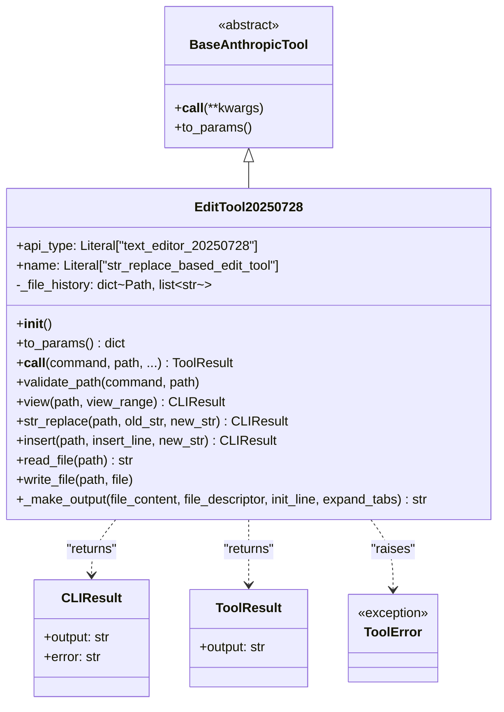
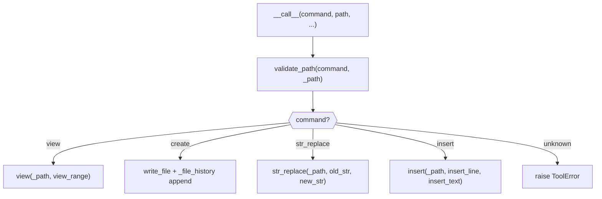
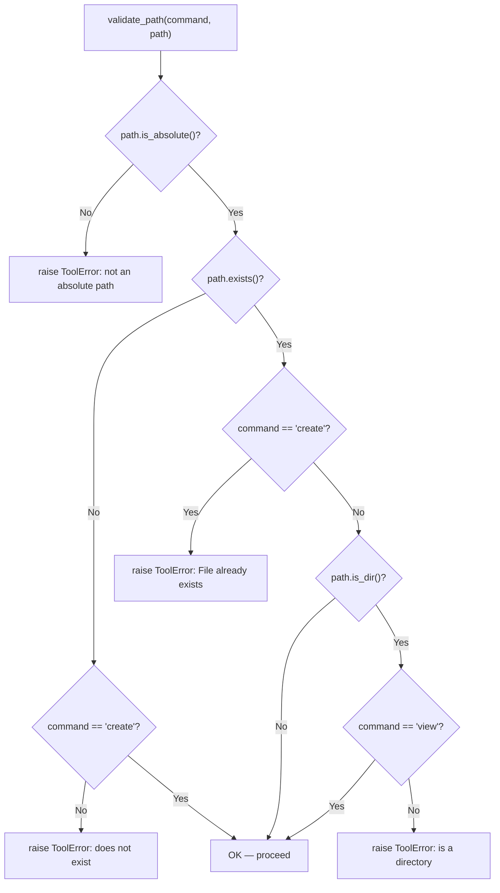

<!-- source: DeepWiki mcp.deepwiki.com · repo anthropics/claude-quickstarts · extra page EditTool · fetched 2026-10-26 -->

# EditTool

<details>
<summary>Relevant source files</summary>

The following files were used as context for generating this wiki page:

- [computer-use-demo/computer_use_demo/tools/edit.py](computer-use-demo/computer_use_demo/tools/edit.py)
- [computer-use-demo/tests/loop_test.py](computer-use-demo/tests/loop_test.py)
- [computer-use-demo/tests/streamlit_test.py](computer-use-demo/tests/streamlit_test.py)
- [computer-use-demo/tests/tools/edit_test.py](computer-use-demo/tests/tools/edit_test.py)

</details>


This page documents `EditTool20250728`, the filesystem editing tool used in the Computer Use Demo. It covers the four supported commands, path validation rules, internal file history state, and output formatting. For an overview of how `EditTool20250728` fits into the broader tool system — including `BaseAnthropicTool`, `ToolCollection`, and tool versioning — see [Tool Architecture & Versioning](#2.4.1). For the other tools in the same system, see [BashTool](#2.4.2) and [ComputerTool](#2.4.3).

---

## Overview

`EditTool20250728` is defined in [computer-use-demo/computer_use_demo/tools/edit.py]() and implements the `text_editor_20250728` API tool type. It exposes four commands to the agent: `view`, `create`, `str_replace`, and `insert`. The tool registers itself with the API under the name `str_replace_based_edit_tool`.

Key identifiers:

| Attribute | Value |
|---|---|
| Class name | `EditTool20250728` |
| `name` | `"str_replace_based_edit_tool"` |
| `api_type` | `"text_editor_20250728"` |
| Source file | `computer-use-demo/computer_use_demo/tools/edit.py` |

The `Command` type alias enumerates the allowed commands:

```
Command = Literal["view", "create", "str_replace", "insert"]
```

[computer-use-demo/computer_use_demo/tools/edit.py:9-14]()

Sources: [computer-use-demo/computer_use_demo/tools/edit.py:18-42]()

---

## Class Structure

**Class diagram: EditTool20250728**



Sources: [computer-use-demo/computer_use_demo/tools/edit.py:18-42]()

---

## Command Reference

The `__call__` method dispatches to a command-specific method based on the `command` parameter. Each command has required parameters; missing required parameters raise `ToolError`.

**Diagram: Command dispatch flow**



Sources: [computer-use-demo/computer_use_demo/tools/edit.py:44-85]()

### `view`

Displays the content of a file or directory listing.

| Parameter | Type | Required | Notes |
|---|---|---|---|
| `path` | `str` | Yes | Must be absolute |
| `view_range` | `list[int]` | No | `[start_line, end_line]`; forbidden for directories |

- **Directory:** runs `find {path} -maxdepth 2 -not -path '*/\.*'` via `run()` and returns a `CLIResult`.
- **File:** reads the full file, then optionally slices to `view_range`. A `final_line` of `-1` means "to end of file".
- Output is formatted by `_make_output`, showing line numbers.

[computer-use-demo/computer_use_demo/tools/edit.py:113-158]()

### `create`

Creates a new file with the given content. Cannot overwrite an existing file.

| Parameter | Type | Required |
|---|---|---|
| `path` | `str` | Yes |
| `file_text` | `str` | Yes |

- Calls `write_file(_path, file_text)`, then appends `file_text` to `_file_history[_path]`.
- Returns a plain `ToolResult` (not `CLIResult`) with the message `"File created successfully at: {_path}"`.

[computer-use-demo/computer_use_demo/tools/edit.py:61-66]()

### `str_replace`

Replaces a unique occurrence of `old_str` with `new_str` in a file.

| Parameter | Type | Required | Notes |
|---|---|---|---|
| `path` | `str` | Yes | |
| `old_str` | `str` | Yes | Must appear exactly once |
| `new_str` | `str` | No | Defaults to `""` (deletion) if omitted |

**Error conditions:**
- `old_str` not found → `ToolError` ("did not appear verbatim")
- `old_str` found more than once → `ToolError` listing the line numbers of each match

**On success:**
1. Reads the file and expands tabs.
2. Replaces the single occurrence.
3. Writes the new content.
4. Saves the pre-edit content to `_file_history[path]`.
5. Returns a `CLIResult` with a context snippet around the changed region (see [SNIPPET_LINES](#snippet_lines-and-_make_output)).

[computer-use-demo/computer_use_demo/tools/edit.py:160-206]()

### `insert`

Inserts text after a given line number (0-indexed, where 0 means before the first line).

| Parameter | Type | Required | Notes |
|---|---|---|---|
| `path` | `str` | Yes | |
| `insert_line` | `int` | Yes | `0` = before first line; `n_lines_file` = after last line |
| `insert_text` | `str` | Yes | |

**Error condition:** `insert_line` outside `[0, n_lines_file]` → `ToolError`.

**On success:**
1. Reads the file and expands tabs.
2. Splits `new_str` on newlines and splices into the line list.
3. Writes the new content.
4. Saves the pre-edit content to `_file_history[path]`.
5. Returns a `CLIResult` with a context snippet.

[computer-use-demo/computer_use_demo/tools/edit.py:208-245]()

---

## Path Validation

`validate_path(command, path)` enforces the following rules before any command executes:

**Diagram: validate_path decision tree**



Summary of rules:

| Condition | Allowed commands |
|---|---|
| Relative path | None (always errors) |
| Path does not exist | `create` only |
| Path exists | `view`, `str_replace`, `insert` |
| Path is a directory | `view` only |
| Path is a file | All commands |

Sources: [computer-use-demo/computer_use_demo/tools/edit.py:87-111]()

---

## `_file_history` State

`_file_history` is a `defaultdict(list)` keyed by `Path`, storing previous file contents as strings.

```python
_file_history: dict[Path, list[str]]
```

It is populated by `create`, `str_replace`, and `insert` — each saves the file content **before** the modification. This gives a per-session history of file states.

> **No undo support:** Although `_file_history` accumulates previous file contents, there is no `undo_edit` command in this tool version. The history is retained in memory for the lifetime of the tool instance but is not exposed as an operation. This is explicitly noted in the class docstring.

[computer-use-demo/computer_use_demo/tools/edit.py:18-36]()

---

## `SNIPPET_LINES` and `_make_output`

### `SNIPPET_LINES`

`SNIPPET_LINES = 4` is a module-level constant that controls the context window shown in success messages for `str_replace` and `insert`. After an edit, the output includes `SNIPPET_LINES` lines before and after the changed region.

[computer-use-demo/computer_use_demo/tools/edit.py:15]()

### `_make_output`

```
_make_output(file_content, file_descriptor, init_line=1, expand_tabs=True) → str
```

Formats file content for display, mimicking `cat -n` output:

1. Truncates content via `maybe_truncate(file_content)` (imported from `tools/run.py`).
2. Optionally expands tabs.
3. Prefixes each line with a right-justified 6-character line number starting at `init_line`.
4. Wraps the result in a header: `"Here's the result of running \`cat -n\` on {file_descriptor}:\n"`.

Example output structure:
```
Here's the result of running `cat -n` on /path/to/file.txt:
     1	line one
     2	line two
     3	line three
```

[computer-use-demo/computer_use_demo/tools/edit.py:261-282]()

Sources: [computer-use-demo/computer_use_demo/tools/edit.py:261-282]()

---

## `to_params`

`EditTool20250728.to_params()` returns only the `name` and `type` fields, unlike `ComputerTool` which returns a full input schema. The schema is registered server-side by Anthropic.

```python
def to_params(self):
    return {
        "name": self.name,        # "str_replace_based_edit_tool"
        "type": self.api_type,    # "text_editor_20250728"
    }
```

[computer-use-demo/computer_use_demo/tools/edit.py:38-42]()

---

## Error Handling

All errors are raised as `ToolError` exceptions, which the `ToolCollection.run()` method catches and converts into `ToolFailure` results to pass back to the agent. File read/write errors are caught in `read_file` and `write_file` and re-raised as `ToolError` with context.

| Error scenario | Message pattern |
|---|---|
| Relative path | `"not an absolute path, it should start with '/'."` |
| Non-existent path (non-create) | `"does not exist. Please provide a valid path."` |
| Existing path (create) | `"File already exists at: {path}. Cannot overwrite files using command \`create\`."` |
| Directory for non-view command | `"is a directory and only the \`view\` command can be used on directories"` |
| `old_str` not found | `"did not appear verbatim in {path}."` |
| Multiple `old_str` matches | `"Multiple occurrences of old_str ... in lines {lines}."` |
| `insert_line` out of range | `"Invalid \`insert_line\` parameter: {insert_line}."` |
| Invalid `view_range` | `"Invalid \`view_range\`."` |
| `view_range` on directory | `"The \`view_range\` parameter is not allowed when \`path\` points to a directory."` |
| File read failure | `"Ran into {e} while trying to read {path}"` |
| File write failure | `"Ran into {e} while trying to write to {path}"` |

Sources: [computer-use-demo/computer_use_demo/tools/edit.py:87-111](), [computer-use-demo/computer_use_demo/tools/edit.py:160-245](), [computer-use-demo/computer_use_demo/tools/edit.py:247-259]()

---

## Test Coverage

Tests for `EditTool20250728` are in [computer-use-demo/tests/tools/edit_test.py](). The test suite covers:

- `test_view_command`: file viewing, directory listing, `view_range` slicing, invalid ranges, non-existent files, `view_range` on directories.
- `test_create_command`: creating new files, missing `file_text`, overwriting existing files.
- `test_str_replace_command`: unique replacement, not-found string, multiple occurrences, history update.
- `test_insert_command`: insert at middle/beginning/end, out-of-range line numbers, history update.
- `test_validate_path`: all six validation branches.

[computer-use-demo/tests/tools/edit_test.py:1-302]()

---

