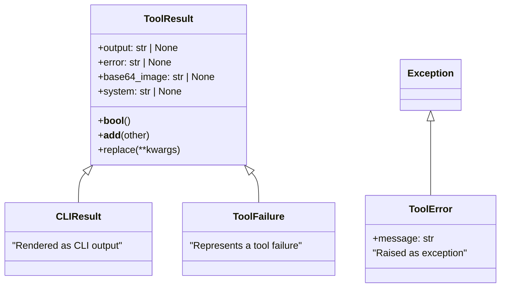
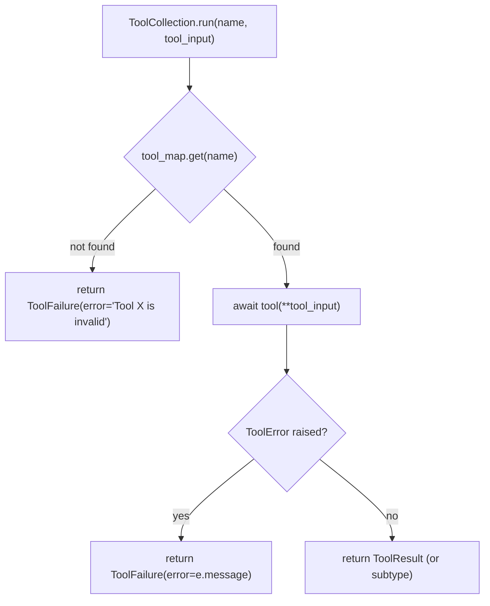
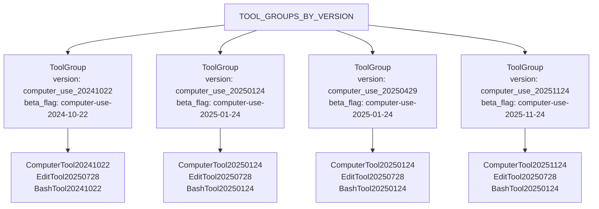
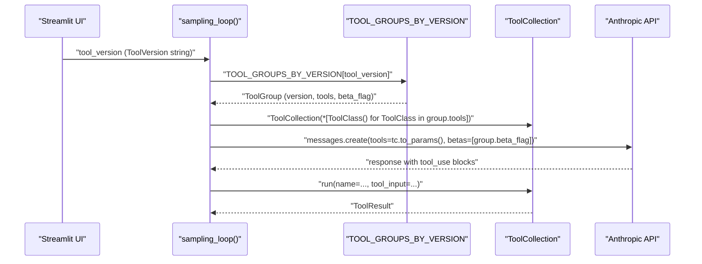

<!-- source: DeepWiki mcp.deepwiki.com · repo anthropics/claude-quickstarts · extra page Tool Architecture & Versioning · fetched 2026-10-26 -->

# Tool Architecture & Versioning

<details>
<summary>Relevant source files</summary>

The following files were used as context for generating this wiki page:

- [computer-use-demo/computer_use_demo/requirements.txt](computer-use-demo/computer_use_demo/requirements.txt)
- [computer-use-demo/computer_use_demo/tools/__init__.py](computer-use-demo/computer_use_demo/tools/__init__.py)
- [computer-use-demo/computer_use_demo/tools/base.py](computer-use-demo/computer_use_demo/tools/base.py)
- [computer-use-demo/computer_use_demo/tools/bash.py](computer-use-demo/computer_use_demo/tools/bash.py)
- [computer-use-demo/computer_use_demo/tools/collection.py](computer-use-demo/computer_use_demo/tools/collection.py)
- [computer-use-demo/computer_use_demo/tools/groups.py](computer-use-demo/computer_use_demo/tools/groups.py)

</details>


This page covers the foundational abstractions that all computer-use tools are built on: `BaseAnthropicTool`, the `ToolResult` type hierarchy, `ToolCollection`, and the versioning registry (`ToolGroup`, `ToolVersion`, `TOOL_GROUPS_BY_VERSION`). It does **not** cover the individual tool implementations — for those, see [BashTool](#2.4.2), [ComputerTool](#2.4.3), and [EditTool](#2.4.4).

---

## Core Abstractions

### `BaseAnthropicTool`

`BaseAnthropicTool` ([computer-use-demo/computer_use_demo/tools/base.py:8-20]()) is an abstract base class (using `ABCMeta`) that all tool implementations must subclass. It declares two abstract methods:

| Method | Signature | Purpose |
|---|---|---|
| `__call__` | `(**kwargs) -> Any` | Executes the tool with arguments provided by the API |
| `to_params` | `() -> BetaToolUnionParam` | Returns the tool's API schema in the format expected by the Anthropic beta messages API |

Every concrete tool class provides its own `to_params` implementation that returns its `api_type` and `name`, which the API uses to identify and route tool calls.

Sources: [computer-use-demo/computer_use_demo/tools/base.py:1-21]()

---

### `ToolResult` and Its Subtypes

`ToolResult` ([computer-use-demo/computer_use_demo/tools/base.py:23-54]()) is a frozen dataclass representing the output of any tool execution. It has four optional fields:

| Field | Type | Description |
|---|---|---|
| `output` | `str \| None` | Standard text output to return to the model |
| `error` | `str \| None` | Error message, if the tool encountered a problem |
| `base64_image` | `str \| None` | A screenshot or image result, base64-encoded |
| `system` | `str \| None` | A system-level message (e.g., "tool must be restarted") |

`ToolResult.__bool__` returns `True` if any field is non-`None`. `ToolResult.__add__` merges two results by concatenating string fields (raising `ValueError` if both have a `base64_image`). `ToolResult.replace` creates a modified copy via `dataclasses.replace`.

Three additional types extend `ToolResult`:

**ToolResult type hierarchy:**



- **`CLIResult`** ([computer-use-demo/computer_use_demo/tools/base.py:57-58]()): A `ToolResult` subclass for command-line output (e.g., from bash). Has no extra fields; exists for semantic distinction.
- **`ToolFailure`** ([computer-use-demo/computer_use_demo/tools/base.py:61-62]()): A `ToolResult` subclass representing a tool failure, typically with only the `error` field set.
- **`ToolError`** ([computer-use-demo/computer_use_demo/tools/base.py:65-69]()): An `Exception` subclass (not a `ToolResult`). Raised internally when a tool encounters an unrecoverable error. It carries a `message` attribute. `ToolCollection.run` catches `ToolError` and converts it to a `ToolFailure`.

Sources: [computer-use-demo/computer_use_demo/tools/base.py:23-69]()

---

## `ToolCollection`

`ToolCollection` ([computer-use-demo/computer_use_demo/tools/collection.py:15-36]()) is a container for a set of instantiated tool objects. It is the primary interface through which `sampling_loop` interacts with tools (see [Sampling Loop & Agent Orchestration](#2.2)).

**Construction:**

```python
ToolCollection(*tools: BaseAnthropicTool)
```

On construction, it builds an internal `tool_map` dict keyed by each tool's `name` field (extracted by calling `to_params()`).

**Methods:**

| Method | Return type | Description |
|---|---|---|
| `to_params()` | `list[BetaToolUnionParam]` | Returns the API parameter schemas for all tools, for inclusion in the API request |
| `run(*, name, tool_input)` | `ToolResult` (async) | Looks up the tool by name, calls it with `**tool_input`, catches `ToolError` and converts to `ToolFailure` |

**`run` dispatch flow:**



Sources: [computer-use-demo/computer_use_demo/tools/collection.py:1-36]()

---

## Versioning System

The versioning system maps string version identifiers to specific sets of tool classes and Anthropic API beta flags. This allows the Streamlit UI (see [Streamlit User Interface](#2.3)) to switch between tool generations without changing any tool logic.

### `ToolVersion` and `BetaFlag`

Both are `Literal` type aliases defined in [computer-use-demo/computer_use_demo/tools/groups.py:9-20]().

| `ToolVersion` | Corresponding `BetaFlag` |
|---|---|
| `"computer_use_20241022"` | `"computer-use-2024-10-22"` |
| `"computer_use_20250124"` | `"computer-use-2025-01-24"` |
| `"computer_use_20250429"` | `"computer-use-2025-01-24"` |
| `"computer_use_20251124"` | `"computer-use-2025-11-24"` |

Note that `computer_use_20250429` reuses the same beta flag as `computer_use_20250124` — it is differentiated by the tool set it uses, not a new API flag.

### `ToolGroup`

`ToolGroup` ([computer-use-demo/computer_use_demo/tools/groups.py:23-27]()) is a frozen dataclass with three fields:

| Field | Type | Description |
|---|---|---|
| `version` | `ToolVersion` | The version identifier string |
| `tools` | `list[type[BaseAnthropicTool]]` | The tool *classes* (not instances) bundled with this version |
| `beta_flag` | `BetaFlag \| None` | The API beta header value to include when calling this version |

### `TOOL_GROUPS_BY_VERSION`

`TOOL_GROUPS_BY_VERSION` ([computer-use-demo/computer_use_demo/tools/groups.py:53]()) is a dict built from the `TOOL_GROUPS` list. It maps each `ToolVersion` string to its `ToolGroup` instance, enabling O(1) lookup at runtime.

```python
TOOL_GROUPS_BY_VERSION: dict[ToolVersion, ToolGroup]
```

**Version-to-tool-class mapping:**



Sources: [computer-use-demo/computer_use_demo/tools/groups.py:1-53]()

---

## Runtime Version Selection

The Streamlit UI holds the selected `ToolVersion` in session state. When a user sends a message, `sampling_loop` receives the version string and performs the following steps to construct a `ToolCollection`:



- The `beta_flag` from the `ToolGroup` is passed as a beta header on every API request for that session.
- Each tool class in `group.tools` is instantiated fresh per session; stateful tools like `BashTool` hold their `_BashSession` as instance state.
- `ToolCollection.to_params()` returns the list of tool schemas that the API uses to identify callable tools.

Sources: [computer-use-demo/computer_use_demo/tools/groups.py:30-53](), [computer-use-demo/computer_use_demo/tools/collection.py:15-36]()

---

## Public Exports

The `tools` package exposes the following symbols via [computer-use-demo/computer_use_demo/tools/__init__.py:1-19]():

| Symbol | Origin |
|---|---|
| `ToolResult` | `tools/base.py` |
| `CLIResult` | `tools/base.py` |
| `BashTool20241022` | `tools/bash.py` |
| `BashTool20250124` | `tools/bash.py` |
| `ToolCollection` | `tools/collection.py` |
| `ComputerTool20241022` | `tools/computer.py` |
| `ComputerTool20250124` | `tools/computer.py` |
| `EditTool20250728` | `tools/edit.py` |
| `TOOL_GROUPS_BY_VERSION` | `tools/groups.py` |
| `ToolVersion` | `tools/groups.py` |

Sources: [computer-use-demo/computer_use_demo/tools/__init__.py:1-19]()

---

