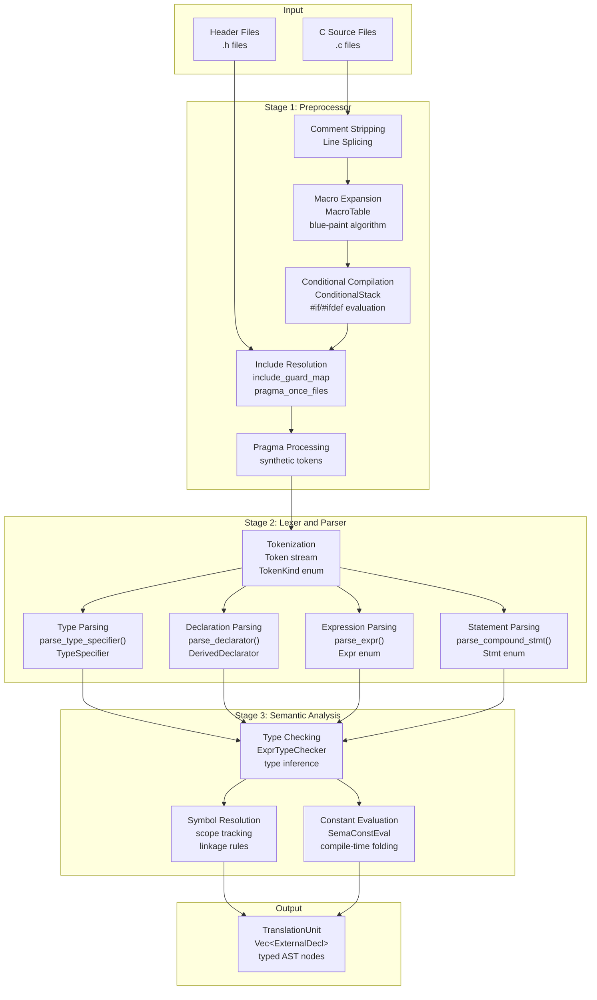
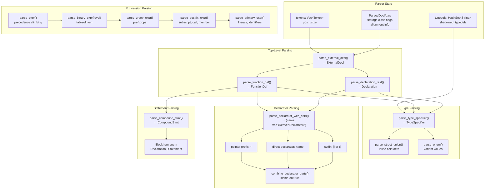
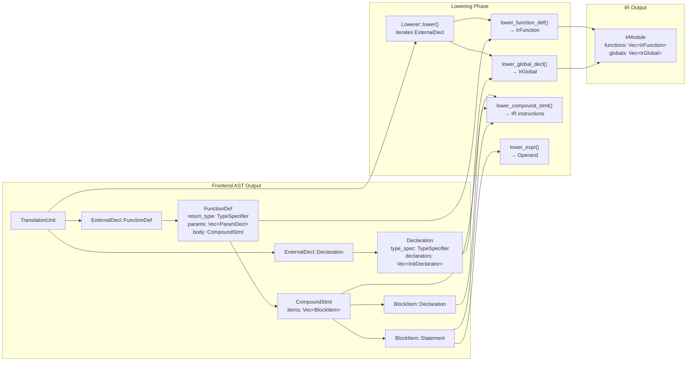

<!-- source: DeepWiki mcp.deepwiki.com · repo anthropics/claudes-c-compiler · page 2 Frontend · fetched 2026-10-26 -->

# Frontend

<details>
<summary>Relevant source files</summary>

The following files were used as context for generating this wiki page:

- [ideas/new_projects.txt](ideas/new_projects.txt)
- [src/common/const_arith.rs](src/common/const_arith.rs)
- [src/common/long_double.rs](src/common/long_double.rs)
- [src/common/types.rs](src/common/types.rs)
- [src/frontend/parser/ast.rs](src/frontend/parser/ast.rs)
- [src/frontend/parser/declarations.rs](src/frontend/parser/declarations.rs)
- [src/frontend/parser/declarators.rs](src/frontend/parser/declarators.rs)
- [src/frontend/parser/expressions.rs](src/frontend/parser/expressions.rs)
- [src/frontend/parser/types.rs](src/frontend/parser/types.rs)
- [src/frontend/preprocessor/README.md](src/frontend/preprocessor/README.md)
- [src/frontend/preprocessor/includes.rs](src/frontend/preprocessor/includes.rs)
- [src/frontend/preprocessor/utils.rs](src/frontend/preprocessor/utils.rs)
- [src/ir/lowering/definitions.rs](src/ir/lowering/definitions.rs)
- [src/ir/lowering/expr.rs](src/ir/lowering/expr.rs)
- [src/ir/lowering/lvalue.rs](src/ir/lowering/lvalue.rs)
- [src/ir/lowering/pointer_analysis.rs](src/ir/lowering/pointer_analysis.rs)
- [src/ir/lowering/stmt.rs](src/ir/lowering/stmt.rs)
- [src/ir/lowering/structs.rs](src/ir/lowering/structs.rs)
- [src/ir/lowering/types.rs](src/ir/lowering/types.rs)

</details>


## Purpose and Scope

The frontend transforms C source code from raw text into a typed Abstract Syntax Tree (AST) ready for IR lowering. It consists of three sequential stages: preprocessing (text-to-text transformation), lexing and parsing (text-to-AST construction), and semantic analysis (AST type annotation and validation).

For details on specific frontend components:
- Preprocessor implementation: see [Preprocessor](#2.1)
- Lexer and parser implementation: see [Lexer and Parser](#2.2)
- Type checking and symbol resolution: see [Semantic Analysis](#2.3)

For information on how the frontend output is consumed:
- IR generation from AST: see [IR and Lowering](#3)
- Type resolution during lowering: see [Type System](#3.2)

## Frontend Pipeline Architecture

The frontend implements a three-stage pipeline with clear separation of concerns:



**Sources:** [src/frontend/preprocessor/includes.rs:1-600](), [src/frontend/parser/declarations.rs:1-100](), [src/frontend/parser/types.rs:1-100](), [src/frontend/parser/expressions.rs:1-100]()

## Preprocessor Stage

The preprocessor operates on raw text before lexical analysis, implementing GCC-compatible macro expansion and include file handling. It produces expanded source text annotated with line markers for accurate error reporting.

**Key Components:**

| Component | File | Responsibility |
|-----------|------|----------------|
| `MacroTable` | `src/frontend/preprocessor/macro_defs.rs` | Object-like and function-like macro storage |
| `ConditionalStack` | `src/frontend/preprocessor/pipeline.rs` | `#if`/`#ifdef`/`#elif`/`#else`/`#endif` nesting |
| `include_guard_map` | `src/frontend/preprocessor/includes.rs` | Classic include guard detection and caching |
| `pragma_once_files` | `src/frontend/preprocessor/includes.rs` | `#pragma once` file tracking |

The preprocessor uses a "blue-paint" algorithm to prevent infinite macro recursion: when a macro is expanded, its name is temporarily marked to prevent re-expansion within that context.

**Include Resolution:** [src/frontend/preprocessor/includes.rs:1-200]() implements a multi-tier search path system:
1. `-iquote` paths for `#include "..."` 
2. `-I` paths for both `"..."` and `<...>`
3. `-isystem` system paths
4. `-idirafter` fallback paths

**Macro Expansion:** Function-like macros support variadic arguments (`__VA_ARGS__`), token pasting (`##`), and stringification (`#`). The preprocessor tracks expansion contexts to emit proper diagnostics with original source locations.

**Sources:** [src/frontend/preprocessor/includes.rs:1-600](), [src/frontend/preprocessor/README.md:1-200](), [src/frontend/preprocessor/utils.rs:1-100]()

## Lexer and Parser Stage

The parser consumes preprocessed text and constructs an untyped AST using a hand-written recursive descent parser. It handles C's complex declarator syntax and maintains a typedef table for context-sensitive lexing.

### Parser Structure



**Sources:** [src/frontend/parser/declarations.rs:1-350](), [src/frontend/parser/types.rs:1-250](), [src/frontend/parser/declarators.rs:1-200](), [src/frontend/parser/expressions.rs:1-100]()

### Key AST Node Types

The AST is defined in [src/frontend/parser/ast.rs:1-600]() using Rust enums and structs:

| AST Node | Purpose | Key Fields |
|----------|---------|------------|
| `TranslationUnit` | Root node for entire source file | `decls: Vec<ExternalDecl>` |
| `ExternalDecl` | Top-level declaration | `FunctionDef \| Declaration \| TopLevelAsm` |
| `FunctionDef` | Function definition | `return_type`, `name`, `params`, `body`, `attrs` |
| `Declaration` | Variable/typedef declaration | `type_spec`, `declarators`, flags (bitfield) |
| `TypeSpecifier` | Type information | 30+ variants: `Int`, `Struct`, `Pointer`, `Array`, etc. |
| `DerivedDeclarator` | Type modifiers | `Pointer`, `Array(size)`, `Function(params, variadic)` |
| `Expr` | Expression nodes | 40+ variants: `BinaryOp`, `UnaryOp`, `FunctionCall`, etc. |
| `Stmt` | Statement nodes | `Compound`, `If`, `While`, `For`, `Switch`, `Return`, etc. |
| `CompoundStmt` | Braced block | `items: Vec<BlockItem>`, `local_labels` |
| `InitDeclarator` | Declarator with optional initializer | `name`, `derived`, `init`, `attrs` |

**Declarator Inside-Out Rule:** [src/frontend/parser/declarators.rs:154-185]() implements C's complex declarator parsing. For `int (*fp)(int)`:
- Outer pointers: `[]`
- Inner derived: `[Pointer]`
- Outer suffixes: `[Function([int])]`
- Result: `[Pointer, FunctionPointer([int])]`

The `combine_declarator_parts()` method detects function pointer patterns by checking if inner derivations contain only pointers/arrays and outer suffixes start with a function.

**Sources:** [src/frontend/parser/ast.rs:1-600](), [src/frontend/parser/declarators.rs:1-350]()

### Expression Parsing Details

Expression parsing uses precedence climbing with a table-driven approach [src/frontend/parser/expressions.rs:1-400]():

```rust
enum PrecedenceLevel {
    LogicalOr,      // ||
    LogicalAnd,     // &&
    BitwiseOr,      // |
    BitwiseXor,     // ^
    BitwiseAnd,     // &
    Equality,       // == !=
    Relational,     // < > <= >=
    Shift,          // << >>
    Additive,       // + -
    Multiplicative, // * / %
}
```

Each level calls the next tighter level recursively. The parser handles:
- **C99 designated initializers:** `.field = value`, `[index] = value`
- **Compound literals:** `(struct S){.x = 1, .y = 2}`
- **Statement expressions:** `({ int x = 1; x + 2; })`
- **GCC extensions:** `__builtin_*` functions, `__attribute__`, `typeof`
- **_Generic selections:** compile-time type-based expression selection

**Sources:** [src/frontend/parser/expressions.rs:1-400]()

## Semantic Analysis Stage

Semantic analysis enriches the AST with type information, validates type correctness, resolves symbols, and pre-evaluates constant expressions. The lowering phase (see [IR and Lowering](#3)) performs semantic analysis as it traverses the AST.

**Key Responsibilities:**

1. **Type Checking** [src/ir/lowering/types.rs:1-600]():
   - Resolve `typedef` names to underlying types
   - Check type compatibility for assignments and function calls
   - Infer expression types from operands
   - Handle `typeof` and `__auto_type`

2. **Symbol Resolution:**
   - Track scopes for local variables, parameters, and static locals
   - Apply linkage rules (internal vs external)
   - Shadow typedef names in function parameter scopes
   - Resolve struct/union member names

3. **Constant Evaluation** [src/common/const_arith.rs:1-200]():
   - Evaluate integer and floating-point constant expressions
   - Handle 128-bit arithmetic for `__int128`
   - Compute array sizes from constant expressions
   - Validate initializer compatibility

4. **Declaration Analysis** [src/ir/lowering/types.rs:200-800]():
   - Compute struct/union layouts with bitfield packing
   - Resolve array dimensions (including VLA runtime sizes)
   - Track alignment attributes (`_Alignas`, `__attribute__((aligned))`)
   - Handle storage classes (`static`, `extern`, `typedef`)

**Sources:** [src/ir/lowering/types.rs:1-800](), [src/ir/lowering/stmt.rs:1-200](), [src/common/const_arith.rs:1-200]()

## AST-to-Lowering Data Flow

The frontend produces a `TranslationUnit` that the lowering phase consumes to generate IR:



**Sources:** [src/ir/lowering/stmt.rs:1-100](), [src/ir/lowering/expr.rs:1-50](), [src/frontend/parser/ast.rs:1-50]()

## Type Specifier Representation

The `TypeSpecifier` enum [src/frontend/parser/ast.rs:400-600]() represents all C type information:

**Scalar Types:**
- Integers: `Void`, `Bool`, `Char`, `UnsignedChar`, `Short`, `UnsignedShort`, `Int`, `UnsignedInt`, `Long`, `UnsignedLong`, `LongLong`, `UnsignedLongLong`, `Int128`, `UnsignedInt128`
- Floating-point: `Float`, `Double`, `LongDouble`
- Complex: `ComplexFloat`, `ComplexDouble`, `ComplexLongDouble`

**Compound Types:**
- `Pointer(Box<TypeSpecifier>, AddressSpace)`: pointer with optional segment qualifier
- `Array(Box<TypeSpecifier>, Option<Box<Expr>>)`: array with optional size expression
- `Struct(tag, fields, is_packed, pragma_pack, struct_aligned)`: struct definition or forward reference
- `Union(tag, fields, is_packed, pragma_pack, struct_aligned)`: union definition or forward reference
- `Enum(tag, variants, is_packed)`: enum definition or forward reference
- `Function(return_type, params, variadic)`: function type

**Type Resolution:**
- `TypedefName(String)`: resolved to underlying `CType` during lowering
- `Typeof(Box<Expr>)`: GCC extension, type inferred from expression
- `TypeofType(Box<TypeSpecifier>)`: wraps another type specifier
- `AutoType`: `__auto_type`, type inferred from initializer

**GCC Extensions:**
- `Vector(Box<TypeSpecifier>, total_bytes)`: `__attribute__((vector_size(N)))`

**Sources:** [src/frontend/parser/ast.rs:400-650](), [src/ir/lowering/types.rs:1-250]()

## Error Handling and Diagnostics

The frontend uses a two-phase error reporting strategy:

1. **Preprocessor Errors:** Collected during preprocessing and emitted before lexing. Include file not found, macro redefinition warnings, and `#error` directives.

2. **Parser Errors:** Emitted during parsing with span information. The parser continues after errors to find additional issues in the same compilation unit.

3. **Semantic Errors:** Emitted during lowering when type mismatches or undefined symbols are detected. These reference the original source locations via span tracking.

Each `Token`, `Expr`, `Stmt`, and `Declaration` carries a `Span` [src/common/source.rs]() that records the original file, line, and column for error messages.

**Sources:** [src/frontend/parser/declarations.rs:1-100](), [src/frontend/preprocessor/README.md:1-100]()

---

