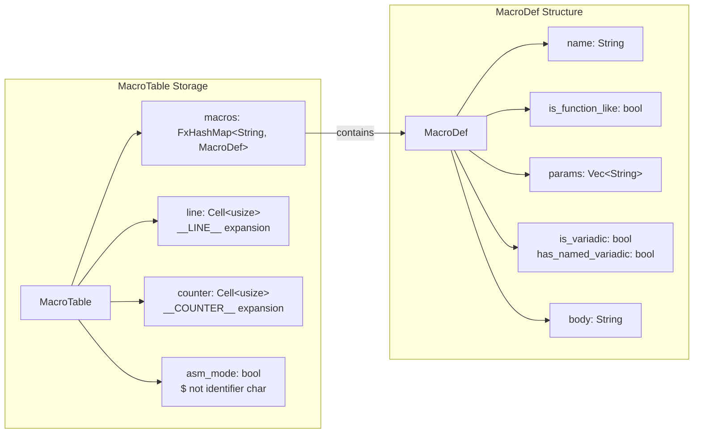
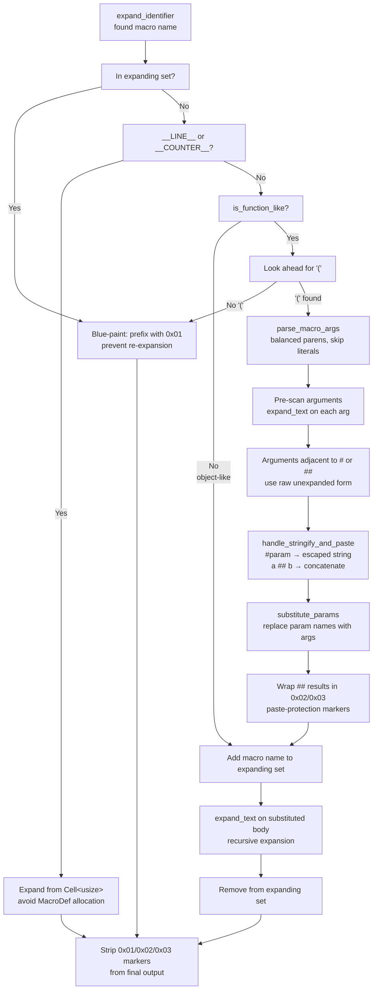
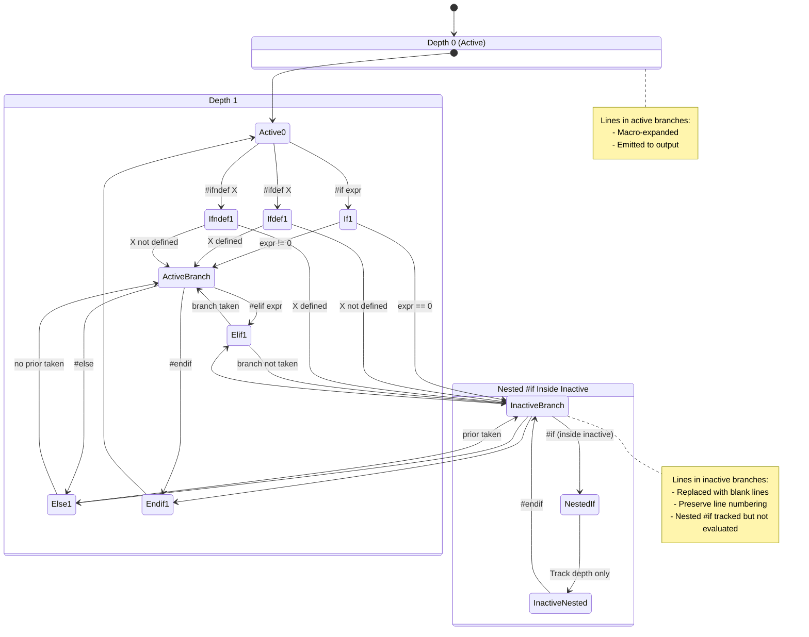
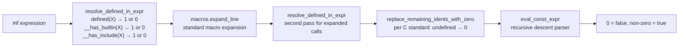
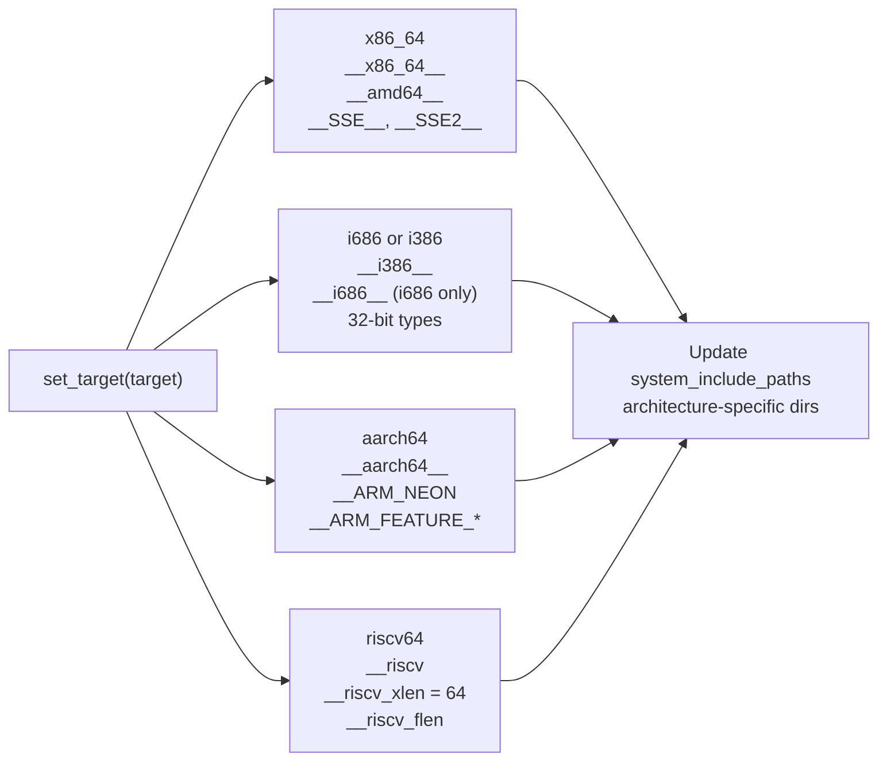

<!-- source: DeepWiki mcp.deepwiki.com · repo anthropics/claudes-c-compiler · page 2.1 Preprocessor · fetched 2026-10-26 -->

# Preprocessor

<details>
<summary>Relevant source files</summary>

The following files were used as context for generating this wiki page:

- [ideas/new_projects.txt](ideas/new_projects.txt)
- [src/common/const_arith.rs](src/common/const_arith.rs)
- [src/common/long_double.rs](src/common/long_double.rs)
- [src/frontend/preprocessor/README.md](src/frontend/preprocessor/README.md)
- [src/frontend/preprocessor/includes.rs](src/frontend/preprocessor/includes.rs)
- [src/frontend/preprocessor/utils.rs](src/frontend/preprocessor/utils.rs)

</details>


The preprocessor is a **text-to-text transformation pass** that operates on raw C source before lexing. It implements ISO C11 translation phases 2-4: line splicing, comment replacement, directive processing, and macro expansion. The output is expanded source text annotated with GCC-compatible line markers.

For information about lexical analysis after preprocessing, see [Lexer and Parser](#2.2). For semantic analysis of preprocessor constant expressions in `#if` directives, see [Constant Evaluation](#8.3).

## Architecture Overview

```mermaid
graph TB
    subgraph "Input"
        SRC["Raw C Source Text<br/>with directives"]
    end
    
    subgraph "Text Processing Pipeline"
        SPLICE["join_continued_lines<br/>backslash-newline → single line"]
        STRIP["strip_block_comments<br/>/* ... */ → space<br/>LineMap for line number remapping"]
        LOOP["Per-Line Main Loop"]
    end
    
    subgraph "Directive Processing"
        DETECT["Detect # at line start"]
        DISPATCH["process_directive<br/>split_first_word"]
        INCLUDE["handle_include<br/>handle_include_next"]
        DEFINE["#define → MacroTable"]
        UNDEF["#undef → remove from MacroTable"]
        COND["#if/#ifdef/#ifndef → ConditionalStack"]
        PRAGMA["handle_pragma<br/>pack/once/weak/visibility"]
        ERROR["#error → errors Vec"]
        LINE["#line → update __LINE__"]
    end
    
    subgraph "Macro Expansion"
        EXPAND["expand_line_reuse<br/>FxHashSet reuse"]
        IDENT["expand_identifier<br/>__LINE__/__COUNTER__ special case"]
        FUNC["expand_function_macro<br/>parse_macro_args"]
        SUBST["substitute_params<br/>handle_stringify_and_paste"]
        RESCAN["Recursive expansion<br/>blue-paint markers 0x01"]
    end
    
    subgraph "Conditional Compilation"
        EVAL["evaluate_condition<br/>resolve_defined_in_expr"]
        CONST["eval_const_expr<br/>recursive descent parser"]
        STACK["ConditionalStack::push/pop<br/>active branch tracking"]
    end
    
    subgraph "Include Resolution"
        RESOLVE["resolve_include_path<br/>GCC-compatible search order"]
        CACHE["include_resolve_cache<br/>FxHashMap keyed by path+context"]
        GUARD["detect_include_guard<br/>classic #ifndef pattern"]
        ONCE["pragma_once_files<br/>FxHashSet"]
    end
    
    subgraph "Output"
        MARKERS["Line Markers<br/># N \"file\" flags"]
        SYNTH["Synthetic Tokens<br/>__ccc_pack_set_N ;"]
        EXPANDED["Expanded Source Text"]
    end
    
    SRC --> SPLICE
    SPLICE --> STRIP
    STRIP --> LOOP
    
    LOOP --> DETECT
    DETECT --> DISPATCH
    DISPATCH --> INCLUDE
    DISPATCH --> DEFINE
    DISPATCH --> UNDEF
    DISPATCH --> COND
    DISPATCH --> PRAGMA
    DISPATCH --> ERROR
    DISPATCH --> LINE
    
    INCLUDE --> RESOLVE
    RESOLVE --> CACHE
    INCLUDE --> GUARD
    INCLUDE --> ONCE
    
    LOOP --> EXPAND
    EXPAND --> IDENT
    EXPAND --> FUNC
    FUNC --> SUBST
    SUBST --> RESCAN
    
    COND --> EVAL
    EVAL --> CONST
    COND --> STACK
    
    DEFINE --> MacroTable
    EXPAND --> MacroTable
    
    LOOP --> MARKERS
    PRAGMA --> SYNTH
    LOOP --> EXPANDED
    
    style LOOP fill:#e1f5ff
    style EXPAND fill:#ffe1f5
    style RESOLVE fill:#fff4e1
    style STACK fill:#f5e1ff
```

**Sources:** [src/frontend/preprocessor/README.md:26-48]()

The preprocessor is implemented in the `Preprocessor` struct with a `preprocess(&mut self, source: &str) -> String` entry point. All processing happens on byte slices (`&[u8]`) for performance, with UTF-8 multi-byte sequences copied verbatim through string/char literals.

**Sources:** [src/frontend/preprocessor/README.md:1-25]()

## Core Data Structures

### Preprocessor State

The `Preprocessor` struct maintains:

| Field | Type | Purpose |
|-------|------|---------|
| `macros` | `MacroTable` | All defined macros with `FxHashMap<String, MacroDef>` |
| `conditionals` | `ConditionalStack` | Stack of `#if`/`#ifdef`/`#ifndef` states |
| `include_stack` | `Vec<PathBuf>` | Currently-processing file stack (for `#include` nesting) |
| `include_resolve_cache` | `FxHashMap<(String, bool, PathBuf), Option<PathBuf>>` | Cached path resolution results |
| `include_guard_macros` | `FxHashMap<PathBuf, String>` | Maps files to detected guard macros |
| `pragma_once_files` | `FxHashSet<PathBuf>` | Files marked with `#pragma once` |
| `expanding` | `FxHashSet<String>` | Reusable set for recursive expansion prevention |
| `errors` | `Vec<PreprocessorDiagnostic>` | `#error` directives and failed `#include` |
| `warnings` | `Vec<PreprocessorDiagnostic>` | `#warning` directives |

**Sources:** [src/frontend/preprocessor/README.md:55-98]()

### MacroDef and MacroTable



**Object-like macros** have `is_function_like = false` and empty `params`. Example: `#define VERSION 42`.

**Function-like macros** have `is_function_like = true` with parameter names in `params`. Example: `#define MAX(a, b) ((a) > (b) ? (a) : (b))`.

**Variadic macros** set `is_variadic = true` for standard `...` syntax (`__VA_ARGS__`) or `has_named_variadic = true` for GNU extension (`args...` where `args` is the parameter name).

Special macros `__LINE__` and `__COUNTER__` use `Cell<usize>` fields to avoid per-line `MacroDef` allocation overhead. `__FILE__` is stored as a regular macro but updated in-place via `set_file()`.

**Sources:** [src/frontend/preprocessor/README.md:100-197](), [src/frontend/preprocessor/README.md:444-462]()

## Macro Expansion Algorithm



**Blue-paint markers** (`0x01` prefix byte) mark identifiers that should not be re-expanded during rescanning. This implements C11 6.10.3.4's recursive expansion prevention: when a macro name appears in its own expansion, it is "painted blue" and ignored by subsequent scans.

**Paste-protection markers** (`0x02`/`0x03` wrap) prevent token-pasting results from being re-substituted as parameters during the same replacement pass. These are stripped before rescanning the full macro body.

**Anti-paste guards** (`would_paste_tokens`) insert protective spaces between adjacent tokens that would otherwise form unintended multi-character tokens (e.g., two `/` becoming `//`, two `+` becoming `++`).

**Sources:** [src/frontend/preprocessor/README.md:136-230]()

### Stringification and Token Pasting

The `handle_stringify_and_paste` function processes `#` and `##` operators:

| Operator | Syntax | Behavior | Example |
|----------|--------|----------|---------|
| `#` | `#param` | Wraps raw (unexpanded) argument in quotes, escaping `"` and `\` | `#define STR(x) #x` → `STR(foo)` = `"foo"` |
| `##` | `a ## b` | Concatenates left and right operands into single token | `#define CONCAT(a,b) a##b` → `CONCAT(foo,bar)` = `foobar` |

**GNU extension:** `, ## __VA_ARGS__` — when `__VA_ARGS__` is empty and appears after `##` preceded by a comma, the comma is removed. This enables `#define DBG(fmt, ...) fprintf(stderr, fmt, ## __VA_ARGS__)` to work with zero variadic arguments.

**Sources:** [src/frontend/preprocessor/README.md:158-195]()

## Include File Resolution

```mermaid
graph TB
    INCLUDE["#include directive<br/>quoted or system"]
    
    MACRO["Path starts with &lt; or \"?"]
    EXPAND["expand_line<br/>macro expansion"]
    NORM["normalize_include_path<br/>strip spaces from expansion"]
    
    QUOTED["Quoted include?<br/>\"file.h\""]
    SYSTEM["System include?<br/>&lt;file.h&gt;"]
    
    subgraph "Quoted Search Order"
        Q1["1. Current file directory"]
        Q2["2. Original source directory"]
        Q3["3. -iquote paths"]
        Q4["4. -I paths"]
        Q5["5. -isystem paths"]
        Q6["6. Default system paths"]
        Q7["7. -idirafter paths"]
    end
    
    subgraph "System Search Order"
        S1["1. -I paths"]
        S2["2. -isystem paths"]
        S3["3. Default system paths"]
        S4["4. -idirafter paths"]
    end
    
    CACHE["include_resolve_cache<br/>FxHashMap&lt;(path, is_system, current_dir), Option&lt;PathBuf&gt;&gt;"]
    
    ABSOLUTE["make_absolute<br/>without resolving symlinks"]
    
    ONCE["pragma_once_files?"]
    GUARD["include_guard_macros?<br/>macro still defined?"]
    DEPTH["Recursive depth &lt; 200?"]
    
    READ["read_c_source_file<br/>bytes_to_string for non-UTF8"]
    DETECT["detect_include_guard<br/>scan for classic pattern"]
    
    PUSH["include_stack.push"]
    SETFILE["macros.set_file<br/>update __FILE__"]
    MARKER["Emit # 1 \"file\" 1<br/>line marker flag 1 = entering"]
    
    PREPROCESS["preprocess_included<br/>recursive preprocessing"]
    
    POP["include_stack.pop"]
    RESTORE["Restore __FILE__"]
    REGISTER["Register detected guard<br/>include_guard_macros.insert"]
    
    BUILTIN["inject_builtin_macros_for_header<br/>stdarg.h → va_start/va_end<br/>stdbool.h → true/false<br/>complex.h → complex/_Complex_I"]
    
    FALLBACK["inject_fallback_declarations_for_header<br/>stdio.h → FILE*, stdin/stdout/stderr<br/>errno.h → extern int errno"]
    
    INCLUDE --> MACRO
    MACRO -->|"No"| EXPAND
    EXPAND --> NORM
    MACRO -->|"Yes"| NORM
    
    NORM --> BUILTIN
    NORM --> QUOTED
    NORM --> SYSTEM
    
    QUOTED --> Q1
    Q1 --> Q2
    Q2 --> Q3
    Q3 --> Q4
    Q4 --> Q5
    Q5 --> Q6
    Q6 --> Q7
    
    SYSTEM --> S1
    S1 --> S2
    S2 --> S3
    S3 --> S4
    
    Q7 --> CACHE
    S4 --> CACHE
    
    CACHE -->|"Hit"| ABSOLUTE
    CACHE -->|"Miss"| ABSOLUTE
    ABSOLUTE --> ONCE
    
    ONCE -->|"Found"| SKIP["Return empty string"]
    ONCE -->|"Not found"| GUARD
    
    GUARD -->|"Defined"| SKIP
    GUARD -->|"Not defined"| DEPTH
    
    DEPTH -->|"Exceeded"| SKIP
    DEPTH -->|"OK"| READ
    
    READ --> DETECT
    DETECT --> PUSH
    PUSH --> SETFILE
    SETFILE --> MARKER
    MARKER --> PREPROCESS
    
    PREPROCESS --> POP
    POP --> RESTORE
    RESTORE --> REGISTER
    
    BUILTIN --> FALLBACK
    FALLBACK --> SKIP
```

**Path resolution** uses a GCC-compatible search order with separate sequences for quoted and system includes. Results are cached in `include_resolve_cache` keyed by `(include_path, is_system, current_dir)` to avoid repeated filesystem probing.

**Symlink preservation:** `make_absolute` constructs absolute paths without calling `std::fs::canonicalize`, preserving symlinks in the path. This matches GCC behavior where `#include "..."` searches relative to the symlink's directory, not the target's directory.

**Include guard detection:** After preprocessing an included file, `detect_include_guard` scans the raw source for the classic pattern:
```c
#ifndef GUARD_MACRO
#define GUARD_MACRO
  ...
#endif
```

The detection is conservative: it returns `None` if the file has `#else`/`#elif` at the outermost level, code before `#ifndef`, or content after `#endif`. When a guard is detected and the guard macro is still defined on subsequent `#include`, re-processing is skipped entirely.

**`#pragma once`:** Files marked with `#pragma once` are added to `pragma_once_files` and skipped on re-inclusion.

**Recursive inclusion limit:** Maximum depth of 200 (matching GCC's default). Files without guards may be re-included intentionally (e.g., TCC's conditional self-inclusion), so only excessive nesting of the *same* file path triggers the limit.

**Sources:** [src/frontend/preprocessor/includes.rs:1-833](), [src/frontend/preprocessor/README.md:298-388]()

### Include Guard Detection Algorithm

The `detect_include_guard` function performs lightweight scanning without full lexing:

1. Track `#if` nesting depth
2. First non-comment directive must be `#ifndef MACRO`
3. Second directive must be `#define MACRO` (same name)
4. Last directive at depth 0 must be `#endif`
5. No code outside the `#ifndef`/`#endif` wrapper
6. No `#else`/`#elif` at the outermost level

**Sources:** [src/frontend/preprocessor/includes.rs:13-157]()

## Conditional Compilation



The `ConditionalStack` maintains a `Vec<ConditionalState>` where each entry tracks:
- Whether any branch in the `#if`/`#elif`/`#else` chain has been taken
- Whether the current branch is active
- Whether the parent context is active (for proper nesting)

### Expression Evaluation Pipeline

`#if` and `#elif` expressions go through multiple stages:



The expression evaluator (`eval_const_expr`) is a recursive-descent parser supporting:
- Integer literals (decimal, hex `0x`, octal `0`) with `U`/`L`/`LL`/`ULL` suffixes
- Character literals with escape sequences
- Ternary operator `? :`
- Logical: `&&`, `||`, `!`
- Bitwise: `&`, `|`, `^`, `~`
- Shifts: `<<`, `>>`
- Relational: `==`, `!=`, `<`, `>`, `<=`, `>=`
- Arithmetic: `+`, `-`, `*`, `/`, `%` (including unary `-` and `+`)

Per C99 6.10.1, arithmetic uses `intmax_t` (signed) or `uintmax_t` (unsigned) depending on whether any operand has a `U` suffix. Hex and octal literals exceeding `INT64_MAX` are implicitly unsigned.

**Sources:** [src/frontend/preprocessor/README.md:233-295]()

## Pragma Handling

The `handle_pragma` dispatcher processes GCC-compatible pragmas and generates side-channel data or synthetic tokens:

| Pragma | Behavior | Output |
|--------|----------|--------|
| `#pragma once` | Marks current file in `pragma_once_files` | No output (side-channel only) |
| `#pragma pack(N)` | Struct packing alignment | `__ccc_pack_set_N ;` synthetic token |
| `#pragma pack()` | Reset to default packing | `__ccc_pack_reset ;` |
| `#pragma pack(push, N)` | Push current, set new | `__ccc_pack_push_N ;` |
| `#pragma pack(push)` | Push current only | `__ccc_pack_push_only ;` |
| `#pragma pack(pop)` | Pop saved packing | `__ccc_pack_pop ;` |
| `#pragma push_macro("X")` | Save macro definition | Updates `macro_save_stack` |
| `#pragma pop_macro("X")` | Restore saved definition | Updates `macros` |
| `#pragma weak sym` | Weak symbol declaration | Appends to `weak_pragmas` |
| `#pragma weak sym = tgt` | Weak symbol alias | Appends to `weak_pragmas` |
| `#pragma redefine_extname old new` | External name redirection | Appends to `redefine_extname_pragmas` |
| `#pragma GCC visibility push(V)` | Symbol visibility control | `__ccc_visibility_push_V ;` |
| `#pragma GCC visibility pop` | Restore visibility | `__ccc_visibility_pop ;` |

**Assembly mode suppression:** When `set_asm_mode(true)` is called (for AT&T assembly preprocessing), `#pragma pack` and `#pragma GCC visibility` synthetic tokens are suppressed because they are C parser-specific and would cause assembler errors.

**Sources:** [src/frontend/preprocessor/README.md:399-419]()

## Predefined Macros

The `define_predefined_macros` function populates the macro table on construction:

| Category | Examples |
|----------|----------|
| **Standard C** | `__STDC__`, `__STDC_VERSION__` (201710L / C17), `__STDC_HOSTED__` |
| **Platform** | `__linux__`, `__unix__`, `__LP64__`, `__ELF__` |
| **Architecture** | `__x86_64__`, `__amd64__` (default); `__aarch64__`, `__ARM_NEON` (via `set_target`) |
| **GCC compat** | `__GNUC__` (14), `__GNUC_MINOR__` (2), `__VERSION__`, `__GNUC_STDC_INLINE__` |
| **sizeof** | `__SIZEOF_POINTER__` (8), `__SIZEOF_INT__` (4), `__SIZEOF_LONG__` (8) |
| **Type limits** | `__INT_MAX__`, `__LONG_MAX__`, `__SIZE_MAX__` |
| **Type names** | `__SIZE_TYPE__` (`long unsigned int`), `__PTRDIFF_TYPE__` (`long int`) |
| **Float characteristics** | `__FLT_MAX__`, `__DBL_EPSILON__`, `__LDBL_MANT_DIG__` |
| **Byte order** | `__BYTE_ORDER__` (`__ORDER_LITTLE_ENDIAN__`) |
| **Atomics** | `__GCC_ATOMIC_INT_LOCK_FREE` (2) |
| **SIMD** | `__SSE__`, `__SSE2__`, `__MMX__` (x86_64 only) |

### Architecture Switching

`set_target(target: &str)` updates architecture-specific macros:



**RISC-V extensions:** `set_riscv_abi` and `set_riscv_march` control float ABI macros (`__riscv_flen`, `__riscv_float_abi_*`) and extension macros (`__riscv_a`, `__riscv_c`, `__riscv_d`, `__riscv_f`, `__riscv_m`, `__riscv_v`).

**x86 extensions:** `set_extended_simd_macros` enables `__SSE3__`, `__SSSE3__`, `__SSE4_1__`, `__SSE4_2__`, `__AVX__`, `__AVX2__` based on flags.

**Sources:** [src/frontend/preprocessor/README.md:421-508]()

### Builtin Header Macros

When well-known standard headers are included, `inject_builtin_macros_for_header` defines compiler-builtin macros regardless of whether the real header exists:

| Header | Macros Defined |
|--------|----------------|
| `stdarg.h` | `va_start(ap, last)` → `__builtin_va_start(ap, last)`<br/>`va_end(ap)` → `__builtin_va_end(ap)`<br/>`va_copy(dest, src)` → `__builtin_va_copy(dest, src)`<br/>`va_arg(ap, type)` → `__builtin_va_arg(ap, type)` |
| `stdbool.h` | `bool` → `_Bool`<br/>`true` → `1`<br/>`false` → `0` |
| `complex.h` | `complex` → `_Complex`<br/>`_Complex_I` → `(__extension__ 1.0fi)`<br/>`I` → `_Complex_I` |
| `stdint.h` | `INT8_MIN` .. `UINT64_MAX`, `INT64_C(x)`, `UINT32_C(x)` (via `builtin_macros.rs`) |
| `stddef.h` | `NULL`, `offsetof(type, member)` (via `builtin_macros.rs`) |
| `float.h` | `FLT_MAX`, `DBL_EPSILON`, `LDBL_DIG` (via `builtin_macros.rs`) |

**Note:** The `va_list`, `__builtin_va_list`, and `__gnuc_va_list` types are NOT injected as typedef text. They are pre-registered as type names by the parser, seeded by sema in `type_context.rs`, and provided with target-specific ABI types by the IR lowerer in `types_seed.rs`.

**Sources:** [src/frontend/preprocessor/includes.rs:723-790](), [src/frontend/preprocessor/README.md:476-508]()

## Output Format

### Line Markers

The preprocessor emits GCC-compatible line markers to maintain accurate source locations:

```
# <line> "<file>" [flags]
```

| Flag | Meaning |
|------|---------|
| 1 | Entering a new include file |
| 2 | Returning from an include file |

Example output:
```c
# 1 "main.c"
int main() {
# 1 "stdio.h" 1
typedef struct _IO_FILE FILE;
# 2 "main.c" 2
    printf("Hello\n");
}
```

**Relative paths:** `format_path_for_line_directive` emits relative paths when the file is under the current working directory, matching GCC behavior. This prevents build system issues (e.g., Perl's `makedepend` treats absolute paths differently).

**Sources:** [src/frontend/preprocessor/includes.rs:240-256](), [src/frontend/preprocessor/README.md:513-535]()

### Synthetic Tokens

Pragma directives generate synthetic tokens for the parser:

```c
#pragma pack(4)       → __ccc_pack_set_4 ;
#pragma pack(push, 8) → __ccc_pack_push_8 ;
#pragma pack(pop)     → __ccc_pack_pop ;
#pragma pack()        → __ccc_pack_reset ;
#pragma GCC visibility push(hidden) → __ccc_visibility_push_hidden ;
#pragma GCC visibility pop → __ccc_visibility_pop ;
```

These synthetic tokens are parsed as statements by the parser and trigger semantic actions (struct alignment updates, symbol visibility changes).

**Sources:** [src/frontend/preprocessor/README.md:399-419]()

### Side-Channel Data

The preprocessor collects non-text data for downstream stages:

| Field | Type | Content |
|-------|------|---------|
| `errors` | `Vec<PreprocessorDiagnostic>` | `#error` messages and unresolved `#include` paths |
| `warnings` | `Vec<PreprocessorDiagnostic>` | `#warning` messages |
| `weak_pragmas` | `Vec<(String, Option<String>)>` | Weak symbol declarations/aliases |
| `redefine_extname_pragmas` | `Vec<(String, String)>` | External name redirections |
| `macro_expansion_info` | `Vec<MacroExpansionInfo>` | Per-line macro expansion records for diagnostics |

`PreprocessorDiagnostic` carries `file`, `line`, `col`, and `message` fields for GCC-compatible error formatting.

**Sources:** [src/frontend/preprocessor/README.md:524-535]()

## Text Processing Utilities

### Line Splicing and Comment Stripping

The preprocessing pipeline begins with two text normalization passes:

1. **`join_continued_lines`** — Backslash-newline sequences are joined into single logical lines per C11 5.1.1.2 phase 2.

2. **`strip_block_comments`** — `/* ... */` block comments are replaced with a single space per C11 5.1.1.2 phase 3. Returns a `LineMap` that remaps output line numbers back to original source line numbers for accurate diagnostics.

Line comments (`//`) are stripped later by `strip_line_comment` on a per-line basis, avoiding false positives inside string literals.

**Sources:** [src/frontend/preprocessor/README.md:1-25](), [src/frontend/preprocessor/README.md:551-553]()

### Multi-Line Macro Invocation Accumulation

When a source line has unbalanced parentheses (more `(` than `)`), the preprocessor accumulates subsequent lines into a `pending_line` buffer until parentheses balance. This handles macro invocations spanning multiple lines:

```c
SOME_MACRO(
    arg1,
    arg2,
    arg3
)
```

A safety limit (`MAX_PENDING_NEWLINES = 100,000`) prevents runaway accumulation. Conditional directives that appear inside accumulated arguments are processed to keep the conditional stack correct but are not added to the pending text.

**Sources:** [src/frontend/preprocessor/README.md:212-230]()

## Design Decisions

### Text-Level Processing

The preprocessor operates on raw text strings rather than a token stream:
- **Simplicity:** No need for a tokenizer that handles both pre- and post-expansion grammars
- **Performance:** Byte-slice scanning with `&[u8]` avoids allocation overhead
- **Compatibility:** Output is a flat string with line markers, matching GCC's `-E` interface

**Sources:** [src/frontend/preprocessor/README.md:557-572]()

### Reusable Expansion State

The `FxHashSet<String>` used for tracking "currently expanding" macros is allocated once and reused across all lines via `expand_line_reuse`. This eliminates per-line allocation overhead when preprocessing large headers.

**Sources:** [src/frontend/preprocessor/README.md:574-579]()

### GCC Compatibility

The preprocessor claims `__GNUC__ 14`, `__GNUC_MINOR__ 2` to satisfy version checks in the Linux kernel, glibc, QEMU, and other major projects. The predefined macro set is tuned for an LP64 Linux/ELF/x86-64 target by default, with `set_target` providing overrides for aarch64, riscv64, i686, and i386.

**Sources:** [src/frontend/preprocessor/README.md:597-603]()

### Assembly Mode

`set_asm_mode(true)` enables specialized preprocessing for AT&T assembly:
- `$` is not treated as an identifier character (allows `$MACRO_NAME` expansion for assembly immediates)
- `#pragma pack` and `#pragma GCC visibility` synthetic tokens are suppressed (they are C parser-specific)

**Sources:** [src/frontend/preprocessor/README.md:82-83]()

---

