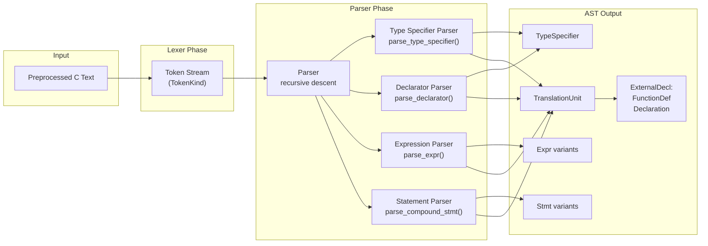
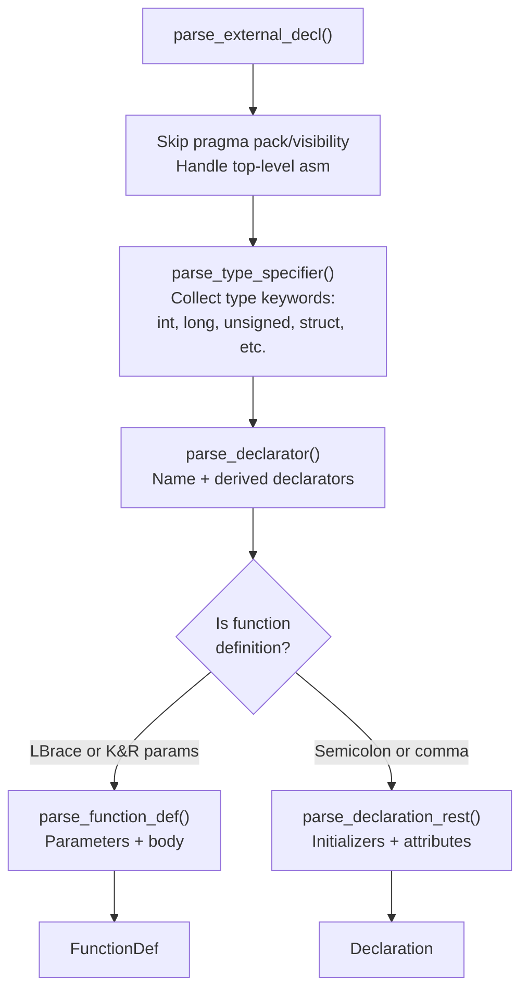
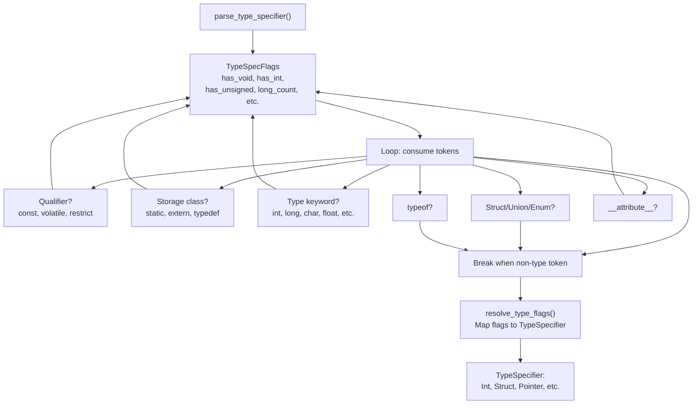
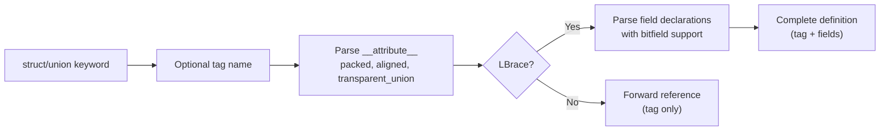
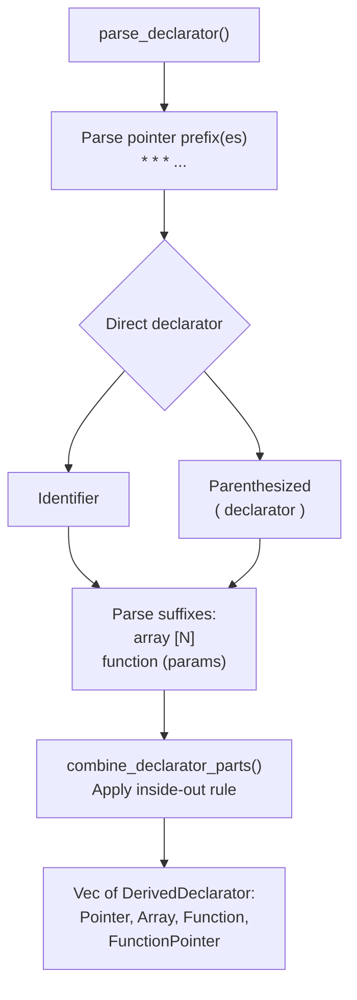
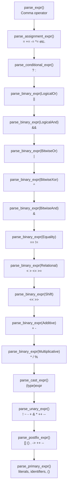
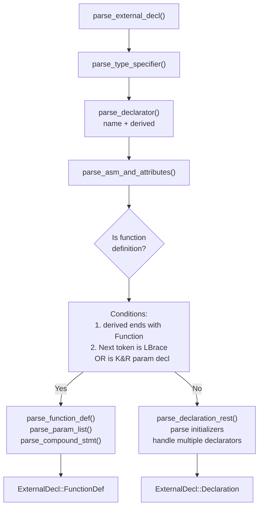
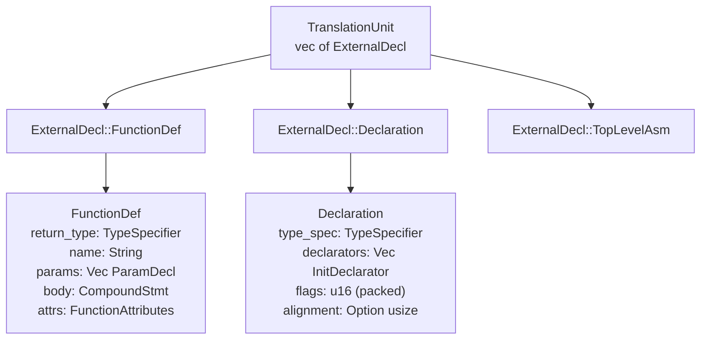
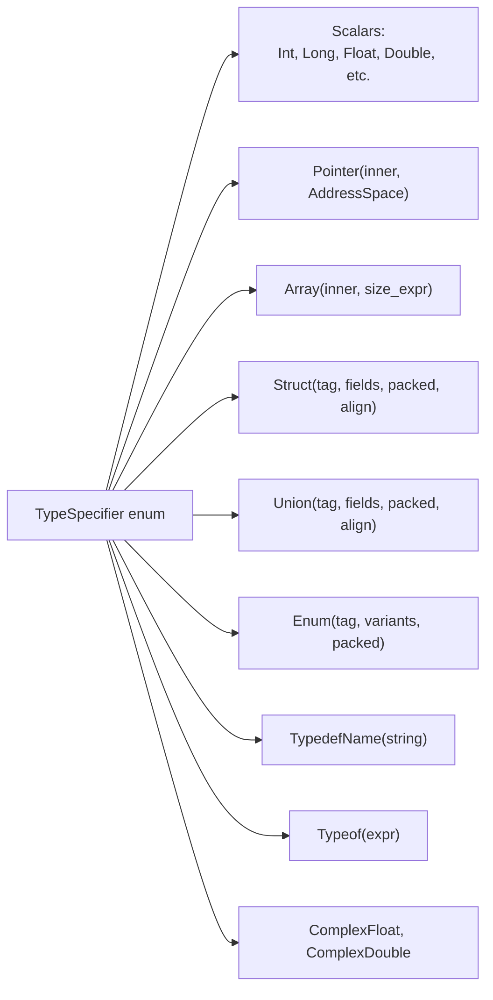

<!-- source: DeepWiki mcp.deepwiki.com · repo anthropics/claudes-c-compiler · page 2.2 Lexer and Parser · fetched 2026-10-26 -->

# Lexer and Parser

<details>
<summary>Relevant source files</summary>

The following files were used as context for generating this wiki page:

- [src/common/types.rs](src/common/types.rs)
- [src/frontend/parser/ast.rs](src/frontend/parser/ast.rs)
- [src/frontend/parser/declarations.rs](src/frontend/parser/declarations.rs)
- [src/frontend/parser/declarators.rs](src/frontend/parser/declarators.rs)
- [src/frontend/parser/expressions.rs](src/frontend/parser/expressions.rs)
- [src/frontend/parser/types.rs](src/frontend/parser/types.rs)
- [src/ir/lowering/definitions.rs](src/ir/lowering/definitions.rs)
- [src/ir/lowering/expr.rs](src/ir/lowering/expr.rs)
- [src/ir/lowering/lvalue.rs](src/ir/lowering/lvalue.rs)
- [src/ir/lowering/pointer_analysis.rs](src/ir/lowering/pointer_analysis.rs)
- [src/ir/lowering/stmt.rs](src/ir/lowering/stmt.rs)
- [src/ir/lowering/structs.rs](src/ir/lowering/structs.rs)
- [src/ir/lowering/types.rs](src/ir/lowering/types.rs)

</details>


**Purpose**: This page documents the lexer and parser frontend components that transform C source code text into an Abstract Syntax Tree (AST). The lexer converts raw text into tokens, and the parser constructs typed AST nodes representing declarations, types, expressions, and statements.

For information about semantic analysis (type checking, symbol resolution), see [Semantic Analysis](#2.3). For information about AST-to-IR transformation, see [IR and Lowering](#3).

---

## Overview

The frontend pipeline consists of two phases:

1. **Lexer** (tokenization): Converts preprocessed C source text into a token stream
2. **Parser** (syntax analysis): Consumes tokens and builds an AST according to C grammar rules

The parser is hand-written recursive descent, handling C's complex syntax including the notorious declarator grammar (`int (*(*fp)(int))(int)` - pointer to function returning pointer to function). The implementation prioritizes GCC compatibility, supporting GNU extensions like `typeof`, statement expressions, and compound literals.



**Sources**: [src/frontend/parser/declarations.rs:1-211](), [src/frontend/parser/types.rs:1-50](), [src/frontend/parser/expressions.rs:1-35]()

---

## Lexer: Tokenization

The lexer converts preprocessed text into a stream of `TokenKind` tokens. While the lexer implementation is not in the provided files, the parser extensively uses token types defined in `crate::frontend::lexer::token::TokenKind`.

### Token Categories

| Category | Examples | Usage |
|----------|----------|-------|
| **Keywords** | `TokenKind::Int`, `TokenKind::Struct`, `TokenKind::If` | Type specifiers, storage classes, control flow |
| **Identifiers** | `TokenKind::Identifier(String)` | Variable/function names, typedef names |
| **Literals** | `TokenKind::IntLiteral(i64)`, `TokenKind::StringLiteral(String)` | Constant values |
| **Operators** | `TokenKind::Plus`, `TokenKind::Star`, `TokenKind::Amp` | Arithmetic, logical, bitwise operations |
| **Punctuation** | `TokenKind::LParen`, `TokenKind::Semicolon`, `TokenKind::LBrace` | Syntax delimiters |
| **Special** | `TokenKind::Eof`, `TokenKind::Attribute` | End-of-file, GCC attributes |

The parser maintains position tracking via `self.pos` (current token index) and `self.tokens` (token vector), enabling lookahead and backtracking for disambiguation.

**Sources**: [src/frontend/parser/declarations.rs:13-15](), [src/frontend/parser/types.rs:9-11](), [src/frontend/parser/expressions.rs:15-17]()

---

## Parser Architecture

The `Parser` struct ([src/frontend/parser/parse.rs]()) maintains:

- **Token stream**: `self.tokens: Vec<Token>`, `self.pos: usize`
- **Typedef tracking**: `self.typedefs: FxHashSet<String>` for disambiguating typedef names from identifiers
- **Attribute state**: `self.attrs: ParsedDeclAttrs` for storage classes, qualifiers, GCC attributes
- **Scope shadowing**: `self.shadowed_typedefs: FxHashSet<String>` for parameter name shadowing
- **Pragma state**: `self.pragma_pack_stack`, `self.pragma_default_visibility` for directive handling

### Parser Control Flow



**Sources**: [src/frontend/parser/declarations.rs:36-211]()

---

## Type Specifier Parsing

Type specifiers in C can appear in any order (`long unsigned int` == `unsigned long int`), so the parser accumulates flags and resolves them afterward.

### `parse_type_specifier()` Flow

[src/frontend/parser/types.rs:45-260]()



### Type Resolution Logic

After collecting flags, `resolve_type_flags()` [src/frontend/parser/types.rs:263-403]() applies precedence rules:

| Flag Combination | Resolved Type |
|------------------|---------------|
| `has_void` | `TypeSpecifier::Void` |
| `has_bool` | `TypeSpecifier::Bool` |
| `has_char + has_unsigned` | `TypeSpecifier::UnsignedChar` |
| `has_char + has_signed` | `TypeSpecifier::Char` |
| `has_short + has_unsigned` | `TypeSpecifier::UnsignedShort` |
| `long_count == 2` | `TypeSpecifier::LongLong` |
| `long_count == 2 + has_unsigned` | `TypeSpecifier::UnsignedLongLong` |
| `has_double + long_count == 1` | `TypeSpecifier::LongDouble` |
| `has_complex + has_float` | `TypeSpecifier::ComplexFloat` |

### Struct/Union/Enum Parsing

For aggregate types, `parse_struct_or_union()` [src/frontend/parser/types.rs:415-575]() handles:

1. **Tag name**: Optional identifier (`struct S` vs anonymous `struct { ... }`)
2. **Field list**: Inline definitions with declarators and bitfield widths
3. **Attributes**: `__attribute__((packed))`, `__attribute__((aligned(N)))`
4. **Pragma pack**: Respects `#pragma pack(N)` for field alignment



**Sources**: [src/frontend/parser/types.rs:39-260](), [src/frontend/parser/types.rs:415-575]()

---

## Declarator Parsing: The Inside-Out Rule

C declarators follow an "inside-out" reading rule: `int (*fp)(int)` means "fp is a pointer to function returning int". The parser handles this via recursive descent with careful combination of pointer prefixes, inner declarators, and postfix suffixes.

### Declarator Structure

[src/frontend/parser/declarators.rs:36-126]()



### Inside-Out Combination Logic

[src/frontend/parser/declarators.rs:154-223]()

For `int (*fp)(int)`:
1. **Outer pointers**: `[]` (no leading `*` before declarator)
2. **Inner derived**: `[Pointer]` (the `*` inside parentheses)
3. **Outer suffixes**: `[Function([int])]` (the `(int)` after closing paren)
4. **Result**: `[Pointer, FunctionPointer([int])]`

For `int (**fpp)(int, int)`:
1. **Outer pointers**: `[]`
2. **Inner derived**: `[Pointer, Pointer]` (two `*` inside parentheses)
3. **Outer suffixes**: `[Function([int, int])]`
4. **Result**: `[Pointer, FunctionPointer, Pointer]` — syntax marker, function pointer, then extra indirection

| Declarator | Outer Pointers | Inner Derived | Outer Suffixes | Combined Result |
|------------|----------------|---------------|----------------|-----------------|
| `int *p` | `[]` | `[]` | `[]` | `[Pointer]` |
| `int a[10]` | `[]` | `[]` | `[Array(10)]` | `[Array(10)]` |
| `int *(*fp)(int)` | `[Pointer]` | `[Pointer]` | `[Function([int])]` | `[Pointer, Pointer, FunctionPointer]` |
| `int (*arr[3])(void)` | `[]` | `[]` | `[Array(3), Function([])]` | `[Array(3), FunctionPointer]` |

### Abstract Declarators

For casts and sizeof, `parse_abstract_declarator()` [src/frontend/parser/declarators.rs:350-550]() parses type-names without identifiers:

- `(int *)` — pointer to int
- `(int (*)(void))` — pointer to function returning int
- `(int [10])` — array of 10 ints

**Sources**: [src/frontend/parser/declarators.rs:1-223](), [src/frontend/parser/declarators.rs:350-550]()

---

## Expression Parsing: Precedence Climbing

The expression parser uses a table-driven precedence climbing approach to handle C's 15 operator precedence levels efficiently.

### Expression Hierarchy

[src/frontend/parser/expressions.rs:19-178]()



### Binary Expression Parsing

[src/frontend/parser/expressions.rs:127-178]()

The `parse_binary_expr(level)` method implements left-associative precedence climbing:

```rust
fn parse_binary_expr(&mut self, level: PrecedenceLevel) -> Expr {
    let mut lhs = self.parse_next_tighter(level);
    while let Some(op) = self.token_to_binop(self.peek(), level) {
        self.advance();
        let rhs = self.parse_next_tighter(level);
        lhs = Expr::BinaryOp(op, Box::new(lhs), Box::new(rhs));
    }
    lhs
}
```

This shared method replaces 10 nearly-identical parsing functions (one per precedence level), using `token_to_binop()` [src/frontend/parser/expressions.rs:127-149]() to map tokens to operators at each level.

### Primary Expressions

[src/frontend/parser/expressions.rs:330-600]()

Primary expressions are the leaves of the expression tree:

| Expression | Token Pattern | AST Node |
|------------|---------------|----------|
| **Integer literal** | `TokenKind::IntLiteral(n)` | `Expr::IntLiteral(n)` |
| **String literal** | `TokenKind::StringLiteral(s)` | `Expr::StringLiteral(s)` |
| **Identifier** | `TokenKind::Identifier(name)` | `Expr::Identifier(name)` |
| **Parenthesized** | `( expr )` | Recursive `parse_expr()` |
| **sizeof** | `sizeof(type)` or `sizeof expr` | `Expr::Sizeof(...)` |
| **_Generic** | `_Generic(expr, type: result, ...)` | `Expr::GenericSelection(...)` |
| **Statement expr** | `({ stmt; ... })` | `Expr::StmtExpr(CompoundStmt)` |

**Sources**: [src/frontend/parser/expressions.rs:1-600]()

---

## Declaration Parsing

The `parse_external_decl()` method [src/frontend/parser/declarations.rs:36-211]() distinguishes between function definitions and variable/type declarations.

### Disambiguation Strategy



### K&R-Style Parameter Handling

[src/frontend/parser/declarations.rs:350-400]()

K&R style declares parameter names in the function declarator, followed by type declarations:

```c
int foo(a, b)
    int a;
    float b;
{
    return a + b;
}
```

The parser:
1. Collects parameter names from `parse_param_list()` (which returns `ParamDecl` with no type_spec)
2. Detects K&R style when next token is not `{` but is a type specifier
3. Calls `parse_kr_params()` to read parameter type declarations
4. Merges names and types into final `ParamDecl` list

### Attribute Handling

[src/frontend/parser/declarations.rs:17-34](), [src/frontend/parser/declarations.rs:139-185]()

GCC attributes can appear in multiple positions:

```c
__attribute__((constructor)) static void init(void) __attribute__((used));
```

The parser accumulates attributes in `DeclContext`:
- **Type-level**: Before type specifier (`__attribute__((const)) int`)
- **Declarator-level**: After pointer (`int * __attribute__((aligned(8))) p`)
- **Post-declarator**: After name (`int foo() __attribute__((noreturn))`)

These are merged via `parse_gcc_attributes()` which sets flags in `self.attrs: ParsedDeclAttrs`.

**Sources**: [src/frontend/parser/declarations.rs:1-400]()

---

## AST Structure

The parser produces a typed AST defined in [src/frontend/parser/ast.rs:1-900]().

### Top-Level Structure



### Type Representation

[src/frontend/parser/ast.rs:600-800]()



### Expression Variants

[src/frontend/parser/ast.rs:850-1100]()

| Variant | Fields | Example |
|---------|--------|---------|
| `IntLiteral` | `(i64, Span)` | `42` |
| `Identifier` | `(String, Span)` | `x` |
| `BinaryOp` | `(BinOp, Box<Expr>, Box<Expr>, Span)` | `a + b` |
| `UnaryOp` | `(UnaryOp, Box<Expr>, Span)` | `!flag` |
| `FunctionCall` | `(Box<Expr>, Vec<Expr>, Span)` | `foo(1, 2)` |
| `Cast` | `(TypeSpecifier, Box<Expr>, Span)` | `(int)3.14` |
| `ArraySubscript` | `(Box<Expr>, Box<Expr>, Span)` | `arr[i]` |
| `MemberAccess` | `(Box<Expr>, String, Span)` | `s.field` |
| `Conditional` | `(Box<Expr>, Box<Expr>, Box<Expr>, Span)` | `a ? b : c` |
| `CompoundLiteral` | `(TypeSpecifier, Box<Initializer>, Span)` | `(struct S){1, 2}` |
| `Sizeof` | `(SizeofArg, Span)` | `sizeof(int)` |
| `GenericSelection` | `(Box<Expr>, Vec<...>, Span)` | `_Generic(x, int: 1)` |

### Statement Variants

[src/frontend/parser/ast.rs:1200-1400]()

Statements include:
- `CompoundStmt` — `{ ... }` with `Vec<BlockItem>` (declarations + statements)
- `IfStmt`, `WhileStmt`, `DoWhileStmt`, `ForStmt` — control flow
- `SwitchStmt`, `CaseStmt`, `DefaultStmt` — multi-way branching
- `ReturnStmt`, `BreakStmt`, `ContinueStmt` — flow control
- `GotoStmt`, `LabeledStmt` — unconditional jumps
- `InlineAsm` — GCC extended asm with constraints

**Sources**: [src/frontend/parser/ast.rs:1-1400]()

---

## Memory Efficiency: Packed Flags

To reduce AST memory footprint, boolean attributes are stored as packed bitfields rather than separate `bool` fields.

### FunctionAttributes Packing

[src/frontend/parser/ast.rs:20-112]()

```rust
pub struct FunctionAttributes {
    flags: u16,  // 13 booleans packed into 2 bytes
    section: Option<String>,
    visibility: Option<String>,
}

pub mod func_attr_flag {
    pub const STATIC: u16 = 1 << 0;
    pub const INLINE: u16 = 1 << 1;
    pub const CONSTRUCTOR: u16 = 1 << 6;
    // ... 13 flags total
}
```

Accessor methods provide the same API as struct fields:

```rust
#[inline] pub fn is_static(&self) -> bool { self.flags & func_attr_flag::STATIC != 0 }
#[inline] pub fn set_static(&mut self, v: bool) { self.set_flag(func_attr_flag::STATIC, v) }
```

This pattern is also used in:
- `Declaration::flags` (9 booleans → 2 bytes) [src/frontend/parser/ast.rs:172-263]()
- `DeclAttributes::flags` (similar packing) [src/frontend/parser/ast.rs:400-500]()

**Sources**: [src/frontend/parser/ast.rs:20-263]()

---

## Error Recovery and Diagnostics

The parser tracks source spans via `Span` [src/common/source.rs]() attached to every AST node, enabling precise error messages.

### Error Emission

```rust
self.emit_error("expected ';' after declaration", self.peek_span());
```

The parser uses several strategies:
1. **Lookahead**: `self.peek()`, `self.pos + 1` for disambiguation
2. **Backtracking**: Save `self.pos`, attempt parse, restore on failure
3. **Synchronization**: Skip to next `;` or `}` after error
4. **Context messages**: `self.expect_context(&TokenKind::RParen, "in function call")`

**Sources**: [src/frontend/parser/declarations.rs:95-108](), [src/frontend/parser/types.rs:157-163]()

---

## Key Parser Methods Reference

| Method | Purpose | File:Lines |
|--------|---------|------------|
| `parse_external_decl()` | Top-level declaration or function definition | [src/frontend/parser/declarations.rs:36-211]() |
| `parse_type_specifier()` | Type keywords and struct/union/enum | [src/frontend/parser/types.rs:45-260]() |
| `parse_declarator()` | Name + derived declarators (pointers, arrays, functions) | [src/frontend/parser/declarators.rs:36-126]() |
| `parse_expr()` | Full expression with comma operator | [src/frontend/parser/expressions.rs:70-80]() |
| `parse_binary_expr()` | Precedence climbing for binary operators | [src/frontend/parser/expressions.rs:153-162]() |
| `parse_compound_stmt()` | Block statement `{ ... }` | [src/frontend/parser/statements.rs]() |
| `parse_initializer()` | Variable/aggregate initializers | [src/frontend/parser/initializers.rs]() |
| `parse_gcc_attributes()` | `__attribute__((...))` syntax | [src/frontend/parser/attributes.rs]() |

**Sources**: All files in [src/frontend/parser/]()

---

