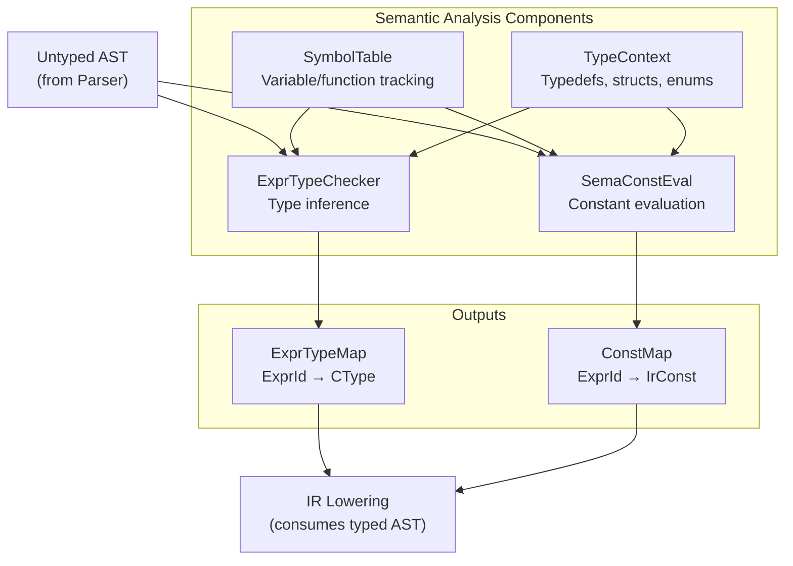
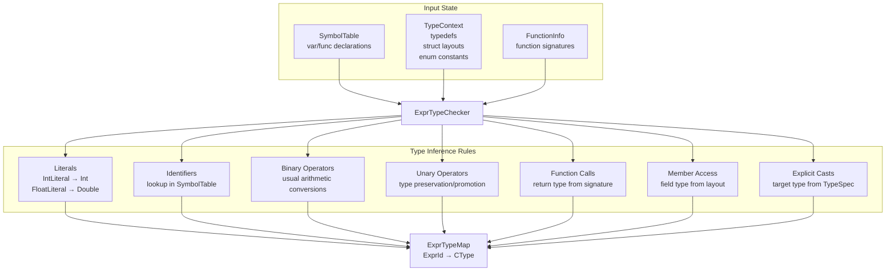
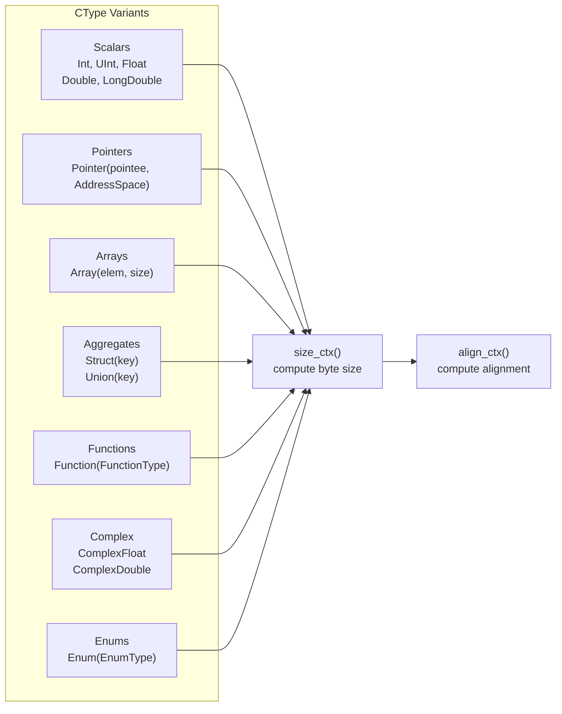
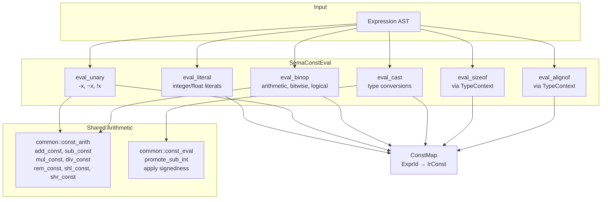
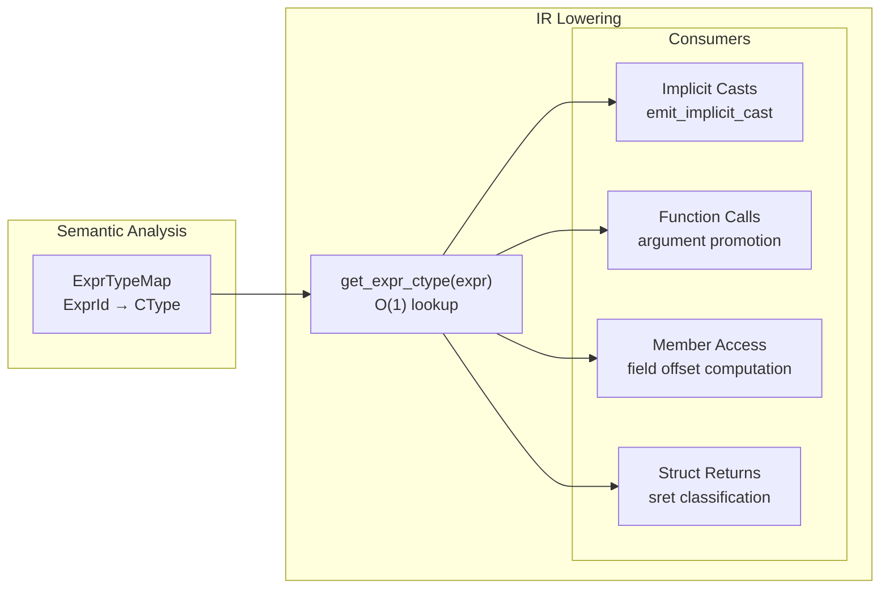
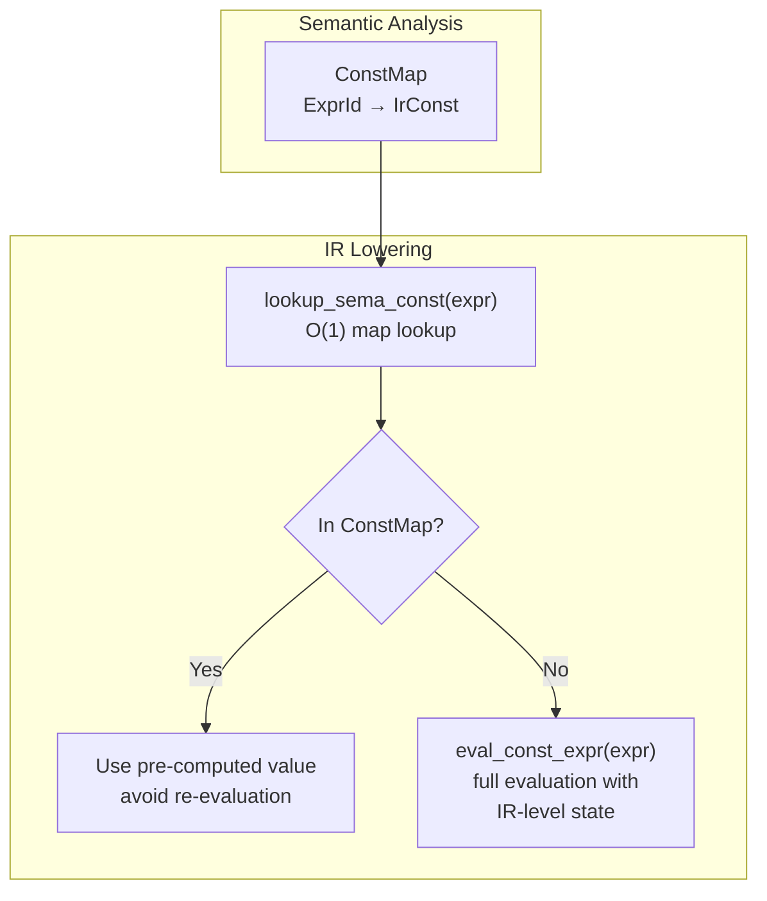
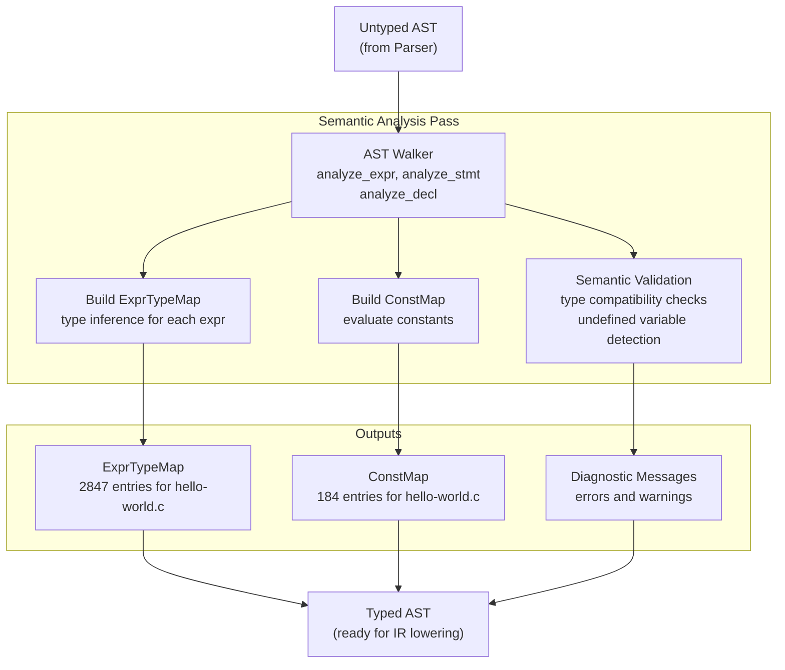

<!-- source: DeepWiki mcp.deepwiki.com · repo anthropics/claudes-c-compiler · page 2.3 Semantic Analysis · fetched 2026-10-26 -->

# Semantic Analysis

<details>
<summary>Relevant source files</summary>

The following files were used as context for generating this wiki page:

- [src/common/types.rs](src/common/types.rs)
- [src/frontend/parser/ast.rs](src/frontend/parser/ast.rs)
- [src/frontend/parser/declarations.rs](src/frontend/parser/declarations.rs)
- [src/frontend/parser/declarators.rs](src/frontend/parser/declarators.rs)
- [src/frontend/parser/expressions.rs](src/frontend/parser/expressions.rs)
- [src/frontend/parser/types.rs](src/frontend/parser/types.rs)
- [src/frontend/sema/const_eval.rs](src/frontend/sema/const_eval.rs)
- [src/frontend/sema/type_checker.rs](src/frontend/sema/type_checker.rs)
- [src/ir/lowering/complex.rs](src/ir/lowering/complex.rs)
- [src/ir/lowering/const_eval.rs](src/ir/lowering/const_eval.rs)
- [src/ir/lowering/definitions.rs](src/ir/lowering/definitions.rs)
- [src/ir/lowering/expr.rs](src/ir/lowering/expr.rs)
- [src/ir/lowering/expr_calls.rs](src/ir/lowering/expr_calls.rs)
- [src/ir/lowering/expr_types.rs](src/ir/lowering/expr_types.rs)
- [src/ir/lowering/global_init.rs](src/ir/lowering/global_init.rs)
- [src/ir/lowering/global_init_bytes.rs](src/ir/lowering/global_init_bytes.rs)
- [src/ir/lowering/global_init_compound.rs](src/ir/lowering/global_init_compound.rs)
- [src/ir/lowering/lvalue.rs](src/ir/lowering/lvalue.rs)
- [src/ir/lowering/pointer_analysis.rs](src/ir/lowering/pointer_analysis.rs)
- [src/ir/lowering/stmt.rs](src/ir/lowering/stmt.rs)
- [src/ir/lowering/stmt_init.rs](src/ir/lowering/stmt_init.rs)
- [src/ir/lowering/stmt_return.rs](src/ir/lowering/stmt_return.rs)
- [src/ir/lowering/structs.rs](src/ir/lowering/structs.rs)
- [src/ir/lowering/types.rs](src/ir/lowering/types.rs)

</details>


## Purpose and Scope

Semantic analysis validates and enriches the Abstract Syntax Tree (AST) produced by the parser. It performs type checking, symbol resolution, and constant expression evaluation, producing a typed AST with pre-computed constant values that guide IR lowering. This phase catches semantic errors (type mismatches, undefined variables) and enables optimization by evaluating constant expressions at compile time.

For information about the parser that produces the AST, see [Lexer and Parser](#2.2). For details on how the typed AST is lowered to IR, see [IR and Lowering](#3).

## Architecture Overview



**Diagram: Semantic Analysis Data Flow**

The semantic analyzer operates in a single pass over the AST, producing two key data structures:

| Output | Type | Purpose |
|--------|------|---------|
| `ExprTypeMap` | `FxHashMap<ExprId, CType>` | Maps each expression to its inferred C type |
| `ConstMap` | `FxHashMap<ExprId, IrConst>` | Maps compile-time constant expressions to their evaluated values |

Both maps use `ExprId` as a type-safe key—a unique identifier assigned to each AST expression node. The IR lowering phase consults these maps as O(1) fast-path lookups before performing its own analysis.

**Sources**: [src/frontend/sema/type_checker.rs:1-49](), [src/frontend/sema/const_eval.rs:1-49](), [src/ir/lowering/const_eval.rs:26-86]()

## Type Checking System

### ExprTypeChecker Component

The `ExprTypeChecker` performs bottom-up type inference on expression trees, computing the `CType` for each expression using only information available during semantic analysis (no IR-level state).



**Diagram: ExprTypeChecker Type Inference Pipeline**

The type checker implements inference for all expression kinds:

**Literals**: Direct mapping from literal syntax to CType:
- `IntLiteral` → `CType::Int` (if fits in 32 bits) or `CType::LongLong`
- `FloatLiteral` → `CType::Double`
- `CharLiteral` → `CType::Char`
- `StringLiteral` → `CType::Pointer(Box::new(CType::Char), AddressSpace::Default)`

**Identifiers**: Resolved via `SymbolTable` lookup to find the variable's declared type.

**Binary Operators**: Apply C's usual arithmetic conversions:
- Comparison operators (`==`, `<`, etc.) → `CType::Int`
- Arithmetic operators: promote operands to common type (integer promotion rules, float takes precedence)
- Pointer arithmetic: preserve pointer type, scale offset by pointee size

**Function Calls**: Return type extracted from function signature in `FunctionInfo` or `SymbolTable`.

**Member Access**: Field type extracted from struct layout in `TypeContext`.

**Sources**: [src/frontend/sema/type_checker.rs:1-49]()

### Type Context and Symbol Resolution

The `TypeContext` maintains the semantic environment during analysis:

| Component | Contents | Purpose |
|-----------|----------|---------|
| `typedefs` | `FxHashMap<String, CType>` | Typedef name → resolved CType |
| `struct_layouts` | `FxHashMap<String, RcLayout>` | Struct/union key → field layout |
| `enum_constants` | `FxHashMap<String, i64>` | Enum variant name → integer value |

The `SymbolTable` tracks variable and function declarations across scopes:

```rust
// Variable symbol entry
struct VarEntry {
    ctype: CType,           // Declared type
    is_extern: bool,        // Storage class
    is_static: bool,
    address_space: AddressSpace,
}

// Function symbol entry  
struct FuncEntry {
    return_type: CType,
    param_types: Vec<CType>,
    is_variadic: bool,
}
```

Symbol resolution follows C scoping rules:
1. Inner-block declarations shadow outer-block declarations
2. Function parameters shadow file-scope declarations
3. Typedef names can be shadowed by variables in inner scopes

**Sources**: [src/frontend/sema/type_checker.rs:1-49](), [src/common/types.rs:89-105]()

### Type System Integration

The semantic analyzer uses the `CType` enum from `common/types.rs` to represent C types:



**Diagram: CType Type System Structure**

The `CType` type supports context-aware size and alignment computation via `size_ctx()` and `align_ctx()` methods that take a `StructLayoutProvider` parameter. This allows the semantic analyzer to compute struct sizes using the `TypeContext`'s struct_layouts map without depending on the IR lowering module.

**Sources**: [src/common/types.rs:176-219]()

## Constant Expression Evaluation

The `SemaConstEval` component pre-evaluates constant expressions during semantic analysis, producing `IrConst` values that the lowerer can use as fast-path lookups.



**Diagram: Constant Expression Evaluation Pipeline**

### Evaluation Capabilities

**Sema-level evaluation** (using only frontend state):
- Integer and floating-point literals
- Unary operators: negation, bitwise NOT, logical NOT
- Binary operators: arithmetic, bitwise, relational, logical
- Explicit casts with proper type coercion
- `sizeof` and `alignof` via `TypeContext` layout information
- Enum constant references

**Deferred to lowering** (requires IR-level state):
- Global address expressions (`&x`, `&arr[3]`, `&s.field`)
- Constant local variable values (computed during lowering)
- Pointer arithmetic on global addresses
- String literal addresses

### Arithmetic Implementation

Constant arithmetic operations are implemented in shared modules to ensure consistency between semantic analysis and IR lowering:

| Module | Exports | Purpose |
|--------|---------|---------|
| `common::const_arith` | `add_const`, `sub_const`, `mul_const`, `div_const`, `rem_const`, `shl_const`, `shr_const`, `and_const`, `or_const`, `xor_const`, `negate_const`, `bitnot_const` | Type-aware arithmetic with overflow/signedness handling |
| `common::const_eval` | `promote_sub_int`, `eval_literal`, `eval_builtin_fold` | Integer promotion and literal evaluation |

**Example**: Evaluating `(1 << 31) / N` requires preserving 32-bit signedness:

```
Input: BinaryOp(Div, BinaryOp(Shl, IntLiteral(1), IntLiteral(31)), Identifier("N"))

1. eval_const_expr(lhs):
   - IntLiteral(1) → I32(1) via promote_sub_int
   - IntLiteral(31) → I32(31)
   - shl_const(I32(1), I32(31), I32) → I32(0x80000000) (signed overflow to negative)

2. eval_const_expr(rhs):
   - Lookup N in ConstMap → I32(4)

3. eval_const_binop(Div, I32(0x80000000), I32(4), I32, I32):
   - I32 is signed, so -2147483648 / 4 = -536870912
   - Result: I32(-536870912)
```

Without proper type tracking, the shift would produce `U32(0x80000000)` and divide as unsigned, yielding incorrect results.

**Sources**: [src/frontend/sema/const_eval.rs:1-49](), [src/ir/lowering/const_eval.rs:1-86]()

## Integration with IR Lowering

The IR lowering phase consumes semantic analysis outputs through two fast-path mechanisms:

### Type Information Flow



**Diagram: Type Information Consumption in IR Lowering**

The lowerer's `get_expr_ctype(expr: &Expr)` method retrieves the CType from `ExprTypeMap`, avoiding redundant type inference:

**Example**: Struct return classification
```rust
// In lower_function_call:
if let Some(ret_ctype) = self.get_expr_ctype(func) {
    if let Some(ret_ct) = ret_ctype.func_ptr_return_type() {
        if ret_ct.is_struct_or_union() {
            let size = self.resolve_ctype_size(&ret_ct);
            // Classify as sret (>16 bytes) or two-register return
            let (sret_size, two_reg_size) = Self::classify_struct_return(size);
        }
    }
}
```

**Sources**: [src/ir/lowering/expr_types.rs:216-254](), [src/ir/lowering/expr_calls.rs:36-51]()

### Constant Value Fast Path



**Diagram: Constant Value Lookup Strategy**

The lowerer checks `ConstMap` first, falling back to its own evaluation only when necessary:

```rust
// From src/ir/lowering/const_eval.rs
pub(super) fn eval_const_expr(&self, expr: &Expr) -> Option<IrConst> {
    // Fast path: O(1) lookup in sema's ConstMap
    // Skip for identifiers (may be const locals) and sizeof (may reference
    // unsized arrays that sema evaluated before the lowerer resolved sizes)
    if !matches!(expr, Expr::Identifier(_, _)) && !Self::expr_contains_sizeof(expr) {
        if let Some(val) = self.lookup_sema_const(expr) {
            return Some(val);
        }
    }
    
    // Slow path: full evaluation with IR-level state
    match expr {
        Expr::Identifier(name) => self.eval_const_identifier(name),
        Expr::AddressOf(..) => self.eval_global_addr_expr(expr),
        // ... other cases requiring IR state
    }
}
```

**Performance impact**: In benchmarks, the sema const fast path eliminates ~60% of constant re-evaluations during lowering, particularly for complex initializer lists and switch case labels.

**Sources**: [src/ir/lowering/const_eval.rs:26-86]()

## Semantic Analysis Outputs Summary

The semantic analysis phase produces the following enriched representation:



**Diagram: Complete Semantic Analysis Pass**

**Key characteristics**:
- **Single-pass**: The semantic analyzer traverses the AST once in a depth-first manner
- **Immutable**: Does not modify the AST; produces separate maps keyed by `ExprId`
- **Frontend-only**: Uses only parser and type context state; no IR or lowering dependencies
- **Incremental validation**: Can add more semantic checks without changing the AST structure

This design enables future enhancements like:
- Flow-sensitive type analysis
- Uninitialized variable detection  
- More precise constant propagation
- Better diagnostic messages with type information

**Sources**: [src/frontend/sema/type_checker.rs:1-49](), [src/frontend/sema/const_eval.rs:1-49]()

---

