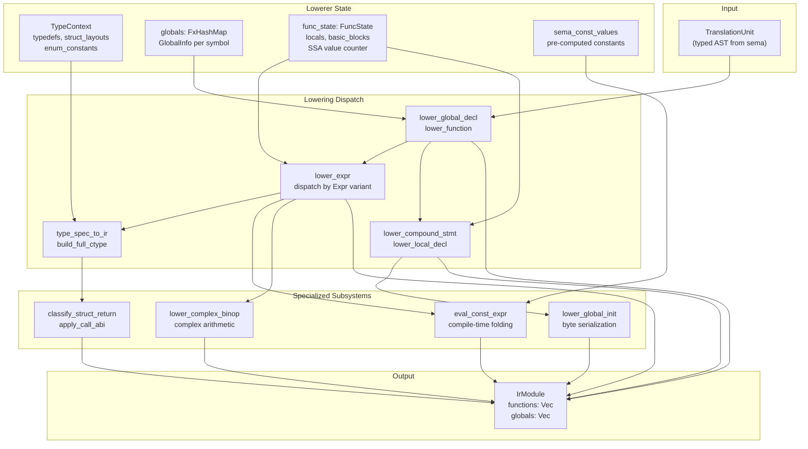
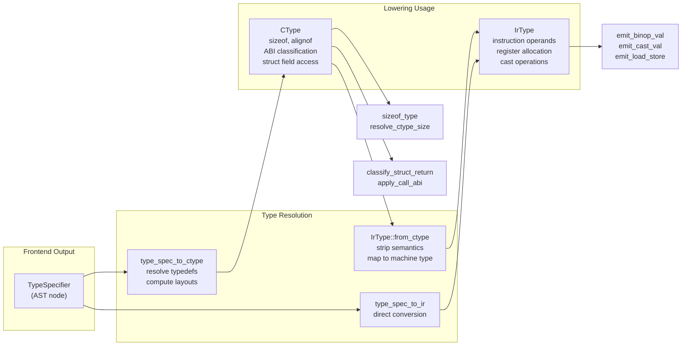
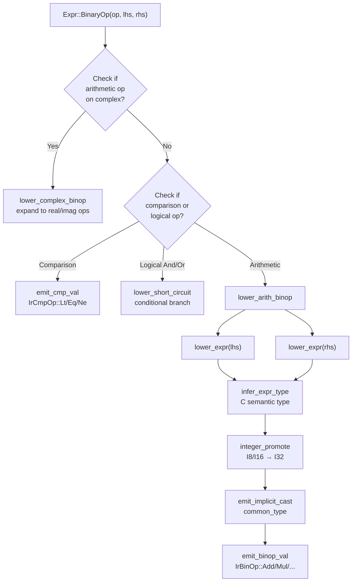
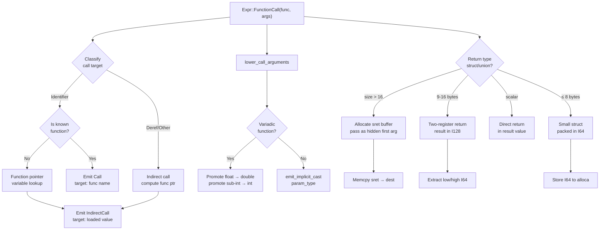
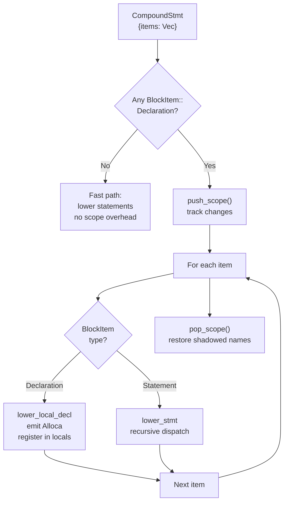
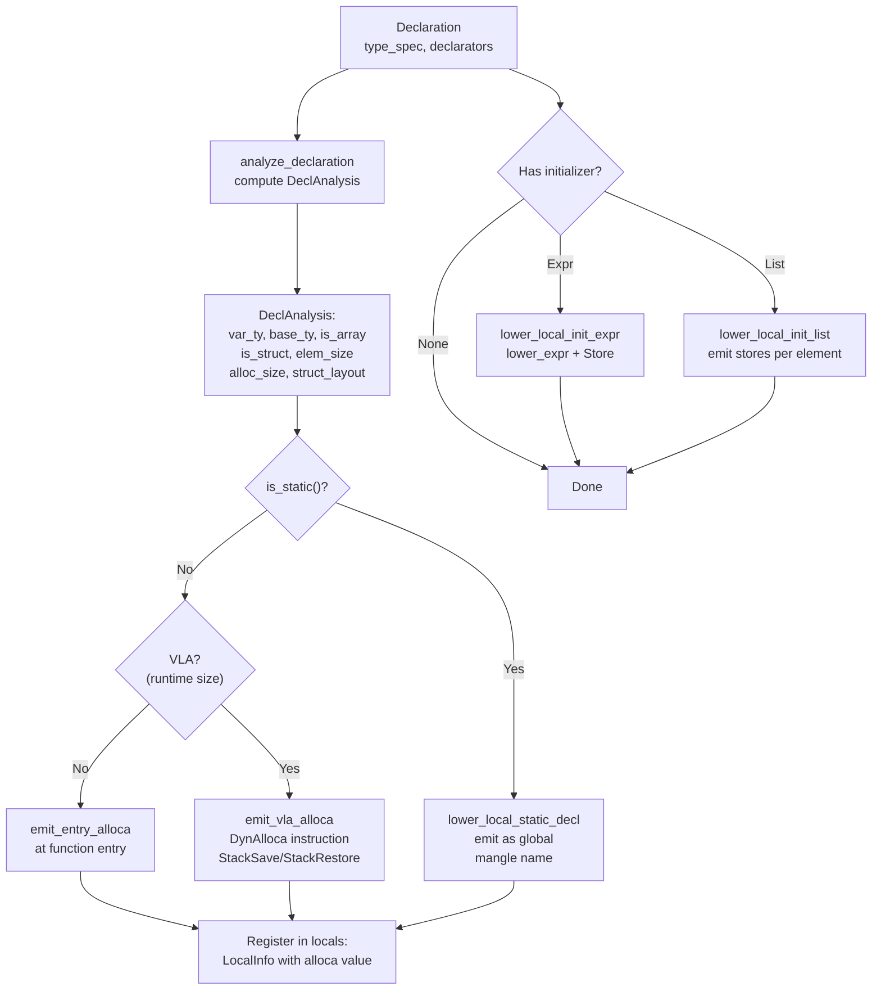
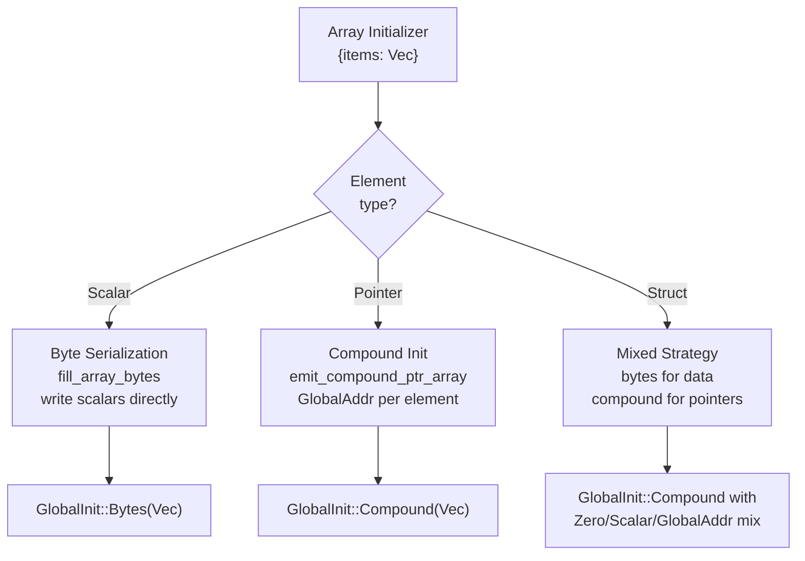
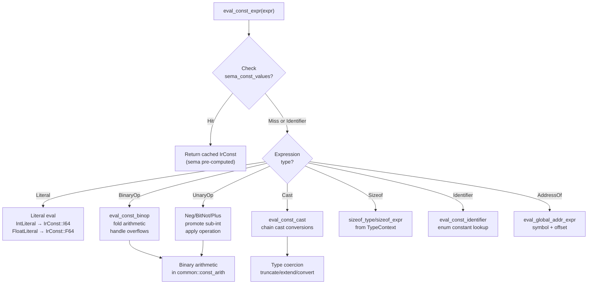
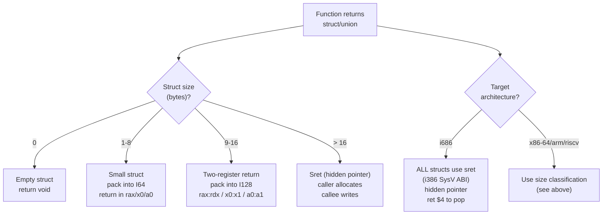
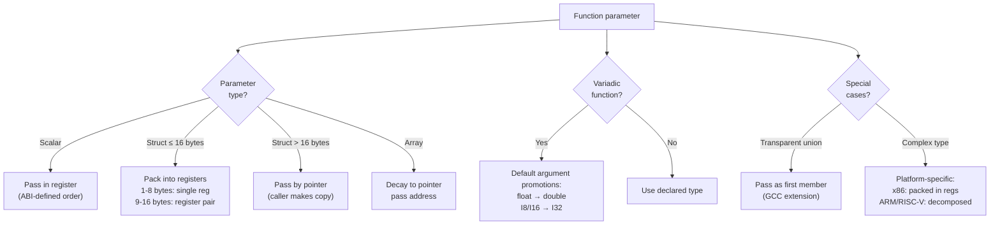

<!-- source: DeepWiki mcp.deepwiki.com · repo anthropics/claudes-c-compiler · page 3 IR and Lowering · fetched 2026-10-26 -->

# IR and Lowering

<details>
<summary>Relevant source files</summary>

The following files were used as context for generating this wiki page:

- [src/common/types.rs](src/common/types.rs)
- [src/frontend/parser/ast.rs](src/frontend/parser/ast.rs)
- [src/frontend/parser/declarations.rs](src/frontend/parser/declarations.rs)
- [src/frontend/parser/declarators.rs](src/frontend/parser/declarators.rs)
- [src/frontend/parser/expressions.rs](src/frontend/parser/expressions.rs)
- [src/frontend/parser/types.rs](src/frontend/parser/types.rs)
- [src/frontend/sema/const_eval.rs](src/frontend/sema/const_eval.rs)
- [src/frontend/sema/type_checker.rs](src/frontend/sema/type_checker.rs)
- [src/ir/lowering/complex.rs](src/ir/lowering/complex.rs)
- [src/ir/lowering/const_eval.rs](src/ir/lowering/const_eval.rs)
- [src/ir/lowering/definitions.rs](src/ir/lowering/definitions.rs)
- [src/ir/lowering/expr.rs](src/ir/lowering/expr.rs)
- [src/ir/lowering/expr_calls.rs](src/ir/lowering/expr_calls.rs)
- [src/ir/lowering/expr_types.rs](src/ir/lowering/expr_types.rs)
- [src/ir/lowering/global_init.rs](src/ir/lowering/global_init.rs)
- [src/ir/lowering/global_init_bytes.rs](src/ir/lowering/global_init_bytes.rs)
- [src/ir/lowering/global_init_compound.rs](src/ir/lowering/global_init_compound.rs)
- [src/ir/lowering/lvalue.rs](src/ir/lowering/lvalue.rs)
- [src/ir/lowering/pointer_analysis.rs](src/ir/lowering/pointer_analysis.rs)
- [src/ir/lowering/stmt.rs](src/ir/lowering/stmt.rs)
- [src/ir/lowering/stmt_init.rs](src/ir/lowering/stmt_init.rs)
- [src/ir/lowering/stmt_return.rs](src/ir/lowering/stmt_return.rs)
- [src/ir/lowering/structs.rs](src/ir/lowering/structs.rs)
- [src/ir/lowering/types.rs](src/ir/lowering/types.rs)

</details>


**Purpose**: This page documents the IR lowering subsystem that transforms the typed Abstract Syntax Tree (AST) from the frontend into Static Single Assignment (SSA) intermediate representation. Lowering resolves type semantics, handles platform-specific ABI requirements, evaluates compile-time constants, and produces machine-agnostic IR ready for optimization.

For information about the IR structure itself (instructions, basic blocks, SSA values), see [IR Structure](#3.1). For type system details (CType and IrType definitions), see [Type System](#3.2). For ABI calling conventions and parameter passing, see [ABI Handling](#3.5).

## Overview

The lowering phase bridges the gap between high-level C semantics and low-level machine operations. The `Lowerer` structure in [src/ir/lowering/lower.rs]() orchestrates this transformation by:

1. **Type Resolution**: Converting semantic `CType` values from the frontend into machine-level `IrType` values for codegen
2. **Expression Lowering**: Translating AST expression nodes into sequences of SSA instructions
3. **Statement Lowering**: Generating control flow (branches, loops) and variable bindings
4. **ABI Handling**: Implementing platform-specific calling conventions, struct returns, and parameter passing
5. **Constant Folding**: Pre-computing compile-time constant expressions

The lowering process is stateful and architecture-aware. It maintains:
- `func_state`: Current function context (locals, basic blocks, SSA values)
- `types`: Type context (typedefs, struct layouts, enum constants)
- `globals`: Global variable and function metadata
- `module`: Output IR module being constructed

**Key Architecture**: Lowering operates as a single-pass recursive descent over the AST, emitting IR instructions directly into the current basic block. Each expression returns an `Operand` (either a SSA `Value` or an immediate `Const`), and control flow is managed through explicit `Terminator` instructions that link basic blocks.

**Sources**: [src/ir/lowering/lower.rs:1-200](), [src/ir/lowering/expr.rs:1-50](), [src/ir/lowering/stmt.rs:1-80]()

## Lowering Pipeline Architecture



**Sources**: [src/ir/lowering/lower.rs:1-500](), [src/ir/lowering/expr.rs:1-200](), [src/ir/lowering/stmt.rs:1-200]()

## Dual Type System

The lowering phase maintains two parallel type representations:

### CType: Semantic C Types

Defined in [src/common/types.rs:176-219](), `CType` represents C language-level types as understood by the semantic analyzer:

```
CType::Int              -> signed 32-bit integer
CType::Pointer(Box<CType>, AddressSpace) -> pointer to type
CType::Array(Box<CType>, Option<usize>) -> array with optional size
CType::Struct(RcStr)    -> struct identified by layout key
CType::Function(FunctionType) -> function signature
CType::ComplexDouble    -> C99 _Complex double (16 bytes)
```

**Key Properties**:
- Carries full semantic information (signedness, pointee types, struct members)
- Used for type checking, sizeof/alignof computation, and ABI classification
- Reference-counted strings (`RcStr`) and layouts (`RcLayout`) enable cheap cloning

### IrType: Machine Types

Defined in [src/common/types.rs](), `IrType` represents backend machine types:

```
IrType::I32, IrType::I64, IrType::U32, IrType::U64  -> integer widths
IrType::F32, IrType::F64, IrType::F128  -> floating point
IrType::Ptr   -> opaque pointer (target-width)
IrType::Void  -> no value
```

**Key Properties**:
- Loses semantic detail (no struct members, no array bounds)
- Enables target-independent optimizations
- Size-based classification only (I8/I16/I32/I64 for integer operations)

### Type Conversion Flow



**Example Conversion**:
- `int arr[10]` → `CType::Array(Box::new(CType::Int), Some(10))` → `IrType::Ptr` (array decays to pointer)
- `struct S` → `CType::Struct("struct.S")` → `IrType::Ptr` (struct passed by reference)
- `float` → `CType::Float` → `IrType::F32`

**Sources**: [src/common/types.rs:176-290](), [src/ir/lowering/types.rs:171-232](), [src/ir/lowering/expr_types.rs:1-100]()

## Expression Lowering Entry Points

The `lower_expr` function in [src/ir/lowering/expr.rs:111-200]() dispatches on the `Expr` enum variant:

| Expression Variant | Handler Function | Output |
|-------------------|------------------|--------|
| `IntLiteral`, `FloatLiteral` | Inline → `Operand::Const` | Immediate constant |
| `Identifier` | `lower_identifier` | Load from local/global |
| `BinaryOp` | `lower_binary_op` | `BinOp` or `Cmp` instruction |
| `UnaryOp` | `lower_unary_op` | `UnaryOp` or `Cast` instruction |
| `FunctionCall` | `lower_function_call` | `Call` or `IndirectCall` |
| `Cast` | `lower_cast` | `Cast` instruction chain |
| `MemberAccess` | `lower_member_access` | `GetElementPtr` + offset |
| `ArraySubscript` | `lower_array_subscript` | `GetElementPtr` + stride |
| `Sizeof` | `lower_sizeof` | Compile-time constant |
| `Conditional` | `lower_conditional` | Branch + Phi nodes |
| `CompoundLiteral` | `lower_compound_literal` | Stack alloca + init |

**Key Design**: Each lowering function returns `Operand` (value or constant) rather than mutating an accumulator. This functional style enables easy composition and constant folding.

**Sources**: [src/ir/lowering/expr.rs:111-200]()

## Expression Lowering Subsystems

### Binary Operations



**Type Inference for Binary Ops**: The lowerer uses `infer_expr_type` (not `get_expr_type`) to preserve narrow literal types. For example, `(1 << 31)` uses `I32` (signed 32-bit) from inference, not `I64` (the storage type). This ensures correct overflow behavior for 32-bit constants per [src/ir/lowering/expr.rs:406-487]().

**Pointer Arithmetic**: Addition/subtraction with pointer operands scales by the pointee size. The lowerer computes `pointee_size` from the operand's `CType` and emits a multiplication before the add/sub instruction per [src/ir/lowering/expr_ops.rs]().

**Sources**: [src/ir/lowering/expr.rs:378-450](), [src/ir/lowering/expr_ops.rs:1-200](), [src/ir/lowering/expr_types.rs:376-451]()

### Function Calls



**Sret (Struct Return)**: Structs larger than 16 bytes on x86-64/ARM/RISC-V (or any struct on i686) use a hidden pointer parameter. The caller allocates stack space and passes its address as the first argument. The function writes the result there and returns void per [src/ir/lowering/expr_calls.rs:36-51]().

**Two-Register Return**: Structs of 9-16 bytes on 64-bit targets return in register pairs (`rax:rdx`, `x0:x1`, `a0:a1`). The lowerer packs them into `IrType::I128`, then extracts the two `I64` halves and stores them at the correct offsets per [src/ir/lowering/expr_calls.rs:36-51]().

**Variadic Promotions**: Arguments to variadic functions (after the fixed parameters) undergo C's default argument promotions: `float` → `double`, `I8/I16` → `I32` per [src/ir/lowering/expr_calls.rs:100-150]().

**Sources**: [src/ir/lowering/expr_calls.rs:1-300](), [src/ir/lowering/expr_types.rs:216-254]()

### Member Access and Array Subscript

Both operations resolve to `GetElementPtr` instructions with computed offsets:

**Struct Member Access** (`s.field` or `ptr->field`):
1. Resolve the base expression's `CType` to get struct layout
2. Lookup field by name to get byte offset
3. Emit `GetElementPtr` with constant offset
4. For bitfields, track bit offset/width for later extract/insert

**Array Subscript** (`arr[index]`):
1. Compute element size from array's `CType`
2. Lower index expression to value
3. Emit multiplication by element size (for non-byte strides)
4. Emit `GetElementPtr` with dynamic offset

**Multi-dimensional Arrays**: Arrays-of-arrays use precomputed strides. For `int arr[3][4]`, the stride for the first subscript is `3*4*sizeof(int) = 48` bytes. Strides are computed in `compute_array_strides` per [src/ir/lowering/types.rs:506-575]().

**Sources**: [src/ir/lowering/expr_access.rs:1-300](), [src/ir/lowering/types.rs:506-575]()

## Statement and Declaration Lowering

### Compound Statements and Scope Management

The `lower_compound_stmt` function in [src/ir/lowering/stmt.rs:30-78]() implements lexical scoping with a lazy scope-tracking optimization:



**Scope Tracking Optimization**: The lowerer only pushes a scope frame if the block contains declarations. This eliminates allocation overhead for blocks with only statements (common in deeply nested control flow) per [src/ir/lowering/stmt.rs:44-72]().

**Shadowing**: When a declaration shadows an outer name, the scope frame stores the old binding. On `pop_scope()`, the old binding is restored per [src/ir/lowering/scope.rs]().

**Sources**: [src/ir/lowering/stmt.rs:30-78](), [src/ir/lowering/scope.rs]()

### Local Variable Declarations



**Declaration Analysis** (`analyze_declaration` in [src/ir/lowering/decl.rs]()): Computes metadata for the declarator:
- `var_ty`: IR type for the variable itself (I32 for `int`, Ptr for `int*` or `int[10]`)
- `base_ty`: IR type of array elements (I32 for `int[10]`)
- `is_array`, `is_struct`, `is_pointer`: Shape flags
- `actual_alloc_size`: Total allocation size in bytes
- `struct_layout`: Reference-counted layout for struct types

**Static Locals**: Declared with `static` inside functions, these are lowered as global variables with mangled names (`{func}.{var}.{id}`) to avoid collisions. They are initialized once at program start, not at each function call per [src/ir/lowering/stmt.rs:387-518]().

**VLAs (Variable-Length Arrays)**: Arrays with runtime-computed sizes emit `DynAlloca` instructions. The lowerer emits `StackSave` at the first VLA in the function and `StackRestore` on scope exit per [src/ir/lowering/stmt.rs:282-304]().

**Sources**: [src/ir/lowering/stmt.rs:80-495](), [src/ir/lowering/decl.rs]()

### Control Flow Lowering

Control flow statements generate basic blocks and terminators:

**If Statement**:
```
lower_if(cond, then_branch, else_branch):
  cond_val = lower_condition_expr(cond)
  then_bb = new_block()
  else_bb = new_block()
  end_bb = new_block()
  
  emit(CondBranch { cond: cond_val, true_bb: then_bb, false_bb: else_bb })
  
  set_current_block(then_bb)
  lower_stmt(then_branch)
  emit(Jump { target: end_bb })
  
  set_current_block(else_bb)
  lower_stmt(else_branch)
  emit(Jump { target: end_bb })
  
  set_current_block(end_bb)
```

**While Loop**:
```
lower_while(cond, body):
  header_bb = new_block()
  body_bb = new_block()
  end_bb = new_block()
  
  emit(Jump { target: header_bb })
  
  set_current_block(header_bb)
  cond_val = lower_condition_expr(cond)
  emit(CondBranch { cond: cond_val, true_bb: body_bb, false_bb: end_bb })
  
  set_current_block(body_bb)
  push_loop_context(header_bb, end_bb)  // for break/continue
  lower_stmt(body)
  pop_loop_context()
  emit(Jump { target: header_bb })
  
  set_current_block(end_bb)
```

**Switch Statement**: Maintained via `SwitchContext` tracking case values and labels. The lowerer emits a `Switch` terminator with all case targets, then lowers the switch body as a single compound statement where case labels mark entry points per [src/ir/lowering/stmt_control.rs]().

**Sources**: [src/ir/lowering/stmt_control.rs]()

## Global Initialization Lowering

Global variable initializers are lowered at compile time to `GlobalInit` values. The lowering strategy depends on the initializer's complexity:

### Scalar Initializers

Simple constants are evaluated via `eval_const_expr` and emitted as `GlobalInit::Scalar(IrConst)`:

```c
int x = 42;                    → GlobalInit::Scalar(IrConst::I64(42))
double pi = 3.14159;           → GlobalInit::Scalar(IrConst::F64(3.14159))
long double ld = 1.0L;         → GlobalInit::Scalar(IrConst::LongDouble(...))
```

**Sources**: [src/ir/lowering/global_init.rs:76-180]()

### String Literal Initializers

String literals have two lowering paths depending on context:

**Array Initialization** (inline the string bytes):
```c
char buf[10] = "hello";  → GlobalInit::String("hello")
wchar_t wb[5] = L"test"; → GlobalInit::WideString([116, 101, 115, 116])
```

**Pointer Initialization** (emit as separate .rodata global):
```c
const char *s = "hello"; → GlobalInit::GlobalAddr(".L.str.0")
```

The distinction matters for alignment and memory layout: inlining places the string directly in the variable's allocation, while the pointer form creates a separate rodata entry per [src/ir/lowering/global_init.rs:289-340]().

**Sources**: [src/ir/lowering/global_init.rs:289-340]()

### Array Initializers

Arrays are lowered based on element type and size:



**Byte Serialization Path**: For arrays of scalars (integers, floats, complex numbers), the lowerer writes constants directly into a byte buffer. This is more compact than emitting individual scalar elements:

```c
int arr[4] = {1, 2, 3, 4};
// Emitted as 16 bytes: [01 00 00 00 02 00 00 00 03 00 00 00 04 00 00 00]
```

**Compound Path**: For arrays containing pointers or requiring relocations, the lowerer emits a `GlobalInit::Compound` with individual elements:

```c
const char *strs[3] = {"hello", "world", NULL};
// Emitted as Compound([GlobalAddr(".L.str.0"), GlobalAddr(".L.str.1"), Zero])
```

**Designated Initializers**: Implemented via sparse array tracking. The lowerer builds a `Vec<Option<Initializer>>` indexed by position, filling gaps with zero per [src/ir/lowering/global_init_compound.rs:102-148]().

**Sources**: [src/ir/lowering/global_init.rs:386-449](), [src/ir/lowering/global_init_bytes.rs:38-100](), [src/ir/lowering/global_init_compound.rs:102-148]()

### Struct Initializers

Struct initialization uses a hybrid strategy:

**Byte Serialization** (for simple structs):
```c
struct Point { int x, y; } p = {10, 20};
// Serialized as 8 bytes: [0a 00 00 00 14 00 00 00]
```

**Compound Init** (for structs with pointers):
```c
struct Entry { const char *key; int val; } e = {"name", 42};
// Emitted as Compound([GlobalAddr(".L.str.0"), Scalar(IrConst::I32(42))])
```

The lowerer chooses byte serialization if all initializer expressions are compile-time constants. Otherwise, it falls back to compound initialization to support relocations per [src/ir/lowering/global_init.rs:427-430]().

**Bitfield Handling**: Bitfields are packed into storage units during byte serialization. For a struct with `unsigned int flags : 4`, the lowerer computes the bit offset within the storage unit and uses bit manipulation to write the value per [src/ir/lowering/global_init_bytes.rs:200-300]().

**Anonymous Members**: Designated initializers like `.anon_struct.field = value` drill through anonymous member offsets recursively per [src/ir/lowering/global_init_compound.rs:32-94]().

**Sources**: [src/ir/lowering/global_init.rs:427-430](), [src/ir/lowering/global_init_bytes.rs:44-350](), [src/ir/lowering/global_init_compound.rs:32-94]()

## Constant Evaluation

The lowering phase performs constant evaluation for two purposes:
1. **Array Sizes**: Computing `sizeof(arr)` requires knowing the element count
2. **Initializers**: Global initializers must be compile-time constants

### Constant Evaluation Pipeline



**Sema Fast Path**: The semantic analyzer precomputes constants during its AST walk and stores results in `sema_const_values: FxHashMap<ExprId, IrConst>`. The lowerer checks this map first (O(1) lookup) before falling back to its own evaluation per [src/ir/lowering/const_eval.rs:26-90]().

**Sizeof Recomputation**: The lowerer skips the sema cache for expressions containing `Sizeof`, because sema evaluates sizeof before the lowerer resolves unsized array dimensions from initializers:

```c
int arr[] = {1, 2, 3};  // sema: size unknown, lowerer: size = 3
sizeof(arr) / sizeof(arr[0])  // must recompute after lowering
```

This is detected via `expr_contains_sizeof` per [src/ir/lowering/const_eval.rs:40-63]().

**Sources**: [src/ir/lowering/const_eval.rs:26-200](), [src/frontend/sema/const_eval.rs:1-100](), [src/common/const_arith.rs]()

### Global Address Expressions

Address-of operators and function names in global initializers resolve to `GlobalInit::GlobalAddr` with optional offsets:

```c
int global_var;
int *p1 = &global_var;              → GlobalAddr("global_var", offset=0)

int arr[10];
int *p2 = &arr[5];                  → GlobalAddr("arr", offset=20)

struct S { int a; char b; } s;
char *p3 = &s.b;                    → GlobalAddr("s", offset=4)
```

The lowerer computes offsets by:
1. Parsing the address expression tree (`&base`, `&base[idx]`, `&base.field`)
2. Accumulating constant offsets (array strides, struct field offsets)
3. Emitting `GlobalAddr(symbol_name, total_offset)` per [src/ir/lowering/const_eval_global_addr.rs]()

**Compound Literals**: File-scope compound literals are materialized as anonymous globals, allowing `&(int[]){1,2,3}` in initializers per [src/ir/lowering/global_init.rs:166-225]().

**Sources**: [src/ir/lowering/const_eval_global_addr.rs](), [src/ir/lowering/global_init.rs:166-225]()

## ABI Handling

The lowering phase implements platform-specific calling conventions and struct return mechanisms. This is necessary because C's function call semantics leave many details to the platform ABI.

### Struct Return Classification



**Implementation**: The `classify_struct_return` function in [src/ir/lowering/expr_calls.rs:36-51]() returns `(sret_size, two_reg_size)`:

```rust
pub(super) fn classify_struct_return(size: usize) -> (Option<usize>, Option<usize>) {
    let ptr_size = target_ptr_size();
    if ptr_size <= 4 {
        // i686: always sret
        (Some(size), None)
    } else {
        // 64-bit targets
        if size > 16 {
            (Some(size), None)  // sret
        } else if size > 8 {
            (None, Some(size))  // two-register
        } else {
            (None, None)  // small struct
        }
    }
}
```

**Sret Lowering**: When a function returns a struct via sret, the lowerer:
1. Allocates a stack buffer at the call site
2. Passes the buffer address as a hidden first parameter
3. After the call, the buffer contains the return value per [src/ir/lowering/expr_calls.rs:200-250]()

**Two-Register Return**: For 9-16 byte structs on 64-bit targets, the lowerer:
1. Declares the function as returning `I128`
2. After the call, extracts low/high `I64` halves via bit operations
3. Stores each half at the correct offset in the destination struct per [src/ir/lowering/expr_calls.rs:250-300]()

**Sources**: [src/ir/lowering/expr_calls.rs:36-300]()

### Parameter Passing



**Variadic Promotions**: Arguments after the fixed parameters in variadic functions undergo C's default argument promotions. The lowerer detects variadic calls and applies promotions per [src/ir/lowering/expr_calls.rs:100-150]():

```rust
if is_variadic && arg_idx >= num_fixed_params {
    // Promote float → double
    if arg_ty == IrType::F32 {
        arg_val = emit_cast_val(arg_val, IrType::F32, IrType::F64);
    }
    // Promote sub-int → int
    if matches!(arg_ty, IrType::I8 | IrType::U8 | IrType::I16 | IrType::U16) {
        arg_val = emit_cast_val(arg_val, arg_ty, IrType::I32);
    }
}
```

**Struct Argument Passing**: The lowerer does not directly handle struct argument passing - that is delegated to the backend codegens. However, it does classify struct parameters into "small" (register) vs "large" (pointer) categories to guide backend decisions per [src/ir/lowering/expr_calls.rs:36-51]().

**Sources**: [src/ir/lowering/expr_calls.rs:36-200]()

### Complex Number ABI

C99 `_Complex` types have platform-specific ABIs:

**x86-64**: Complex numbers are packed into floating-point register pairs:
- `_Complex float` (8 bytes) → `{xmm0, xmm1}` or single `xmm` register
- `_Complex double` (16 bytes) → `{xmm0, xmm1}` register pair

**AArch64 and RISC-V**: Complex numbers decompose to independent real/imaginary components:
- `_Complex float` → `{fa0 (real), fa1 (imag)}`
- `_Complex double` → `{fa0 (real), fa1 (imag)}`

The lowering phase represents complex values as pointers to `{real, imag}` pairs in memory. Actual register assignment is handled by architecture-specific codegens per [src/ir/lowering/complex.rs:1-50]().

**Sources**: [src/ir/lowering/complex.rs:1-50]()

## Type Caching and Resolution

The lowering phase caches type resolution results to avoid redundant computation:

### CType Cache

`TypeContext` maintains `ctype_cache: FxHashMap<String, CType>` for struct/union/typedef resolution:

```rust
pub fn type_spec_to_ctype(&self, ts: &TypeSpecifier) -> CType {
    match ts {
        TypeSpecifier::TypedefName(name) => {
            // Fast path: check cache
            if let Some(cached) = self.types.ctype_cache.get(name) {
                return cached.clone();
            }
            // Slow path: resolve through typedefs
            if let Some(ct) = self.types.typedefs.get(name) {
                self.types.ctype_cache.insert(name.clone(), ct.clone());
                return ct.clone();
            }
            // Fallback
            CType::Int
        }
        // ... handle other variants
    }
}
```

**Cache Invalidation**: When a struct/union is redefined in an inner scope, the cache entry is invalidated per [src/ir/lowering/structs.rs:173-181]().

**Sources**: [src/ir/lowering/types_ctype.rs](), [src/ir/lowering/structs.rs:173-181]()

### Struct Layout Cache

Struct layouts are computed once and stored in `TypeContext::struct_layouts: FxHashMap<String, RcLayout>`:

```rust
pub fn get_struct_layout_for_type(&self, ts: &TypeSpecifier) -> Option<RcLayout> {
    match ts {
        TypeSpecifier::Struct(Some(tag), _, _, _, _) => {
            let key = format!("struct.{}", tag);
            self.types.struct_layouts.get(&key).cloned()
        }
        // ... handle anonymous and typedef'd structs
    }
}
```

**Cheap Cloning**: Layouts use `Rc<StructLayout>` so cloning only increments a reference count, not deep-copying the entire field list per [src/common/types.rs:85-91]().

**Sources**: [src/ir/lowering/structs.rs:269-301](), [src/common/types.rs:85-91]()

## Key Data Structures

### Lowerer

The main lowering state, defined in [src/ir/lowering/lower.rs]():

| Field | Type | Purpose |
|-------|------|---------|
| `module` | `IrModule` | Output IR being constructed |
| `func_state` | `Option<FuncState>` | Current function context (locals, blocks) |
| `types` | `TypeContext` | Type resolution (typedefs, struct layouts) |
| `globals` | `FxHashMap<String, GlobalInfo>` | Global variable metadata |
| `func_meta` | `FuncMeta` | Function signature metadata |
| `sema_const_values` | `ConstMap` | Pre-computed constants from sema |
| `known_functions` | `FxHashSet<String>` | Direct call targets |

### FuncState

Per-function lowering state in [src/ir/lowering/lower.rs]():

| Field | Type | Purpose |
|-------|------|---------|
| `name` | `String` | Function name |
| `locals` | `FxHashMap<String, LocalInfo>` | Local variable bindings |
| `basic_blocks` | `Vec<BasicBlock>` | CFG blocks with instructions |
| `current_bb` | `BlockId` | Active block for new instructions |
| `next_value` | `u32` | SSA value counter |
| `loop_stack` | `Vec<LoopContext>` | Break/continue targets |
| `switch_stack` | `Vec<SwitchContext>` | Switch case labels |

### DeclAnalysis

Computed metadata for variable declarations in [src/ir/lowering/definitions.rs:100-150]():

| Field | Type | Purpose |
|-------|------|---------|
| `var_ty` | `IrType` | Variable IR type (I32, Ptr, etc.) |
| `base_ty` | `IrType` | Array element type |
| `c_type` | `Option<CType>` | Full semantic type |
| `is_array`, `is_struct`, `is_pointer` | `bool` | Shape flags |
| `actual_alloc_size` | `usize` | Total allocation size in bytes |
| `struct_layout` | `Option<RcLayout>` | Layout for struct types |

**Sources**: [src/ir/lowering/lower.rs](), [src/ir/lowering/definitions.rs:1-200]()

---

