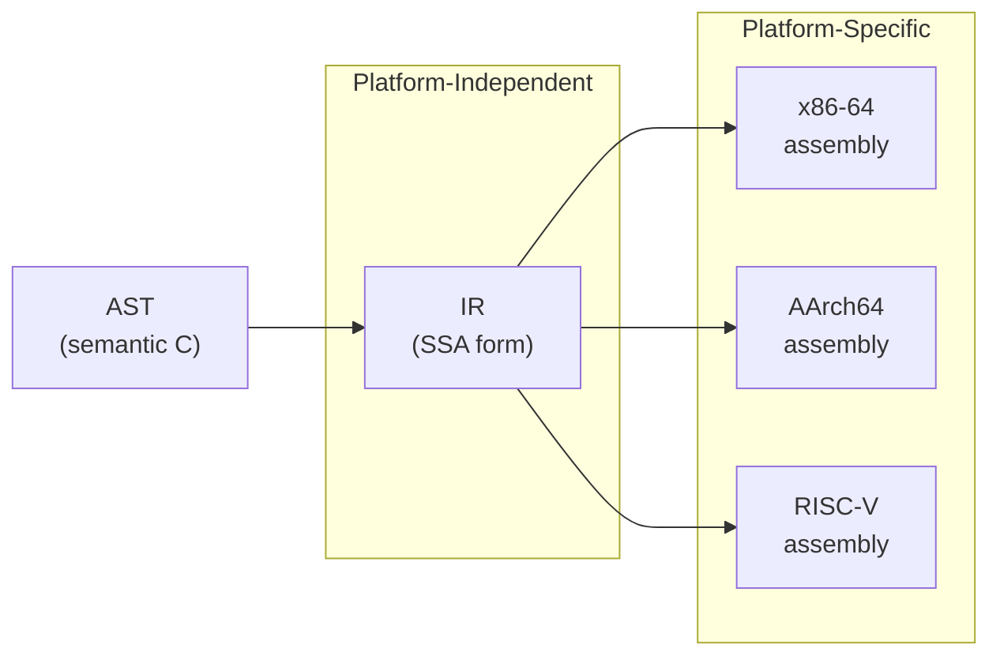
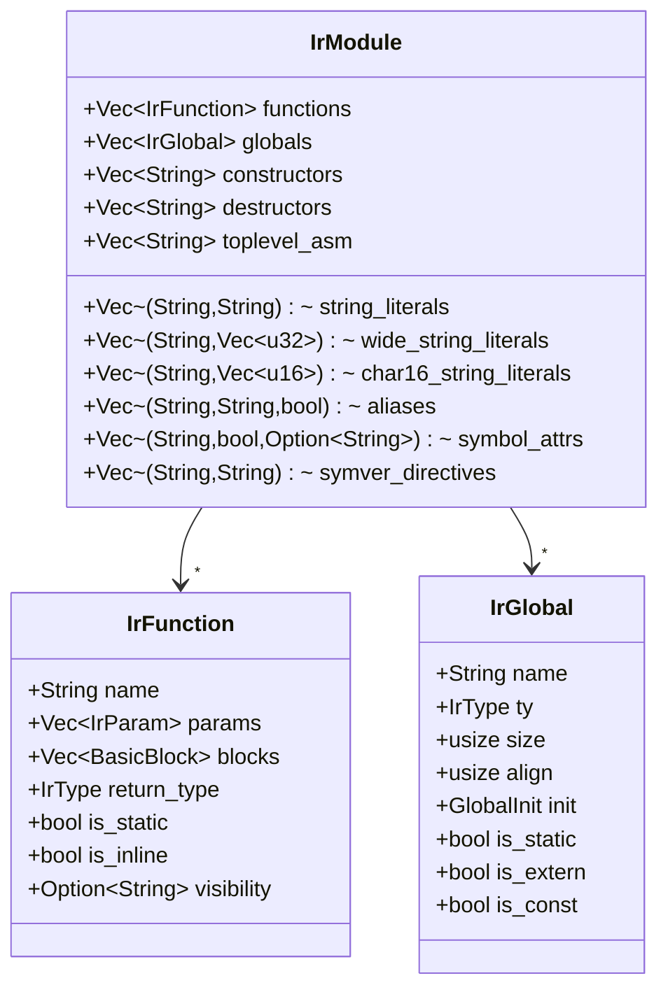
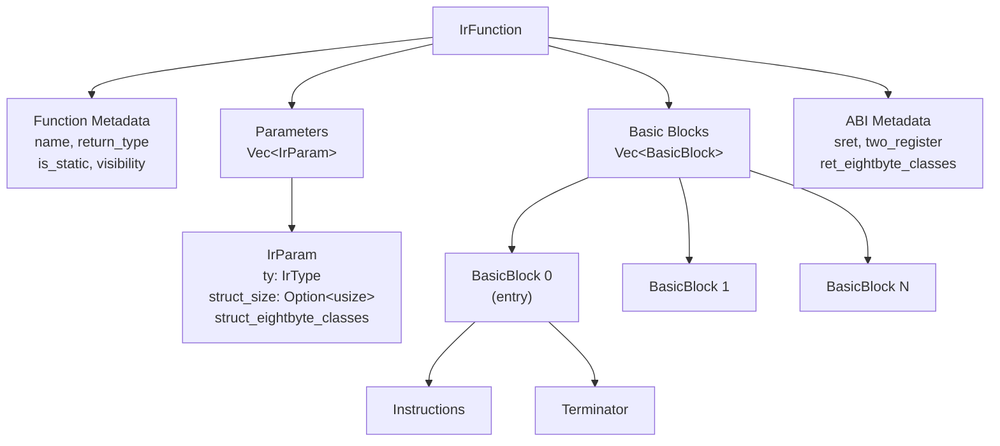
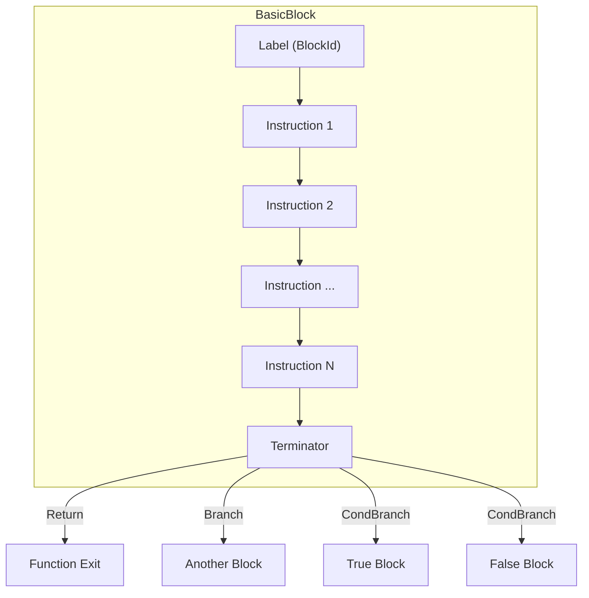
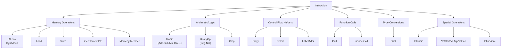
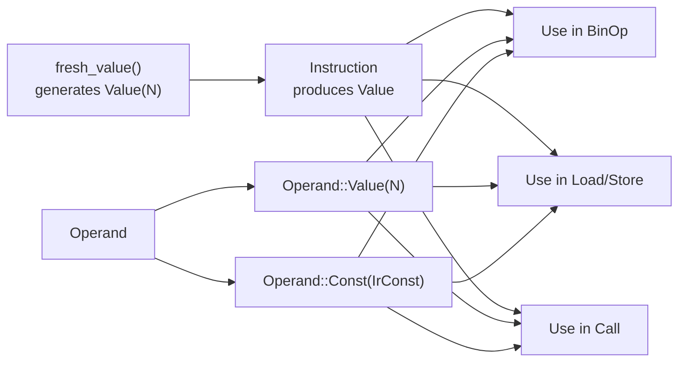
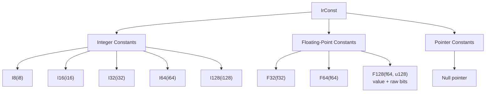
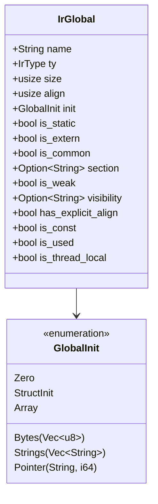
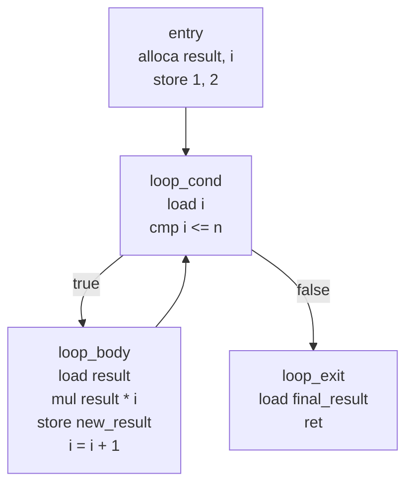

<!-- source: DeepWiki mcp.deepwiki.com · repo anthropics/claudes-c-compiler · page 3.1 IR Structure · fetched 2026-10-26 -->

# IR Structure

<details>
<summary>Relevant source files</summary>

The following files were used as context for generating this wiki page:

- [src/backend/arm/codegen/intrinsics.rs](src/backend/arm/codegen/intrinsics.rs)
- [src/backend/i686/codegen/intrinsics.rs](src/backend/i686/codegen/intrinsics.rs)
- [src/backend/riscv/codegen/intrinsics.rs](src/backend/riscv/codegen/intrinsics.rs)
- [src/backend/x86/codegen/intrinsics.rs](src/backend/x86/codegen/intrinsics.rs)
- [src/common/types.rs](src/common/types.rs)
- [src/frontend/parser/ast.rs](src/frontend/parser/ast.rs)
- [src/frontend/parser/declarations.rs](src/frontend/parser/declarations.rs)
- [src/frontend/parser/declarators.rs](src/frontend/parser/declarators.rs)
- [src/frontend/parser/expressions.rs](src/frontend/parser/expressions.rs)
- [src/frontend/parser/types.rs](src/frontend/parser/types.rs)
- [src/frontend/sema/builtins.rs](src/frontend/sema/builtins.rs)
- [src/ir/intrinsics.rs](src/ir/intrinsics.rs)
- [src/ir/lowering/definitions.rs](src/ir/lowering/definitions.rs)
- [src/ir/lowering/expr.rs](src/ir/lowering/expr.rs)
- [src/ir/lowering/expr_builtins.rs](src/ir/lowering/expr_builtins.rs)
- [src/ir/lowering/func_lowering.rs](src/ir/lowering/func_lowering.rs)
- [src/ir/lowering/lvalue.rs](src/ir/lowering/lvalue.rs)
- [src/ir/lowering/pointer_analysis.rs](src/ir/lowering/pointer_analysis.rs)
- [src/ir/lowering/stmt.rs](src/ir/lowering/stmt.rs)
- [src/ir/lowering/structs.rs](src/ir/lowering/structs.rs)
- [src/ir/lowering/types.rs](src/ir/lowering/types.rs)
- [src/ir/module.rs](src/ir/module.rs)

</details>


## Purpose and Scope

This page documents the SSA-based intermediate representation (IR) that serves as the compiler's platform-independent code representation. The IR defines `IrModule` (compilation units), `IrFunction` (SSA functions), `Instruction` (operations), `BasicBlock` (control flow units), and the `Value` system (SSA numbering). 

For information about how the frontend AST is transformed into IR, see [Type System](#3.2), [Expression Lowering](#3.3), and [Statement Lowering](#3.4). For details on IR optimization passes, see [Optimization Passes](#4).

---

## Overview of the IR

The compiler uses a Static Single Assignment (SSA) intermediate representation that bridges the semantic C AST from the frontend to the architecture-specific backends. Each source file produces one `IrModule` containing multiple `IrFunction` instances. Functions are represented as control flow graphs of `BasicBlock` nodes, where each block contains a sequence of `Instruction` operations followed by a `Terminator` that transfers control to other blocks.

### Key Design Principles



**SSA Properties:**
- Each `Value` is assigned exactly once (single assignment)
- Values are identified by unique `u32` indices
- No explicit phi nodes (handled by backend register allocation)
- Explicit memory operations (`Load`/`Store`) for all memory accesses

**Sources:** [src/ir/module.rs:1-120]()

---

## IrModule: The Compilation Unit

`IrModule` represents a complete compilation unit (one source file after preprocessing). It aggregates all functions, global variables, string literals, and linker metadata.

### IrModule Structure



### Module Components

| Component | Purpose | Example |
|-----------|---------|---------|
| `functions` | All function definitions | `main`, `helper`, static functions |
| `globals` | Global variable declarations | `int global_counter;` |
| `string_literals` | String constants | `(label, "hello\n")` |
| `wide_string_literals` | Wide strings (L"...") | `(label, [0x0068, 0x0069, 0x0000])` |
| `char16_string_literals` | UTF-16 strings (u"...") | `(label, [0x0041, 0x0042, 0x0000])` |
| `constructors` | Functions with `__attribute__((constructor))` | Run before `main` |
| `destructors` | Functions with `__attribute__((destructor))` | Run after `main` |
| `aliases` | Symbol aliases | `__attribute__((alias("target")))` |
| `toplevel_asm` | Top-level `asm("...")` directives | Emitted verbatim |
| `symbol_attrs` | External symbol attributes | `.weak`, `.hidden` directives |
| `symver_directives` | Symbol versioning | `__attribute__((symver("name@@VERSION")))` |

**Sources:** [src/ir/module.rs:11-33]()

---

## IrFunction: SSA Function Representation

Each function is represented as a control flow graph of basic blocks with SSA value numbering. The function structure includes parameters (with ABI decomposition metadata), local allocas, and control flow blocks.

### IrFunction Components



### IrParam Structure

Each parameter carries type information and ABI metadata for correct calling convention handling:

| Field | Type | Purpose |
|-------|------|---------|
| `ty` | `IrType` | IR type of the parameter |
| `struct_size` | `Option<usize>` | Size for struct parameters |
| `struct_eightbyte_classes` | `Vec<EightbyteClass>` | SysV AMD64 classification (INTEGER/SSE) |
| `struct_riscv_float_class` | `Option<RiscvFloatClass>` | RISC-V LP64D float struct detection |
| `struct_align` | `Option<usize>` | Alignment for struct parameters |

**ABI-specific parameter decomposition:**
- **sret (struct return):** Large structs (>16 bytes on x86-64) are returned via a hidden pointer parameter prepended to the parameter list
- **Complex numbers:** `_Complex float` and `_Complex double` are decomposed into two FP registers or packed into a single register depending on the ABI
- **Two-register returns:** Structs of 9-16 bytes on x86-64 are returned in two registers (e.g., `rax:rdx`)

**Sources:** [src/ir/module.rs:35-106]()

---

## Basic Blocks and Control Flow

Functions are represented as control flow graphs where each `BasicBlock` contains a linear sequence of instructions followed by a single `Terminator` that transfers control.

### BasicBlock Structure



### Terminator Types

Each basic block ends with exactly one terminator:

| Terminator | Syntax | Purpose |
|------------|--------|---------|
| `Return { value: Option<Operand> }` | `ret` / `ret %42` | Return from function |
| `Branch { target: BlockId }` | `br label %bb2` | Unconditional jump |
| `CondBranch { cond: Operand, true_bb: BlockId, false_bb: BlockId }` | `br i1 %cond, label %then, label %else` | Conditional branch |
| `Switch { scrutinee: Operand, cases: Vec<(i64, BlockId)>, default_bb: BlockId }` | `switch i64 %val, label %default [...]` | Multi-way branch |
| `Unreachable` | `unreachable` | Terminates control flow (trap/abort) |

**Control Flow Invariants:**
- Every block must have exactly one terminator
- The entry block (block 0) is the function entry point
- Blocks are indexed sequentially (`BlockId(0)`, `BlockId(1)`, ...)
- No cycles are explicitly represented (SSA form handles loop phis via backend)

**Sources:** [src/ir/instruction.rs:1-50]() (inferred from usage in [src/ir/lowering/stmt.rs:30-800]())

---

## Instructions

Instructions represent individual operations within basic blocks. Each instruction produces zero or one SSA value (identified by a `Value(u32)`).

### Instruction Categories



### Key Instruction Examples

#### Memory Operations

```
// Stack allocation (fixed size)
%1 = alloca i32, size 4, align 4

// Dynamic stack allocation (VLA)
%2 = dynalloca i64 %size, align 16

// Load from memory
%3 = load i32, ptr %1

// Store to memory
store i32 42, ptr %1

// Get element pointer (address arithmetic)
%4 = getelementptr ptr %base, i64 16

// Bulk memory operations
memcpy ptr %dest, ptr %src, size 64
memset ptr %dest, i8 0, size 64
```

#### Arithmetic and Logical Operations

```
// Binary operations
%5 = add i64 %a, %b
%6 = mul i32 %x, %y
%7 = and i64 %p, 0xFF
%8 = shl i32 %val, 3

// Comparison
%9 = cmp eq i32 %a, %b
%10 = cmp slt i64 %x, 100

// Unary operations
%11 = neg f64 %val
%12 = not i64 %mask
```

#### Function Calls

```
// Direct call
%13 = call i32 @printf(ptr %fmt, i64 %arg)

// Indirect call through function pointer
%14 = indirectcall ptr %fptr, [i64 %arg1, i64 %arg2]
```

#### Type Conversions

```
// Integer/float/pointer casts
%15 = cast i32 %val to i64     // Sign-extend
%16 = cast f32 %f to f64       // Float extend
%17 = cast i64 %i to ptr       // Int to pointer
```

#### Special Operations

```
// Hardware intrinsics (SSE, NEON, etc.)
%18 = intrinsic Paddd(ptr %a, ptr %b) -> ptr %dest

// Inline assembly
%19 = inlineasm "movq %gs:0, $0" outputs [%dest] inputs []

// Variable argument list operations
vastart ptr %ap
%20 = vaarg ptr %ap, i64
vaend ptr %ap
```

**Sources:** [src/ir/lowering/expr.rs:1-558](), [src/ir/lowering/stmt.rs:1-1500]()

---

## SSA Values and Operands

The IR uses SSA form where each value is assigned exactly once. Values are represented by `Value(u32)` indices that are generated sequentially during lowering.

### Value System



### Operand Representation

Instructions consume `Operand` arguments which can be either SSA values or constants:

```rust
// Operand enum (inferred from usage)
enum Operand {
    Value(Value),      // SSA value reference
    Const(IrConst),    // Compile-time constant
}

// Value is a newtype wrapper around u32
struct Value(u32);
```

**Value Generation Example:**

```
// Lowering: int x = a + b;
%1 = load i32, ptr %a_alloca              // fresh_value() → Value(1)
%2 = load i32, ptr %b_alloca              // fresh_value() → Value(2)
%3 = add i32 %1, %2                       // fresh_value() → Value(3)
store i32 %3, ptr %x_alloca
```

**SSA Invariants:**
- Each `Value(N)` is defined by exactly one instruction
- Values are numbered monotonically increasing
- No explicit phi nodes (loops handled by backend register allocation)
- Memory is accessed explicitly via `Load`/`Store` (not SSA-ified)

**Sources:** [src/ir/lowering/expr.rs:364-383](), [src/ir/instruction.rs:1-50]() (inferred)

---

## IrType: The IR Type System

The IR uses a simplified type system that abstracts away C's type qualifiers and complex declarators. Each `IrType` represents a value's bit-width and interpretation.

### IrType Enumeration

| IrType | Size | Description |
|--------|------|-------------|
| `Void` | 0 | No value (function return only) |
| `I8` | 1 byte | Signed 8-bit integer (`char`) |
| `U8` | 1 byte | Unsigned 8-bit integer (`unsigned char`, `_Bool`) |
| `I16` | 2 bytes | Signed 16-bit integer (`short`) |
| `U16` | 2 bytes | Unsigned 16-bit integer (`unsigned short`) |
| `I32` | 4 bytes | Signed 32-bit integer (`int`) |
| `U32` | 4 bytes | Unsigned 32-bit integer (`unsigned int`) |
| `I64` | 8 bytes | Signed 64-bit integer (`long`, `long long`) |
| `U64` | 8 bytes | Unsigned 64-bit integer (`unsigned long`, `unsigned long long`) |
| `I128` | 16 bytes | Signed 128-bit integer (`__int128`) |
| `U128` | 16 bytes | Unsigned 128-bit integer (`unsigned __int128`) |
| `F32` | 4 bytes | IEEE 754 single precision (`float`) |
| `F64` | 8 bytes | IEEE 754 double precision (`double`) |
| `F128` | 16 bytes | IEEE 754 quadruple precision (`long double` on AArch64/RISC-V)<br/>x87 80-bit extended precision (`long double` on x86) |
| `Ptr` | 4/8 bytes | Pointer (size depends on target: 4 bytes on i686, 8 bytes on x86-64/AArch64/RISC-V) |

### Type Selection by Target

The `target_int_ir_type()` function returns the natural word type for the target:

```
LP64 (x86-64, AArch64, RISC-V):   Ptr = 8 bytes, target_int_ir_type() → I64
ILP32 (i686):                      Ptr = 4 bytes, target_int_ir_type() → I32
```

**Complex and Aggregate Types:**

Complex numbers (`_Complex float`, `_Complex double`) and structs/unions are represented as `Ptr` in the IR — they are accessed via explicit memory operations (`Load`/`Store`/`Memcpy`) rather than being loaded into SSA values directly.

**Type Promotion:**

The `widened_op_type()` function determines the operation width for arithmetic:
- **LP64:** All integer operations widened to `I64` (machine word)
- **ILP32:** Operations stay at natural width (`I32` for int, `I64` for long long)

**Sources:** [src/common/types.rs:1-150](), [src/ir/lowering/types.rs:171-232]()

---

## IrConst: Constant Values

`IrConst` represents compile-time constant values that can appear directly in instructions without allocating SSA values.

### IrConst Variants



### Constant Usage

Constants appear directly in `Operand::Const` positions:

```
// Integer constant
%1 = add i64 %x, 42

// Float constant
%2 = fadd f64 %y, 3.14

// Null pointer
store ptr 0, ptr %ptr_var

// Constant in comparison
%3 = cmp eq i32 %status, 0
```

**Long Double Representation:**

`IrConst::F128` stores both the `f64` approximation (for constant folding) and the raw 128-bit encoding:

```rust
// From usage in lowering
IrConst::F128 { value: f64, bytes: u128 }
```

On x86/i686, this represents x87 80-bit extended precision stored in 128 bits (padded). On AArch64/RISC-V, it represents IEEE 754 binary128.

**Sources:** [src/ir/constants.rs:1-50]() (inferred from usage in [src/ir/lowering/expr.rs:114-122]())

---

## IrGlobal: Global Variable Declarations

Global variables are declared at module level with initializers and linkage metadata.

### IrGlobal Structure



### GlobalInit Variants

| Variant | Purpose | Example |
|---------|---------|---------|
| `Zero` | Zero-initialized (`.bss` section) | `int uninit;` |
| `Bytes(Vec<u8>)` | Arbitrary byte sequence | Packed struct initializer |
| `Strings(Vec<String>)` | Array of string literal references | `char *strs[] = {"a", "b"};` |
| `Pointer(String, i64)` | Pointer to symbol + offset | `&global_var + 4` |
| `StructInit { fields: Vec<GlobalInit>, ... }` | Nested struct initializer | `struct S s = { .a = 1, .b = 2 };` |
| `Array { elements: Vec<GlobalInit>, ... }` | Array initializer | `int arr[] = {1, 2, 3};` |

### Global Variable Example

```c
// C source
static const int table[3] = {10, 20, 30};
extern volatile int shared_counter;
__thread int per_cpu_var = 0;
```

```
// IR globals
global @table, i32, size 12, align 4, init Array([I32(10), I32(20), I32(30)]),
       is_static=true, is_const=true

global @shared_counter, i32, size 4, align 4, init Zero,
       is_extern=true, is_volatile=true

global @per_cpu_var, i32, size 4, align 4, init I32(0),
       is_thread_local=true
```

**Linkage and Visibility:**

- **`is_static`:** Internal linkage (file-local symbol)
- **`is_extern`:** External linkage (declaration, defined elsewhere)
- **`is_common`:** Tentative definition (merged by linker)
- **`is_weak`:** Weak symbol (can be overridden)
- **`visibility`:** ELF visibility (`"hidden"`, `"protected"`, `"default"`)
- **`section`:** Place in custom ELF section (e.g., `".init.data"`)

**Thread-Local Storage:**

Variables with `is_thread_local=true` are emitted with `.tls` directives and accessed via TLS models (Local Exec, Initial Exec, General Dynamic, Local Dynamic) depending on linkage.

**Sources:** [src/ir/module.rs:108-145](), [src/ir/lowering/stmt.rs:387-518]()

---

## Putting It All Together: Example

### C Source

```c
int factorial(int n) {
    int result = 1;
    for (int i = 2; i <= n; i++) {
        result = result * i;
    }
    return result;
}
```

### IR Representation

```
function @factorial(i32 %n) -> i32 {
entry:
  %result_alloca = alloca i32, size 4, align 4
  store i32 1, ptr %result_alloca
  %i_alloca = alloca i32, size 4, align 4
  store i32 2, ptr %i_alloca
  br label %loop_cond

loop_cond:
  %i = load i32, ptr %i_alloca
  %cond = cmp sle i32 %i, %n
  br i1 %cond, label %loop_body, label %loop_exit

loop_body:
  %result = load i32, ptr %result_alloca
  %new_result = mul i32 %result, %i
  store i32 %new_result, ptr %result_alloca
  %next_i = add i32 %i, 1
  store i32 %next_i, ptr %i_alloca
  br label %loop_cond

loop_exit:
  %final_result = load i32, ptr %result_alloca
  ret i32 %final_result
}
```

### Control Flow Graph



**Key IR Features Demonstrated:**

1. **Function signature:** `@factorial(i32 %n) -> i32`
2. **Entry block allocas:** Variables stored on stack via `alloca`
3. **SSA values:** Each `load` produces a new SSA value
4. **Basic blocks:** `entry`, `loop_cond`, `loop_body`, `loop_exit`
5. **Terminators:** `br`, `ret`
6. **Memory operations:** Explicit `load`/`store` for all variable access
7. **Arithmetic:** `mul`, `add` on SSA values

**Sources:** [src/ir/lowering/stmt.rs:30-1500](), [src/ir/lowering/expr.rs:111-558]()

---

