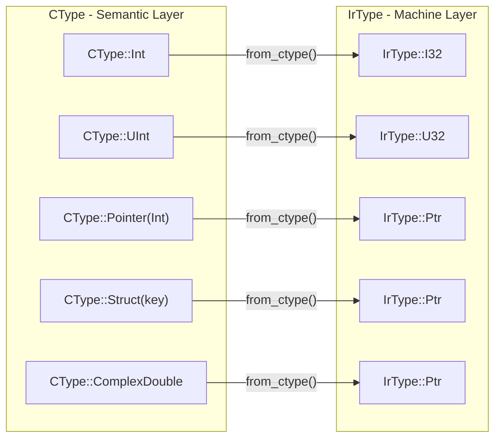
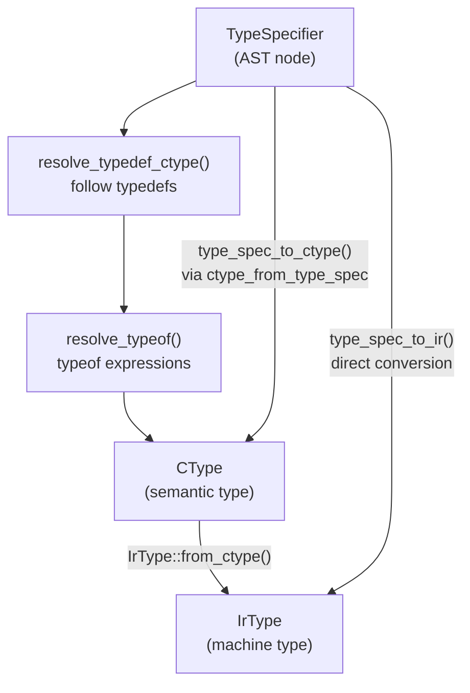
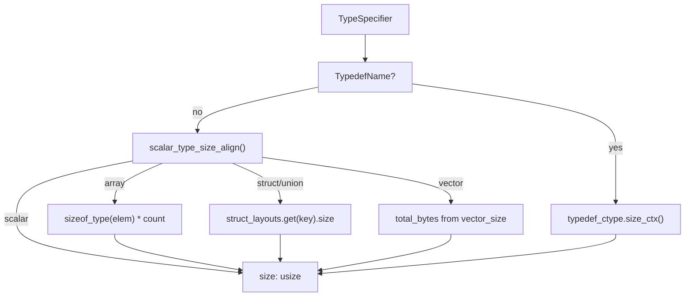
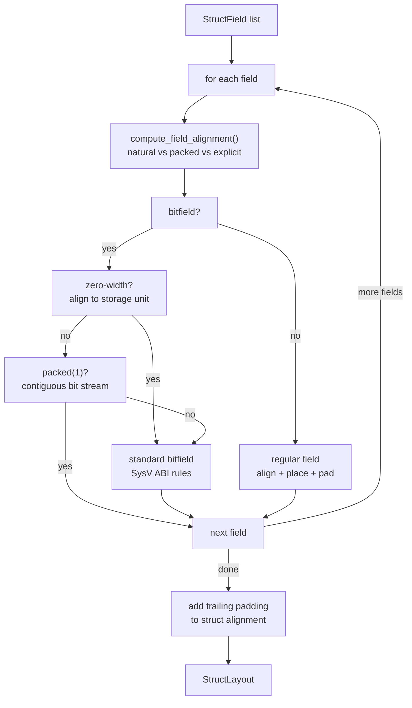
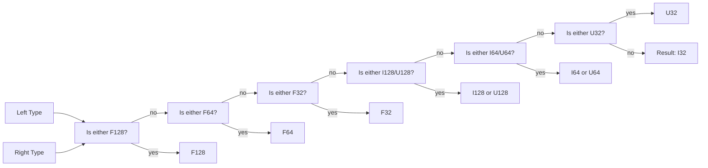
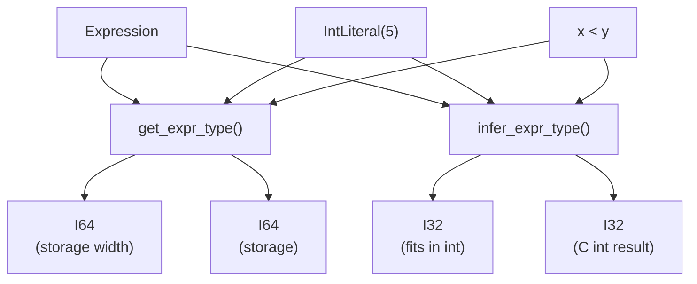
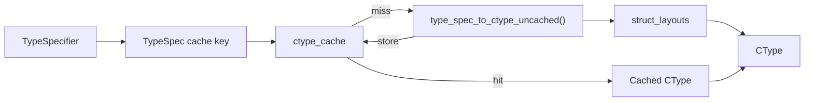

<!-- source: DeepWiki mcp.deepwiki.com · repo anthropics/claudes-c-compiler · page 3.2 Type System · fetched 2026-10-26 -->

# Type System

<details>
<summary>Relevant source files</summary>

The following files were used as context for generating this wiki page:

- [src/common/types.rs](src/common/types.rs)
- [src/frontend/parser/ast.rs](src/frontend/parser/ast.rs)
- [src/frontend/parser/declarations.rs](src/frontend/parser/declarations.rs)
- [src/frontend/parser/declarators.rs](src/frontend/parser/declarators.rs)
- [src/frontend/parser/expressions.rs](src/frontend/parser/expressions.rs)
- [src/frontend/parser/types.rs](src/frontend/parser/types.rs)
- [src/frontend/sema/const_eval.rs](src/frontend/sema/const_eval.rs)
- [src/frontend/sema/type_checker.rs](src/frontend/sema/type_checker.rs)
- [src/ir/lowering/complex.rs](src/ir/lowering/complex.rs)
- [src/ir/lowering/const_eval.rs](src/ir/lowering/const_eval.rs)
- [src/ir/lowering/definitions.rs](src/ir/lowering/definitions.rs)
- [src/ir/lowering/expr.rs](src/ir/lowering/expr.rs)
- [src/ir/lowering/expr_calls.rs](src/ir/lowering/expr_calls.rs)
- [src/ir/lowering/expr_types.rs](src/ir/lowering/expr_types.rs)
- [src/ir/lowering/global_init.rs](src/ir/lowering/global_init.rs)
- [src/ir/lowering/global_init_bytes.rs](src/ir/lowering/global_init_bytes.rs)
- [src/ir/lowering/global_init_compound.rs](src/ir/lowering/global_init_compound.rs)
- [src/ir/lowering/lvalue.rs](src/ir/lowering/lvalue.rs)
- [src/ir/lowering/pointer_analysis.rs](src/ir/lowering/pointer_analysis.rs)
- [src/ir/lowering/stmt.rs](src/ir/lowering/stmt.rs)
- [src/ir/lowering/stmt_init.rs](src/ir/lowering/stmt_init.rs)
- [src/ir/lowering/stmt_return.rs](src/ir/lowering/stmt_return.rs)
- [src/ir/lowering/structs.rs](src/ir/lowering/structs.rs)
- [src/ir/lowering/types.rs](src/ir/lowering/types.rs)

</details>


## Purpose and Scope

The type system in Claude's C Compiler maintains a **dual-level type representation** to bridge high-level C semantics with low-level machine code generation. This page documents:

- **CType**: Semantic C types that preserve source-level information (signedness, struct/union identity, typedef names)
- **IrType**: Machine-level types used in SSA intermediate representation
- Type conversion, promotion, and sizing rules
- Struct/union layout computation with bitfields, packing, and alignment
- Target-specific type handling (ILP32 vs LP64, long double representations)

For information about how types are lowered from AST to IR during code generation, see [Expression Lowering](#3.3). For ABI-specific struct passing and return conventions, see [ABI Handling](#3.5).

---

## Dual Type System: CType and IrType

The compiler maintains two parallel type systems to separate concerns:

**CType (Semantic Types)** - Defined in [src/common/types.rs:176-219]()
- Preserves source-level C type information
- Distinguishes `int` vs `unsigned int`, `struct Foo` vs `struct Bar`
- Tracks pointer address spaces (`__seg_gs`, `__seg_fs`)
- Stores function signatures, array dimensions, enum variants
- Used for type checking, constant evaluation, and ABI decisions

**IrType (Machine Types)** - Referenced throughout lowering
- Simple machine-level scalar types: `I8`, `I16`, `I32`, `I64`, `U8`, `U16`, `U32`, `U64`, `F32`, `F64`, `F128`, `Ptr`, `Void`
- Used in IR instructions for register allocation and code generation
- All pointers collapse to `Ptr` regardless of pointee type
- Struct/union/complex values represented as `Ptr` (address of aggregate)



**Diagram: CType to IrType Mapping**

Sources: [src/common/types.rs:176-219](), [src/ir/lowering/types.rs:171-232]()

---

## Type Resolution Pipeline

Type resolution flows through multiple stages from AST to IR:



**Diagram: Type Resolution Flow**

### TypeSpecifier Resolution

The parser produces `TypeSpecifier` AST nodes that may contain indirection through typedefs or `typeof` expressions. The lowerer resolves these layers:

**resolve_type_spec()** - [src/ir/lowering/types.rs:22-32]()
- Follows `TypeofType` wrappers up to 32 levels deep
- Returns the underlying concrete `TypeSpecifier`
- Does not resolve `TypedefName` (handled separately via CType)

**resolve_typedef_ctype()** - [src/ir/lowering/types.rs:37-44]()
- Looks up typedef names in `TypeContext::typedefs` map
- Returns the resolved `CType` for the typedef
- Handles `typeof(expr)` by evaluating the expression's type

**resolve_typeof()** - [src/ir/lowering/types.rs:96-129]()
- Resolves `typeof(expr)` to a concrete `TypeSpecifier`
- Evaluates expression type and converts back to AST form
- Handles nested `typeof(typeof(...))` chains

### CType Construction

**type_spec_to_ctype()** - Referenced in [src/ir/lowering/types_ctype.rs]()
- Primary entry point for semantic type construction
- Handles all C type categories: scalars, pointers, arrays, functions, aggregates
- Resolves struct/union layouts from `TypeContext::struct_layouts`
- Caches results in `ctype_cache` to avoid redundant work

**build_full_ctype()** - Used for complex declarators
- Applies derived declarators (pointer, array, function) to base type
- Constructs nested `CType::Pointer`, `CType::Array`, `CType::Function`
- Handles function pointer typedef unwrapping

Sources: [src/ir/lowering/types.rs:22-44](), [src/ir/lowering/types.rs:96-129](), [src/ir/lowering/types_ctype.rs]()

---

## Type Sizing and Alignment

### Target-Specific Configuration

The type system adapts to different target architectures through thread-local configuration:

**Target Pointer Size** - [src/common/types.rs:13-34]()
- `target_ptr_size()`: Returns 4 for i686/ILP32, 8 for x86-64/LP64
- `target_is_32bit()`: Boolean check for 32-bit targets
- `set_target_ptr_size()`: Configured at compilation start

**Long Double Representation** - [src/common/types.rs:36-45]()
- x86/i686: 80-bit x87 extended precision (12/16 bytes storage)
- AArch64/RISC-V: IEEE 754 binary128 (16 bytes)
- Controlled by `target_long_double_is_f128()`

| Type | ILP32 (i686) | LP64 (x86-64) | Notes |
|------|--------------|---------------|-------|
| `char` | 1 byte, align 1 | 1 byte, align 1 | |
| `short` | 2 bytes, align 2 | 2 bytes, align 2 | |
| `int` | 4 bytes, align 4 | 4 bytes, align 4 | |
| `long` | **4 bytes**, align 4 | **8 bytes**, align 8 | ILP32 vs LP64 |
| `long long` | 8 bytes, **align 4** | 8 bytes, **align 8** | i686 aligns to 4 |
| `float` | 4 bytes, align 4 | 4 bytes, align 4 | |
| `double` | 8 bytes, **align 4** | 8 bytes, **align 8** | i686 aligns to 4 |
| `long double` | **12 bytes**, align 4 | **16 bytes**, align 16 | x87 80-bit vs f128 |
| pointer | **4 bytes**, align 4 | **8 bytes**, align 8 | Target word size |

**Table: Target-Specific Type Sizes**

### Sizeof and Alignof Computation

**sizeof_type()** - [src/ir/lowering/types.rs:357-401]()
- Handles all type categories with target-aware sizing
- Recursively computes array sizes: `elem_size * array_count`
- Looks up struct/union layouts from cache
- Evaluates VLA size expressions for runtime arrays
- Special handling for packed enums and vector types

**alignof_type()** - [src/ir/lowering/types.rs:404-442]()
- Returns `_Alignof` alignment (C11 semantics)
- Incorporates typedef alignment overrides from `__attribute__((aligned))`
- For arrays, returns element alignment (not array size)
- For structs, returns layout's computed alignment

**preferred_alignof_type()** - [src/ir/lowering/types.rs:446-492]()
- Returns `__alignof__` alignment (GCC extension)
- On i686: `long long` and `double` prefer 8-byte alignment (vs ABI's 4-byte)
- Used for stack alignment decisions in `__builtin_alloca_with_align`



**Diagram: sizeof_type() Resolution Flow**

Sources: [src/common/types.rs:6-82](), [src/ir/lowering/types.rs:236-278](), [src/ir/lowering/types.rs:357-492]()

---

## Struct and Union Layout

### Layout Computation

**StructLayout** - [src/common/types.rs:293-307]()
- `fields`: Vector of `StructFieldLayout` with name, offset, CType, bitfield info
- `size`: Total size including trailing padding
- `align`: Required alignment of the struct
- `is_union`: All fields at offset 0 for unions
- `is_transparent_union`: ABI passes as first member type

**StructLayoutBuilder** - [src/common/types.rs:310-333]()
- Stateful builder for incremental layout computation
- Tracks current offset, maximum alignment, bitfield packing state
- Handles `__attribute__((packed))` and `#pragma pack(N)`
- Per-field alignment overrides from `_Alignas` or `__attribute__((aligned))`



**Diagram: Struct Layout Algorithm**

### Bitfield Handling

Bitfields require careful bit-level packing with storage unit alignment:

**Standard (SysV) Bitfields** - [src/common/types.rs:404-458]()
- Each bitfield occupies a storage unit of its declared type size
- Bitfields cannot span storage unit boundaries
- When a bitfield doesn't fit in the current unit, start a new aligned unit
- Alignment respects the storage type (e.g., `unsigned int x:5` aligns to 4 bytes)

**Packed Bitfields** (`#pragma pack(1)` or `__attribute__((packed))`) - [src/common/types.rs:371-402]()
- Contiguous bit stream across all bitfields
- May span storage unit boundaries
- Minimal alignment (1 byte)
- Storage type widened if bitfield spans beyond declared type

Example:
```c
struct Standard {
    unsigned int a : 5;  // bits 0-4 of byte 0-3
    unsigned int b : 28; // bits 5-32 (spans), moves to byte 4-7
    unsigned int c : 3;  // bits 0-2 of byte 8-11
} __attribute__((aligned(4)));

struct Packed {
    unsigned int a : 5;  // bits 0-4 of byte 0
    unsigned int b : 28; // bits 5-32 of byte 0-4 (spans boundaries)
    unsigned int c : 3;  // bits 33-35 of byte 4
} __attribute__((packed));
```

**Zero-Width Bitfields** - [src/common/types.rs:357-369]()
- `int : 0` forces alignment to next storage unit boundary
- Terminates current bitfield run
- Used to ensure subsequent fields start on natural boundaries

Sources: [src/common/types.rs:293-458](), [src/ir/lowering/types.rs:319-355]()

---

## Type Conversion and Promotion

### Integer Promotion

**Integer Promotion Rules** (C11 6.3.1.1) - [src/ir/lowering/expr_types.rs:23-31]()
- All sub-`int` types (`char`, `short`, `bool`) promote to `int`
- `I8`, `U8`, `I16`, `U16` → `I32`
- Applied before binary operations and unary `+`, `-`, `~`

**Bitfield Promotion** - [src/ir/lowering/expr_types.rs:41-67]()
- Special rules for bitfield member access
- If all values fit in `int`, promote to `int`
- Unsigned bitfield with width ≤ 31 → `I32`
- Unsigned bitfield with width = 32 → `U32`
- Signed bitfield with width ≤ 32 → `I32`

### Usual Arithmetic Conversions

**common_type()** - [src/ir/lowering/expr.rs:489-513]()
- Applied to binary operation operands
- Float > integer (F128 > F64 > F32)
- Wider type wins within same category
- Unsigned promoted over signed at same width



**Diagram: Usual Arithmetic Conversions Algorithm**

### Implicit Casts

**emit_implicit_cast()** - [src/ir/lowering/expr.rs:523-542]()
- Inserted automatically during expression lowering
- Required when source and target types differ
- Handles int ↔ float, sign conversions, width changes
- Skips no-op casts (e.g., `Ptr` → `Ptr`)

**Cast Instruction Types**:
- `Cast { from_ty: IrType, to_ty: IrType }`: General type conversion
- Uses machine instructions: sign-extend (`movsx`), zero-extend (`movzx`), truncate, `cvtsi2sd` (int→float), `cvttsd2si` (float→int)

Sources: [src/ir/lowering/expr.rs:489-556](), [src/ir/lowering/expr_types.rs:23-67]()

---

## Expression Type Inference

The lowerer infers types for expressions to guide code generation:

### get_expr_type() vs infer_expr_type()

**get_expr_type()** - [src/ir/lowering/expr_types.rs:485-683]()
- Returns the **IR storage type** for an expression
- All literals return `I64` (storage width)
- Used for instruction selection and operand sizing

**infer_expr_type()** - [src/ir/lowering/expr.rs:396-487]()
- Returns the **C semantic type** for arithmetic conversions
- Literals return their actual range type (`IntLiteral` in i32 range → `I32`)
- Used for common_type() decisions in binary operations
- Comparison and logical operators return `I32` (C `int` result)



**Diagram: get_expr_type() vs infer_expr_type() Distinction**

### Binary Operation Type Resolution

**get_binop_type()** - [src/ir/lowering/expr_types.rs:378-451]()
- Comparison/logical operators: `I32` (C `int`)
- Shift operators: Promoted left operand type only
- Arithmetic operators: `common_type(lhs, rhs)` via usual arithmetic conversions
- Pointer subtraction: `target_int_ir_type()` (ptrdiff_t)
- Complex operands: Returns `Ptr` (address of complex result)

### Type Inference for Special Expressions

**Array Subscript** - [src/ir/lowering/expr_types.rs:467-484]()
- Element type of array: `CType::Array(elem, _)` → `IrType::from_ctype(elem)`
- Pointee type of pointer: `CType::Pointer(pointee, _)` → `IrType::from_ctype(pointee)`
- Works for both `arr[idx]` and `idx[arr]` (commutative)

**Function Call Return** - [src/ir/lowering/expr_types.rs:485-550]()
- Direct call: Lookup in `known_functions` map or global `FunctionInfo`
- Indirect call: Extract return type from function pointer's `CType::Function`
- Builtin call: `builtin_return_type()` maps ~60 builtins to specific IrTypes

**Struct Member Access** - [src/ir/lowering/expr_types.rs:615-683]()
- Resolve base struct layout via `resolve_field_ctype()`
- Look up field by name in `StructLayout::fields`
- Return field's IrType: `IrType::from_ctype(&field.ty)`
- Handle bitfields: Return storage type with bit offset/width metadata

Sources: [src/ir/lowering/expr_types.rs:378-683](), [src/ir/lowering/expr.rs:396-487]()

---

## Specialized Type Handling

### Complex Types

C99 `_Complex` types represent complex numbers as pairs of floats:

**Representation** - [src/ir/lowering/complex.rs:1-12]()
- `_Complex float`: `[f32 real, f32 imag]` = 8 bytes, align 4
- `_Complex double`: `[f64 real, f64 imag]` = 16 bytes, align 8
- `_Complex long double`: `[f128 real, f128 imag]` = 32 bytes (x86-64), 24 bytes (i686)

**IrType Mapping** - [src/ir/lowering/complex.rs:28-36]()
- All complex values represented as `IrType::Ptr`
- Points to stack-allocated `{real, imag}` pair
- Component access via `load_complex_real()`, `load_complex_imag()`

**Arithmetic Operations** - [src/ir/lowering/complex.rs:189-429]()
- Addition: `(a+bi) + (c+di) = (a+c) + (b+d)i`
- Multiplication: `(a+bi) * (c+di) = (ac-bd) + (ad+bc)i`
- Division: Uses complex conjugate multiplication
- All operations return fresh stack allocas with computed results

### Vector Types

GCC `__attribute__((vector_size(N)))` extension:

**Representation** - [src/common/types.rs:214-218]()
- `CType::Vector(elem_type, total_bytes)`
- E.g., `int __attribute__((vector_size(16)))` = 4 × i32 elements
- Small vectors (≤16 bytes) passed in SIMD registers
- Large vectors passed via memory (sret-like)

**IrType Mapping**:
- Vector variables: `IrType::Ptr` (address of vector data)
- SIMD intrinsics operate on vector elements directly

### Enum Types

**Unpacked Enums** - [src/common/types.rs:252-268]()
- Default: 4 bytes (C `int`)
- Extended: 8 bytes if any variant exceeds i32/u32 range
- Signedness: Determined by variant values (unsigned if any value > i32::MAX)

**Packed Enums** (`__attribute__((packed))`) - [src/common/types.rs:269-290]()
- Minimum integer type that fits all variants
- Signed range: 1 byte (-128..127), 2 bytes (-32768..32767), etc.
- Unsigned range: 1 byte (0..255), 2 bytes (0..65535), etc.
- Reduces memory footprint for enums with small value ranges

Sources: [src/ir/lowering/complex.rs:1-36](), [src/common/types.rs:214-290]()

---

## Type Context and Caching

The `TypeContext` maintains shared type information across compilation:

**TypeContext Fields** - [src/frontend/sema/type_context.rs]()
- `typedefs`: Map of typedef name → CType
- `struct_layouts`: Map of struct/union key → RcLayout (reference-counted)
- `enum_constants`: Map of enum variant name → i64 value
- `typedef_alignments`: Explicit `__attribute__((aligned))` overrides
- `func_ptr_typedefs`: Set of typedef names that are function pointers

**Layout Caching** - [src/ir/lowering/types.rs:281-317]()
- Struct/union layouts computed once and cached by key
- Keys: `"struct.TagName"`, `"union.TagName"`, or `"__anon_N"` for anonymous
- Reference-counted (`Rc<StructLayout>`) for cheap cloning
- Scoped updates: `insert_struct_layout_scoped()` tracks changes for unwinding

**CType Caching** - Referenced in [src/ir/lowering/types_ctype.rs]()
- Memoizes `type_spec_to_ctype()` results in `ctype_cache`
- Avoids redundant struct layout lookups and array dimension evaluation
- Invalidated when struct definitions are redefined in inner scopes



**Diagram: CType Caching Flow**

Sources: [src/frontend/sema/type_context.rs](), [src/ir/lowering/types.rs:281-317](), [src/ir/lowering/types_ctype.rs]()

---

## Key Algorithms

### Type Compatibility Checking

**ctypes_compatible()** - [src/ir/lowering/types.rs:149-169]()
- Used by `__builtin_types_compatible_p(type1, type2)`
- Structural equality with special rules:
  - Enums compatible with `int`
  - Pointers compatible if pointee types compatible
  - Arrays compatible if element types match and sizes match (or both unsized)
  - Structs/unions compatible if same key (name + fields)
- Ignores top-level qualifiers (`const`, `volatile`)

### Declaration Analysis

**analyze_declaration()** - [src/ir/lowering/definitions.rs]()
- Computes full type information for a declarator
- Returns `DeclAnalysis` with:
  - `var_ty`: IrType for the variable
  - `base_ty`: IrType for array elements or struct base
  - `is_array`, `is_pointer`, `is_struct`: Type category flags
  - `elem_size`, `alloc_size`: Size computations
  - `struct_layout`: Cached layout for struct/union types
  - `array_dim_strides`: Multidimensional array indexing strides

**Derived Declarator Application**:
- Pointer: `base_type` → `CType::Pointer(base_type)`
- Array: `base_type` → `CType::Array(base_type, size)`
- Function: `base_type` → `CType::Function(FunctionType { return_type: base_type, ... })`
- Applied right-to-left (innermost first)

Sources: [src/ir/lowering/types.rs:149-169](), [src/ir/lowering/definitions.rs](), [src/ir/lowering/stmt.rs:102-155]()

---

## Integration with Lowering

The type system interfaces with expression and statement lowering:

**Expression Type Usage** - [src/ir/lowering/expr.rs:111-201]()
- `lower_expr()`: Produces `Operand` with implicit type
- `lower_expr_with_type()`: Produces typed operand, inserting cast if needed
- `get_expr_type()`: Determines operand IrType for instruction selection
- `common_type()`: Resolves binary operation result type

**Statement Type Usage** - [src/ir/lowering/stmt.rs:80-155]()
- `analyze_declaration()`: Computes allocation size and layout
- `lower_local_decl()`: Emits `Alloca` instruction with computed size/align
- Type-driven initialization: Scalars vs arrays vs structs

**ABI Type Usage** - See [ABI Handling](#3.5)
- Struct return classification by size
- Parameter passing (registers vs stack)
- Complex number decomposition (packed vs register pairs)

Sources: [src/ir/lowering/expr.rs:111-556](), [src/ir/lowering/stmt.rs:80-155]()

---

