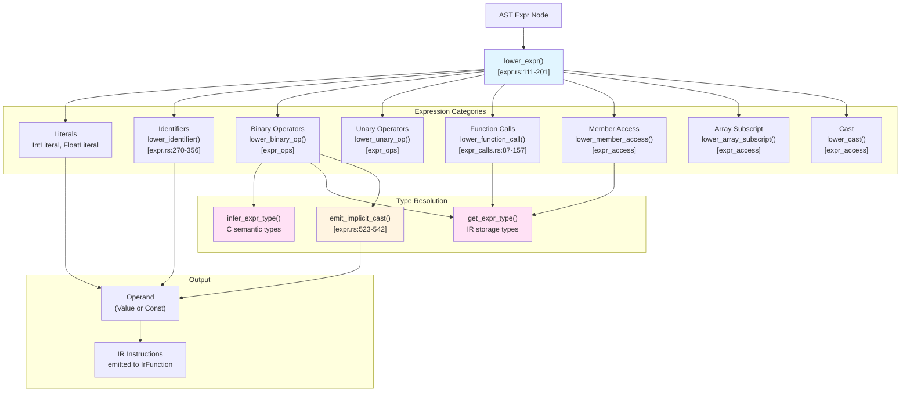
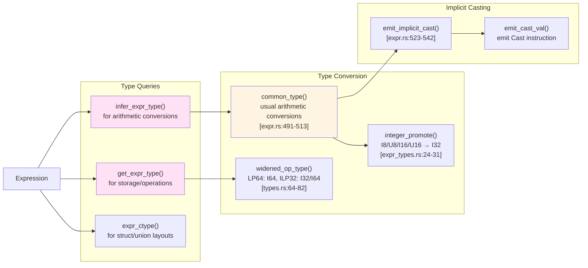
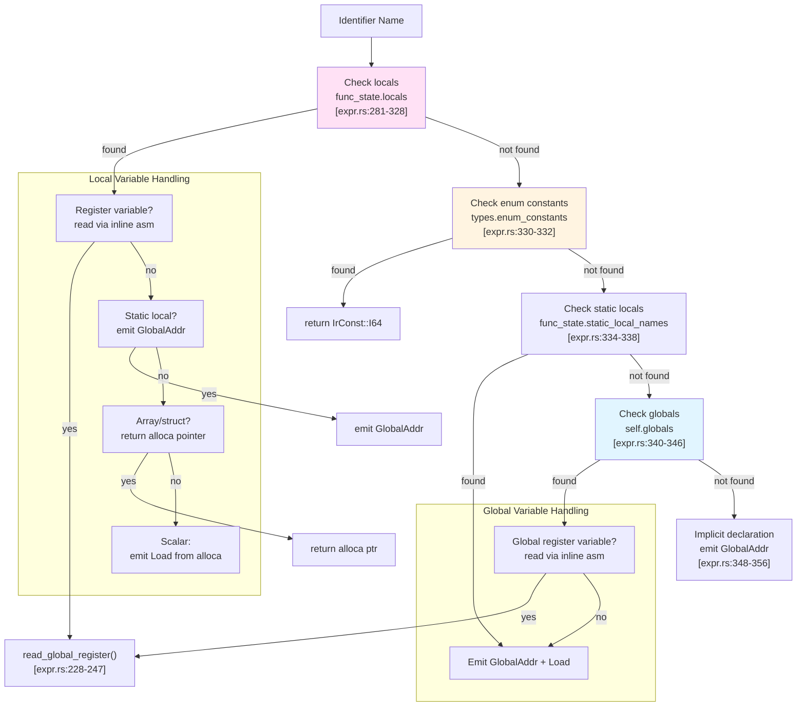
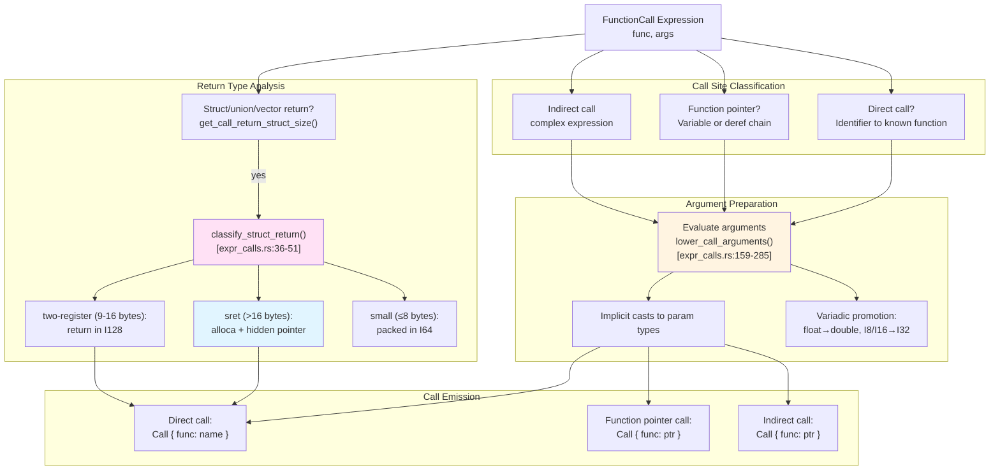
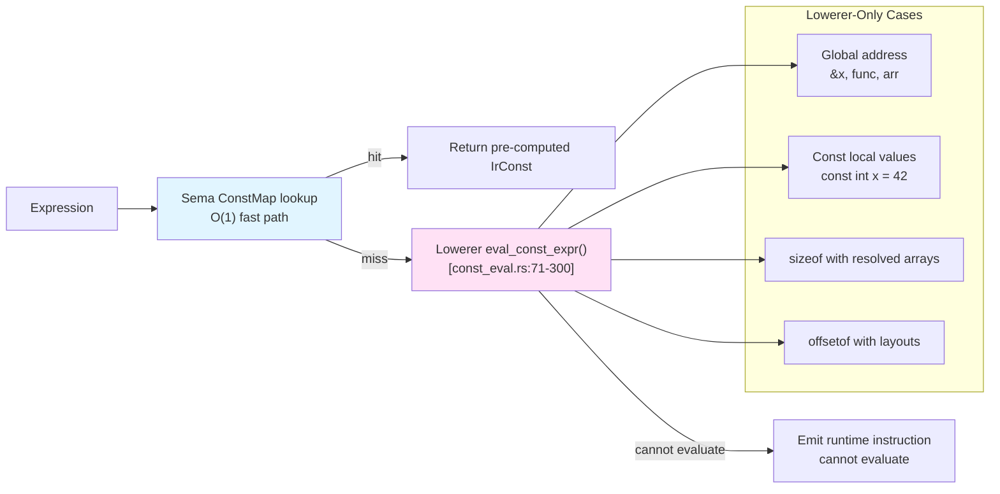

<!-- source: DeepWiki mcp.deepwiki.com · repo anthropics/claudes-c-compiler · page 3.3 Expression Lowering · fetched 2026-10-26 -->

# Expression Lowering

<details>
<summary>Relevant source files</summary>

The following files were used as context for generating this wiki page:

- [src/common/types.rs](src/common/types.rs)
- [src/frontend/parser/ast.rs](src/frontend/parser/ast.rs)
- [src/frontend/parser/declarations.rs](src/frontend/parser/declarations.rs)
- [src/frontend/parser/declarators.rs](src/frontend/parser/declarators.rs)
- [src/frontend/parser/expressions.rs](src/frontend/parser/expressions.rs)
- [src/frontend/parser/types.rs](src/frontend/parser/types.rs)
- [src/frontend/sema/const_eval.rs](src/frontend/sema/const_eval.rs)
- [src/frontend/sema/type_checker.rs](src/frontend/sema/type_checker.rs)
- [src/ir/lowering/complex.rs](src/ir/lowering/complex.rs)
- [src/ir/lowering/const_eval.rs](src/ir/lowering/const_eval.rs)
- [src/ir/lowering/definitions.rs](src/ir/lowering/definitions.rs)
- [src/ir/lowering/expr.rs](src/ir/lowering/expr.rs)
- [src/ir/lowering/expr_calls.rs](src/ir/lowering/expr_calls.rs)
- [src/ir/lowering/expr_types.rs](src/ir/lowering/expr_types.rs)
- [src/ir/lowering/global_init.rs](src/ir/lowering/global_init.rs)
- [src/ir/lowering/global_init_bytes.rs](src/ir/lowering/global_init_bytes.rs)
- [src/ir/lowering/global_init_compound.rs](src/ir/lowering/global_init_compound.rs)
- [src/ir/lowering/lvalue.rs](src/ir/lowering/lvalue.rs)
- [src/ir/lowering/pointer_analysis.rs](src/ir/lowering/pointer_analysis.rs)
- [src/ir/lowering/stmt.rs](src/ir/lowering/stmt.rs)
- [src/ir/lowering/stmt_init.rs](src/ir/lowering/stmt_init.rs)
- [src/ir/lowering/stmt_return.rs](src/ir/lowering/stmt_return.rs)
- [src/ir/lowering/structs.rs](src/ir/lowering/structs.rs)
- [src/ir/lowering/types.rs](src/ir/lowering/types.rs)

</details>


**Purpose**: This page documents how C expressions are lowered from the Abstract Syntax Tree (AST) to the Intermediate Representation (IR). Expression lowering converts high-level C expression semantics into SSA-form IR instructions, handling type inference, implicit conversions, constant folding, operator dispatch, function call conventions, and memory access patterns.

For statement and declaration lowering, see [Statement and Declaration Lowering](#3.4). For ABI-specific handling of function calls and struct returns, see [ABI Handling](#3.5). For expression type resolution at the semantic analysis level, see [Semantic Analysis](#2.3).

---

## Overview and Architecture

Expression lowering is the core translation phase that converts parsed C expressions into executable IR instructions. The `Lowerer` struct in [src/ir/lowering/lower.rs]() provides the main `lower_expr()` entry point, which dispatches to specialized handlers based on the AST expression variant.

The expression lowering system is organized into focused submodules:
- **expr.rs**: Main dispatcher and literal/identifier handling
- **expr_types.rs**: Type inference and size computation
- **expr_ops.rs**: Binary/unary operators, conditional, short-circuit evaluation
- **expr_calls.rs**: Function call lowering and argument preparation
- **expr_access.rs**: Member access, array subscript, address-of, casts
- **expr_builtins.rs**: Compiler builtin and intrinsic dispatch
- **expr_atomics.rs**: Atomic operations (`__atomic_*`, `__sync_*`)
- **expr_assign.rs**: Assignment and compound assignment operators

**Diagram: Expression Lowering Dispatch Flow**



**Sources**: [src/ir/lowering/expr.rs:1-559](), [src/ir/lowering/expr_types.rs:1-700]()

---

## Main Entry Point: `lower_expr()`

The `lower_expr()` method [src/ir/lowering/expr.rs:111-201]() is the central dispatcher that pattern-matches on the AST `Expr` enum and delegates to specialized handlers. It returns an `Operand`, which is either a `Value` (SSA temporary) or a `Const` (compile-time constant).

**Expression Dispatch Table**:

| AST Expression Variant | Handler Method | Location |
|------------------------|----------------|----------|
| `IntLiteral`, `FloatLiteral` | Immediate `IrConst` | [expr.rs:114-128]() |
| `Identifier` | `lower_identifier()` | [expr.rs:138,270-356]() |
| `BinaryOp` | `lower_binary_op()` | [expr.rs:139](), expr_ops module |
| `UnaryOp` | `lower_unary_op()` | [expr.rs:140](), expr_ops module |
| `FunctionCall` | `lower_function_call()` | [expr.rs:144](), [expr_calls.rs:87]() |
| `MemberAccess` | `lower_member_access()` | [expr.rs:175-176](), expr_access module |
| `ArraySubscript` | `lower_array_subscript()` | [expr.rs:174](), expr_access module |
| `Cast` | `lower_cast()` | [expr.rs:151](), expr_access module |
| `Assign` | `lower_assign()` | [expr.rs:142](), expr_assign module |
| `AddressOf`, `Deref` | `lower_address_of()`, `lower_deref()` | [expr.rs:172-173](), expr_access module |
| `Conditional` | `lower_conditional()` | [expr.rs:145-147](), expr_ops module |

**Sources**: [src/ir/lowering/expr.rs:111-201]()

---

## Type Resolution and Inference

Expression lowering uses two parallel type systems: **C semantic types** (`CType`) for source-level semantics and **IR storage types** (`IrType`) for code generation. Two key methods handle type resolution:

### `get_expr_type()` - IR Storage Types

Returns the `IrType` used to store/operate on an expression's result. All integer literals return `I64`, comparisons return `I64`, etc. This matches the IR's SSA value types.

**Example**:
- `IntLiteral(42)` → `I64` (even though 42 fits in I32)
- `x == y` → `I64` (comparison result)
- `&var` → `Ptr`

[src/ir/lowering/expr_types.rs:484-700]()

### `infer_expr_type()` - C Semantic Types

Returns the **C-level semantic type** for arithmetic conversions. Integer literals are narrowed to fit their actual value range (I32 if ≤ 2³¹-1), comparisons return I32 (C `int`), etc. Used for binary operation type selection and usual arithmetic conversions.

**Example**:
- `IntLiteral(42)` → `I32` (fits in int)
- `IntLiteral(1LL << 40)` → `I64` (requires long long)
- `x == y` → `I32` (C int result per standard)
- `x + y` → `common_type(infer_expr_type(x), infer_expr_type(y))`

[src/ir/lowering/expr.rs:396-487]()

**Diagram: Type Resolution Flow**



**Sources**: [src/ir/lowering/expr.rs:396-542](), [src/ir/lowering/expr_types.rs:24-67](), [src/common/types.rs:52-82]()

---

## Literal and Identifier Handling

### Literals

Literals are lowered to `IrConst` values immediately without emitting instructions:

**Integer Literals** [expr.rs:114-119]():
- `IntLiteral(val)` → `IrConst::I64(val)`
- `UIntLiteral(val)` → `IrConst::I64(val as i64)`
- `LongLiteral`, `LongLongLiteral` → `I64`
- Signedness preserved in the original value, cast handled later

**Floating-Point Literals** [expr.rs:120-122]():
- `FloatLiteral(val)` → `IrConst::F64(val)` (default double)
- `FloatLiteralF32(val)` → `IrConst::F32(val)` (float suffix)
- `FloatLiteralLongDouble(val, bytes)` → `IrConst::long_double_with_bytes(val, bytes)` (F128 with raw bits)

**Character Literals** [expr.rs:123-128]():
- Sign-extended from signed char to int: `'\xEF'` → `-17` (not 239)
- Matches GCC behavior for signed char default

**String Literals** [expr.rs:136,207-216]():
- Interned in `.rodata` and returned as `GlobalAddr`
- Narrow strings: `"hello"` → `.LC0`
- Wide strings: `L"hello"` → `.LC1` (UTF-32 on 64-bit, UTF-16 on i686)
- Char16 strings: `u"hello"` → `.LC2` (UTF-16)

**Imaginary Literals** [expr.rs:131-133]():
- `ImaginaryLiteral(val)` → `_Complex double` with real=0, imag=val
- Stored as pointer to `{0.0, val}` pair

**Sources**: [src/ir/lowering/expr.rs:114-136](), [src/ir/lowering/expr.rs:207-223]()

### Identifiers

Identifier lookup [expr.rs:270-356]() follows a precedence hierarchy:

**Diagram: Identifier Resolution Chain**



**Key Behaviors**:

1. **Local Variables** [expr.rs:281-328]():
   - Arrays/structs return the alloca pointer directly (no load)
   - Scalars emit `Load` from alloca
   - Register variables without initializer read hardware register via inline asm
   - Static locals emit `GlobalAddr` to mangled global name

2. **Enum Constants** [expr.rs:330-332]():
   - Resolved to `IrConst::I64(value)` immediately
   - Shadows global variables with same name

3. **Global Variables** [expr.rs:340-346]():
   - Emit `GlobalAddr` instruction followed by `Load` (for scalars)
   - Arrays/structs return address without load
   - Global register variables (e.g., `register void *x asm("rsp")`) read via inline asm

4. **Implicit Declarations** [expr.rs:348-356]():
   - Unknown identifiers emit `GlobalAddr` (warning emitted by sema)
   - Applies `__asm__("label")` linker symbol redirect if present

**Sources**: [src/ir/lowering/expr.rs:270-356](), [src/ir/lowering/expr.rs:228-247]()

---

## Binary and Unary Operators

Binary and unary operator lowering (in the **expr_ops** module) handles arithmetic, bitwise, logical, comparison, and short-circuit operations.

### Binary Operators

Binary operator lowering [expr_ops module]() follows this pattern:

1. **Type Inference**: Determine operation type via `infer_expr_type()` for both operands
2. **Common Type**: Compute `common_type(lhs_ty, rhs_ty)` for usual arithmetic conversions
3. **Lower Operands**: Evaluate LHS and RHS to `Operand`
4. **Implicit Casts**: Cast operands to common type if needed
5. **Emit Instruction**: Generate appropriate `BinOp` or `Cmp` IR instruction

**Arithmetic Operators** (`+`, `-`, `*`, `/`, `%`):
- Integer operations widened to `I32` (ILP32) or `I64` (LP64) via `widened_op_type()`
- Floating-point operations use F32/F64/F128 directly
- Pointer arithmetic scales by pointee size automatically

**Bitwise Operators** (`&`, `|`, `^`, `<<`, `>>`):
- Left shifts: use LHS type after integer promotion
- Right shifts: use LHS type, distinguish signed (arithmetic) vs unsigned (logical)

**Comparison Operators** (`==`, `!=`, `<`, `<=`, `>`, `>=`):
- Return C `int` type (I32) per standard
- Emit `Cmp` instruction with appropriate `IrCmpOp` variant
- Handle pointer comparisons (unsigned) vs integer comparisons (signed/unsigned based on operands)

**Logical Operators** (`&&`, `||`):
- **Short-circuit evaluation**: RHS not evaluated if LHS determines result
- Use `CondBranch` to skip RHS evaluation block
- Mask float sign bit for truthiness testing (handles -0.0 correctly) [expr.rs:34-67]()
- Complex values test `(real != 0) || (imag != 0)` per C11 6.3.1.2

**Pointer Subtraction** (`ptr1 - ptr2`):
- Result is `ptrdiff_t` (target_int_ir_type: I32 on i686, I64 on x86-64)
- Automatically divided by pointee size

**Sources**: expr_ops module (referenced in [expr.rs:5-10]()), [src/ir/lowering/expr.rs:34-109](), [src/ir/lowering/expr.rs:377-450]()

### Unary Operators

**Arithmetic Unary** (`+`, `-`, `~`):
- Integer promotion applied: I8/U8/I16/U16 → I32
- Negation preserves float type (no promotion)

**Logical Not** (`!`):
- Returns C `int` (I32)
- Emit comparison against zero

**Address-Of** (`&`):
- Resolves to lvalue address (see [lvalue.rs]())
- For arrays: returns base address
- For functions: returns function address
- For bitfields: not allowed (error)

**Dereference** (`*`):
- Emits `Load` instruction if operand is scalar
- For structs/arrays: returns pointer (no load)
- Strips no-op dereferences on function pointers

**Increment/Decrement** (`++`, `--`, postfix variants):
- Load current value, emit Add/Sub, store back
- Postfix: returns old value (requires temporary)
- Prefix: returns new value directly

**Sources**: expr_ops module, [src/ir/lowering/expr_access.rs](), [src/ir/lowering/lvalue.rs:1-200]()

---

## Function Call Lowering

Function call lowering [expr_calls.rs:87-157]() is the most complex expression category, handling:
- Direct vs indirect calls
- Argument preparation with implicit casts
- Struct return conventions (sret, two-register)
- Variadic argument promotion
- Complex number and vector passing

**Diagram: Function Call Lowering Flow**



### Struct Return Classification

The `classify_struct_return()` method [expr_calls.rs:36-51]() determines how to return struct/union/vector values:

| Target | Size Range | Convention | Registers |
|--------|-----------|------------|-----------|
| i686 (ILP32) | All sizes | sret (hidden pointer) | Stack arg, caller-provided |
| x86-64/ARM/RISC-V | >16 bytes | sret (hidden pointer) | rdi/x8/a0 (first arg) |
| x86-64/ARM/RISC-V | 9-16 bytes | Two-register return | rax:rdx / x0:x1 / a0:a1 |
| x86-64/ARM/RISC-V | 1-8 bytes | Small struct (packed) | rax / x0 / a0 |

**sret (Structure Return) Handling**:
1. Allocate temporary on caller's stack
2. Pass address as hidden first argument
3. Callee writes result directly to caller's memory
4. Caller uses alloca pointer as result

**Two-Register Return** [expr_calls.rs:223-246]():
- Function returns I128 value in register pair
- Caller unpacks via shifts and masks
- Stores to local alloca for subsequent use

**Sources**: [src/ir/lowering/expr_calls.rs:36-51](), [src/ir/lowering/expr_calls.rs:159-285]()

### Argument Preparation

The `lower_call_arguments()` method [expr_calls.rs:159-285]() handles:

1. **Implicit Type Casts**:
   - Cast each argument to its parameter type (if prototype available)
   - Example: `int x; func(x)` where `func(long)` casts `x` to I64

2. **Variadic Argument Promotion** (for unprototyped or `...` params):
   - `float` → `double` (F32 → F64)
   - `I8`, `I16` → `I32` (integer promotion)
   - Small integers are widened to default argument promotion

3. **Struct/Union Arguments**:
   - Small structs (≤16 bytes): packed into registers
   - Large structs: passed by hidden pointer (not documented; uses aggregate ABI)

4. **Complex Number Arguments**:
   - Decomposed per ABI: x86-64 packs into F64, ARM/RISC-V use pairs

**Sources**: [src/ir/lowering/expr_calls.rs:159-285]()

---

## Member Access and Array Subscripts

### Struct/Union Member Access

Member access (`s.field`, `p->field`) [expr_access module]() resolves field offsets and emits GEP instructions:

**Process**:
1. **Base Expression**: Lower base to pointer (struct value or pointer-to-struct)
2. **Layout Lookup**: Resolve struct layout via `get_struct_layout_for_type()` [structs.rs:272-337]()
3. **Field Resolution**: Find field by name, get byte offset
4. **GEP Emission**: `GetElementPtr` with constant offset
5. **Load/Store**: For scalar fields, emit Load; for nested structs, return pointer

**Bitfield Handling**:
- Store field's `(bit_offset, bit_width)` metadata
- Load storage unit via GEP
- Extract/insert bits using shifts and masks
- See [expr_assign module]() for bitfield assignment

**Anonymous Member Access** [structs.rs:337-396]():
- Drill through anonymous struct/union members
- Chain GEP offsets: `outer.offset + anon.offset + field.offset`

**Sources**: expr_access module (referenced in [expr.rs:6]()), [src/ir/lowering/structs.rs:272-400]()

### Array Subscripts

Array subscript (`arr[idx]`, `idx[arr]`) [expr_access module]() emits pointer arithmetic:

**Process**:
1. **Base/Index**: Either operand can be array or integer (C allows `3[arr]`)
2. **Pointer Type**: Determine element type and size
3. **GEP Emission**: `GetElementPtr { base, offset: idx * elem_size }`
4. **Multi-Dimensional**: For multi-dim arrays, compute strides and fold indices

**Subscript on Array** [expr.rs:174]():
```
arr[i] → GEP(arr, i * sizeof(elem))
```

**Subscript on Pointer** [expr.rs:174]():
```
ptr[i] → GEP(ptr, i * sizeof(pointee))
```

**Vector Subscript** [expr_access module]():
- Elements extracted via `VectorExtract` instruction
- Index must be compile-time constant

**Sources**: expr_access module, [src/ir/lowering/expr.rs:174](), [src/ir/lowering/pointer_analysis.rs:1-350]()

---

## Casts and Type Conversions

### Explicit Casts

Explicit cast expressions [expr_access module]() emit `Cast` instructions:

**Integer Casts**:
- Widening: zero-extend (unsigned) or sign-extend (signed)
- Narrowing: truncate high bits
- Signedness change: reinterpret bits

**Floating-Point Casts**:
- F32 ↔ F64 ↔ F128: precision conversion
- FP → Int: truncate toward zero
- Int → FP: convert with rounding

**Pointer Casts**:
- All pointers are `IrType::Ptr`, no instruction emitted
- Integer ↔ Pointer: reinterpret as I64/Ptr

**Complex Casts** [complex.rs:147-182]():
- Real ↔ Complex: `real_to_complex()`, `complex_to_complex()`
- Stored as `{real, imag}` pairs in memory

**Sources**: expr_access module, [src/ir/lowering/complex.rs:147-182]()

### Implicit Conversions

The `emit_implicit_cast()` method [expr.rs:523-542]() inserts automatic type conversions:

**When Applied**:
- Binary operation operand balancing
- Function call argument to parameter type
- Assignment RHS to LHS type
- Return statement value to function return type

**Skip Cases**:
- Same source and target type
- Target is `Ptr` or `Void`
- Pointer ↔ Float (invalid, error handled by sema)

**Bool Normalization** [expr.rs:544-556]():
- For `_Bool` storage: emit `(val != 0)` comparison
- Must occur **before** truncation to preserve high bits
- Example: `_Bool b = 0x100` → `b = (0x100 != 0)` → `b = 1`

**Sources**: [src/ir/lowering/expr.rs:523-556]()

---

## Constant Folding Integration

Expression lowering integrates tightly with constant folding to eliminate runtime computation where possible.

**Sema Pre-Computed Constants** [const_eval.rs:26-33]():
- Sema's `ConstMap` stores pre-computed values for pure expressions
- Lowerer consults this map as O(1) fast path via `lookup_sema_const()`
- Skipped for identifiers (lowerer has more info) and sizeof (may have unsized arrays)

**Lowerer Constant Evaluation** [const_eval.rs:71-300]():
- Falls back to `eval_const_expr()` for expressions needing lowering state:
  - Global address expressions (`&x`, `func`, `arr`)
  - Const local variable values
  - Sizeof with resolved array dimensions
  - Offsetof with struct layout info

**Constant Propagation During Lowering**:
- Binary ops on two constants fold immediately
- Casts of constants coerce without emitting instruction
- Address arithmetic on globals resolves to `GlobalAddr` + offset

**Diagram: Constant Evaluation Strategy**



**Optimization Impact**:
- Array bounds constants folded to eliminate GEP indirection
- Enum constants replaced with immediate values
- String literal addresses resolved at link time
- Arithmetic chains collapsed to single constants

**Sources**: [src/ir/lowering/const_eval.rs:26-300](), [src/frontend/sema/const_eval.rs:1-500]()

---

## Special Expression Categories

### Conditional Operator (`? :`)

The ternary conditional [expr_ops module]() uses control flow:

1. Lower condition to boolean (mask float sign bit)
2. Create true/false blocks + merge block
3. Emit `CondBranch` based on condition
4. Lower then-expr in true block, else-expr in false block
5. Both branches emit `Jump` to merge block with phi node
6. Result is phi node value in merge block

**GNU Extension**: `a ?: b` (omitted middle) evaluates `a` once, uses as result if truthy

**Sources**: expr_ops module (referenced in [expr.rs:5-10]())

### Comma Operator

Comma expressions [expr.rs:181-183]() evaluate left side for side effects, discard result, return right side:
```c
(x++, y++)  // Increment x, increment y, result is y's new value
```

Implementation: `lower_expr(lhs); lower_expr(rhs)` — LHS result discarded

**Sources**: [src/ir/lowering/expr.rs:181-183]()

### Statement Expressions (`({ ... })`)

GNU C statement expressions [expr_ops module]() allow compound statements as expressions:

**Example**:
```c
int x = ({ int a = 1; int b = 2; a + b; });  // x = 3
```

**Lowering**:
1. Lower compound statement (creates new scope)
2. Last statement must be expression
3. Return expression's value
4. Variables allocated on stack, cleaned up after

**Sources**: expr_ops module

### Compound Literals

Compound literals [expr_access module]() create temporary objects with specified initializer:

**Global Scope**: Interned as anonymous static variable
**Local Scope**: Allocate on stack, initialize via init lowering
**Array Literals**: Decay to pointer (for use in initializers)

**Sources**: expr_access module, [src/ir/lowering/stmt.rs:360-382]()

---

## Integration with Other Lowering Phases

Expression lowering coordinates with:

**Type Resolution** [Type System](#3.2):
- Uses `type_spec_to_ir()` and `type_spec_to_ctype()` for type queries
- Resolves struct layouts for member access
- Handles typedef resolution and typeof expressions

**Statement Lowering** [Statement and Declaration Lowering](#3.4):
- Expression statements call `lower_expr()` and discard result
- Return statements use `lower_expr()` for return value
- Initializers use specialized init lowering paths

**ABI Handling** [ABI Handling](#3.5):
- Function calls defer to ABI layer for parameter passing
- Struct returns follow platform conventions (sret, two-register)
- Complex numbers decomposed per ABI

**Optimization** [Optimization Passes](#4):
- Constant folding creates `IrConst::*` operands for optimization passes
- Copy propagation benefits from SSA form
- GVN eliminates redundant expressions

**Sources**: [src/ir/lowering/types.rs:1-700](), [src/ir/lowering/stmt.rs:1-1500](), [src/ir/lowering/expr_types.rs:1-700]()

---

