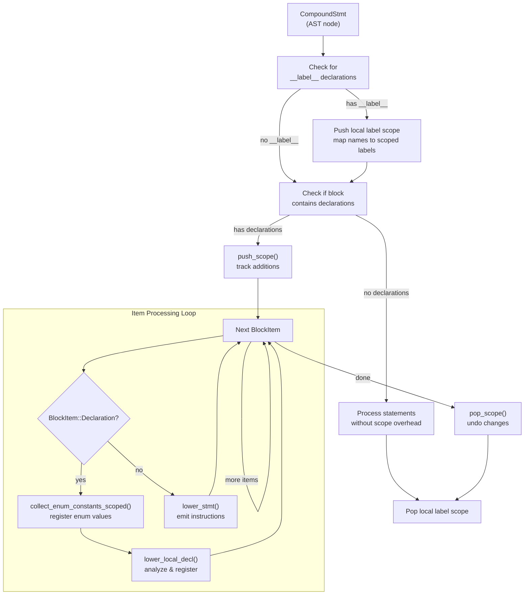
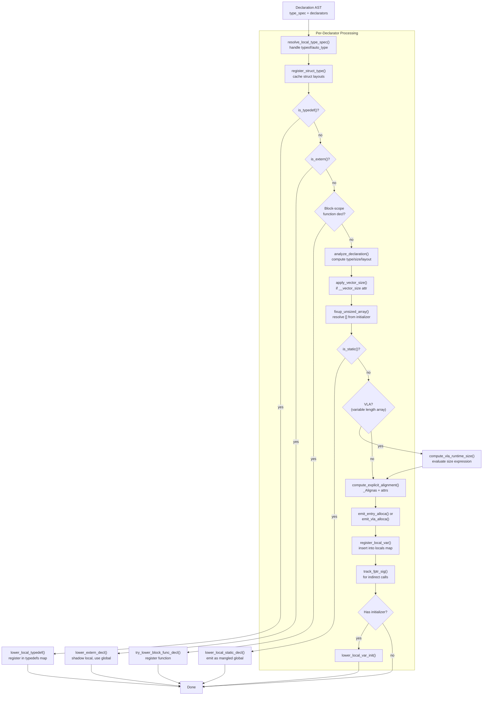
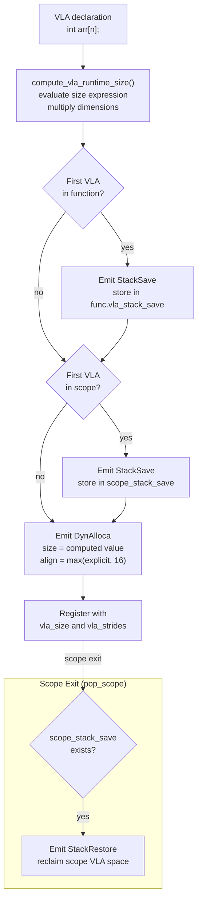
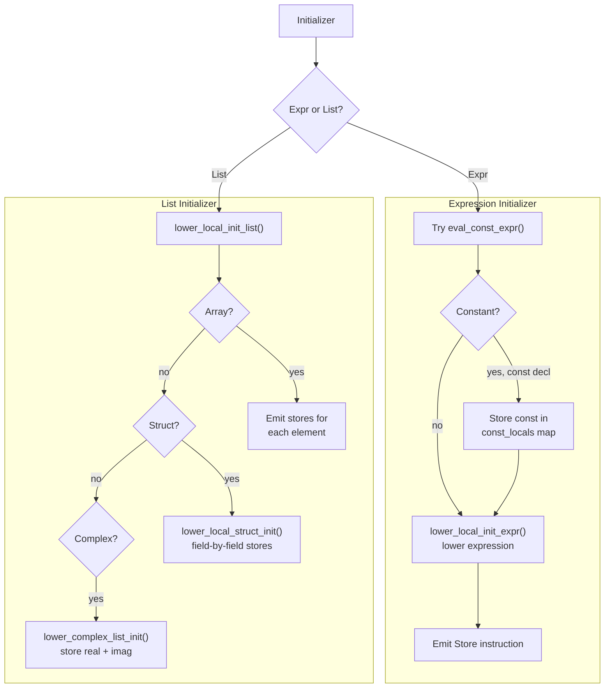
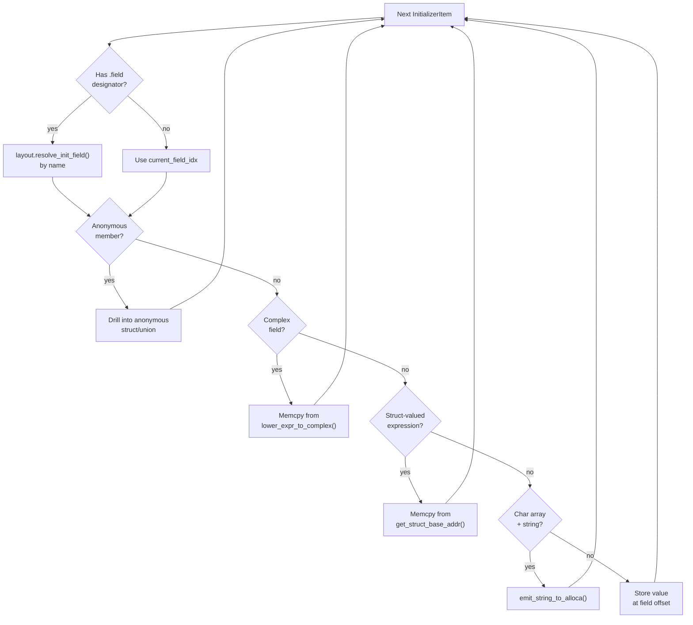
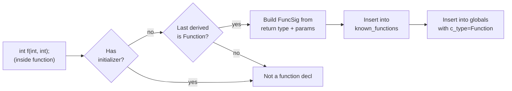

<!-- source: DeepWiki mcp.deepwiki.com · repo anthropics/claudes-c-compiler · page 3.4 Statement and Declaration Lowering · fetched 2026-10-26 -->

# Statement and Declaration Lowering

<details>
<summary>Relevant source files</summary>

The following files were used as context for generating this wiki page:

- [src/common/types.rs](src/common/types.rs)
- [src/frontend/parser/ast.rs](src/frontend/parser/ast.rs)
- [src/frontend/parser/declarations.rs](src/frontend/parser/declarations.rs)
- [src/frontend/parser/declarators.rs](src/frontend/parser/declarators.rs)
- [src/frontend/parser/expressions.rs](src/frontend/parser/expressions.rs)
- [src/frontend/parser/types.rs](src/frontend/parser/types.rs)
- [src/frontend/sema/const_eval.rs](src/frontend/sema/const_eval.rs)
- [src/frontend/sema/type_checker.rs](src/frontend/sema/type_checker.rs)
- [src/ir/lowering/complex.rs](src/ir/lowering/complex.rs)
- [src/ir/lowering/const_eval.rs](src/ir/lowering/const_eval.rs)
- [src/ir/lowering/definitions.rs](src/ir/lowering/definitions.rs)
- [src/ir/lowering/expr.rs](src/ir/lowering/expr.rs)
- [src/ir/lowering/expr_calls.rs](src/ir/lowering/expr_calls.rs)
- [src/ir/lowering/expr_types.rs](src/ir/lowering/expr_types.rs)
- [src/ir/lowering/global_init.rs](src/ir/lowering/global_init.rs)
- [src/ir/lowering/global_init_bytes.rs](src/ir/lowering/global_init_bytes.rs)
- [src/ir/lowering/global_init_compound.rs](src/ir/lowering/global_init_compound.rs)
- [src/ir/lowering/lvalue.rs](src/ir/lowering/lvalue.rs)
- [src/ir/lowering/pointer_analysis.rs](src/ir/lowering/pointer_analysis.rs)
- [src/ir/lowering/stmt.rs](src/ir/lowering/stmt.rs)
- [src/ir/lowering/stmt_init.rs](src/ir/lowering/stmt_init.rs)
- [src/ir/lowering/stmt_return.rs](src/ir/lowering/stmt_return.rs)
- [src/ir/lowering/structs.rs](src/ir/lowering/structs.rs)
- [src/ir/lowering/types.rs](src/ir/lowering/types.rs)

</details>


**Purpose**: This document describes how the compiler transforms C statements and declarations from AST to IR. Statement lowering handles control flow structures (if, while, for, switch, etc.) and expression statements, while declaration lowering analyzes variable/function/typedef declarations, resolves types and sizes, allocates storage, and emits initialization code.

**Scope**: This page focuses on the declaration analysis and registration process, local variable initialization, static local handling, and scope management. For control flow statement lowering (loops, conditionals, switch), see [3.4](#3.4). For expression lowering, see [3.3](#3.3). For global declaration handling, see the global initialization sections. For type resolution details, see [3.2](#3.2).

---

## Overview

The statement and declaration lowering system converts AST `Stmt` and `Declaration` nodes into IR instructions. The main entry points are in `Lowerer` methods that dispatch based on node type:

- **`lower_compound_stmt`**: Processes compound statements (blocks containing declarations and statements)
- **`lower_local_decl`**: Analyzes and registers local variable declarations
- **`lower_stmt`**: Dispatches to specific statement handlers (if/while/for/return/etc.)

The lowering process maintains function-local state (`func_state`) tracking locals, scope frames, labels, and loop/switch context. Declarations are analyzed to determine storage requirements, alignment, and initialization behavior before emitting IR instructions.

**Key Design Principle**: Declarations are analyzed first to resolve their complete type (including array dimensions from initializers), then registered in the symbol table, and finally initialized. This two-phase approach allows forward references within initializers and correct handling of self-referential static locals.

Sources: [src/ir/lowering/stmt.rs:29-78](), [src/ir/lowering/lower.rs]()

---

## Compound Statement Lowering

### Block Structure and Scope Management

The `lower_compound_stmt` method processes compound statements (blocks) that contain intermixed declarations and statements. It implements C's block scope rules with optimizations for declaration-free blocks.



**Optimization**: If a block contains no declarations (only statements), scope tracking is skipped entirely since statements don't introduce new bindings. This avoids the overhead of `push_scope`/`pop_scope` for common patterns like `{ stmt1; stmt2; }`.

**Local Labels**: GNU C allows `__label__ name;` declarations at the start of a block to declare goto labels with block scope. These are tracked in `local_label_scopes` and mapped to unique names (`name$ll{scope_id}`) to avoid conflicts with file-scope labels.

Sources: [src/ir/lowering/stmt.rs:30-78]()

---

## Declaration Analysis

### The `DeclAnalysis` Structure

Before emitting any IR, the `analyze_declaration` method computes complete type information for a declarator. This produces a `DeclAnalysis` containing:

| Field | Purpose |
|-------|---------|
| `var_ty` | IR type for scalar storage (I8, I32, I64, Ptr, F32, F64, F128) |
| `base_ty` | Element type for arrays |
| `c_type` | Full semantic C type (from `build_full_ctype`) |
| `is_array` | Whether this is an array declaration |
| `is_pointer` | Whether this is a pointer variable |
| `is_struct` | Whether this is a struct/union value |
| `is_array_of_pointers` | Array of pointer types (affects initialization) |
| `struct_layout` | Struct field layout (offset, types) |
| `elem_size` | Size of array elements in bytes |
| `actual_alloc_size` | Total allocation size in bytes |
| `array_dim_strides` | Stride for each array dimension (for subscripting) |

**Fixup for Unsized Arrays**: Arrays declared without a size (`int arr[]`) have their dimensions resolved from initializers. The `fixup_unsized_array` method computes the actual size and updates `DeclAnalysis` accordingly.

Sources: [src/ir/lowering/definitions.rs:91-148](), [src/ir/lowering/types.rs:591-642]()

---

### Declaration Analysis Flow



Sources: [src/ir/lowering/stmt.rs:80-155](), [src/ir/lowering/types.rs:506-642]()

---

## Local Variable Declaration

### Standard Local Variables

The `lower_local_decl` method processes local variable declarations:

1. **Type Resolution**: Resolve `typeof`/`__auto_type` to concrete types
2. **Struct Registration**: Cache struct/union layouts for quick access
3. **Type Classification**: Determine if typedef, extern, or block-scope function
4. **Declaration Analysis**: Compute sizes, alignments, and layout
5. **Alignment**: Merge explicit `_Alignas`, attribute alignment, and type natural alignment
6. **Allocation**: Emit `Alloca` instruction (or `DynAlloca` for VLAs)
7. **Registration**: Insert into `locals` map with metadata
8. **Initialization**: Lower initializer expression or list

**Alignment Calculation**: The effective alignment is the maximum of:
- Explicit `_Alignas(N)` or `__attribute__((aligned(N)))`
- Type's natural alignment (from struct layout or scalar type)
- Typedef alignment overrides

This ensures that `struct S x;` where `S` has `__attribute__((aligned(16)))` gets 16-byte alignment even without explicit alignment on the variable declaration.

Sources: [src/ir/lowering/stmt.rs:80-155](), [src/ir/lowering/stmt.rs:266-279]()

---

### Static Local Variables

Static local variables are implemented as globals with mangled names to ensure uniqueness across functions. The mangling scheme is `{function_name}.{variable_name}.{counter}`.

```mermaid
graph LR
    StaticLocal["static int x = 42;<br/>(in function foo)"]
    MangleName["Mangle name:<br/>foo.x.0"]
    
    subgraph "Global Registration"
        PreRegister["Pre-register in<br/>globals map"]
        EvalInit["lower_global_init()<br/>compile-time evaluation"]
        ComputeAlign["Natural + explicit<br/>alignment"]
        EmitGlobal["Emit IrGlobal<br/>in module.globals"]
    end
    
    UpdateLocalInfo["Create LocalInfo<br/>with static_global_name"]
    InsertLocal["Insert into locals<br/>(bare name maps to mangled)"]
    TrackMapping["Insert into<br/>static_local_names map"]
    
    StaticLocal --> MangleName
    MangleName --> PreRegister
    PreRegister --> EvalInit
    EvalInit --> ComputeAlign
    ComputeAlign --> EmitGlobal
    EmitGlobal --> UpdateLocalInfo
    UpdateLocalInfo --> InsertLocal
    InsertLocal --> TrackMapping
```



**Pre-Registration**: The global is registered in `self.globals` *before* evaluating its initializer. This allows self-referential initializers like:
```c
static struct work w = { .entry = { &w.entry, &w.entry } };
```

**Alignment**: Static locals compute alignment from three sources:
1. Type's natural alignment (via `alignof_type`)
2. Explicit `_Alignas` or `__attribute__((aligned(N)))`
3. Typedef alignment overrides

The alignment resolution uses the lowerer's type information to pick up struct `__attribute__((aligned(N)))` from the type definition, not just the variable declaration.

**Access**: Each reference to the static local emits a fresh `GlobalAddr` instruction in the current basic block. This avoids issues with unreachable blocks that would result from emitting `GlobalAddr` once in the entry block.

Sources: [src/ir/lowering/stmt.rs:387-518]()

---

## Variable Length Arrays (VLAs)

VLAs require dynamic stack allocation since their size is not known until runtime. The implementation uses `StackSave`/`StackRestore` to reclaim stack space at scope exit.

### VLA Allocation Strategy



**Stack Pointer Management**:
- **Function-level save**: The first VLA in any function emits `StackSave` to capture the initial stack pointer. This is restored in the function epilogue via `func.vla_stack_save`.
- **Scope-level save**: The first VLA in each block scope emits `StackSave` to capture the stack pointer before that scope's VLAs. This is restored at scope exit via `scope_stack_save`.

**Strides for Multi-Dimensional VLAs**: For multi-dimensional VLAs like `int arr[n][m]`, the `compute_vla_local_strides` method evaluates dimension expressions and computes stride values for subscripting. These are stored in `LocalInfo.vla_strides`.

Sources: [src/ir/lowering/stmt.rs:281-304](), [src/ir/lowering/types.rs:643-686]()

---

## Initialization Lowering

### Expression vs List Initializers

C supports two initializer forms:
- **Expression**: `int x = 42;` or `int *p = &global;`
- **List**: `int arr[] = {1, 2, 3};` or `struct S s = { .a = 1 };`

The lowering dispatches based on initializer type:



Sources: [src/ir/lowering/stmt.rs:360-382](), [src/ir/lowering/stmt_init.rs:78-331]()

---

### Local Array Initialization

Array initialization handles several cases:
- **Flat arrays**: `int arr[] = {1, 2, 3}`
- **Multi-dimensional**: `int arr[][2] = {{1,2}, {3,4}}`
- **Designated initializers**: `int arr[10] = {[5] = 1, [3] = 2}`
- **String literals**: `char str[] = "hello"`
- **Struct arrays**: `struct S arr[] = {{1}, {2}}`

**String Literal Optimization**: When initializing a char array from a string literal, `emit_string_to_alloca` copies bytes directly instead of emitting individual `Store` instructions for each character.

**Designated Initializers**: These use a current-index tracker that jumps to the designated index, initializes that element, and continues from there:
```c
int arr[10] = {[5] = 1, 2, 3, [2] = 4};  // arr[5]=1, arr[6]=2, arr[7]=3, arr[2]=4
```

Sources: [src/ir/lowering/stmt_init.rs:159-263]()

---

### Local Struct Initialization

Struct initialization emits a sequence of `Store` instructions to initialize each field. The process handles:
- **Positional initializers**: `struct S x = {1, 2, 3}`
- **Designated initializers**: `struct S x = { .b = 2, .a = 1 }`
- **Anonymous members**: Drilling into anonymous struct/union fields
- **Nested structs**: Recursive initialization
- **Complex fields**: Special memcpy-based initialization for `_Complex` fields
- **Struct-valued expressions**: Using `Memcpy` for function calls returning structs

**Field Resolution**:


Sources: [src/ir/lowering/stmt.rs:621-802]()

---

## Special Declaration Types

### Extern Declarations

Extern declarations in function scope (`extern int x;`) reference file-scope globals:

1. **Shadow Local**: Remove any same-named local variable in the current scope
2. **Shadow Static Local**: Remove any same-named static local mapping
3. **Register Global**: If not already in `globals` map, register it with analysis from the declaration
4. **Scoped Tracking**: Store shadowing info in scope frame for restoration on scope exit

The shadowing ensures that `extern int x;` inside a function body refers to the global `x`, not any local variable or static local with the same name in outer scopes.

Sources: [src/ir/lowering/stmt_init.rs:29-58]()

---

### Block-Scope Function Declarations

Function declarations inside blocks (`int f(int);`) declare external functions:



**Function Signature Tracking**: The `FuncSig` contains return type and parameter types, used for:
- Type checking at call sites
- Determining argument promotion (unprototyped functions promote float→double)
- Struct return classification (sret vs two-register)

Sources: [src/ir/lowering/stmt_init.rs:60-129]()

---

### Typedef Declarations

Typedef declarations register type aliases in the `typedefs` map:

**Local Typedef Processing**:
1. **Extract Function Pointer Info**: If the typedef is a function pointer, extract signature for call-site type checking
2. **Build CType**: Construct the full `CType` from type specifier + derived declarators
3. **Apply Vector Size**: If `__attribute__((vector_size(N)))` present, wrap in `CType::Vector`
4. **Preserve Anonymous Keys**: If the typedef refers to an anonymous struct/union that sema already registered, reuse sema's key for `_Generic` matching consistency
5. **Register Typedef**: Insert into `typedefs` map with scoped tracking
6. **Alignment Override**: If the typedef has `__attribute__((aligned(N)))`, store in `typedef_alignments`
7. **VLA Typedef Size**: If the typedef involves VLA dimensions, evaluate and store the size

**Anonymous Struct Key Preservation**:
When lowering `typedef struct { ... } name;` where sema assigned an anonymous key like `__anon_struct_7`, the lowerer detects this by comparing the new and existing `CType` for the typedef name. If both are anonymous structs and differ, it copies the struct layout from the new key to the old key and uses the old key. This ensures `_Generic` type matching works correctly since sema's const-eval uses sema's keys.

Sources: [src/ir/lowering/stmt.rs:193-250]()

---

## Scope Management

### Scope Frame Stack

The `scope_stack` tracks changes made in each block scope for undo-on-exit:

```rust
struct ScopeFrame {
    // Variables shadowed by this scope (restore on exit)
    shadowed_locals: Vec<(String, LocalInfo)>,
    shadowed_static_names: Vec<(String, String)>,
    
    // Typedefs/struct layouts added in this scope
    added_typedefs: Vec<String>,
    added_struct_layouts: Vec<String>,
    invalidated_ctype_cache: Vec<String>,
    
    // Cleanup functions for __attribute__((cleanup))
    cleanup_vars: Vec<(String, Value)>,
    
    // VLA stack pointer for this scope
    scope_stack_save: Option<Value>,
}
```

**Push/Pop Operations**:
- `push_scope()`: Allocates a new `ScopeFrame` and pushes onto `scope_stack`
- `pop_scope()`: Restores shadowed variables, removes added typedefs/layouts, emits cleanup calls, and restores VLA stack pointer

**Cleanup Attribute**: Variables with `__attribute__((cleanup(func)))` are tracked in `cleanup_vars`. At scope exit, `pop_scope` emits calls to the cleanup function with the variable's address.

Sources: [src/ir/lowering/lower.rs]() (ScopeFrame definition), [src/ir/lowering/stmt.rs:44-64]()

---

## Code Entity Reference

### Core Methods in `Lowerer`

| Method | File:Lines | Purpose |
|--------|-----------|---------|
| `lower_compound_stmt` | [src/ir/lowering/stmt.rs:30-78]() | Process compound statements with scope management |
| `lower_local_decl` | [src/ir/lowering/stmt.rs:80-155]() | Analyze and register local variable declarations |
| `lower_local_typedef` | [src/ir/lowering/stmt.rs:193-250]() | Register typedef in local scope |
| `lower_local_static_decl` | [src/ir/lowering/stmt.rs:387-518]() | Emit static local as mangled global |
| `lower_local_var_init` | [src/ir/lowering/stmt.rs:360-382]() | Dispatch initializer lowering |
| `register_local_var` | [src/ir/lowering/stmt.rs:306-332]() | Insert variable into locals map |
| `emit_vla_alloca` | [src/ir/lowering/stmt.rs:281-304]() | Emit dynamic stack allocation for VLA |
| `fixup_unsized_array` | [src/ir/lowering/types.rs:687-714]() | Resolve array size from initializer |
| `analyze_declaration` | [src/ir/lowering/types.rs:591-642]() | Compute type, size, layout for declarator |

### Data Structures

| Type | File:Lines | Purpose |
|------|-----------|---------|
| `LocalInfo` | [src/ir/lowering/definitions.rs:54-90]() | Metadata for local variables |
| `DeclAnalysis` | [src/ir/lowering/definitions.rs:91-148]() | Result of declaration analysis |
| `ScopeFrame` | [src/ir/lowering/lower.rs]() | Tracks changes for scope undo |
| `CompoundStmt` | [src/frontend/parser/ast.rs:486-492]() | AST node for compound statements |
| `Declaration` | [src/frontend/parser/ast.rs:294-399]() | AST node for declarations |
| `Initializer` | [src/frontend/parser/ast.rs:515-519]() | AST enum for initializer forms |

Sources: [src/ir/lowering/stmt.rs](), [src/ir/lowering/definitions.rs](), [src/ir/lowering/types.rs]()

---

