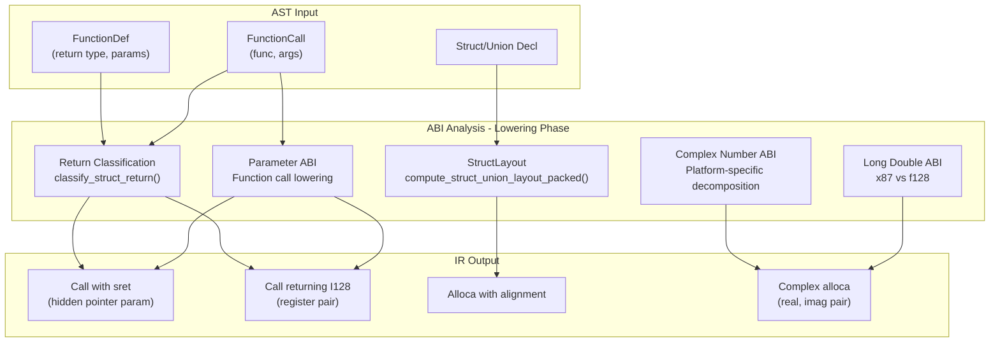
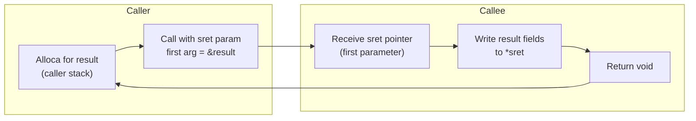
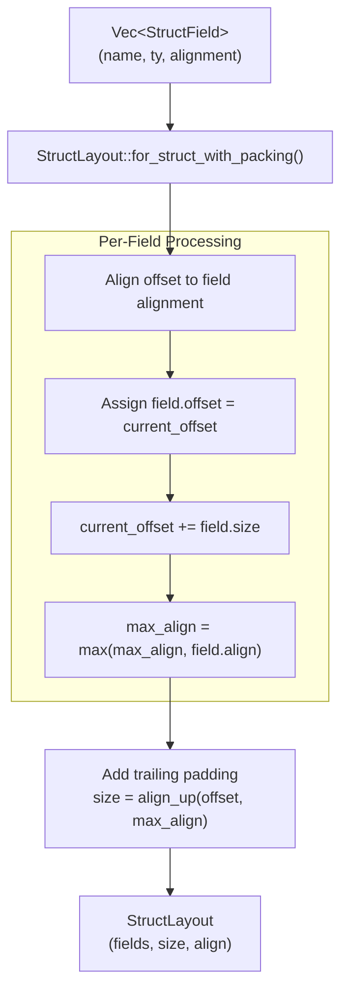
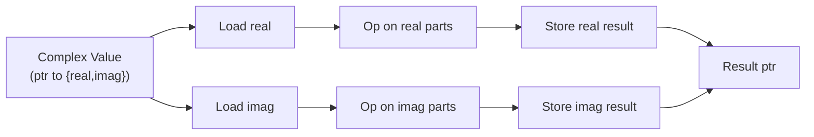

<!-- source: DeepWiki mcp.deepwiki.com · repo anthropics/claudes-c-compiler · page 3.5 ABI Handling · fetched 2026-10-26 -->

# ABI Handling

<details>
<summary>Relevant source files</summary>

The following files were used as context for generating this wiki page:

- [src/common/types.rs](src/common/types.rs)
- [src/frontend/parser/ast.rs](src/frontend/parser/ast.rs)
- [src/frontend/parser/declarations.rs](src/frontend/parser/declarations.rs)
- [src/frontend/parser/declarators.rs](src/frontend/parser/declarators.rs)
- [src/frontend/parser/expressions.rs](src/frontend/parser/expressions.rs)
- [src/frontend/parser/types.rs](src/frontend/parser/types.rs)
- [src/frontend/sema/const_eval.rs](src/frontend/sema/const_eval.rs)
- [src/frontend/sema/type_checker.rs](src/frontend/sema/type_checker.rs)
- [src/ir/lowering/complex.rs](src/ir/lowering/complex.rs)
- [src/ir/lowering/const_eval.rs](src/ir/lowering/const_eval.rs)
- [src/ir/lowering/definitions.rs](src/ir/lowering/definitions.rs)
- [src/ir/lowering/expr.rs](src/ir/lowering/expr.rs)
- [src/ir/lowering/expr_calls.rs](src/ir/lowering/expr_calls.rs)
- [src/ir/lowering/expr_types.rs](src/ir/lowering/expr_types.rs)
- [src/ir/lowering/global_init.rs](src/ir/lowering/global_init.rs)
- [src/ir/lowering/global_init_bytes.rs](src/ir/lowering/global_init_bytes.rs)
- [src/ir/lowering/global_init_compound.rs](src/ir/lowering/global_init_compound.rs)
- [src/ir/lowering/lvalue.rs](src/ir/lowering/lvalue.rs)
- [src/ir/lowering/pointer_analysis.rs](src/ir/lowering/pointer_analysis.rs)
- [src/ir/lowering/stmt.rs](src/ir/lowering/stmt.rs)
- [src/ir/lowering/stmt_init.rs](src/ir/lowering/stmt_init.rs)
- [src/ir/lowering/stmt_return.rs](src/ir/lowering/stmt_return.rs)
- [src/ir/lowering/structs.rs](src/ir/lowering/structs.rs)
- [src/ir/lowering/types.rs](src/ir/lowering/types.rs)

</details>


## Purpose and Scope

ABI Handling encompasses the platform-specific Application Binary Interface (ABI) rules that govern how functions are called, how data structures are laid out in memory, and how types are passed between compilation units. This page documents the ABI implementation in the IR lowering phase, including:

- **Calling conventions**: How function arguments and return values are passed (registers vs stack, hidden pointers)
- **Struct layout**: Field offsets, alignment, padding, and bitfield packing
- **Type-specific ABI rules**: Complex numbers, long double, transparent unions
- **Platform differences**: x86-64 vs i686 vs AArch64 vs RISC-V

For backend-specific code generation details (register allocation, instruction selection), see [Code Generation Architecture](#5.1). For the type system that feeds into ABI decisions, see [Type System](#3.2).

**Sources:** [src/ir/lowering/expr_types.rs:1-68](), [src/ir/lowering/expr_calls.rs:1-52](), [src/common/types.rs:1-46]()

---

## Overview: ABI in the Lowering Pipeline

ABI handling occurs during IR lowering (AST → SSA IR) rather than in the backend. This design keeps the backend architecture-agnostic while ensuring correct platform-specific semantics early in the pipeline.



**Diagram: ABI Handling Flow in IR Lowering**

The lowerer consults platform configuration (`target_ptr_size()`, `target_is_32bit()`, `target_long_double_is_f128()`) to make ABI decisions and emits IR instructions with explicit size/alignment metadata that the backend can generate code for directly.

**Sources:** [src/ir/lowering/expr_calls.rs:23-51](), [src/common/types.rs:20-55](), [src/ir/lowering/complex.rs:1-12]()

---

## Struct Return ABI

### sret (Structure Return via Hidden Pointer)

When a function returns a struct that is too large to fit in registers, the caller allocates space for the result and passes a hidden pointer as the first argument. The callee writes the result to this pointer and returns `void`.

**Size thresholds:**
- **x86-64 / AArch64 / RISC-V (64-bit)**: Structs > 16 bytes use sret
- **i686 (32-bit)**: **All** structs use sret (i386 System V ABI requirement)



**Diagram: sret Calling Convention**

**Implementation:** [`classify_struct_return()`](src/ir/lowering/expr_calls.rs:36-51) determines whether a struct size requires sret:

```rust
// i686: all structs use sret
if ptr_size <= 4 {
    (Some(size), None)
} else {
    // x86-64/ARM/RISC-V: > 16 bytes
    if size > 16 {
        (Some(size), None)
    } else if size > 8 {
        (None, Some(size))  // two-register
    } else {
        (None, None)  // small struct
    }
}
```

When sret is required, the lowerer emits a temporary alloca at the call site and passes its address as the first argument in `CallInfo::sret_size`. The backend generates code to allocate stack space and pass the pointer in the first parameter register (or stack slot on i686).

**Sources:** [src/ir/lowering/expr_calls.rs:23-51](), [src/ir/lowering/expr_calls.rs:86-180]()

---

### Two-Register Returns

Structs between 9-16 bytes (on 64-bit targets) are returned in a register pair packed into `I128`. The struct data occupies the low bytes; high bytes are undefined.

**Example:** A 12-byte struct on x86-64:
- Bytes 0-7 in `rax`
- Bytes 8-11 in the low 4 bytes of `rdx`
- High 4 bytes of `rdx` are undefined

The lowerer emits an `Instruction::Call` that returns `I128`. At the call site, this value is stored into the result alloca with the appropriate width cast (`I128` → `I64` for 8-byte stores, `I128` → `I32` for final 4-byte store).

**Note:** i686 does not use two-register returns; all structs go through sret.

**Sources:** [src/ir/lowering/expr_calls.rs:36-51](), [src/backend/common.rs:600-700]()

---

## Parameter Passing

### Register vs Stack Allocation

The lowerer does not directly implement register assignment (that's the backend's job via calling convention traits). However, it must handle:

1. **Struct parameters**: On i686, struct parameters are always passed by value on the stack. On 64-bit targets, small structs may be passed in registers (determined by the backend based on System V AMD64 / AAPCS64 / RISC-V LP64 rules).

2. **Transparent unions**: A union with `__attribute__((transparent_union))` is passed using the ABI of its first member. The lowerer marks the layout:
   ```rust
   layout.is_transparent_union = true;
   ```
   The backend then treats the union parameter as if it were the first member's type for register assignment.

3. **Variadic arguments**: Arguments passed to variadic functions after the fixed parameters require default argument promotion (integers narrower than `int` promote to `int`, `float` promotes to `double`). The lowerer performs these promotions in `lower_call_arguments()`.

**Sources:** [src/ir/lowering/types.rs:59-78](), [src/ir/lowering/expr_calls.rs:195-315](), [src/ir/lowering/structs.rs:245-267]()

---

## Struct Layout

### Field Offset Computation

Struct layout is computed by `StructLayout::for_struct_with_packing()` and cached in `TypeContext::struct_layouts`. Each field gets:
- **Byte offset**: Aligned to the field's natural alignment (or overridden by `__attribute__((aligned(N)))` / `__attribute__((packed))`)
- **Alignment requirement**: The struct's overall alignment is the maximum of all field alignments
- **Total size**: Includes trailing padding to align the struct size to its alignment



**Diagram: Struct Layout Computation**

**Platform differences:**
- **i686**: `double` and `long long` have 4-byte alignment (not 8) in structs
- **x86-64**: Natural 8-byte alignment for 8-byte types
- **`#pragma pack(N)`**: Caps field alignment at `N` bytes
- **`__attribute__((packed))`**: Forces all field alignments to 1

**Sources:** [src/common/types.rs:319-444](), [src/ir/lowering/types.rs:319-355]()

---

### Bitfield Packing

Bitfields are packed into "storage units" (the declared field type, e.g., `int` for `int bits : 5`). The lowerer tracks:
- **Storage unit offset**: The byte offset of the unit containing the bitfield
- **Bit offset within the unit**: Where the bitfield starts (0-based from LSB)
- **Bit width**: Number of bits occupied

**Two packing modes:**
1. **Standard (System V)**: Bitfields cannot span storage unit boundaries. A bitfield that doesn't fit in the current unit starts a new unit aligned to the field type.
2. **`#pragma pack(1)` / `__attribute__((packed))`**: Bitfields form a contiguous bit stream and may span storage units. The storage type is widened if necessary.

**Zero-width bitfields** (`:0`) force alignment to the next storage unit boundary, used to align subsequent fields.

**Sources:** [src/common/types.rs:356-444](), [src/ir/lowering/global_init_bytes.rs:370-442]()

---

## x86-64 Eightbyte Classification

On x86-64 (System V AMD64 ABI), structs up to 16 bytes are classified into two "eightbytes" to determine whether they are passed in general-purpose or SSE registers.

```rust
pub enum EightbyteClass {
    NoClass,    // Not yet assigned
    Sse,        // All fields are float/double → xmm register
    Integer,    // Contains non-float field → GP register
}
```

**Merge rules** (line 125-131 of `types.rs`):
- `NoClass` + `X` = `X`
- `Integer` + anything = `Integer`
- `SSE` + `SSE` = `SSE`

A struct like `{ double x; double y; }` (16 bytes) gets classified as `[Sse, Sse]` and passed in `xmm0, xmm1`. A struct like `{ int a; double b; }` gets `[Integer, Sse]` and passed in `rdi, xmm0`.

**The lowerer does not perform this classification**—it's handled by the backend in `X86Codegen::classify_struct()`. The lowerer just ensures the struct layout is correct.

**Sources:** [src/common/types.rs:109-132](), [src/backend/x86/codegen/abi.rs:1-150]()

---

## RISC-V Hardware Floating-Point ABI

The RISC-V LP64D ABI has special rules for passing small structs with specific field patterns in FP registers:

```rust
pub enum RiscvFloatClass {
    OneFloat { is_double: bool },
    TwoFloats { lo_is_double: bool, hi_is_double: bool },
    FloatAndInt { float_is_double, float_offset, int_offset, int_size },
    IntAndFloat { float_is_double, int_offset, int_size, float_offset },
}
```

Examples:
- `struct { float f; }` → `OneFloat` → passed in `fa0`
- `struct { float f; int i; }` → `FloatAndInt` → `fa0` (float), `a0` (int)
- `struct { double d1; double d2; }` → `TwoFloats` → `fa0`, `fa1`

**The backend implements this classification**; the lowerer just computes correct struct layouts.

**Sources:** [src/common/types.rs:138-162](), [src/backend/riscv/codegen/abi.rs:1-250]()

---

## Complex Number ABI

C99 `_Complex` types are represented as pairs `{ real, imag }` and laid out in memory as:

| Type | Size | Alignment (x86-64) | Alignment (i686) |
|------|------|-------------------|------------------|
| `_Complex float` | 8 bytes | 4 | 4 |
| `_Complex double` | 16 bytes | 8 | 4 |
| `_Complex long double` | 32 bytes | 16 | 4 (on i686: 24 bytes) |

### Platform Decomposition Differences

**x86-64 (GCC behavior):**
- `_Complex float` is passed as a single 64-bit value (packed into `F64`)
- `_Complex double` is passed as two `F64` values (`xmm0`, `xmm1`)

**AArch64 / RISC-V:**
- `_Complex float` is passed as two `F32` values (separate registers)
- `_Complex double` is passed as two `F64` values

The lowerer always represents complex values as **pointers to the `{real, imag}` pair** in IR. Arithmetic operations load the components, perform operations, and store back:



**Diagram: Complex Arithmetic Lowering**

The backend then handles packing/unpacking for parameter passing and return values according to platform conventions.

**Sources:** [src/ir/lowering/complex.rs:1-140](), [src/ir/lowering/complex.rs:200-350]()

---

## Long Double Handling

`long double` has different representations:

| Platform | Size | Precision | Alignment |
|----------|------|-----------|-----------|
| x86-64 | 16 bytes | 80-bit x87 | 16 |
| i686 | 12 bytes | 80-bit x87 | 4 |
| AArch64 | 16 bytes | IEEE 754 binary128 | 16 |
| RISC-V | 16 bytes | IEEE 754 binary128 | 16 |

The lowerer uses `target_long_double_is_f128()` to determine whether `long double` should map to:
- `IrType::F128` (AArch64/RISC-V) → backend emits quad-precision instructions
- `IrType::F128` with special handling (x86/i686) → backend emits x87 FPU instructions

**Key difference:** Even though both use `F128` in IR, the backend interprets this differently:
- On AArch64/RISC-V: Uses native `f128` arithmetic (quad-precision IEEE 754)
- On x86: Uses x87 `fld`/`fstp` with 80-bit extended precision

### Constant Representation

Long double constants are stored as `IrConst::long_double(f64_approx, [u8; 16])`:
- The `f64` approximation is used for compile-time arithmetic
- The raw bytes preserve the exact representation (80-bit x87 packed into 16 bytes, or IEEE binary128)

**Sources:** [src/ir/lowering/types.rs:191](), [src/ir/ir.rs:150-180](), [src/common/types.rs:36-45]()

---

## Platform Detection and Configuration

The lowerer queries platform configuration through thread-local state:

```rust
pub fn target_ptr_size() -> usize;      // 4 for i686, 8 for LP64
pub fn target_is_32bit() -> bool;       // true for i686
pub fn target_int_ir_type() -> IrType;  // I32 for i686, I64 for LP64
pub fn target_long_double_is_f128() -> bool;  // false for x86/i686
```

These are set by the driver at compilation start:

```rust
set_target_ptr_size(4);  // or 8
set_target_long_double_is_f128(false);  // or true for ARM/RISC-V
```

**Pointer-width types:**
- `long` is 4 bytes on i686, 8 bytes on LP64 (x86-64/ARM/RISC-V)
- `size_t`, `ptrdiff_t`, and pointer arithmetic results follow `target_int_ir_type()`

**Arithmetic widening:**
- On i686: Operations stay at their C type width (32-bit `int` ops use 32-bit IR, `long long` uses 64-bit)
- On LP64: All integer ops are widened to 64-bit machine word size

**Sources:** [src/common/types.rs:13-82](), [src/ir/lowering/types.rs:171-232]()

---

## Type Size and Alignment Queries

The lowerer provides unified methods for querying type properties:

| Method | Returns | Example |
|--------|---------|---------|
| `sizeof_type(ts: &TypeSpecifier)` | `usize` | `sizeof(struct S)` |
| `alignof_type(ts: &TypeSpecifier)` | `usize` | `_Alignof(struct S)` |
| `preferred_alignof_type(ts: &TypeSpecifier)` | `usize` | `__alignof__(long long)` on i686 |
| `type_spec_to_ir(ts: &TypeSpecifier)` | `IrType` | `int` → `I32` |
| `type_spec_to_ctype(ts: &TypeSpecifier)` | `CType` | Full semantic type |

**`_Alignof` vs `__alignof__`:**
- `_Alignof` (C11): Returns the ABI alignment (4 for `long long` on i686)
- `__alignof__` (GCC): Returns the "preferred" alignment (8 for `long long` on i686)

The lowerer uses ABI alignment (`alignof_type()`) for stack layout and struct offsets, matching actual memory layout requirements.

**Sources:** [src/ir/lowering/types.rs:357-492]()

---

## Address Space Qualifiers

GCC's named address space extension (`__seg_gs`, `__seg_fs`) allows segment-relative pointers. The lowerer tracks address space in:

```rust
pub enum AddressSpace {
    Default,
    SegGs,  // x86 GS-relative (per-CPU variables)
    SegFs,  // x86 FS-relative (TLS on some platforms)
}
```

Loads and stores through segment-qualified pointers emit `Instruction::Load/Store` with the `seg_override` field set. The x86 backend then emits the appropriate segment prefix (`%gs:` or `%fs:`).

**Example:** Linux kernel per-CPU variables:
```c
int __seg_gs *percpu_var;
int value = *percpu_var;  // emits: movl %gs:0, %eax
```

**Sources:** [src/common/types.rs:164-174](), [src/ir/lowering/lvalue.rs:1-50]()

---

## Summary

ABI handling in the lowerer ensures:

1. **Correct struct return conventions**: sret for large structs, register pairs for medium structs, packed small structs
2. **Platform-specific layout**: i686 vs LP64 differences in alignment and size
3. **Complex/long double mapping**: Platform-aware representation and arithmetic
4. **Type metadata preservation**: The IR carries enough information for the backend to generate correct calling sequences

The design philosophy is **early ABI resolution**: The lowerer makes all ABI decisions, emitting explicit IR with size/alignment metadata. The backend then has a simple job—generate code that matches the IR semantics without needing to re-analyze types.

**Sources:** [src/ir/lowering/expr_calls.rs:1-400](), [src/ir/lowering/types.rs:1-700](), [src/common/types.rs:1-900]()

---

