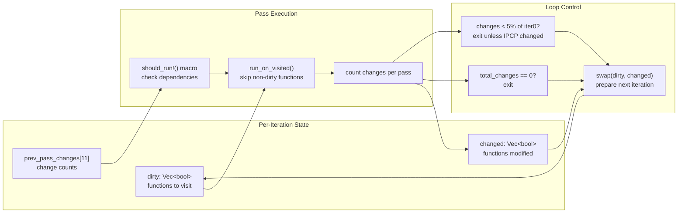
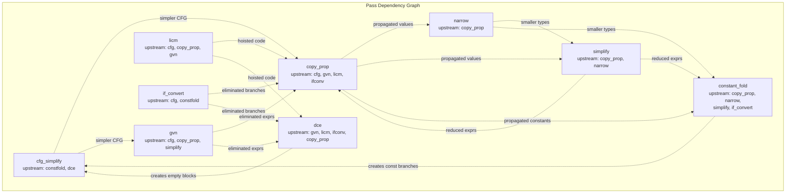
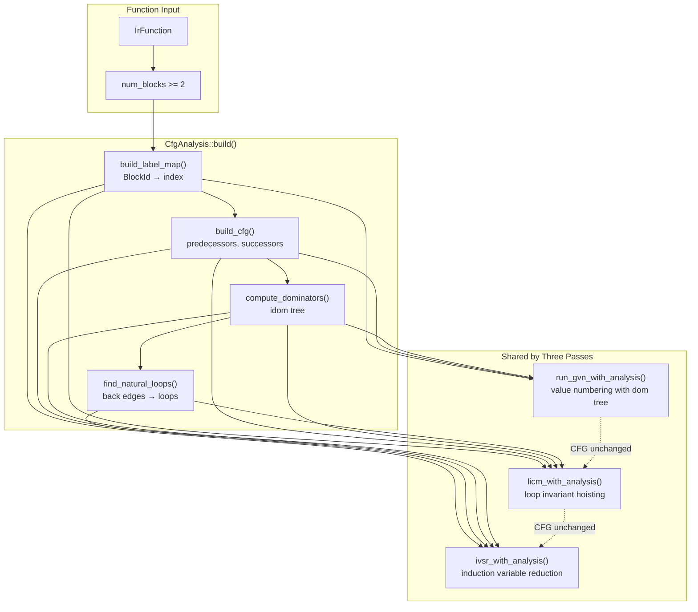
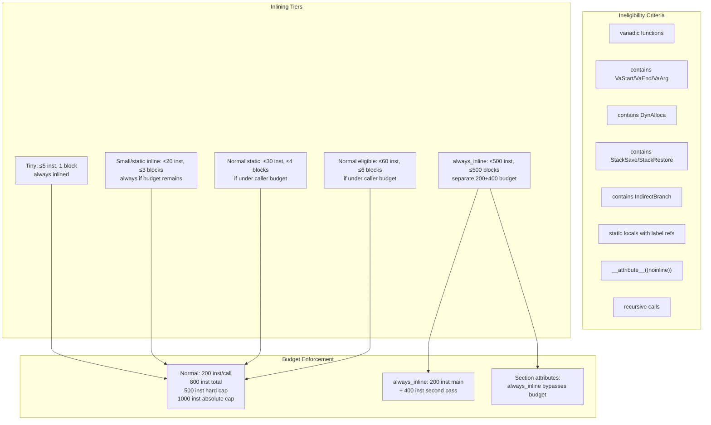

<!-- source: DeepWiki mcp.deepwiki.com · repo anthropics/claudes-c-compiler · page 4 Optimization Passes · fetched 2026-10-26 -->

# Optimization Passes

<details>
<summary>Relevant source files</summary>

The following files were used as context for generating this wiki page:

- [src/backend/liveness.rs](src/backend/liveness.rs)
- [src/backend/regalloc.rs](src/backend/regalloc.rs)
- [src/passes/README.md](src/passes/README.md)
- [src/passes/cfg_simplify.rs](src/passes/cfg_simplify.rs)
- [src/passes/constant_fold.rs](src/passes/constant_fold.rs)
- [src/passes/copy_prop.rs](src/passes/copy_prop.rs)
- [src/passes/if_convert.rs](src/passes/if_convert.rs)
- [src/passes/inline.rs](src/passes/inline.rs)
- [src/passes/licm.rs](src/passes/licm.rs)
- [src/passes/mod.rs](src/passes/mod.rs)
- [src/passes/narrow.rs](src/passes/narrow.rs)
- [src/passes/simplify.rs](src/passes/simplify.rs)

</details>


This document describes the multi-phase optimization pass pipeline that transforms the compiler's intermediate representation (IR) to produce better machine code. The pipeline performs intraprocedural and interprocedural analyses and transformations including constant folding, dead code elimination, loop optimizations, function inlining, and algebraic simplification.

For information about IR structure and lowering from AST, see [IR and Lowering](#3). For backend code generation, see [Backend Code Generation](#5).

**Design Philosophy**: All optimization levels (`-O0` through `-O3`, `-Os`, `-Oz`) run the same full set of passes. While the compiler is maturing, having separate tiers creates hard-to-find bugs where code works at one level but breaks at another. Running all passes at all levels maximizes test coverage of the optimizer and catches issues early.

Sources: [src/passes/mod.rs:6-11](), [src/passes/README.md:8-11]()

## Pipeline Architecture

The optimization pipeline executes in four sequential phases with an iterative main loop:

```mermaid
graph TB
    subgraph Phase0["Phase 0: Inlining"]
        INLINE["inline<br/>function inlining"]
        GNU["gnu_inline conversion"]
        M2R["mem2reg<br/>promote allocas to SSA"]
        CF1["constant_fold × 1"]
        CP1["copy_prop × 1"]
        SIMP1["simplify × 1"]
        CF2["constant_fold × 2"]
        CP2["copy_prop × 2"]
        RASM["resolve_asm<br/>inline asm symbols"]
    end
    
    subgraph Phase05["Phase 0.5: IsConstant"]
        ISCONST["resolve_remaining_is_constant<br/>__builtin_constant_p resolution"]
    end
    
    subgraph MainLoop["Main Loop (up to 3 iterations)"]
        direction TB
        CFG1["cfg_simplify<br/>fold branches, thread jumps"]
        CPROP1["copy_prop"]
        DIVCONST["div_by_const<br/>iter 0, 64-bit only"]
        NARROW["narrow<br/>eliminate widen-op-narrow"]
        SIMPLIFY["simplify<br/>algebraic identities"]
        CONSTFOLD["constant_fold<br/>compile-time evaluation"]
        
        subgraph SharedCFG["Shared CFG Analysis"]
            GVN["gvn<br/>value numbering, CSE"]
            LICM["licm<br/>hoist loop invariants"]
            IVSR["iv_strength_reduce<br/>iter 0 only"]
        end
        
        IFCONV["if_convert<br/>branch → select"]
        CPROP2["copy_prop"]
        DCE["dce<br/>dead code elimination"]
        CFG2["cfg_simplify"]
        IPCP["ipcp<br/>interprocedural const prop"]
    end
    
    subgraph Phase11["Phase 11: Cleanup"]
        DEADSTATIC["dead_statics<br/>remove unreferenced statics"]
    end
    
    INLINE --> GNU
    GNU --> M2R
    M2R --> CF1
    CF1 --> CP1
    CP1 --> SIMP1
    SIMP1 --> CF2
    CF2 --> CP2
    CP2 --> RASM
    RASM --> ISCONST
    
    ISCONST --> CFG1
    CFG1 --> CPROP1
    CPROP1 --> DIVCONST
    DIVCONST --> NARROW
    NARROW --> SIMPLIFY
    SIMPLIFY --> CONSTFOLD
    CONSTFOLD --> GVN
    GVN --> LICM
    LICM --> IVSR
    IVSR --> IFCONV
    IFCONV --> CPROP2
    CPROP2 --> DCE
    DCE --> CFG2
    CFG2 --> IPCP
    
    IPCP -.dirty tracking.-> CFG1
    IPCP --> DEADSTATIC
```



**Phase 0 - Inlining**: Function inlining runs first to substitute bodies of small static/inline functions and `__attribute__((always_inline))` functions. After inlining, a cleanup sequence (mem2reg, constant_fold, copy_prop, simplify) runs once to canonicalize the expanded IR. Functions with `gnu_inline` attribute are converted to declarations after inlining to prevent infinite recursion.

**Phase 0.5 - IsConstant Resolution**: After inlining, any `__builtin_constant_p` whose operand became constant has been resolved to `1`. The remaining `IsConstant` instructions are resolved to `0`, enabling `cfg_simplify` to fold conditional branches that test `__builtin_constant_p` results and eliminate dead code paths. This prevents linker errors for intentionally undefined symbols (e.g., the Linux kernel's `__bad_udelay()`).

**Main Loop**: Runs for up to 3 iterations with per-function dirty tracking. Each iteration executes the full sequence of intraprocedural passes plus one interprocedural pass (IPCP). The loop terminates early when either no changes occur (fixed point) or changes drop below 5% of the first iteration (diminishing returns).

**Phase 11 - Dead Static Elimination**: Removes internal-linkage functions and `static const` globals that are unreferenced after optimization. Essential for `static inline` functions from headers where dead code elimination makes some callees completely unreferenced.

Sources: [src/passes/mod.rs:167-181](), [src/passes/README.md:26-140]()

## Pass Execution Strategy

### Dirty Tracking and Iteration



The optimizer maintains two boolean vectors per iteration:
- **`dirty`**: Indicates which functions to visit during the current iteration. Initially all functions are dirty.
- **`changed`**: Accumulates which functions were modified by any pass during the current iteration.

The helper function `run_on_visited` enforces the dirty-tracking contract: it skips declaration-only functions entirely, skips non-dirty functions, and marks a function as changed whenever a pass reports modifications.

At the end of each iteration, `dirty` and `changed` are swapped: only functions that were actually modified become dirty for the next iteration, ensuring functions that have converged are not revisited.

Sources: [src/passes/mod.rs:143-165](), [src/passes/README.md:143-195]()

### Per-Pass Skip Logic



The pipeline tracks change counts for each pass in the previous iteration. Before running a pass, the pipeline checks whether the pass itself or any of its upstream dependencies made changes last time using the `should_run!` macro. If neither the pass nor its upstream passes produced changes, the pass is skipped entirely for the current iteration.

On the first iteration, all previous-change counts are set to `usize::MAX` so every pass runs unconditionally.

**Diminishing Returns Early Exit**: The pipeline tracks total changes (excluding DCE) from the first iteration as a baseline. If a subsequent iteration produces fewer than 5% of that baseline and IPCP did not make changes, the loop exits early. DCE is excluded because its large change count (often thousands of removed dead instructions) would inflate the baseline and make productive later iterations look like diminishing returns.

The pipeline guarantees at least two full iterations before the diminishing-returns check can trigger, because multi-step constant propagation chains need at least two iterations to fully propagate.

Sources: [src/passes/mod.rs:318-336](), [src/passes/README.md:161-195]()

## Shared CFG Analysis



Three passes in the main loop (GVN, LICM, IVSR) all require the same expensive CFG analysis: label maps, predecessor/successor adjacency, dominator trees, and natural loop detection. Rather than computing this independently in each pass, the function `run_gvn_licm_ivsr_shared` builds a single `CfgAnalysis` per function and passes it to all three.

This sharing is sound because:
- **GVN** only replaces operands within existing instructions; it does not add, remove, or reorder blocks, so the CFG structure is unchanged after GVN.
- **LICM** hoists instructions into preheader blocks but does not add or remove blocks from the CFG, so the analysis remains valid for IVSR.

For single-block functions, only GVN runs via a fast path that skips CFG analysis entirely, since LICM and IVSR require at least two blocks to form a loop.

Sources: [src/passes/mod.rs:65-165](), [src/passes/README.md:199-217]()

## Phase 0: Function Inlining

The inliner substitutes callee function bodies into call sites to eliminate call overhead and expose cross-function optimization opportunities. Inlining runs before the main optimization loop because it creates the most significant opportunities for constant propagation, dead code elimination, and wrapper function elimination.

### Eligibility and Heuristics



**Inlining Tiers** (per [src/passes/inline.rs:20-163]()):

| Category | Instruction Limit | Block Limit | Budget | Notes |
|----------|------------------|-------------|--------|-------|
| Tiny | 5 | 1 | Ignores caller size | Always inlined to avoid linker errors |
| Small / static inline | 20 | 3 | Normal budget | Always inlined if budget not exhausted |
| Normal static | 30 | 4 | Normal budget | Inlined if under caller budget |
| Normal eligible | 60 | 6 | Normal budget | Inlined if under caller budget |
| `always_inline` | 500 | 500 | 200 + 400 separate | Section attributes bypass budget |

**Budget System**:
- **Normal inlining**: Stops when caller exceeds 200 instructions or 800 total inlined instructions, with hard cap at 500 instructions (1000 absolute cap)
- **always_inline budget**: 200 instructions in main loop, kept low to prevent stack frame bloat (CCC allocates ~8 bytes per SSA value on stack)
- **Section attribute bypass**: When caller has section attribute (e.g., `.init.text`), `always_inline` callees bypass budget entirely
- **Second pass**: After main loop, remaining `always_inline` sites processed with independent 400-instruction budget and up to 300 rounds

Each caller processes up to 200 inlining rounds to handle chains of inlined calls (A calls B calls C, where B inlined into A exposes call to C).

Sources: [src/passes/inline.rs:314-551](), [src/passes/README.md:222-279]()

### Inlining Mechanics

The inliner clones the callee's blocks with remapped value and block IDs, wires arguments by inserting stores into the callee's parameter allocas, creates a merge block for the return value (using a phi if the callee has multiple return paths), and splices the cloned blocks into the caller. After all inlining is complete, inline assembly symbol references are resolved by tracing value chains back through `Load`, `Store`, `Copy`, `GEP`, and `GlobalAddr` instructions.

Sources: [src/passes/inline.rs:552-1200]()

## Main Loop Passes

### cfg_simplify - CFG Simplification

Simplifies the control flow graph through seven sub-passes that run to a fixpoint (repeating until no sub-pass makes changes):

1. **Fold constant conditional branches**: Resolves `CondBranch` conditions by walking Copy, Phi, Cmp, Select, and Cast chains both locally within a block and globally across single-predecessor chains (up to 8 hops) and across all blocks (up to 16 recursion depth). When condition resolves to constant, replaces with unconditional jump.

2. **Fold constant switches**: If Switch discriminant resolves to constant, replaces with direct branch to matching case (or default).

3. **Simplify redundant conditional branches**: When CondBranch has both targets pointing to same block, replaces with unconditional branch.

4. **Thread jump chains**: Identifies empty blocks (no instructions, unconditional branch terminator) and redirects their predecessors to final target. Chains followed transitively with cycle detection, up to depth limit of 32 hops. Safety check prevents threading when it would merge CondBranch edges that carry conflicting phi values.

5. **Remove dead blocks**: BFS from entry block to compute reachability (also marking blocks referenced by `LabelAddr`, inline asm goto labels, and global initializer label blocks). Unreachable blocks removed and phi entries in surviving blocks cleaned up.

6. **Simplify trivial phis**: Phi nodes with single incoming edge, or where all incoming values are identical, replaced with `Copy` instructions.

7. **Merge single-predecessor blocks**: When block A ends with unconditional branch to block B and B has exactly one predecessor (A), fuses B into A. Skips blocks referenced by `LabelAddr`, inline asm goto labels, or global initializer labels.

This pass appears twice in each iteration: once at the beginning (to clean up from previous iteration's constant folding and DCE) and once at the end (to clean up after current iteration's DCE and if-conversion).

Sources: [src/passes/cfg_simplify.rs:1-80](), [src/passes/README.md:281-321]()

### copy_prop - Copy Propagation

Replaces uses of a `Copy` instruction's destination with the Copy's source operand, transitively following chains of copies. Important because many other passes produce copies: phi simplification, mem2reg, algebraic simplification (when an identity like `x + 0` reduces to `x`), and GVN.

Uses a flat `Vec<Option<Operand>>` indexed by value ID for O(1) lookups, taking advantage of dense sequential SSA value IDs. Chain resolution uses union-find-style path compression: when resolving `%a = Copy %b` and `%b = Copy %c`, all intermediate entries updated to point directly to `%c` in single pass, giving amortized O(1) resolution. Multi-def detection prevents propagating ambiguous values. Chain depth limited to 64 hops to prevent pathological cases.

After copy propagation, dead Copy instructions cleaned up by DCE. Appears twice in each iteration: once early (after CFG simplification) and once late (after GVN, LICM, if-conversion).

Sources: [src/passes/copy_prop.rs:1-370](), [src/passes/README.md:323-344]()

### div_by_const - Division by Constant Strength Reduction

Replaces integer division and modulo by compile-time constants with equivalent multiply-and-shift sequences. On x86, `div`/`idiv` instructions cost 20-90 cycles, while replacement sequence costs 3-5 cycles.

**Supported transformations**:
- **Unsigned division** (`x /u C`): replaced with widened multiply by magic number followed by right shift, using algorithm from Hacker's Delight by Henry S. Warren Jr.
- **Signed division by power-of-2** (`x /s 2^k`): replaced with biased arithmetic right shift handling negative rounding correctly
- **Signed division by constant** (`x /s C`): replaced with magic-number multiply, shift, and sign correction
- **Signed division by negative constant** (`x /s -C`): delegates to positive-constant case and negates result
- **Modulo** (`x % C`): rewritten as `x - (x / C) * C` using optimized division

**Only 32-bit operand values currently optimized**: For native I32/U32 types, pass applies directly. For I64/U64 operations, pass performs value-range analysis to detect operands provably 32-bit (e.g., values produced by zero-extending or sign-extending from 32-bit type, or loaded from 32-bit memory location). When both dividend and divisor fit in 32 bits, generates 32-bit magic-number sequence operating within 64-bit type. Genuine 64-bit divisions fall through to native `div`/`idiv`.

Pass disabled on 32-bit targets (i686) because generated 64-bit multiply-and-shift sequences cannot be executed correctly by 32-bit backend. Runs only during first iteration of main loop; subsequent iterations clean up expanded instruction sequences.

Sources: [src/passes/div_by_const.rs:1-500](), [src/passes/README.md:346-382]()

### narrow - Integer Narrowing

Eliminates unnecessary widening introduced by C's integer promotion rules. Compiler's frontend promotes sub-64-bit operands to I64 before performing arithmetic, then narrows result back, creating widen-operate-narrow pattern that generates redundant sign/zero-extension instructions.

**Three transformation phases**:

**Phase 1: Narrow binary operations with explicit narrowing cast**. Detects canonical pattern:
```
%w = Cast %x, I32 -> I64       (widen)
%r = BinOp add %w, %y, I64    (operate at I64)
%n = Cast %r, I64 -> I32       (narrow)
```
Rewrites to operate directly at narrow type:
```
%r = BinOp add %x, narrow(%y), I32
```
Safe for operations where low bits are width-independent when truncated: Add, Sub, Mul, And, Or, Xor, Shl. Right shifts safe when extension type matches shift type (arithmetic shift with sign extension, logical shift with zero extension).

**Phase 2: Narrow binary operations without explicit cast**. On 64-bit targets, narrows I64 bitwise operations (And, Or, Xor) to I32 when all operands provably 32-bit values, even without explicit narrowing cast. Uses both widening cast map and load-type map to identify narrow operands. Disabled on 32-bit targets and restricted to I32/U32 output.

**Phase 3: Narrow comparisons**. When both operands of comparison widened from same type, narrows comparison to operate at original type. Signed comparisons (Slt/Sle/Sgt/Sge) require source type to be signed; unsigned comparisons (Ult/Ule/Ugt/Uge) require unsigned; Eq/Ne safe with either sign.

Sources: [src/passes/narrow.rs:1-340](), [src/passes/README.md:384-428]()

### simplify - Algebraic Simplification

Applies algebraic identities, strength reductions, and peephole optimizations to individual instructions. One of the broadest passes in pipeline.

**Identity simplifications** (integer-only, to preserve IEEE 754 float semantics):
```
x + 0 => x          x - 0 => x          x - x => 0
x * 0 => 0          x * 1 => x          x / 1 => x
x / x => 1          x % 1 => 0          x % x => 0
x & 0 => 0          x & ~0 => x         x & x => x
x | 0 => x          x | ~0 => ~0        x | x => x
x ^ 0 => x          x ^ x => 0
x << 0 => x         x >> 0 => x
```

Float identities restricted to cases respecting IEEE 754: `x * 1.0` and `x / 1.0` safe, but `x + 0.0`, `x * 0.0`, `x - x`, `x / x` not (due to signed zeros, NaN, infinity).

**Strength reductions** (integer-only):
```
x * 2     => x + x
x * 2^k   => x << k
x * (-1)  => neg(x)
x /u 2^k  => x >>l k    (unsigned only)
x %u 2^k  => x & (2^k - 1)   (unsigned only)
```

**Constant reassociation**: When binary operation's operand is itself binary operation with constant, two constants combined. Examples: `(x + 3) + 5 => x + 8`, `(x * 4) * 8 => x * 32`, `(x & 0xFF) & 0x0F => x & 0x0F`, `(x << 2) << 3 => x << 5`. When combined constant is identity element, entire operation eliminated.

**Cast chain optimization**:
```
Cast(x, T -> T)                       => Copy(x)       (identity cast)
Cast(const, A -> B)                   => Copy(folded)   (constant cast)
Cast(Cast(x:A, A->B), B->A) where A<=B => Copy(x)     (widen then narrow back)
Cast(Cast(x, A->B), B->C) where A<B<C  => Cast(x, A->C)  (double widen, same sign)
Cast(Cast(x, A->B), B->C) where A>B>C  => Cast(x, A->C)  (double narrow)
```

**Comparison simplifications**:
- Self-comparison: `Cmp(Eq, x, x)` => 1, `Cmp(Slt, x, x)` => 0 (integer-only)
- Boolean test elimination: `Cmp(Ne, bool, 0)` => `bool`, `Cmp(Eq, bool, 0)` => inverted comparison
- Unsigned-zero: `Ult x, 0` => 0, `Uge x, 0` => 1, `Ule x, 0` => `Eq x, 0`, `Ugt x, 0` => `Ne x, 0`

**Math library call lowering**: Recognized calls replaced with IR intrinsics: `sqrt`/`sqrtf` => `SqrtF64`/`SqrtF32`, `fabs`/`fabsf` => `FabsF64`/`FabsF32`, `pow(x, 0.0)` => `1.0`, `pow(x, 2.0)` => `x * x`, etc.

Sources: [src/passes/simplify.rs:1-800](), [src/passes/README.md:429-516]()

### constant_fold - Constant Folding

Evaluates operations whose operands are all compile-time constants, replacing instruction with computed result. Runs to fixpoint within each function, rebuilding constant map each iteration so folded results chain into subsequent folds.

**Folded operation types**:
- **BinOp**: all integer arithmetic, bitwise, shift operations. Float (F32/F64) arithmetic via native IEEE 754. F128/long double via platform-specific x87 (x86/i686) or software f128 (ARM/RISC-V) arithmetic. I128 via native Rust i128.
- **UnaryOp**: Neg, Not, Clz, Ctz, Popcount (width-sensitive), Bswap (16/32/64-bit), IsConstant.
- **Cmp**: all 10 comparison operators for integer, float, F128 (with correct NaN unordered handling), I128.
- **Cast**: integer-to-integer (with proper width truncation), float-to-float, float-to-int (with NaN/Inf/out-of-range safety), int-to-float, I128 casts with proper sign/zero extension.
- **Select**: both-arms-same folding, constant-condition folding, both-arms-same-constant folding.
- **GetElementPtr**: constant base + constant offset.

**Width sensitivity**: Sub-32-bit types (I8, U8, I16, U16) require careful promotion. Constant map tracks target type of Cast instructions so I8 values sign-extended while U8 values zero-extended, implementing C11 integer promotion semantics.

**IsConstant handling**: Pass folds `IsConstant` to 1 when operand is compile-time constant. Non-constant operands left for Phase 0.5 resolution step.

Sources: [src/passes/constant_fold.rs:1-700](), [src/passes/README.md:517-553]()

## Analysis and Loop Optimization Passes

### gvn - Global Value Numbering

Dominator-based common subexpression elimination (CSE) pass with redundant load elimination and store-to-load forwarding. Walks dominator tree in depth-first order, maintaining scoped hash tables that map expression keys to previously computed values.

**Value-numbered expression types**:
- **BinOp**: with commutative operand canonicalization (smaller value number first), so `a + b` and `b + a` receive same value number
- **UnaryOp**: unary operations
- **Cmp**: comparisons (without commutative canonicalization)
- **Cast**: type conversions keyed by source and destination type. Excluded for 128-bit types.
- **GetElementPtr**: base + offset address computations
- **Load**: redundant load elimination. Excluded for float, long double, 128-bit types.

**Redundant load elimination**: Two loads from same pointer with same type produce same value if no intervening memory modification occurs. Load value numbers use generation counter: any memory-clobbering instruction (Store, Call, CallIndirect, Memcpy, atomic operations, InlineAsm, fences) bumps generation, instantly invalidating all cached load entries. At block merge points (blocks with >1 predecessor), generation also bumped to conservatively invalidate inherited load entries.

**Store-to-load forwarding**: When Store writes value V to pointer P, subsequent Load from P (matching value number and type, same generation) replaced with `Copy(V)`. Tracked with same generation scheme as load CSE. Forwarding disabled for escaped parameter allocas to preserve correctness of backend's ParamRef optimization.

**Scoped hash tables**: Pass maintains four rollback logs (pure expressions, load entries, store-forwarding entries, value number assignments). On entering dominator subtree, current log positions saved. On backtracking, all entries beyond saved position undone, giving scoped hash-table semantics without cloning.

Sources: [src/passes/gvn.rs:1-600](), [src/passes/README.md:555-593]()

### licm - Loop-Invariant Code Motion

Identifies natural loops in CFG and hoists loop-invariant instructions to preheader blocks that execute before loop. Instruction is loop-invariant if all operands are constants, defined outside loop, or themselves defined by loop-invariant instructions (computed to fixpoint).

Loops processed innermost-first (sorted by body size). Each loop must have single-entry preheader block; loops with multiple outside predecessors skipped. Hoisted instructions topologically sorted (Kahn's algorithm) before insertion into preheader to ensure def-before-use ordering.

**Safety rules**:
- **Pure instructions** (arithmetic, casts, GEP, Copy, GlobalAddr, Select, pure Intrinsics) always hoistable. Division and remainder excluded because they can trap (SIGFPE on divide-by-zero).
- **Loads from non-address-taken allocas** hoistable when alloca not stored to inside loop body.
- **Loads from GlobalAddr pointers** hoistable when loop contains no calls, no stores to any global-derived pointer, and no direct stores to that specific global.
- **Loads from address-taken allocas** never hoistable because stores through derived pointers may not be tracked.
- **All other loads** (runtime-computed pointers) conservatively rejected since there is no alias analysis.

Sources: [src/passes/licm.rs:1-400](), [src/passes/README.md:595-621]()

### iv_strength_reduce - Induction Variable Strength Reduction

Transforms expensive per-iteration index computations in loops into cheaper pointer increment operations. For typical array access pattern `for (int i = 0; i < n; i++) sum += arr[i];`, IR computes `base + i * sizeof(int)` every iteration via cast, shift (or multiply), and GEP. After strength reduction, loop maintains running pointer incremented by `sizeof(int)` each iteration, eliminating per-iteration multiply and cast.

**Finding induction variables**: Scans phi nodes in loop header for basic induction variables: `%iv = phi(init, %iv_next)` where `%iv_next = %iv + constant_step`. Supports looking through Cast and Copy chains to find back-edge increment. Only single-latch loops (exactly one back-edge block) supported.

**Finding derived expressions**: Once basic IVs identified, looks for multiplications or shifts by constants where one operand derives from basic IV (following Cast and Copy chains for up to 3 propagation passes). These derived expressions that feed into GEP instructions become candidates for strength reduction.

**Applying transformation**: For each eligible GEP, creates new pointer induction variable (phi in loop header) that starts at initial pointer and increments by `iv.step * stride` bytes each iteration. Original GEP replaced with copy of new pointer IV. Dead original computations removed by subsequent DCE.

| Limit | Value | Purpose |
|-------|-------|---------|
| Max stride | 1024 bytes | Avoids unusual access patterns |
| Max cast chain depth | 10 | Prevents pathological chain following |
| Shift amount range | 0..64 | Validates shift amounts before computing stride |

Runs only during first iteration of main loop. Uses shared CFG analysis with GVN and LICM.

Sources: [src/passes/iv_strength_reduce.rs:1-400](), [src/passes/README.md:623-663]()

### if_convert - If-Conversion

Converts simple diamond and triangle branch-and-phi patterns into `Select` instructions, which lower to conditional moves (`cmov` on x86, `csel` on AArch64).

**Diamond pattern**:
```
pred:
    condbranch %cond, true_block, false_block
true_block:                          false_block:
    (0-8 side-effect-free instrs)       (0-8 side-effect-free instrs)
    branch merge                        branch merge
merge:
    %result = phi [true_val, true_block], [false_val, false_block]
```

**Triangle pattern** (one arm falls through to merge):
```
pred:
    condbranch %cond, arm, merge
arm:
    (0-8 side-effect-free instructions)
    branch merge
merge:
    %result = phi [arm_val, arm], [pred_val, pred]
```

Both patterns rewritten to:
```
pred:
    (hoisted arm instructions)
    %result = select %cond, true_val, false_val
    branch merge
```

Each arm may contain up to 8 instructions (to accommodate C type system patterns like Load + Cast chains that inflate instruction count). Both arms must be side-effect-free: no stores, calls, loads, atomics, division/remainder (can trap), or inline assembly. Branches with already-constant conditions skipped (deferred to cfg_simplify). F128 and I128 phi types rejected. Pass iterates to fixpoint within each invocation, since converting one diamond may expose another.

Sources: [src/passes/if_convert.rs:1-420](), [src/passes/README.md:665-713]()

## Interprocedural Passes

### ipcp - Interprocedural Constant Propagation

Performs three optimizations across function boundaries:

1. **Constant return propagation**: Identifies defined, non-weak, non-variadic, side-effect-free functions that return same constant on every return path. Replaces all `Call` instructions to these functions with constant value. Side-effect-free means no stores, calls, loads, atomics, inline asm, memcpy, or va_arg operations.

2. **Dead call elimination**: Identifies defined, non-weak, side-effect-free, void-returning functions with no `Unreachable` terminators (traps are observable side effects). Removes entire `Call` instructions to these functions from all callers. Eliminates references to symbols that would otherwise cause linker errors.

3. **Constant argument propagation**: For static, defined, non-weak, non-variadic functions: when all call sites pass same constant for given parameter, replaces `ParamRef` instruction in function body with copy of that constant. Functions whose address is taken (via `GlobalAddr` or global initializer references) have all parameters marked as varying since they may be called indirectly with unknown arguments.

IPCP runs at end of every iteration (not just first), because earlier passes within same iteration may simplify call arguments to constants (e.g., phi nodes collapsed after CFG simplification resolves dead branches). When IPCP makes changes, pipeline marks all functions dirty and always runs at least one more iteration to allow cleanup passes to process newly exposed constants.

Sources: [src/passes/ipcp.rs:1-400](), [src/passes/README.md:715-744]()

### dce - Dead Code Elimination

Removes instructions whose results never used by any other instruction or terminator. Uses use-count-based worklist algorithm with O(n) complexity:

1. Build use counts for all values in single forward pass. Self-referencing phi edges (`v = phi [..., v, ...]`) excluded from count to prevent dead self-referencing phis from surviving.
2. Build definition map from value IDs to their defining instruction locations, excluding side-effecting instructions.
3. Seed worklist with non-side-effecting instructions that have zero use count.
4. Process worklist: for each dead instruction, decrement its operands' use counts (saturating); if any operand's count drops to zero, add its defining instruction to worklist.
5. Sweep all dead instructions in single pass.

**Side-effecting instructions** never removed regardless of whether result is used: Store, Call, CallIndirect, Alloca, DynAlloca, Memcpy, all atomic operations (including Fence), InlineAsm, StackRestore, VaStart/VaEnd/VaCopy/VaArg/VaArgStruct, multi-return helpers (GetReturn*Second, SetReturn*Second), and Intrinsics that are non-pure or have destination pointer.

Sources: [src/passes/dce.rs:1-400](), [src/passes/README.md:746-770]()

### dead_statics - Dead Static Function and Global Elimination

Removes internal-linkage (`static`) functions and `static const` globals that are unreachable from any externally visible symbol. Uses BFS reachability analysis:

**Roots** (seeds for BFS):
- All non-static defined functions and non-static defined globals
- Functions and globals with `is_used` attribute
- All aliases (both alias name and its target)
- All constructors and destructors
- Address-taken `static always_inline` functions
- Static symbols whose names appear in `toplevel_asm` (conservative check)
- Common globals

**References** scanned from function bodies (`Call`, `GlobalAddr`, `InlineAsm.input_symbols`) and global initializer trees. Any static symbol not reached during BFS removed from module. After removal, pass also cleans up `module.symbol_attrs` to remove entries for unreferenced symbols.

Sources: [src/passes/dead_statics.rs:1-200](), [src/passes/README.md:771-790]()

## Performance Characteristics

### Liveness Analysis

The liveness analysis used by register allocation (see [Register Allocation](#5.6)) uses compact bitsets instead of hash sets for gen/kill/live_in/live_out. Value IDs remapped to dense [0..N) range so bitsets are minimal size. This eliminates per-iteration heap allocation and replaces hash-table operations with fast word-level bitwise ops (union = OR, difference = AND-NOT, equality = ==).

The analysis uses backward dataflow iteration to correctly handle loops:
1. Assign sequential program points to all instructions and terminators
2. Run backward dataflow to compute live-in/live-out sets for each block (correctly handles values live across loop back-edges)
3. Build intervals by taking union of def/use points and live-through blocks

Sources: [src/backend/liveness.rs:1-600]()

### Register Allocation Priority

Register allocation uses weighted use counts where uses inside loops are weighted more heavily. A use inside loop at depth D contributes 10^D to weighted use count (so use in singly-nested loop counts 10x, doubly-nested counts 100x). This ensures inner-loop temporaries get priority for register allocation over values in straight-line code, critical for performance in compute-heavy loops.

Three-phase allocation:
1. **Callee-saved registers**: Assigned to values whose live ranges span function calls (preserved across calls by ABI)
2. **Caller-saved registers**: Assigned to values whose live ranges do NOT span any function call (destroyed by calls)
3. **Callee-saved spillover**: Remaining callee-saved registers assigned to highest-priority non-call-spanning values

Sources: [src/backend/regalloc.rs:1-400]()

---

