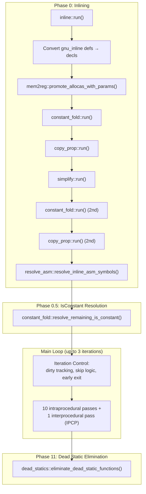
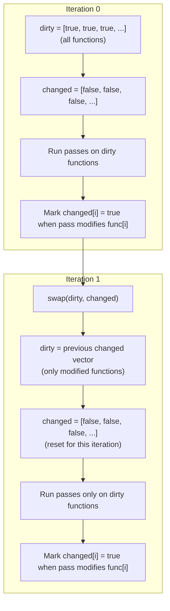
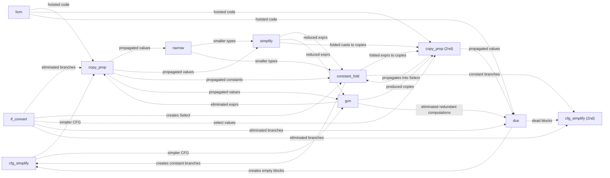
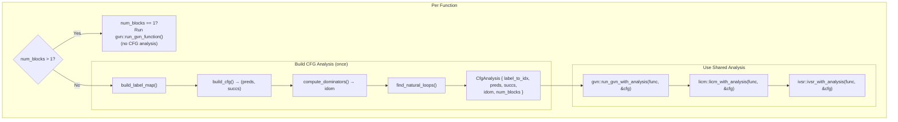

<!-- source: DeepWiki mcp.deepwiki.com · repo anthropics/claudes-c-compiler · page 4.1 Pass Pipeline Architecture · fetched 2026-10-26 -->

# Pass Pipeline Architecture

<details>
<summary>Relevant source files</summary>

The following files were used as context for generating this wiki page:

- [src/backend/liveness.rs](src/backend/liveness.rs)
- [src/backend/regalloc.rs](src/backend/regalloc.rs)
- [src/passes/README.md](src/passes/README.md)
- [src/passes/cfg_simplify.rs](src/passes/cfg_simplify.rs)
- [src/passes/constant_fold.rs](src/passes/constant_fold.rs)
- [src/passes/copy_prop.rs](src/passes/copy_prop.rs)
- [src/passes/if_convert.rs](src/passes/if_convert.rs)
- [src/passes/inline.rs](src/passes/inline.rs)
- [src/passes/licm.rs](src/passes/licm.rs)
- [src/passes/mod.rs](src/passes/mod.rs)
- [src/passes/narrow.rs](src/passes/narrow.rs)
- [src/passes/simplify.rs](src/passes/simplify.rs)

</details>


## Purpose and Scope

This document describes the architecture of the optimization pass pipeline: how passes are organized into phases, how the pipeline controls iteration and convergence, and how passes coordinate to avoid redundant work. For details on individual optimization passes (inlining, GVN, LICM, etc.), see [4.2](#4.2), [4.3](#4.3), and [4.4](#4.4).

The pass pipeline transforms IR from the lowering phase ([3](#3)) into optimized IR suitable for code generation ([5](#5)). All optimization levels (`-O0` through `-O3`, `-Os`, `-Oz`) run the same full pipeline to maximize test coverage and avoid level-specific bugs.

**Sources:** [src/passes/README.md:1-23](), [src/passes/mod.rs:243-268]()

## Pipeline Phases

The optimizer executes in four sequential phases: inlining, `IsConstant` resolution, the main iterative loop, and dead static elimination.

### Phase Diagram



**Sources:** [src/passes/README.md:26-68](), [src/passes/mod.rs:213-240](), [src/passes/mod.rs:275-551]()

### Phase 0: Inlining and Cleanup

Function inlining runs first to expose cross-function optimization opportunities. The `inline::run()` function substitutes callee bodies into call sites using a budget-based heuristic. After inlining completes, `extern inline` functions with the `gnu_inline` attribute are converted to declarations (lines 226-231) to prevent infinite recursion.

A fixed cleanup sequence runs once on the freshly inlined code:
1. **mem2reg** promotes stack allocations back to SSA registers
2. **constant_fold** folds constants exposed by inlining
3. **copy_prop** propagates copies from phi elimination
4. **simplify** applies algebraic identities
5. **constant_fold** (2nd) catches additional folding opportunities
6. **copy_prop** (2nd) cleans up remaining copies
7. **resolve_asm** resolves inline assembly symbol references

**Sources:** [src/passes/mod.rs:213-240](), [src/passes/README.md:72-96]()

### Phase 0.5: IsConstant Resolution

After inlining, any `__builtin_constant_p` call whose operand became a compile-time constant has already been resolved to `1` by constant folding. The remaining `IsConstant` instructions have operands that are definitively not compile-time constants (parameters, globals, etc.), so this phase resolves them all to `0`.

This resolution is critical for enabling `cfg_simplify` to fold conditional branches that test `__builtin_constant_p` results and eliminate dead code paths. Without it, unreachable function calls guarded by `__builtin_constant_p` would survive into the object file and cause linker errors for intentionally undefined symbols (e.g., the Linux kernel's `__bad_udelay()`).

**Sources:** [src/passes/mod.rs:276](), [src/passes/README.md:98-112](), [src/passes/constant_fold.rs:26-58]()

### Main Loop Structure

The main loop iterates up to 3 times, running a fixed sequence of intraprocedural passes followed by one interprocedural pass (IPCP). The loop uses per-function dirty tracking and per-pass skip logic, terminating early when either no pass made changes or the iteration produced fewer than 5% as many changes as the first iteration.

```mermaid
graph LR
    subgraph MainIteration["Main Loop Iteration (0..3)"]
        direction TB
        CFG1["cfg_simplify (1st)"]
        CPROP1["copy_prop (1st)"]
        DIVCONST["div_by_const<br/>(iter 0 only, 64-bit only)"]
        NARROW["narrow"]
        SIMPLIFY["simplify"]
        CONSTFOLD["constant_fold"]
        
        subgraph SharedCFG["Shared CFG Analysis"]
            GVN["gvn"]
            LICM["licm"]
            IVSR["iv_strength_reduce<br/>(iter 0 only)"]
        end
        
        IFCONV["if_convert"]
        CPROP2["copy_prop (2nd)"]
        DCE["dce"]
        CFG2["cfg_simplify (2nd)"]
        IPCP["ipcp (interprocedural)"]
        
        CFG1 --> CPROP1
        CPROP1 --> DIVCONST
        DIVCONST --> NARROW
        NARROW --> SIMPLIFY
        SIMPLIFY --> CONSTFOLD
        CONSTFOLD --> GVN
        GVN --> LICM
        LICM --> IVSR
        IVSR --> IFCONV
        IFCONV --> CPROP2
        CPROP2 --> DCE
        DCE --> CFG2
        CFG2 --> IPCP
    end
    
    IPCP --> CHECK{"Fixed point or<br/>diminishing returns?"}
    CHECK -->|No| MainIteration
    CHECK -->|Yes| EXIT["Exit to Phase 11"]
```



**Sources:** [src/passes/mod.rs:297-539](), [src/passes/README.md:114-139]()

### Phase 11: Dead Static Elimination

After all intraprocedural optimizations complete, `dead_statics::eliminate_dead_static_functions()` removes internal-linkage (`static`) functions and `static const` globals that are no longer referenced by any live symbol. This is essential for `static inline` functions from headers: after optimization eliminates dead code paths, some callees become completely unreferenced and can be removed.

**Sources:** [src/passes/mod.rs:550](), [src/passes/README.md:131-139]()

## Iteration Strategy

The pipeline uses three complementary mechanisms to avoid redundant work: dirty tracking, per-pass skip logic, and early exit heuristics.

### Dirty Tracking

The optimizer maintains two boolean vectors, each with one entry per function:
- **dirty**: indicates which functions should be visited during the current iteration
- **changed**: accumulates which functions were modified by any pass during the current iteration

At the start of the first iteration, every function is dirty. At the end of each iteration, `dirty` and `changed` are swapped (line 538): only functions that were actually modified become dirty for the next iteration.



The `run_on_visited()` helper function (lines 37-63) enforces the contract: it skips declaration-only functions entirely, skips non-dirty functions, and marks a function as changed whenever a pass reports modifications.

**Sources:** [src/passes/mod.rs:278-284](), [src/passes/mod.rs:538](), [src/passes/mod.rs:37-63](), [src/passes/README.md:143-159]()

### Per-Pass Skip Logic

In addition to per-function dirty tracking, the pipeline tracks how many changes each pass made in the previous iteration. Before running a pass, the pipeline checks whether the pass itself or any of its upstream dependencies made changes last time. If neither the pass nor its upstream passes produced any changes, the pass is skipped entirely.

This is driven by an explicit dependency graph encoded in the `should_run!` macro:

```rust
macro_rules! should_run {
    ($self_idx:expr, $($upstream:expr),*) => {{
        prev_pass_changes[$self_idx] > 0 $(|| prev_pass_changes[$upstream] > 0)*
    }};
}
```

Pass indices: `0=cfg1, 1=copyprop1, 2=narrow, 3=simplify, 4=constfold, 5=gvn, 6=licm, 7=ifconv, 8=copyprop2, 9=dce, 10=cfg2`.

On the first iteration, all `prev_pass_changes` are set to `MAX` so every pass runs unconditionally (line 292).

**Sources:** [src/passes/mod.rs:333-337](), [src/passes/mod.rs:290-293](), [src/passes/README.md:161-176]()

### Pass Dependency Graph

The dependency graph defines which passes create opportunities for which other passes:



**Example skip decision from [src/passes/mod.rs:341-346]():**
```rust
// Phase 1: CFG simplification
// Upstream: constfold (constant branches), dce (empty blocks)
if !dis.cfg && should_run!(0, 4, 9) {
    let n = timed_pass!("cfg_simplify1", ...);
    // ...
}
```

Here, `cfg_simplify` (pass 0) runs only if pass 0, pass 4 (`constant_fold`), or pass 9 (`dce`) made changes in the previous iteration.

**Sources:** [src/passes/mod.rs:319-337](), [src/passes/mod.rs:341-477](), [src/passes/README.md:161-176]()

### Early Exit Heuristics

The pipeline implements two early exit conditions:

1. **Fixed point detection** (line 498-500): If `total_changes == 0`, additional iterations are useless.

2. **Diminishing returns** (lines 527-532): If an iteration produced fewer than 5% as many changes as the first iteration (measured via `total_changes_excl_dce`), and IPCP did not make changes, the loop exits early. The 5% threshold saves one full pipeline iteration with negligible impact on optimization quality.

DCE is excluded from the diminishing-returns comparison because it is a cleanup pass whose large change count (often thousands of removed dead instructions) would inflate the baseline and make productive later iterations look like diminishing returns.

**Exception:** If IPCP made changes in an iteration, the pipeline always runs at least one more iteration regardless of diminishing returns, because IPCP changes (constant arguments, dead call elimination) require a full round of constant folding, DCE, and CFG simplification to clean up.

The pipeline also guarantees at least two full iterations before the diminishing-returns check can trigger (line 528: `iter > 1`), because multi-step constant propagation chains need at least two iterations to fully propagate.

**Sources:** [src/passes/mod.rs:497-532](), [src/passes/README.md:178-196]()

## Shared CFG Analysis

Three passes in the main loop—GVN, LICM, and IVSR—all require the same expensive CFG analysis: label maps, predecessor/successor adjacency, dominator trees, and natural loop detection. Rather than computing this independently in each pass, the function `run_gvn_licm_ivsr_shared()` builds a single `CfgAnalysis` per function and passes it to all three.

### Shared Analysis Architecture



This sharing is sound because:
- **GVN** only replaces operands within existing instructions; it does not add, remove, or reorder blocks, so the CFG structure is unchanged after GVN
- **LICM** hoists instructions into preheader blocks but does not add or remove blocks from the CFG, so the analysis remains valid for IVSR

For single-block functions, only GVN runs via a fast path that skips CFG analysis entirely (lines 100-109), since LICM and IVSR require at least two blocks to form a loop.

**Sources:** [src/passes/mod.rs:65-165](), [src/passes/mod.rs:409-429](), [src/passes/README.md:199-216]()

### Code Integration

The shared analysis logic resides in `run_gvn_licm_ivsr_shared()`:

```rust
fn run_gvn_licm_ivsr_shared(
    module: &mut IrModule,
    visit: &[bool],
    changed: &mut [bool],
    run_gvn: bool,
    run_licm: bool,
    run_ivsr: bool,
    time_passes: bool,
    iter: usize,
) -> (usize, usize, usize) {
    // ... iterate over dirty functions
    
    // GVN fast path: single-block functions don't need CFG analysis
    if num_blocks == 1 {
        if run_gvn {
            let n = gvn::run_gvn_function(func);
            // ...
        }
        continue;
    }
    
    // Build CFG analysis once for this function
    let cfg = CfgAnalysis::build(func);
    
    // Run GVN with shared analysis
    if run_gvn {
        let n = gvn::run_gvn_with_analysis(func, &cfg);
        // ...
    }
    
    // Run LICM with shared analysis (CFG still valid after GVN)
    if run_licm {
        let n = licm::licm_with_analysis(func, &cfg);
        // ...
    }
    
    // Run IVSR with shared analysis (CFG still valid after LICM)
    if run_ivsr {
        let n = iv_strength_reduce::ivsr_with_analysis(func, &cfg);
        // ...
    }
    
    (gvn_total, licm_total, ivsr_total)
}
```

**Sources:** [src/passes/mod.rs:73-165]()

## Implementation Details

### Module Entry Point

The `run_passes()` function is the main entry point, invoked from the driver after IR lowering:

```rust
pub(crate) fn run_passes(
    module: &mut IrModule, 
    _opt_level: u32, 
    target: crate::backend::Target
) {
    let disabled = std::env::var("CCC_DISABLE_PASSES").unwrap_or_default();
    if disabled.contains("all") {
        return;
    }
    
    run_inline_phase(module, &disabled);
    constant_fold::resolve_remaining_is_constant(module);
    
    let iterations = 3;
    let num_funcs = module.functions.len();
    let mut dirty = vec![true; num_funcs];
    let dis = DisabledPasses::from_env(&disabled);
    let mut changed = vec![false; num_funcs];
    
    // ... main loop (lines 297-539)
    
    dead_statics::eliminate_dead_static_functions(module);
}
```

The `_opt_level` parameter is accepted for API compatibility but currently ignored—all levels behave identically to maximize test coverage (lines 243-268).

**Sources:** [src/passes/mod.rs:269-551]()

### Pass Control Structures

| Data Structure | Type | Purpose |
|---------------|------|---------|
| `dirty` | `Vec<bool>` | Which functions to visit this iteration |
| `changed` | `Vec<bool>` | Which functions were modified this iteration |
| `prev_pass_changes` | `[usize; 11]` | Change count per pass from previous iteration |
| `cur_pass_changes` | `[usize; 11]` | Change count per pass in current iteration |
| `iter0_total_changes` | `usize` | Baseline for diminishing-returns check (excl. DCE) |
| `DisabledPasses` | `struct` | Per-pass enable/disable flags from env vars |

**Sources:** [src/passes/mod.rs:278-301](), [src/passes/mod.rs:183-211]()

### Environment Variables

| Variable | Effect |
|----------|--------|
| `CCC_DISABLE_PASSES=all` | Skip all optimization |
| `CCC_DISABLE_PASSES=cfg,gvn,...` | Disable specific passes (comma-separated) |
| `CCC_TIME_PASSES=1` | Print timing for each pass |

**Sources:** [src/passes/mod.rs:270-273](), [src/passes/mod.rs:286](), [src/passes/README.md:220-223]()

### Target-Specific Behavior

Some passes are conditionally enabled based on the target architecture:

- **div_by_const** (line 368): Disabled on 32-bit targets (i686) because it generates I64 multiply-and-shift sequences that the i686 backend cannot execute correctly
- **narrow** (phase 2 in narrow.rs:270): Restricts phase 2 narrowing to 64-bit targets to avoid sub-int register complications

**Sources:** [src/passes/mod.rs:358-372](), [src/passes/narrow.rs:263-289]()

---

