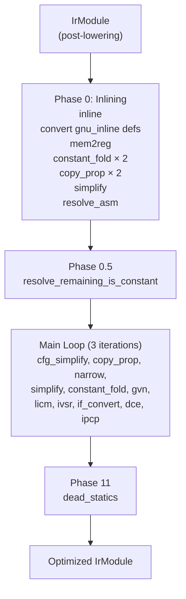
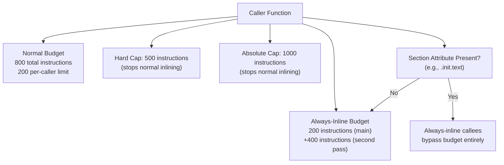
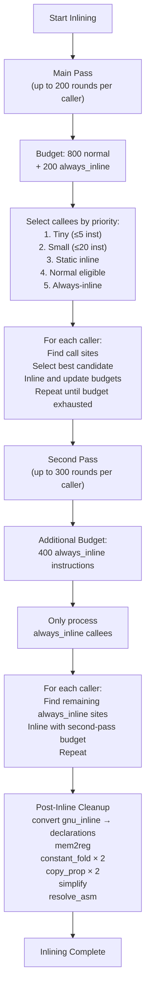
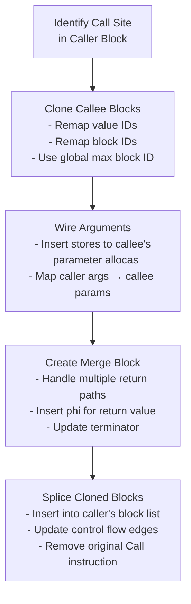

<!-- source: DeepWiki mcp.deepwiki.com · repo anthropics/claudes-c-compiler · page 4.2 Inlining · fetched 2026-10-26 -->

# Inlining

<details>
<summary>Relevant source files</summary>

The following files were used as context for generating this wiki page:

- [src/backend/liveness.rs](src/backend/liveness.rs)
- [src/backend/regalloc.rs](src/backend/regalloc.rs)
- [src/passes/README.md](src/passes/README.md)
- [src/passes/cfg_simplify.rs](src/passes/cfg_simplify.rs)
- [src/passes/constant_fold.rs](src/passes/constant_fold.rs)
- [src/passes/copy_prop.rs](src/passes/copy_prop.rs)
- [src/passes/if_convert.rs](src/passes/if_convert.rs)
- [src/passes/inline.rs](src/passes/inline.rs)
- [src/passes/licm.rs](src/passes/licm.rs)
- [src/passes/mod.rs](src/passes/mod.rs)
- [src/passes/narrow.rs](src/passes/narrow.rs)
- [src/passes/simplify.rs](src/passes/simplify.rs)

</details>


## Purpose and Scope

Function inlining substitutes the bodies of small functions directly into their call sites, eliminating call overhead and exposing cross-function optimization opportunities. This pass is the first phase (Phase 0) of the optimization pipeline, running before all other transformations to maximize downstream optimization potential.

For information about other optimization passes in the pipeline, see [Pass Pipeline Architecture](#4.1). For details on post-inlining transformations that clean up the expanded code, see [Transformation Passes](#4.4).

**Sources:** [src/passes/README.md:222-280](), [src/passes/inline.rs:1-11]()

---

## Position in the Optimization Pipeline

Inlining executes as Phase 0, before the main optimization loop, because it creates the largest optimization opportunities for subsequent passes:



**Diagram: Inlining Position in Pass Pipeline**

By running first, inlining enables:
- **Constant propagation through function arguments**: When a callee receives constant arguments, operations on those constants can be folded away
- **Dead code elimination of unused branches**: Conditional code paths that depend on constant parameters become unreachable after inlining
- **Small wrapper elimination**: Trivial getter/setter functions disappear, reducing indirection

**Sources:** [src/passes/README.md:26-140](), [src/passes/mod.rs:213-240](), [src/passes/inline.rs:1-11]()

---

## Eligibility Rules

Not all functions are safe or profitable to inline. The pass enforces strict eligibility criteria:

### Excluded Function Types

| Exclusion Reason | Rationale |
|-----------------|-----------|
| Variadic functions | Variable argument handling requires specialized ABI setup that cannot be inlined |
| Functions with `VaStart`, `VaEnd`, `VaArg` | These instructions depend on the function's stack frame layout |
| Functions with `DynAlloca` | Dynamic stack allocation sizes are unknown at inline time |
| Functions with `StackSave`/`StackRestore` | Stack pointer manipulation is frame-specific |
| Functions with `IndirectBranch` | Computed goto targets cannot be remapped safely |
| Functions with static locals referenced by `LabelAddr` | Static variable addresses must remain stable across translation units |
| Functions marked `__attribute__((noinline))` | Explicit opt-out directive |
| Recursive calls | Prevents infinite inlining expansion |

### Additional Eligibility Checks

The pass maintains a **callee map** (`HashMap<String, CalleeData>`) containing only eligible function bodies. This map is built once at the start and consulted throughout both inlining passes.

**Sources:** [src/passes/README.md:231-233](), [src/passes/inline.rs:1-11](), [src/passes/inline.rs:326-332]()

---

## Heuristic System

Inlining uses a **tiered size-based heuristic** that prioritizes small functions and respects per-caller budgets:

### Size Categories

| Category | Instruction Limit | Block Limit | Budget Consumed | Priority |
|----------|-------------------|-------------|-----------------|----------|
| Tiny | 5 | 1 | None (always inline) | Highest |
| Small / static inline | 20 | 3 | Normal budget | High |
| Normal static | 30 | 4 | Normal budget | Medium |
| Normal eligible | 60 | 6 | Normal budget | Medium |
| `always_inline` (main pass) | 500 | 500 | Separate 200-inst budget | Mandatory |
| `always_inline` (second pass) | 500 | 500 | Additional 400-inst budget | Mandatory |

**Tiny functions** (≤5 instructions, single block) bypass all budget restrictions because:
1. They have negligible code size impact
2. Not inlining them can cause linker errors when they contain conditional references to undefined symbols (e.g., `folio_test_large_rmappable()` returns false when `CONFIG_TRANSPARENT_HUGEPAGE` is disabled, making calls to `folio_undo_large_rmappable()` dead but still visible to the linker if not inlined)

**Small functions** (≤20 instructions, ≤3 blocks) are always inlined unless the `always_inline` budget is exhausted, because they typically contain conditionally-compiled calls like `fscache_clear_page_bits()` which must be inlined to eliminate references to non-existent symbols.

**Static inline functions** within normal limits are always inlined to match GCC behavior—critical for functions like `ror32` where shift amounts need constant propagation to avoid stack frame bloat.

### Budget Tracking



**Diagram: Budget System Architecture**

The dual budget system prevents normal inlining from starving `always_inline` functions. When a caller has a section attribute (e.g., kernel `.init.text`), `always_inline` callees bypass budgets entirely to prevent section mismatch errors.

**Sources:** [src/passes/README.md:236-272](), [src/passes/inline.rs:19-186](), [src/passes/inline.rs:203-312]()

---

## Two-Pass Strategy

Inlining executes two separate passes to handle both performance optimization and correctness requirements:



**Diagram: Two-Pass Inlining Strategy**

### Main Pass (Rounds 1-200)

The main pass processes all eligible callees using a **priority-based selection**:

1. **Scan for call sites**: Collect all eligible call sites in the current function
2. **Priority selection**: Choose the highest-priority callee that fits within budgets
3. **Inline**: Perform the substitution and deduct from appropriate budget
4. **Iterate**: Repeat until no more eligible callees fit or 200 rounds exhausted

The round limit prevents infinite loops in functions with hundreds of call sites (e.g., `___slab_alloc` in `mm/slub.c`).

### Second Pass (Rounds 1-300)

The second pass handles **correctness-critical `always_inline` functions** that were not processed in the main pass due to:
- Main pass budget exhaustion
- Round limit reached before processing all call sites

This pass uses an **independent 400-instruction budget** and only processes `always_inline` callees. It does not enforce caller size caps (hard cap, absolute cap) because these are semantic requirements that must succeed regardless of caller size.

Examples requiring the second pass:
- **KVM nVHE functions**: Always-inline chains that reference section-specific symbols (e.g., `__kvm_nvhe_gic_nonsecure_priorities`) which only exist when inlined
- **`cpucap_is_possible()` chains**: Nested always-inline calls (~84 instructions each, appearing 3+ times per function) that exceed the 200-instruction main-pass budget

**Sources:** [src/passes/inline.rs:314-551](), [src/passes/README.md:244-272]()

---

## Inlining Mechanics

The process of inlining a single call site involves several careful transformations:



**Diagram: Single Call Site Inlining Process**

### Step 1: Clone Callee Blocks

The inliner clones all blocks from the callee function, performing two critical remappings:

**Value ID Remapping**: Each SSA value in the callee is assigned a new ID in the caller's value space to avoid collisions:

```
Callee: %0, %1, %2, ...
Caller has: %0..%99
Cloned callee values: %100, %101, %102, ...
```

**Block ID Remapping**: Block labels must be globally unique across the entire module (assembly output uses `.LBB{id}` labels). The inliner maintains a **global max block ID** counter across all functions to ensure uniqueness.

### Step 2: Wire Arguments

Arguments are wired by creating stores into the callee's parameter allocas:

```
Original call: call foo(%arg1, %arg2)
Callee has: %param_alloca_0 (for param 0), %param_alloca_1 (for param 1)

Generated:
  store %arg1 → %param_alloca_0
  store %arg2 → %param_alloca_1
```

This is safe because parameter allocas are addressable locations. The subsequent `mem2reg` pass (in post-inline cleanup) promotes these back to SSA registers.

### Step 3: Create Merge Block

When the callee has multiple return paths, the inliner creates a merge block with a phi node:

```
Callee returns from 3 different blocks:
  block_A: return %val_A
  block_B: return %val_B  
  block_C: return %val_C

Generated merge block:
  merge:
    %result = phi [%val_A, block_A], [%val_B, block_B], [%val_C, block_C]
```

For single-return callees, no merge block or phi is needed.

### Step 4: Splice Cloned Blocks

The cloned blocks are inserted into the caller's block list, and the original Call instruction is replaced with:
- An unconditional branch to the callee's entry block (if single return path), or
- The merge block (if multiple return paths)

### Inline Assembly Symbol Resolution

After all inlining completes, a specialized pass (`resolve_asm`) traces value chains to resolve symbolic references in inline assembly. This is necessary when inlining exposes constant addresses:

```c
static inline void foo(u16 bit) {
    asm("..." : "i"(&boot_cpu_data + bit));  // "i" = immediate constraint
}
```

After inlining with constant `bit`, the expression `&boot_cpu_data + 74` becomes resolvable. The pass builds a lightweight definition map tracking `GlobalAddr`, `GEP`, `Add`, and `Cast`/`Copy` chains to produce symbol strings like `"boot_cpu_data+74"` for the backend.

**Sources:** [src/passes/inline.rs:428-478](), [src/passes/README.md:274-279](), [src/passes/resolve_asm.rs]() (referenced in mod.rs)

---

## Post-Inline Cleanup

After inlining completes, a fixed sequence of cleanup passes canonicalizes the expanded IR:

| Pass | Purpose | Iterations |
|------|---------|------------|
| `convert gnu_inline defs → declarations` | Prevent infinite recursion in `extern inline` functions | 1 |
| `mem2reg` | Promote parameter allocas (created during argument wiring) back to SSA | 1 |
| `constant_fold` | Fold constants exposed by inlining (e.g., inlined function returns constant) | 2 |
| `copy_prop` | Propagate copies from phi elimination and mem2reg | 2 |
| `simplify` | Apply algebraic identities to simplified code | 1 |
| `resolve_asm` | Resolve inline assembly symbol references | 1 |

The **double constant folding and copy propagation** handles chains: the first fold may create copies, which copy propagation resolves, exposing more folding opportunities for the second iteration.

### GNU Inline Attribute Handling

`extern inline` functions with the `gnu_inline` attribute are converted to declarations after inlining:

```c
extern inline void btowc() __attribute__((gnu_inline)) {
    // Body exists only for inlining
    call btowc();  // Internal call must resolve to external symbol
}
```

Without this conversion, the internal `call btowc` would resolve to the local definition, causing infinite recursion. Converting to a declaration ensures any remaining (non-inlined) calls resolve to the external library symbol.

**Sources:** [src/passes/README.md:83-97](), [src/passes/mod.rs:213-240]()

---

## Code Structure

The inlining implementation is organized into several key components:

### Primary Entry Point

- **`run(module: &mut IrModule) -> usize`** [src/passes/inline.rs:316](): Main entry point that orchestrates both passes and cleanup

### Callee Analysis

- **`build_callee_map(module: &IrModule) -> HashMap<String, CalleeData>`** [src/passes/inline.rs](): Constructs a snapshot of all eligible callee functions with their blocks, parameter counts, and classification flags
- **`CalleeData`** structure [src/passes/inline.rs](): Stores cloned function body, eligibility metadata (`is_always_inline`, `is_static_inline`, `exceeds_normal_limits`)

### Call Site Processing

- **`find_inline_call_sites(func: &IrFunction, callee_map: &HashMap<String, CalleeData>, skip_list: &[String], caller_has_section: bool) -> Vec<InlineCallSite>`** [src/passes/inline.rs](): Scans a function for eligible call sites
- **`select_inline_site(...) -> Option<(InlineCallSite, usize, bool)>`** [src/passes/inline.rs:203-312](): Implements the priority-based selection heuristic with budget checking
- **`InlineCallSite`** structure [src/passes/inline.rs](): Represents a call site with block/instruction indices and callee name

### Core Transformation

- **`inline_call_site(caller: &mut IrFunction, site: &InlineCallSite, callee_data: &CalleeData, global_max_block_id: &mut u32) -> bool`** [src/passes/inline.rs](): Performs the actual inlining transformation (clone, wire, merge, splice)

### Budget Constants

All budget limits and size thresholds are defined as module-level constants:
- `MAX_INLINE_INSTRUCTIONS` [src/passes/inline.rs:24](): 60 instructions
- `MAX_INLINE_BLOCKS` [src/passes/inline.rs:29](): 6 blocks
- `MAX_INLINE_BUDGET_PER_CALLER` [src/passes/inline.rs:33](): 800 instructions
- `MAX_CALLER_INSTRUCTIONS_AFTER_INLINE` [src/passes/inline.rs:45](): 200 instructions
- `MAX_ALWAYS_INLINE_BUDGET_PER_CALLER` [src/passes/inline.rs:129](): 200 instructions
- `MAX_ALWAYS_INLINE_SECOND_PASS_BUDGET` [src/passes/inline.rs:144](): 400 instructions
- `MAX_CALLER_INSTRUCTIONS_HARD_CAP` [src/passes/inline.rs:162](): 500 instructions
- `MAX_CALLER_INSTRUCTIONS_ABSOLUTE_CAP` [src/passes/inline.rs:185](): 1000 instructions

### Debugging Support

The implementation provides several environment variables for debugging:
- `CCC_INLINE_DEBUG`: Print verbose inlining decisions
- `CCC_INLINE_SKIP`: Comma-separated list of caller names to skip
- `CCC_INLINE_VALIDATE`: Run validation checks after each inline
- `CCC_INLINE_DUMP_IR`: Dump IR after each inline operation

**Sources:** [src/passes/inline.rs:1-800](), [src/passes/mod.rs:213-240]()

---

