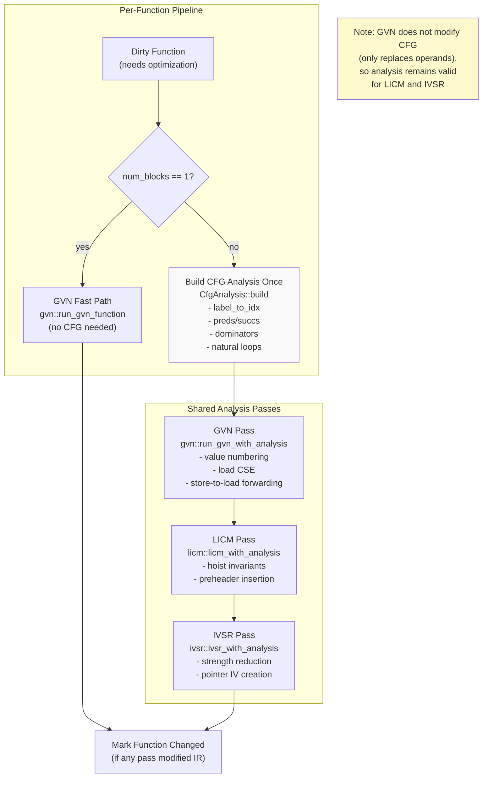
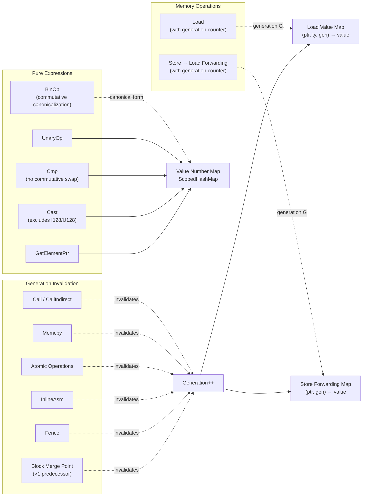
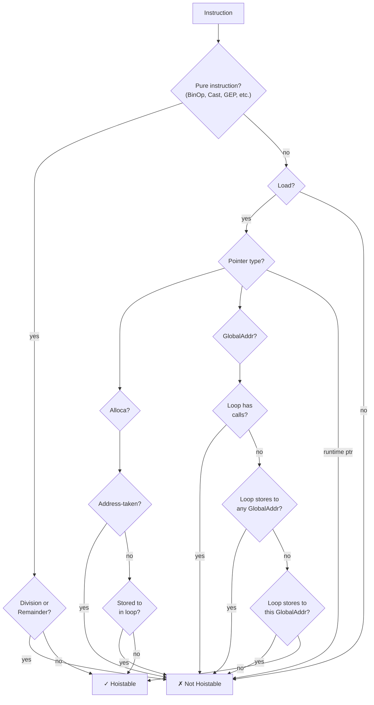
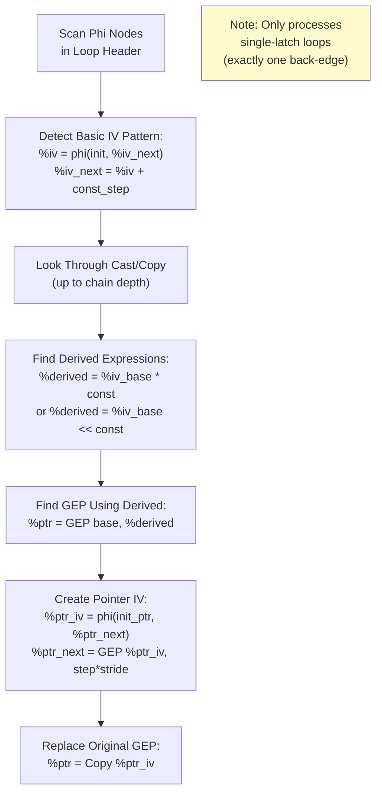

<!-- source: DeepWiki mcp.deepwiki.com · repo anthropics/claudes-c-compiler · page 4.3 Analysis Passes · fetched 2026-10-26 -->

# Analysis Passes

<details>
<summary>Relevant source files</summary>

The following files were used as context for generating this wiki page:

- [src/backend/liveness.rs](src/backend/liveness.rs)
- [src/backend/regalloc.rs](src/backend/regalloc.rs)
- [src/passes/README.md](src/passes/README.md)
- [src/passes/cfg_simplify.rs](src/passes/cfg_simplify.rs)
- [src/passes/constant_fold.rs](src/passes/constant_fold.rs)
- [src/passes/copy_prop.rs](src/passes/copy_prop.rs)
- [src/passes/if_convert.rs](src/passes/if_convert.rs)
- [src/passes/inline.rs](src/passes/inline.rs)
- [src/passes/licm.rs](src/passes/licm.rs)
- [src/passes/mod.rs](src/passes/mod.rs)
- [src/passes/narrow.rs](src/passes/narrow.rs)
- [src/passes/simplify.rs](src/passes/simplify.rs)

</details>


**Purpose**: This document covers the three major analysis-driven optimization passes in the compiler: GVN (Global Value Numbering), LICM (Loop-Invariant Code Motion), and IVSR (Induction Variable Strength Reduction). These passes perform sophisticated dataflow analysis and control flow analysis to eliminate redundant computations, hoist loop-invariant code, and optimize induction variables. For transformation passes like constant folding and simplification, see [Transformation Passes](#4.4). For the overall pass pipeline architecture, see [Pass Pipeline Architecture](#4.1).

---

## Shared CFG Analysis Architecture

The three analysis passes (GVN, LICM, IVSR) all require expensive control flow graph analysis: predecessor/successor adjacency lists, dominator trees, and natural loop detection. Rather than computing this independently in each pass, the pipeline builds a single `CfgAnalysis` structure per function and shares it across all three passes.

**Diagram: Shared Analysis Flow**



**Sources**: [src/passes/mod.rs:65-165](), [src/passes/README.md:199-217]()

### Analysis Sharing Soundness

The sharing is safe because:

1. **GVN** only replaces operands within existing instructions. It does not add, remove, or reorder blocks, so CFG structure (predecessors, successors, dominators) remains unchanged.

2. **LICM** hoists instructions into preheader blocks but does not add or remove blocks from the CFG. The dominator tree and loop structure remain valid for IVSR.

3. **Single-block fast path**: Functions with only one block skip CFG analysis entirely and run only GVN via `run_gvn_function`, since LICM and IVSR require at least two blocks to form a loop.

**Implementation**: [src/passes/mod.rs:73-165]()

**Key Data Structure**: `CfgAnalysis` contains:
- `label_to_idx`: `BlockId` → block index mapping
- `preds`/`succs`: predecessor/successor adjacency lists
- `idom`: immediate dominator map
- `num_blocks`: block count

**Sources**: [src/passes/mod.rs:65-165](), [src/ir/analysis.rs]()

---

## Global Value Numbering (GVN)

GVN is a dominator-based common subexpression elimination (CSE) pass that eliminates redundant computations. It walks the dominator tree in depth-first order, maintaining scoped hash tables that map expression fingerprints to previously computed values. When a redundant expression is found, it is replaced with a `Copy` of the earlier result.

### Value-Numbered Expression Types

**Diagram: GVN Expression Categories**



**Sources**: [src/passes/gvn.rs:1-50](), [src/passes/README.md:555-593]()

### BinOp Commutative Canonicalization

For commutative operations (Add, Mul, And, Or, Xor), operands are sorted by value number before hashing. This ensures that `a + b` and `b + a` receive the same value number and are recognized as equivalent.

**Example**:
```
%1 = Add %x, %y, I64
%2 = Add %y, %x, I64   // Recognized as redundant with %1
```

**Implementation**: [src/passes/gvn.rs]() - `value_number_binop` function

**Sources**: [src/passes/gvn.rs](), [src/passes/README.md:560-562]()

### Load CSE and Store-to-Load Forwarding

GVN performs redundant load elimination and store-to-load forwarding using a generation counter scheme:

| Operation | Effect on Generation |
|-----------|---------------------|
| `Load` from pointer P | Record (P, ty, gen) → value |
| `Store` value V to pointer P | Record (P, gen) → V for forwarding |
| Memory-clobbering instruction | Increment generation counter |
| Block with >1 predecessor | Increment generation counter |

**Memory-clobbering instructions**: `Store`, `Call`, `CallIndirect`, `Memcpy`, atomic operations, `InlineAsm`, `Fence`.

**Exclusions**: Float, long double, and I128/U128 loads are excluded from CSE to avoid complications with their specialized register paths.

**Store-to-load forwarding is disabled for escaped parameter allocas** to preserve correctness of the backend's `ParamRef` optimization.

**Implementation**: [src/passes/gvn.rs]() - `try_load_cse` and `try_store_forwarding` functions

**Sources**: [src/passes/gvn.rs](), [src/passes/README.md:573-585]()

### Scoped Hash Tables

GVN maintains four rollback logs for scoped hash table semantics:

1. **Pure expressions**: `BinOp`, `UnaryOp`, `Cmp`, `Cast`, `GEP`
2. **Load entries**: pointer → value mappings
3. **Store forwarding entries**: pointer → stored value
4. **Value number assignments**: value ID → value number

When entering a dominator subtree, current log positions are saved. When backtracking, all entries beyond the saved position are undone. This provides scoped visibility without cloning the entire hash table.

**Implementation**: Same scoping pattern used by mem2reg's SSA rename phase.

**Sources**: [src/passes/gvn.rs](), [src/passes/README.md:587-593]()

---

## Loop-Invariant Code Motion (LICM)

LICM identifies natural loops in the CFG and hoists loop-invariant instructions to preheader blocks that execute before the loop. An instruction is loop-invariant if all its operands are either constants, defined outside the loop, or themselves defined by loop-invariant instructions (computed to a fixpoint).

### Safety Rules

**Diagram: LICM Hoistability Decision Tree**



**Sources**: [src/passes/licm.rs:73-90](), [src/passes/README.md:606-621]()

### Pure Instructions

Always hoistable (no side effects):
- Arithmetic: `BinOp` (excluding division/remainder)
- Type operations: `Cast`, `Copy`
- Address computation: `GetElementPtr`, `GlobalAddr`
- Selection: `Select`
- Comparisons: `Cmp`
- Pure intrinsics: `IntrinsicOp::is_pure()`

**Division and remainder are excluded** because they can trap with SIGFPE on divide-by-zero and must not be speculatively executed past a guard condition.

**Sources**: [src/passes/licm.rs:76-90]()

### Load Hoisting

Loads can only be hoisted when the compiler can prove the memory location is not modified inside the loop:

**Table: Load Hoisting Conditions**

| Pointer Type | Conditions for Hoisting |
|-------------|------------------------|
| Non-address-taken alloca | No stores to the alloca in loop body |
| GlobalAddr pointer | Loop has no function calls AND loop has no stores to any GlobalAddr pointer AND loop has no stores to this specific GlobalAddr |
| Address-taken alloca | Never hoistable (stores through derived pointers may not be tracked) |
| Runtime-computed pointer | Never hoistable (no alias analysis) |

**Implementation**: [src/passes/licm.rs:93-176]() - `AllocaAnalysis` structure tracks address-taken allocas

**Sources**: [src/passes/licm.rs:93-176](), [src/passes/README.md:612-621]()

### Loop Invariance Fixpoint

LICM computes loop invariance iteratively to a fixpoint:

1. Mark operands that are constants or defined outside the loop as invariant
2. For each instruction in the loop, if all operands are invariant, mark it as invariant
3. Repeat step 2 until no new instructions are marked invariant

Hoisted instructions are topologically sorted (Kahn's algorithm) before insertion into the preheader to ensure def-before-use ordering.

**Sources**: [src/passes/licm.rs](), [src/passes/README.md:595-605]()

---

## Induction Variable Strength Reduction (IVSR)

IVSR transforms expensive per-iteration index computations in loops into cheaper pointer increment operations. This is particularly important for array accesses where the index computation involves multiplication.

### Transformation Example

**Before IVSR**:
```c
for (int i = 0; i < n; i++) {
    sum += arr[i];  // Computes: base + i * sizeof(int) each iteration
}
```

**IR Before**:
```
loop_header:
    %i = phi [0, preheader], [%i_next, loop_body]
    %i_64 = Cast %i, I32 -> I64
    %i_scaled = BinOp Mul %i_64, 4, I64      // multiply each iteration
    %ptr = GEP %arr_base, %i_scaled
    %val = Load %ptr
    %sum_new = BinOp Add %sum, %val
    %i_next = BinOp Add %i, 1
    CondBranch %cond, loop_header, exit
```

**IR After IVSR**:
```
preheader:
    %ptr_init = GEP %arr_base, 0

loop_header:
    %i = phi [0, preheader], [%i_next, loop_body]
    %ptr = phi [%ptr_init, preheader], [%ptr_next, loop_body]  // new pointer IV
    %val = Load %ptr
    %sum_new = BinOp Add %sum, %val
    %i_next = BinOp Add %i, 1
    %ptr_next = GEP %ptr, 4                   // increment by constant stride
    CondBranch %cond, loop_header, exit
```

**Sources**: [src/passes/iv_strength_reduce.rs](), [src/passes/README.md:622-653]()

### Finding Induction Variables

**Diagram: IVSR Pattern Detection**



**Sources**: [src/passes/iv_strength_reduce.rs](), [src/passes/README.md:635-653]()

### Constraints and Limits

**Table: IVSR Limits**

| Parameter | Limit | Purpose |
|-----------|-------|---------|
| Max stride | 1024 bytes | Avoids unusual access patterns |
| Max cast chain depth | 10 | Prevents pathological chain following |
| Shift amount range | 0..64 | Validates shift amounts before computing stride |
| Loop structure | Single-latch only | Exactly one back-edge block required |

**Sources**: [src/passes/iv_strength_reduce.rs](), [src/passes/README.md:654-661]()

### Execution Strategy

IVSR runs **only during the first iteration** of the main optimization loop. It creates work for later cleanup (dead code elimination of the original multiply/shift operations) rather than benefiting from iteration. Subsequent passes clean up the expanded instruction sequences.

**Sources**: [src/passes/mod.rs:412](), [src/passes/README.md:127-129]()

---

## Loop Analysis Infrastructure

The `loop_analysis` module provides shared utilities for detecting natural loops and computing loop bodies. Used by both LICM and IVSR.

### Natural Loop Detection

A **natural loop** has:
1. A single-entry header block (the loop entry point)
2. One or more back-edges (blocks that branch back to the header)
3. A body consisting of all blocks dominated by the header that can reach a back-edge block

**Algorithm**: For each back-edge (tail → header) where header dominates tail:
1. Start with body = {header, tail}
2. BFS backward from tail, adding all blocks that can reach tail and are dominated by header
3. Result is the natural loop for that back-edge

**Implementation**: [src/passes/loop_analysis.rs]() - `find_natural_loops` function

**Sources**: [src/passes/loop_analysis.rs](), [src/passes/README.md:795-809]()

### Loop Merging

Multiple back-edges to the same header create separate natural loops. The analysis merges these into a single loop for optimization:

```rust
// Multiple tail blocks (tail1, tail2) → header
// Results in two natural loops with same header
// Merged into one loop: body = union of both bodies
```

**Implementation**: [src/passes/loop_analysis.rs]() - `merge_loops_by_header` function

**Sources**: [src/passes/loop_analysis.rs]()

### Preheader Detection

LICM requires loops to have a **single-entry preheader block**: a block that:
- Is the only outside predecessor of the loop header
- Unconditionally branches to the loop header

Loops with multiple outside predecessors are skipped (a future improvement could create dedicated preheader blocks).

**Implementation**: [src/passes/licm.rs]() - checked when processing each loop

**Sources**: [src/passes/licm.rs](), [src/passes/README.md:595-605]()

---

## Integration with Pass Pipeline

The three analysis passes run in Phase 5-6a of each main loop iteration:

**Pipeline Position**:
```
Phase 1: cfg_simplify
Phase 2: copy_prop
Phase 2a: div_by_const (iter 0 only, 64-bit targets only)
Phase 2b: narrow
Phase 3: simplify
Phase 4: constant_fold
Phase 5-6a: GVN + LICM + IVSR (shared CFG analysis)  ← HERE
Phase 7: if_convert
Phase 8: copy_prop (second round)
Phase 9: dce
Phase 10: cfg_simplify (second round)
Phase 10.5: ipcp
```

**Should-run logic**: The pipeline tracks per-pass change counts from the previous iteration. A pass runs only if it or any upstream dependency made changes last time:

| Pass | Upstream Dependencies |
|------|----------------------|
| GVN | cfg_simplify, copy_prop, simplify |
| LICM | cfg_simplify, copy_prop, GVN |
| IVSR | Always runs (iteration 0 only) |

On iteration 0, all change counts are set to `usize::MAX` so every pass runs unconditionally.

**Sources**: [src/passes/mod.rs:405-429](), [src/passes/README.md:320-337]()

---

