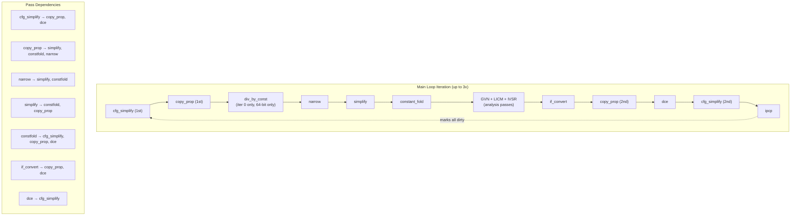
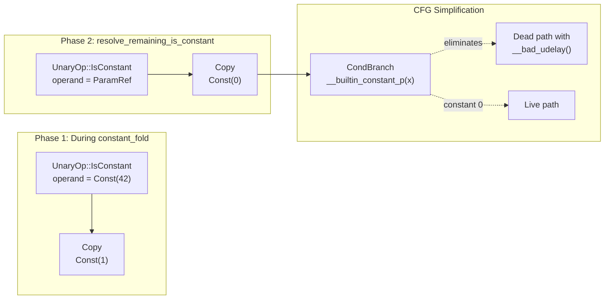
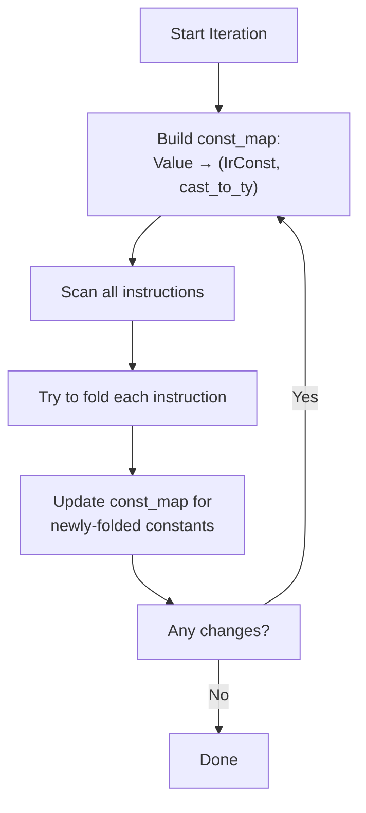
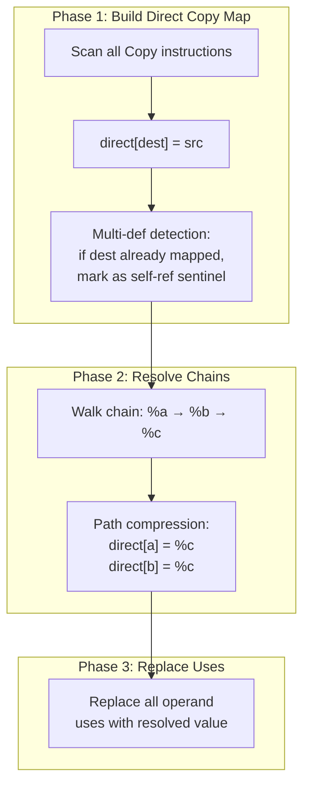
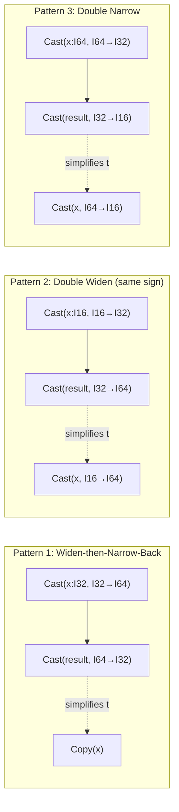
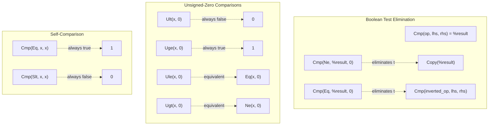
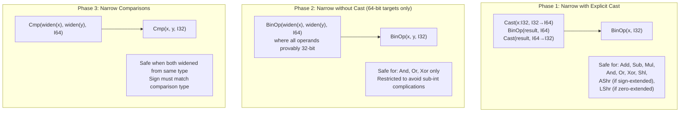
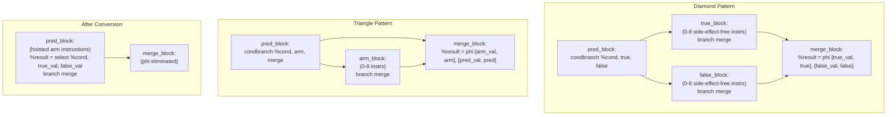
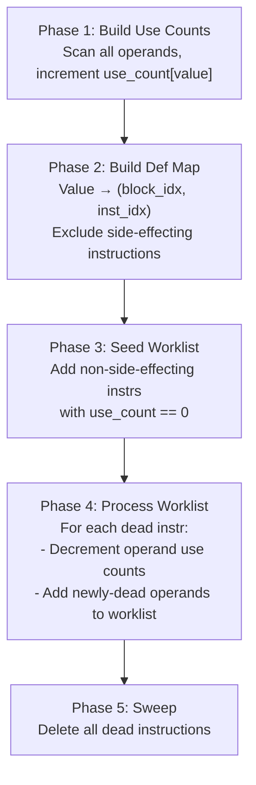
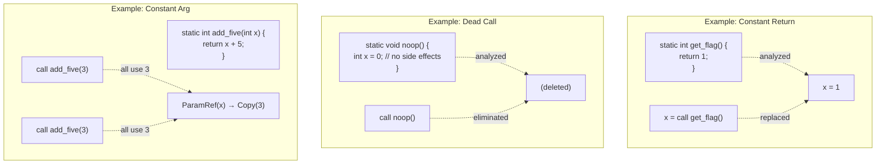

<!-- source: DeepWiki mcp.deepwiki.com · repo anthropics/claudes-c-compiler · page 4.4 Transformation Passes · fetched 2026-10-26 -->

# Transformation Passes

<details>
<summary>Relevant source files</summary>

The following files were used as context for generating this wiki page:

- [src/backend/liveness.rs](src/backend/liveness.rs)
- [src/backend/regalloc.rs](src/backend/regalloc.rs)
- [src/passes/README.md](src/passes/README.md)
- [src/passes/cfg_simplify.rs](src/passes/cfg_simplify.rs)
- [src/passes/constant_fold.rs](src/passes/constant_fold.rs)
- [src/passes/copy_prop.rs](src/passes/copy_prop.rs)
- [src/passes/if_convert.rs](src/passes/if_convert.rs)
- [src/passes/inline.rs](src/passes/inline.rs)
- [src/passes/licm.rs](src/passes/licm.rs)
- [src/passes/mod.rs](src/passes/mod.rs)
- [src/passes/narrow.rs](src/passes/narrow.rs)
- [src/passes/simplify.rs](src/passes/simplify.rs)

</details>


This page documents the transformation passes in the optimization pipeline. These passes modify the IR to produce more efficient code through techniques like constant folding, algebraic simplification, copy elimination, and control flow optimization.

For information about the overall pipeline structure and iteration strategy, see [Pass Pipeline Architecture](#4.1). For analysis passes (GVN, LICM, IVSR), see [Analysis Passes](#4.3). For function inlining, see [Inlining](#4.2).

## Overview

Transformation passes operate on the IR to simplify expressions, eliminate redundant operations, and replace expensive instructions with cheaper equivalents. Unlike analysis passes which primarily compute information, transformation passes directly modify the IR structure. The main transformation passes are:

- **constant_fold**: Evaluates operations on compile-time constants
- **copy_prop**: Eliminates redundant Copy instructions by propagating values
- **simplify**: Applies algebraic identities and strength reduction
- **narrow**: Eliminates unnecessary integer widening/narrowing patterns
- **div_by_const**: Replaces division by constants with multiply-shift sequences
- **if_convert**: Converts branch+phi diamonds to Select instructions
- **dce**: Removes dead (unused) instructions
- **ipcp**: Interprocedural constant propagation and dead call elimination

These passes run in a carefully orchestrated sequence within the main optimization loop, with dirty tracking to avoid redundant work on unchanged functions.

Sources: [src/passes/README.md:1-220](), [src/passes/mod.rs:167-181]()

## Pass Execution Flow



**Pass Ordering Rationale**

The passes are ordered to maximize opportunities for subsequent transformations:

1. **cfg_simplify** first cleans up the control flow graph from previous iterations
2. **copy_prop** propagates values to expose constants and enable narrowing
3. **div_by_const** runs early (iteration 0 only) so subsequent passes can optimize the expanded sequences
4. **narrow** eliminates widen-operate-narrow patterns before simplification
5. **simplify** applies algebraic identities, creating new folding opportunities
6. **constant_fold** evaluates constant expressions exposed by simplification
7. **Analysis passes** (GVN, LICM, IVSR) eliminate redundant computations and hoist invariants
8. **if_convert** converts branches to selects, enabling further optimization
9. **copy_prop** (2nd) propagates copies created by GVN, simplify, and if_convert
10. **dce** removes dead instructions, potentially creating empty blocks
11. **cfg_simplify** (2nd) cleans up empty blocks created by DCE
12. **ipcp** runs last, finding cross-function optimization opportunities

Sources: [src/passes/mod.rs:298-491](), [src/passes/README.md:47-68]()

## Constant Folding (constant_fold)

The `constant_fold` pass evaluates operations on compile-time constants, replacing instructions with their computed results. This eliminates runtime computation and enables further optimizations like dead code elimination and branch folding.

### Folded Operations

**Constant Folding by Type**

| Operation Type | Supported | Notes |
|---------------|-----------|-------|
| BinOp (int) | All ops | Add, Sub, Mul, Div, Rem, And, Or, Xor, Shl, AShr, LShr |
| BinOp (F32/F64) | All ops | Native IEEE 754 via Rust f32/f64 |
| BinOp (F128) | All ops | Platform-specific: x87 on x86/i686, software f128 on ARM/RISC-V |
| BinOp (I128/U128) | All ops | Native Rust i128 arithmetic |
| UnaryOp | All ops | Neg, Not, Clz, Ctz, Popcount, Bswap, IsConstant |
| Cmp (int) | All ops | Eq, Ne, Slt, Sle, Sgt, Sge, Ult, Ule, Ugt, Uge |
| Cmp (float) | All ops | Correct NaN unordered handling |
| Cast | All types | Int-to-int, float-to-float, int-to-float, float-to-int, I128 |
| Select | Both arms same | Folds to the common value |
| Select | Const cond | Folds to true_val or false_val |
| GetElementPtr | Const base+offset | Folds to single constant offset |

**Width Sensitivity**: Sub-32-bit types (I8, U8, I16, U16) require special handling. The pass tracks the target type of Cast instructions so that constants are correctly sign-extended (I8/I16) or zero-extended (U8/U16) when used as operands, implementing C11 integer promotion semantics.

Sources: [src/passes/constant_fold.rs:1-52](), [src/passes/README.md:517-553]()

### IsConstant Resolution

The `__builtin_constant_p` builtin is lowered to `UnaryOp::IsConstant` instructions. The constant folding pass resolves these in two phases:

**Phase 1** (within `fold_function`): If the operand is a compile-time constant, the `IsConstant` instruction is folded to `Copy(1)`.

**Phase 2** (in `resolve_remaining_is_constant`): After inlining and post-inline cleanup, any remaining `IsConstant` instructions have operands that are definitively not compile-time constants (e.g., function parameters, globals). These are resolved to `Copy(0)`.

This two-phase approach is critical for the Linux kernel, which uses `__builtin_constant_p` to guard calls to intentionally-undefined functions (e.g., `__bad_udelay()`) that should only appear in dead code paths. Resolving to 0 before the main optimization loop allows `cfg_simplify` to fold the branch and eliminate the unreachable call, preventing linker errors.



Sources: [src/passes/constant_fold.rs:26-58](), [src/passes/README.md:98-112]()

### Fixpoint Iteration with Const Map

The `fold_function` implementation uses a fixpoint loop with a constant value map to handle chains of constant expressions:



The const map tracks both the constant value and the defining Cast's target type (if any). This enables correct sign/zero extension for sub-int constants when used as UnaryOp operands. For example, `-(unsigned short)(-1)` folds correctly because the cast target type (U16) is tracked, ensuring zero-extension rather than sign-extension.

Sources: [src/passes/constant_fold.rs:60-134](), [src/passes/README.md:517-553]()

## Copy Propagation (copy_prop)

The `copy_prop` pass eliminates redundant Copy instructions by replacing uses of a Copy's destination with the Copy's source operand. This is critical because many passes generate Copy instructions:

- Phi elimination (from mem2reg and cfg_simplify)
- GVN (when replacing redundant computations)
- Simplify (when algebraic identities reduce to Copy, e.g., `x + 0 => x`)
- Constant folding (when folding reduces to a constant Copy)

Without copy propagation, each Copy becomes a load-to-accumulator then store-to-new-slot sequence in code generation, wasting both instructions and stack space.

### Algorithm: Chain Resolution with Path Compression



**Path Compression**: When resolving a copy chain like `%a = Copy %b`, `%b = Copy %c`, all intermediate entries are updated to point directly to the final resolved value (`%c`). This makes subsequent resolution amortized O(1) per entry instead of O(chain_length).

**Multi-Definition Handling**: If a value has multiple Copy definitions (e.g., from single-phi elimination where a phi is replaced by Copy instructions in each predecessor), the value is marked with a self-referencing sentinel and excluded from propagation. This prevents incorrect transformation when different control flow paths produce different values for the same SSA name.

Sources: [src/passes/copy_prop.rs:1-118](), [src/passes/README.md:324-345]()

### Performance Optimization

The pass uses a flat `Vec<Option<Operand>>` indexed by Value ID instead of `FxHashMap`, since Value IDs are dense sequential `u32` values. This eliminates hashing overhead and gives O(1) lookups with better cache locality.

```rust
// Efficient: O(1) lookup via direct indexing
let mut direct: Vec<Option<Operand>> = vec![None; max_id + 1];
if let Some(replacement) = direct[value_id as usize] {
    // Use replacement
}
```

Sources: [src/passes/copy_prop.rs:35-118]()

## Algebraic Simplification (simplify)

The `simplify` pass applies algebraic identities, strength reductions, and peephole optimizations to individual instructions. This is one of the broadest passes in the pipeline, with transformations spanning arithmetic identities, comparison simplification, cast chain optimization, and constant reassociation.

### Identity Simplifications

**Integer-only identities** (to preserve IEEE 754 float semantics):

| Pattern | Simplified To | Notes |
|---------|---------------|-------|
| `x + 0` | `x` | Identity element for addition |
| `x - 0` | `x` | Zero is right-identity for subtraction |
| `x - x` | `0` | Self-subtraction (not safe for float due to NaN) |
| `x * 0` | `0` | Annihilator for multiplication |
| `x * 1` | `x` | Multiplicative identity |
| `x / 1` | `x` | Division by one |
| `x / x` | `1` | Self-division (not safe for float: NaN/Inf) |
| `x % 1` | `0` | Modulo by one is always zero |
| `x % x` | `0` | Self-modulo |
| `x & 0` | `0` | AND with zero |
| `x & ~0` | `x` | AND with all-ones |
| `x & x` | `x` | Idempotent AND |
| `x \| 0` | `x` | OR with zero |
| `x \| ~0` | `~0` | OR with all-ones |
| `x \| x` | `x` | Idempotent OR |
| `x ^ 0` | `x` | XOR with zero |
| `x ^ x` | `0` | XOR with self |
| `x << 0` | `x` | Shift by zero |
| `x >> 0` | `x` | Shift by zero |
| `0 << x` | `0` | Shifting zero |
| `0 >> x` | `0` | Shifting zero |

**Float identities** are restricted to IEEE 754-safe cases: `x * 1.0` and `x / 1.0` are safe, but `x + 0.0`, `x * 0.0`, `x - x`, and `x / x` are not (due to signed zeros, NaN, and infinity).

Sources: [src/passes/simplify.rs:1-63](), [src/passes/README.md:429-451]()

### Strength Reductions

Replaces expensive operations with cheaper equivalents:

| Original | Transformed | Benefit |
|----------|-------------|---------|
| `x * 2` | `x + x` | Slightly cheaper on some microarchitectures |
| `x * 2^k` | `x << k` | Multiply by power-of-2 → shift |
| `x * (-1)` | `neg(x)` | Single neg instruction vs imul |
| `x /u 2^k` | `x >>l k` | Unsigned divide by power-of-2 → logical shift |
| `x %u 2^k` | `x & (2^k - 1)` | Unsigned modulo by power-of-2 → mask |

These are integer-only transformations. Float strength reduction is unsafe due to precision differences.

Sources: [src/passes/simplify.rs:452-460](), [src/passes/README.md:452-460]()

### Cast Chain Optimization

Detects and eliminates redundant cast chains:



**Safety constraints**:
- Widen-then-narrow-back: Safe when `inner_from == to_ty` and `inner_from.size() <= from_ty.size()` (ensures widening, not narrowing)
- Double widen: Safe only when inner source and intermediate types have the same signedness (otherwise extension behavior differs)
- Double narrow: Always safe (both narrowings just truncate to low bits)

Sources: [src/passes/simplify.rs:286-377](), [src/passes/README.md:472-480]()

### Comparison Simplifications



**Boolean-ness tracking**: The pass transitively tracks values known to be boolean (0 or 1). This includes Cmp results and bitwise And/Or/Xor of boolean values. Boolean test elimination uses this information to avoid redundant comparisons.

Sources: [src/passes/simplify.rs:481-530](), [src/passes/README.md:483-491]()

### Constant Reassociation

When a binary operation's operand is itself a binary operation with a constant, the two constants are combined:

**Examples**:
- `(x + 3) + 5` → `x + 8`
- `(x * 4) * 8` → `x * 32`
- `(x & 0xFF) & 0x0F` → `x & 0x0F`
- `(x << 2) << 3` → `x << 5`
- `(x + C1) - C2` → `x + (C1 - C2)`

This requires definition lookup to find the inner BinOp instruction. The pass builds a `Vec<Option<BinOpDef>>` indexed by Value ID for O(1) lookup.

When the combined constant is an identity element (e.g., `x + 0`, `x * 1`), the entire operation is eliminated by the identity simplification rules.

Sources: [src/passes/simplify.rs:461-471](), [src/passes/README.md:461-467]()

## Integer Narrowing (narrow)

The `narrow` pass eliminates unnecessary integer widening introduced by C's integer promotion rules. The frontend promotes sub-64-bit operands to I64 before performing arithmetic, then narrows the result back. This creates a widen-operate-narrow pattern that generates redundant sign/zero-extension instructions.

### Three-Phase Transformation



Sources: [src/passes/narrow.rs:1-30](), [src/passes/README.md:383-428]()

### Safety Constraints

**Phase 1** (with explicit narrowing Cast): Safe for operations where the low bits are width-independent when truncated:
- **Add, Sub, Mul, And, Or, Xor, Shl**: Low bits are identical regardless of operation width
- **AShr**: Safe when LHS was sign-extended from a signed type (extension bits match what shift brings in)
- **LShr**: Safe when LHS was zero-extended from an unsigned type

The BinOp result must have exactly one use (the narrowing cast) to ensure no other code depends on the widened value.

**Phase 2** (no Cast): Only safe for bitwise ops (And, Or, Xor) because arithmetic ops can produce different upper bits due to carries. Only runs on 64-bit targets (i686 register ops don't implicitly zero-extend to 64-bit). Restricted to I32/U32 output to avoid sub-int register complications.

**Phase 3** (Cmp): When both operands of a comparison were widened from the same type, the comparison can be narrowed. Signed comparisons require the source type to be signed; unsigned comparisons require unsigned; Eq/Ne are safe with either sign.

Sources: [src/passes/narrow.rs:166-307]()

### Use Count Requirements

All three phases check that the intermediate result has exactly one use. This prevents incorrect transformation when the widened value is consumed by multiple instructions (where some might expect the full I64 value).

The pass builds a use count vector by scanning all instructions and terminators, counting references to each Value ID. Only values with `use_count == 1` are eligible for narrowing.

Sources: [src/passes/narrow.rs:132-150]()

## Division by Constant (div_by_const)

The `div_by_const` pass replaces integer division and modulo by compile-time constants with equivalent multiply-and-shift sequences. On x86, `div`/`idiv` instructions cost 20-90 cycles, while the replacement sequence costs 3-5 cycles, making this one of the most impactful single optimizations for integer-heavy code.

### Transformation Types

| Operation | Transformation | Algorithm |
|-----------|----------------|-----------|
| Unsigned div (`x /u C`) | `(x * magic) >> shift` | Hacker's Delight algorithm |
| Unsigned div (magic > 32-bit) | `((x * magic) >> 32) + x) >> (shift-1)` | Add-and-shift fixup |
| Signed div by 2^k | Biased arithmetic right shift | Handles negative rounding |
| Signed div by C | `((x * magic) >> shift) + sign_correction` | Magic number with sign correction |
| Signed div by -C | Negate result of `x / C` | Delegates to positive case |
| Modulo (`x % C`) | `x - (x / C) * C` | Uses optimized division from above |
| Unsigned mod by 2^k | `x & (C - 1)` | Handled by simplify pass, not div_by_const |

**Only 32-bit operand values are currently optimized**. For native I32/U32 types, the pass applies directly. For I64/U64 operations, the pass performs value-range analysis to detect operands that are provably 32-bit (e.g., values produced by zero-extending or sign-extending from a 32-bit type). Genuine 64-bit divisions fall through to native `div`/`idiv` instructions.

Sources: [src/passes/README.md:346-382]()

### Platform Restrictions

The pass is **disabled on i686** because the generated 64-bit multiply-and-shift sequences cannot be executed correctly by the 32-bit backend. The i686 backend truncates 64-bit operations to 32 bits, producing wrong results. Until i686 has proper 64-bit arithmetic support, it falls back to hardware `idiv`/`div` instead.

The pass runs **only during the first iteration** of the main loop (iteration 0). Subsequent iterations clean up the expanded instruction sequences via narrowing, simplification, constant folding, and DCE.

Sources: [src/passes/mod.rs:358-372](), [src/passes/README.md:346-382]()

## If-Conversion (if_convert)

The `if_convert` pass converts simple branch+phi diamond patterns into Select instructions, which lower to conditional moves (`cmov` on x86, `csel` on AArch64). This eliminates branches in favor of branchless code, which is critical for performance in tight loops with simple conditionals.

### Detected Patterns



Sources: [src/passes/if_convert.rs:1-125]()

### Safety Rules

**Side-effect-free requirement**: Both arms must contain only pure operations. The pass rejects blocks containing:
- **Stores**: Write side effects
- **Calls**: External side effects
- **Loads**: Can trap (segfault) on invalid pointers
- **Division/Remainder**: Can trap with SIGFPE on divide-by-zero
- **Atomics**: Memory ordering side effects
- **Inline assembly**: Unknown side effects

This ensures that evaluating both operands of the Select (which happens unconditionally) matches the original branch semantics (which evaluates only one arm).

**Instruction limit**: Each arm may contain up to 8 instructions. This threshold accommodates C type system patterns (Load + Cast chains for parameter loads and sign extensions) while preventing over-speculation. Example: `Load, Cast, Load, Cast, BinOp, Cast` = 6 instructions.

**Constant condition exclusion**: Branches with constant conditions are skipped. `cfg_simplify` folds these more efficiently (single pass vs multi-iteration). Converting to Select delays dead code elimination.

Sources: [src/passes/if_convert.rs:148-246]()

### Phi to Select Conversion

All phi nodes in the merge block that reference both arms are converted to Select instructions. Multiple phis are handled by creating multiple Select instructions. The Select instructions are placed in the predecessor block, and the original arm blocks become empty (just unconditional branches), which are later eliminated by `cfg_simplify`.

F128 and I128 phi types are rejected because Select lowering for these types is complex and backend-dependent.

Sources: [src/passes/if_convert.rs:329-380]()

## Dead Code Elimination (dce)

The `dce` pass removes instructions whose results are never used by any other instruction or terminator. Uses a use-count-based worklist algorithm with O(n) complexity.

### Algorithm



**Self-referencing phi handling**: Phi edges where the incoming value is the phi itself (`v = phi [..., v, ...]`) are excluded from the use count. This prevents dead self-referencing phis from surviving.

Sources: [src/passes/README.md:745-770](), [src/passes/mod.rs:463-468]()

### Side-Effecting Instructions

The following instructions are **never removed** regardless of whether their result is used:

| Category | Instructions | Reason |
|----------|-------------|--------|
| Memory writes | Store, Memcpy | Write side effects |
| Calls | Call, CallIndirect | External side effects, may modify memory/globals |
| Allocations | Alloca, DynAlloca | Backend uses positional indexing for parameter mapping |
| Atomics | AtomicRmw, AtomicCmpxchg, AtomicStore, Fence | Memory ordering side effects |
| Variable args | VaStart, VaEnd, VaCopy, VaArg, VaArgStruct | Runtime stack manipulation |
| Multi-return helpers | SetReturnF64Second, etc. | Side effect: storing second return value |
| Intrinsics | Non-pure intrinsics, intrinsics with dest pointer | Store through dest pointer is a side effect |
| Inline assembly | InlineAsm | Unknown side effects |
| Stack save/restore | StackRestore | Side effect: modifying stack pointer |

Pure intrinsics (e.g., `SqrtF32`) without a destination pointer are DCE-eligible.

Sources: [src/passes/README.md:762-770]()

## Interprocedural Constant Propagation (ipcp)

The `ipcp` pass performs three cross-function optimizations:

### Constant Return Propagation

Identifies defined, non-weak, non-variadic, side-effect-free functions that return the same constant on every return path. Replaces all Call instructions to these functions with the constant value.

**Side-effect-free definition**: No stores, calls, loads, atomics, inline asm, memcpy, or any va_arg operations. This ensures the function's only observable effect is its return value.

### Dead Call Elimination

Identifies defined, non-weak, side-effect-free, void-returning functions with no Unreachable terminators. Removes entire Call instructions to these functions from all callers. This eliminates references to symbols that would otherwise cause linker errors.

**Trap detection**: Functions containing Unreachable terminators are excluded because traps are observable side effects (program termination).

### Constant Argument Propagation

For static, defined, non-weak, non-variadic functions: when all call sites pass the same constant for a given parameter, replaces the ParamRef instruction in the function body with a copy of that constant.

**Address-taken handling**: Functions whose address is taken (via GlobalAddr or global initializer references) have all parameters marked as varying since they may be called indirectly with unknown arguments.



Sources: [src/passes/README.md:716-744]()

### Iteration Strategy

IPCP runs **at the end of every iteration** (not just the first), because earlier passes within the same iteration may simplify call arguments to constants (e.g., phi nodes collapsed after CFG simplification resolves dead branches).

When IPCP makes changes, the pipeline marks all functions dirty and always runs at least one more iteration to allow cleanup passes (constant folding, DCE, cfg_simplify) to process the newly exposed constants. Without this, dead code referencing undefined symbols would survive.

Sources: [src/passes/mod.rs:479-491](), [src/passes/README.md:716-744]()

## Pass-Specific Optimizations

### Math Library Call Lowering

The `simplify` pass recognizes standard math library calls and replaces them with IR intrinsics or simplified expressions:

| Call | Transformed | Type |
|------|-------------|------|
| `sqrt(x)` / `sqrtf(x)` | `Intrinsic::SqrtF64` / `SqrtF32` | Intrinsic |
| `fabs(x)` / `fabsf(x)` | `Intrinsic::FabsF64` / `FabsF32` | Intrinsic |
| `pow(x, 0.0)` | `1.0` | Constant |
| `pow(x, 1.0)` | `x` | Identity |
| `pow(x, 2.0)` | `x * x` | Simplification |
| `pow(x, -1.0)` | `1.0 / x` | Reciprocal |
| `pow(x, 0.5)` | `sqrt(x)` | Intrinsic |

This avoids expensive libc calls for simple cases and enables backend-specific optimizations (e.g., x86 `sqrtsd` instruction).

Sources: [src/passes/simplify.rs:512-516](), [src/passes/README.md:512-516]()

### GEP Simplification

The `simplify` pass optimizes GetElementPtr chains:

- `GEP(base, 0)` → `Copy(base)` (zero offset is identity)
- `GEP(GEP(base, C1), C2)` → `GEP(base, C1 + C2)` (fold constant offsets)

This is complementary to the backend's GEP folding optimization (which merges constant offsets into Load/Store addressing modes). The IR-level folding enables dead code elimination when intermediate GEP results become unused.

Sources: [src/passes/simplify.rs:506-509](), [src/passes/README.md:505-509]()

### Select Simplification

Both `simplify` and `constant_fold` handle Select optimization:

**simplify**: Structural simplification
- `select cond, x, x` → `x` (both arms same)
- `select Const(0), a, b` → `b` (constant false condition)
- `select Const(nonzero), a, b` → `a` (constant true condition)

**constant_fold**: Constant folding with const map
- `select Const(cond), Const(a), Const(b)` → `Const(result)`
- `select cond, x, x` → `x` (both arms same operand, even across different widths)

The separation allows simplify to handle the structural cases early, while constant_fold handles the deep constant propagation cases using the const map.

Sources: [src/passes/simplify.rs:496-503](), [src/passes/constant_fold.rs:333-368]()

---

