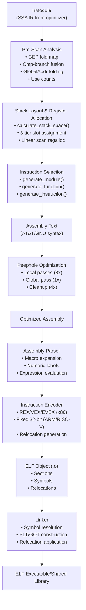
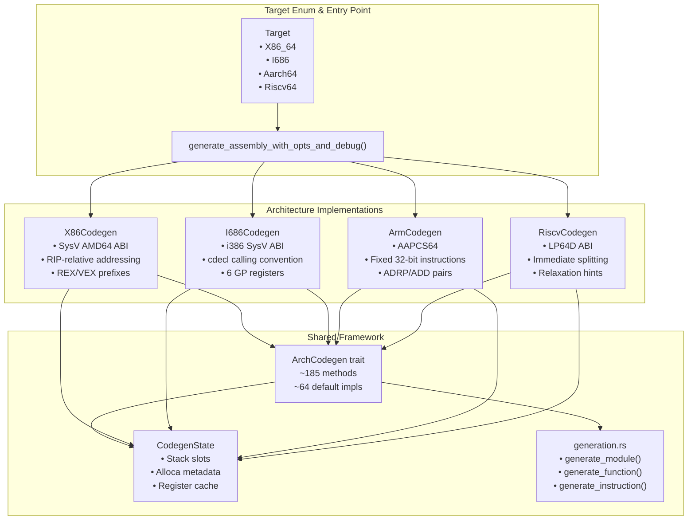
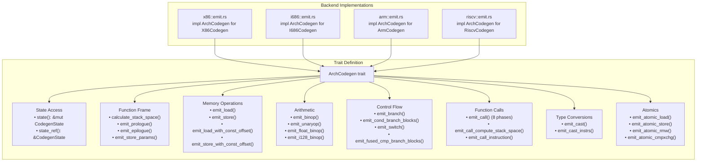
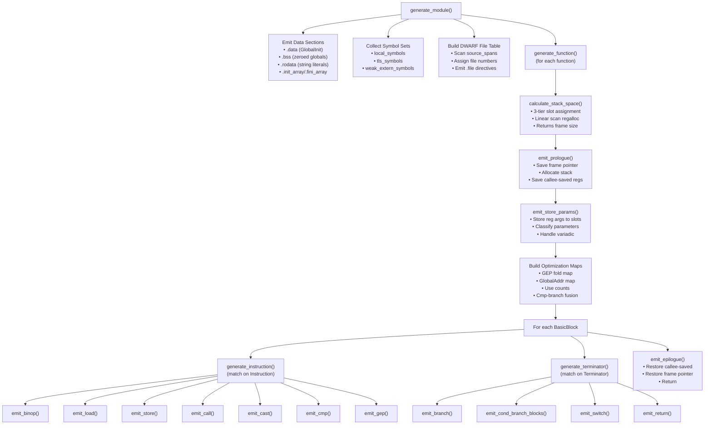
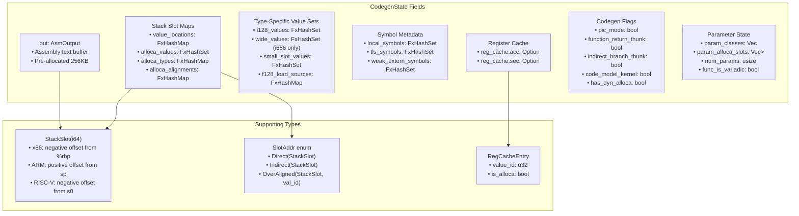
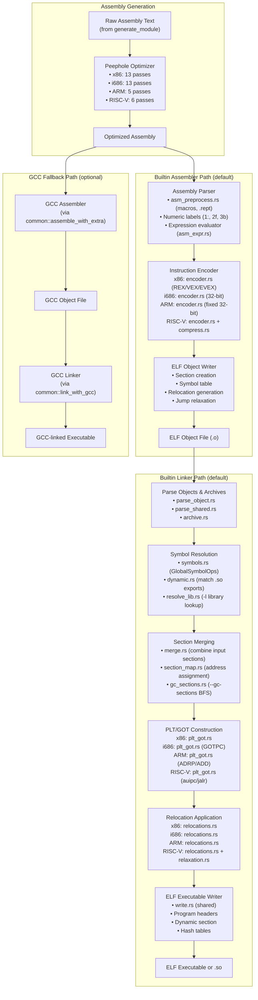

<!-- source: DeepWiki mcp.deepwiki.com · repo anthropics/claudes-c-compiler · page 5 Backend Code Generation · fetched 2026-10-26 -->

# Backend Code Generation

<details>
<summary>Relevant source files</summary>

The following files were used as context for generating this wiki page:

- [README.md](README.md)
- [src/backend/README.md](src/backend/README.md)
- [src/backend/common.rs](src/backend/common.rs)
- [src/backend/generation.rs](src/backend/generation.rs)
- [src/backend/mod.rs](src/backend/mod.rs)
- [src/backend/state.rs](src/backend/state.rs)
- [src/backend/traits.rs](src/backend/traits.rs)
- [src/frontend/lexer/token.rs](src/frontend/lexer/token.rs)
- [src/frontend/preprocessor/conditionals.rs](src/frontend/preprocessor/conditionals.rs)
- [src/frontend/preprocessor/macro_defs.rs](src/frontend/preprocessor/macro_defs.rs)
- [src/frontend/preprocessor/mod.rs](src/frontend/preprocessor/mod.rs)
- [src/main.rs](src/main.rs)
- [src/passes/dce.rs](src/passes/dce.rs)
- [src/passes/gvn.rs](src/passes/gvn.rs)

</details>


## Overview

The backend transforms optimized SSA-form IR into executable ELF binaries through a multi-stage pipeline: instruction selection generates assembly text, builtin assemblers encode instructions into ELF object files, and builtin linkers resolve symbols and apply relocations to produce final executables. The backend supports four target architectures (x86-64, i686, AArch64, RISC-V 64) through a unified trait-based abstraction that shares ~90% of code generation logic while allowing architecture-specific instruction emission.

For details on:
- The `ArchCodegen` trait and shared infrastructure, see [Code Generation Architecture](#5.1)
- Architecture-specific instruction selection, see [x86-64 Backend](#5.2), [i686 Backend](#5.3), [AArch64 Backend](#5.4), [RISC-V Backend](#5.5)
- Register assignment strategy, see [Register Allocation](#5.6)
- Stack slot allocation and lifetime analysis, see [Stack Layout](#5.7)

## Compilation Pipeline



**Sources**: [src/backend/README.md:13-82](), [src/backend/mod.rs:294-340](), [src/backend/generation.rs:485-531]()

The pipeline executes in six phases:

1. **Pre-Scan Analysis**: [src/backend/generation.rs:364-398]() builds optimization maps before instruction emission. The GEP fold map identifies constant-offset pointer arithmetic foldable into Load/Store addressing modes. Compare-branch fusion detects `Cmp` instructions whose result feeds only a `CondBranch` terminator. GlobalAddr folding maps pointer values to symbol names for RIP-relative access.

2. **Stack Layout & Register Allocation**: [src/backend/stack_layout/mod.rs]() assigns stack slots and physical registers to IR values using a three-tier allocator (addressable allocas, liveness-based packing, block-local reuse) and linear scan register allocation with callee-saved priority.

3. **Instruction Selection**: [src/backend/generation.rs:486-531]() walks the IR and dispatches each instruction through the `ArchCodegen` trait. Emits function prologue, processes instructions block-by-block, emits epilogue.

4. **Peephole Optimization**: Architecture-specific passes optimize the generated assembly. x86 runs 13 passes including load-modify-store fusion, redundant load elimination, tail call optimization. ARM/RISC-V run 5-6 passes.

5. **Assembly Parsing & Encoding**: Builtin assemblers parse AT&T/GNU syntax, expand macros, encode instructions to machine code, generate relocations. [src/backend/x86/assembler/](), [src/backend/i686/assembler/](), [src/backend/arm/assembler/](), [src/backend/riscv/assembler/]()

6. **Linking**: Builtin linkers read object files and archives, resolve symbols against shared libraries (libc.so.6, libm.so.6), construct PLT/GOT for dynamic linking, apply relocations, write ELF executables. [src/backend/x86/linker/](), [src/backend/i686/linker/](), [src/backend/arm/linker/](), [src/backend/riscv/linker/]()

## Multi-Architecture Support



**Sources**: [src/backend/mod.rs:120-388](), [src/backend/traits.rs:1-20](), [src/backend/README.md:100-220]()

The `Target` enum [src/backend/mod.rs:121-128]() selects the target architecture at runtime based on the binary name (`ccc`, `ccc-x86`, `ccc-arm`, `ccc-riscv`, `ccc-i686`). Each target instantiates its architecture-specific codegen struct:

| Architecture | Codegen Struct | ABI | Key Features |
|--------------|----------------|-----|--------------|
| x86-64 | `X86Codegen` | SysV AMD64 | RIP-relative addressing, variable-length encoding, 16 GP registers |
| i686 | `I686Codegen` | i386 SysV (cdecl) | Register pressure (6 GP regs), stack-based struct returns, 32-bit pointers |
| AArch64 | `ArmCodegen` | AAPCS64 | Fixed 32-bit instructions, page-relative ADRP/ADD, HFA detection |
| RISC-V 64 | `RiscvCodegen` | LP64D | Immediate splitting (12-bit), RV64C compression, relaxation hints |

## The ArchCodegen Trait



**Sources**: [src/backend/traits.rs:1-20](), [src/backend/traits.rs:99-103](), [src/backend/README.md:222-300]()

The `ArchCodegen` trait [src/backend/traits.rs:99-803]() defines ~185 methods that each backend implements. Approximately 64 methods have default implementations [src/backend/traits.rs:6-11]() built from "primitive" methods that backends override with 1-4 line architecture-specific implementations.

Key trait method categories:

- **Operand Handling**: `emit_load_operand()` loads an `Operand` (constant or value) into the accumulator register. `emit_store_result()` stores the accumulator to a value's stack slot. `emit_copy_value()` copies between values, using register-to-register moves when both have register assignments.

- **Memory Access**: `emit_load()` and `emit_store()` dispatch through `SlotAddr` (Direct/Indirect/OverAligned) to handle alloca addressing patterns. `emit_load_with_const_offset()` folds GEP constant offsets into Load addressing modes.

- **Type Primitives**: `load_instr_for_type()`, `store_instr_for_type()`, `mov_instr_for_type()` return instruction mnemonics for a given `IrType` (e.g., `"movq"` for I64 on x86, `"ldr"` for I64 on ARM).

- **8-Phase Call Convention**: `emit_call()` orchestrates: Phase 0: classify arguments and compute stack space, Phase 1: F128 pre-conversion, Phase 2: spill function pointer, Phase 3: push stack arguments, Phase 3.5: sret pointer setup, Phase 4: load register arguments, Phase 5: emit call instruction, Phase 6: cleanup and store result.

The `delegate_to_impl!` macro [src/backend/traits.rs:36-64]() eliminates boilerplate by generating delegation to `_impl` methods:

```rust
delegate_to_impl! {
    fn calculate_stack_space(&mut self, func: &IrFunction) -> i64 
        => calculate_stack_space_impl;
    fn emit_prologue(&mut self, func: &IrFunction, frame_size: i64) 
        => emit_prologue_impl;
}
```

## Code Generation Dispatch



**Sources**: [src/backend/generation.rs:486-531](), [src/backend/generation.rs:690-1128](), [src/backend/generation.rs:1130-1443]()

### Module-Level Generation

`generate_module()` [src/backend/generation.rs:498-531]() orchestrates top-level emission:

1. **Pre-size output buffer** [src/backend/generation.rs:536-545](): Allocate `total_instructions * 40 bytes` (clamped to 256KB-64MB) to avoid repeated reallocations.

2. **Collect symbol sets** [src/backend/generation.rs:551-583](): Build `local_symbols` (static or hidden visibility), `tls_symbols` (thread-local), `weak_extern_symbols` for PIC and GOT decisions.

3. **Build DWARF file table** [src/backend/generation.rs:588-625](): When `debug_info` is enabled, scan all `source_spans`, resolve filenames via `SourceManager`, assign DWARF file numbers, emit `.file` directives.

4. **Emit data sections** [src/backend/common.rs:969-1223](): Generate `.data`, `.bss`, `.rodata` sections with global initializers (scalar values, arrays, structs, symbol references).

5. **Emit functions** [src/backend/generation.rs:517](): Call `generate_function()` for each non-declaration function.

6. **Emit metadata** [src/backend/generation.rs:518-522](): Symbol aliases, `.symver` directives, symbol attributes, `.init_array`/`.fini_array` constructors/destructors.

### Function-Level Generation

`generate_function()` [src/backend/generation.rs:690-1128]() processes a single function:

1. **Reset state** [src/backend/generation.rs:703-710](): Clear per-function state (register cache, F128 load sources, has_dyn_alloca flag).

2. **Emit directives** [src/backend/generation.rs:724-765](): `.globl`/`.local` for linkage, `.hidden`/`.protected` for visibility, `.type`/`.size` for ELF metadata, patchable function entry NOP padding for ftrace.

3. **Handle naked functions** [src/backend/generation.rs:767-779](): Functions with `__attribute__((naked))` emit only inline asm blocks with no prologue/epilogue.

4. **Stack layout & register allocation** [src/backend/generation.rs:784-799](): Call `calculate_stack_space()` which runs the three-tier allocator and linear scan regalloc. Align frame size to 16 bytes (x86/ARM) or 8 bytes (RISC-V, due to smaller CRT/libc frame alignment).

5. **Emit prologue & parameter stores** [src/backend/generation.rs:801-815](): Save frame pointer, allocate stack, save callee-saved registers. Store ABI register arguments to stack slots for addressability.

6. **Build optimization maps** [src/backend/generation.rs:817-888]():
   - **Use counts** [src/backend/generation.rs:404-435](): Count references to each value for fusion eligibility.
   - **GEP fold map** [src/backend/generation.rs:52-152](): Identify GEPs with constant offsets used only as Load/Store pointers.
   - **GlobalAddr map** [src/backend/generation.rs:161-193](): Map GlobalAddr values to symbol names for RIP-relative folding.
   - **GlobalAddr pointer set** [src/backend/generation.rs:279-399](): Distinguish pointer vs integer uses in kernel code model.
   - **Cmp-branch fusion** [src/backend/generation.rs:440-483](): Detect `Cmp` results used only by `CondBranch`.

7. **Emit basic blocks** [src/backend/generation.rs:892-1068](): For each block, emit label, invalidate register cache at block boundaries, emit instructions via `generate_instruction()`, emit terminator (or fused compare-and-branch).

8. **Emit .size directive** [src/backend/generation.rs:1127](): Close function metadata for ELF symbol table.

### Instruction-Level Generation

`generate_instruction()` [src/backend/generation.rs:1130-1443]() dispatches each `Instruction` variant to the appropriate `ArchCodegen` method. The function also manages the register value cache: instructions following the load-compute-store pattern leave the accumulator holding the result, enabling subsequent instructions to skip reloading. Instructions with unpredictable clobbers (calls, inline asm, atomics) invalidate the cache [src/backend/generation.rs:1205-1207](), [src/backend/generation.rs:1249-1251]().

Key instruction patterns:

- **Alloca** [src/backend/generation.rs:1147-1163](): Load the alloca's stack address into the accumulator (via `leaq`/`adr`/`addi`). The result is marked in the register cache as `is_alloca=true`.

- **Load/Store** [src/backend/generation.rs:1164-1220](): Check for segment overrides (x86 `%gs:`/`%fs:`), GlobalAddr folding (RIP-relative `symbol(%rip)`), GEP folding (constant offset in addressing mode). Dispatch to `emit_load()` or `emit_store()`.

- **BinOp** [src/backend/generation.rs:1221-1225](): Dispatch to `emit_binop()`, which classifies as i128, float, or integer and delegates to the specialized method.

- **Call** [src/backend/generation.rs:1245-1255](): Direct calls pass `direct_name: Some(func_name)`, indirect calls pass `func_ptr: Some(operand)`. Invalidate register cache after the call.

- **Cmp** [src/backend/generation.rs:1369-1371](): Emit comparison instruction, leaving the boolean result in the accumulator.

## Shared Codegen State



**Sources**: [src/backend/state.rs:1-240](), [src/backend/state.rs:15-21](), [src/backend/state.rs:23-76](), [src/backend/state.rs:78-240]()

`CodegenState` [src/backend/state.rs:78-240]() holds mutable state shared across all backends:

### Stack Slot Tracking

- **`value_locations`** [src/backend/state.rs:82](): Maps IR `Value.0` (u32) to `StackSlot` frame offset. Indexed by value ID for O(1) lookup during instruction emission.

- **`alloca_values`** [src/backend/state.rs:84](): Values whose stack slot IS the data (not a pointer to data). Load/store instructions emit direct rbp-relative access rather than indirect pointer dereference.

- **`alloca_types`** [src/backend/state.rs:86](): Maps alloca value ID to its `IrType`. Used for type-aware memcpy size computation and load/store instruction selection.

- **`alloca_alignments`** [src/backend/state.rs:88](): Allocas with alignment > 16 bytes. Stack layout reserves 16-byte slots but runtime address computation aligns the pointer: `lea offset(%rbp), %reg; and $-align, %reg`.

### Type-Specific Value Sets

- **`i128_values`** [src/backend/state.rs:90](): Values of type I128/U128. Require 16-byte copy (two 8-byte loads/stores on 64-bit, complex codegen on i686).

- **`wide_values`** [src/backend/state.rs:92-95](): I64/U64/F64 values on i686. Don't fit in a single 32-bit register; need special copy handling (x87 fldl/fstpl for F64, two-word copy for I64).

- **`f128_load_sources`** [src/backend/state.rs:128-140](): Maps F128 value ID to `(source_value_id, byte_offset, is_indirect)`. Enables full-precision F128 operations by reloading from original memory location instead of using lossy f64 intermediate.

### Register Value Cache

`RegCache` [src/backend/state.rs:40-76]() tracks which IR values are in accumulator/secondary registers:

- **`acc`** [src/backend/state.rs:48](): Primary accumulator (x86 `%rax`, ARM `x0`, RISC-V `t0`). Stores `RegCacheEntry { value_id, is_alloca }` where `is_alloca` distinguishes address (leaq) vs value (movq) semantics.

- **`set_acc()`** [src/backend/state.rs:53-56](): Mark accumulator as holding a value. Called after load, compute, or alloca address computation.

- **`acc_has()`** [src/backend/state.rs:59-62](): Check if accumulator holds a value with matching alloca status. Enables skipping redundant loads.

- **`invalidate_all()`** [src/backend/state.rs:70-75](): Clear all cached entries. Called on operations that may clobber any register (calls, inline asm, atomics, complex operations using scratch registers).

## Assembly Output and Linking



**Sources**: [src/backend/common.rs:1-12](), [src/backend/mod.rs:343-371](), [src/backend/mod.rs:374-386](), [src/backend/README.md:1-11]()

### Builtin Toolchain (Default)

When no Cargo features are enabled, the backend uses fully native assemblers and linkers [src/backend/README.md:6-11]():

**Builtin Assemblers** [src/backend/README.md:163-180]():
- Parse AT&T/GNU syntax with GAS-compatible macro expansion [src/backend/asm_preprocess.rs]()
- Encode instructions to architecture-specific machine code [src/backend/x86/assembler/encoder.rs](), [src/backend/arm/assembler/encoder.rs](), [src/backend/riscv/assembler/encoder.rs]()
- Generate ELF object files with sections, symbols, relocations [src/backend/elf/object_writer.rs]()
- Apply multi-pass jump relaxation to optimize branch encodings [src/backend/x86/assembler/jumps.rs](), [src/backend/arm/assembler/jumps.rs]()

**Builtin Linkers** [src/backend/README.md:172-180](), [src/backend/linker_common/]():
- Load archives (.a) and iterate symbol resolution until closure [src/backend/linker_common/archive.rs]()
- Match undefined symbols against shared library exports (libc.so.6, libm.so.6) [src/backend/linker_common/dynamic.rs]()
- Construct PLT (Procedure Linkage Table) and GOT (Global Offset Table) for dynamic linking [src/backend/x86/linker/plt_got.rs](), [src/backend/arm/linker/plt_got.rs]()
- Apply relocations (R_X86_64_*, R_386_*, R_AARCH64_*, R_RISCV_*) to resolve symbol references [src/backend/x86/linker/relocations.rs](), [src/backend/arm/linker/relocations.rs]()
- Generate .eh_frame_hdr for exception handling [src/backend/linker_common/eh_frame.rs]()
- Write ELF executables or shared libraries [src/backend/linker_common/write.rs]()

### GCC Fallback (Optional)

When `gcc_assembler` and/or `gcc_linker` Cargo features are enabled [src/backend/common.rs:13-49]():

- **GCC Assembler**: [src/backend/common.rs:84-119]() writes assembly to temporary file, invokes `gcc -c` (or cross-compiler like `aarch64-linux-gnu-gcc`), produces object file.

- **GCC Linker**: [src/backend/common.rs:246-298]() invokes GCC as linker driver with appropriate flags (`-no-pie`, `-static`, etc.). Required for operations builtin linker doesn't support (relocatable linking `-r`).

Validation [src/backend/common.rs:136-187](): Before linking, the backend reads each `.o` file's ELF header and validates `e_machine` matches the target. Mismatches (e.g., passing x86-64 object to i686 linker) produce clear diagnostics: `"Object file architecture mismatch: target is i686 (ELF e_machine=3) but foo.o is for x86-64 (e_machine=62)"`.

---

